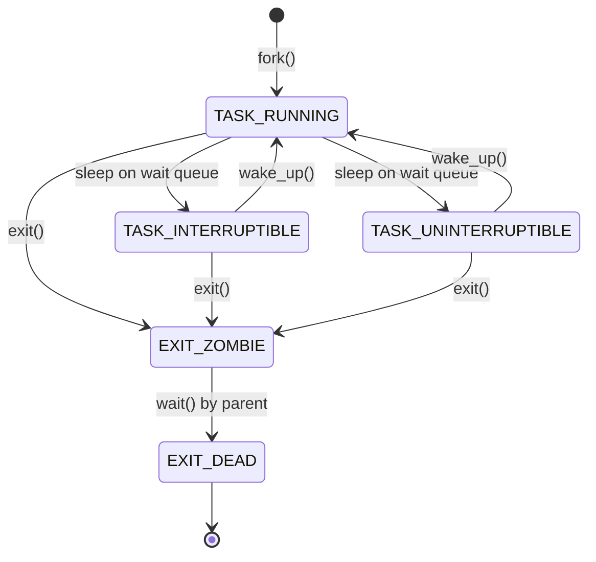
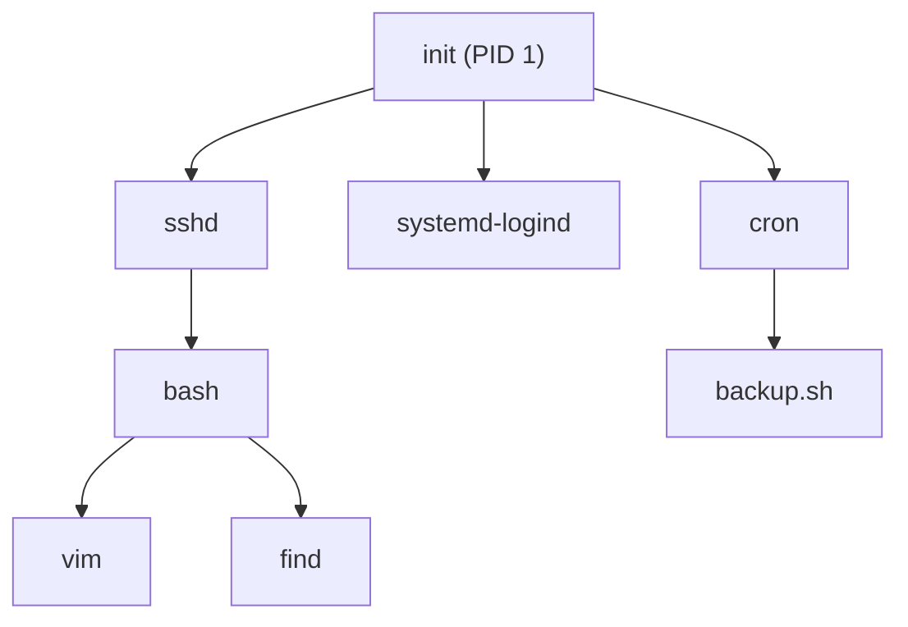

## 들어가며

> "A process is the activity resulting from the execution of a program."
> — Maurice Bach, *The Design of the UNIX Operating System*


프로그램을 작성하고, 컴파일하고, 실행한다. 그러나 실행 버튼을 누르는 순간, 정적인 바이너리 파일은 어떻게 살아 움직이는 프로세스가 되는가. 더 나아가 `fork`를 호출하면 프로세스가 복제된다고 하는데, 메모리 전체를 복사하는 것인가. 그렇다면 왜 `fork`는 그렇게 빠른가.

이 글은 운영체제의 가장 핵심적인 추상화인 프로세스의 본질을 분해한다. 리눅스 커널이 프로세스를 어떻게 표현하고, 생성하고, 관리하는지를 `task_struct`, `do_fork`, `copy_process`, `execve`, `wait`까지 코드 레벨에서 따라간다.

특히 fork-exec 모델, Copy-on-Write, 그리고 스레드와 프로세스의 통일된 추상화인 `clone`에 집중한다. 이 세 가지가 UNIX 프로세스 모델의 핵심이며, 컨테이너와 PID 네임스페이스로 이어지는 분기점이다.


---

## 목차
1. [프로세스란 무엇인가](#1-프로세스란-무엇인가)
2. [task_struct: 리눅스가 프로세스를 표현하는 방법](#2-task_struct-리눅스가-프로세스를-표현하는-방법)
3. [프로세스 상태 머신](#3-프로세스-상태-머신)
4. [fork의 내부](#4-fork의-내부)
5. [Copy-on-Write: 왜 fork가 빠른가](#5-copy-on-write-왜-fork가-빠른가)
6. [exec: 프로세스 이미지 교체](#6-exec-프로세스-이미지-교체)
7. [프로세스 계층: init, 부모, 자식, 고아, 좀비](#7-프로세스-계층-init-부모-자식-고아-좀비)
8. [프로세스 vs 스레드: clone의 플래그들](#8-프로세스-vs-스레드-clone의-플래그들)
9. [PID와 네임스페이스](#9-pid와-네임스페이스)
10. [실전: /proc 파일시스템으로 프로세스 탐색](#10-실전-proc-파일시스템으로-프로세스-탐색)


---

## 1. 프로세스란 무엇인가

### 프로그램과 프로세스의 차이

디스크에 저장된 실행 파일은 **프로그램**이다. 이것은 정적인 명령어와 데이터의 집합이다. 그러나 이 프로그램이 실행되면 **프로세스**가 된다. 프로세스는 다음을 포함한다.

- **코드 세그먼트** (text): 실행할 기계어 명령어
- **데이터 세그먼트**: 전역 변수, 정적 변수
- **힙**: 동적 할당된 메모리
- **스택**: 함수 호출, 지역 변수
- **프로세스 제어 블록** (PCB): 운영체제가 관리하는 메타데이터

같은 프로그램을 여러 번 실행하면 여러 개의 프로세스가 생성된다. 각 프로세스는 독립적인 주소 공간을 가지며, 서로 간섭하지 않는다.

### 프로세스의 탄생: UNIX의 혁명

1960년대 후반, Multics 프로젝트는 복잡하고 느렸다. Ken Thompson과 Dennis Ritchie는 단순함을 추구하며 UNIX를 설계했다. 그들은 프로세스를 운영체제의 중심 추상화로 삼았다.

Dennis Ritchie는 1974년 논문 "The UNIX Time-Sharing System"에서 이렇게 썼다:

> "A process is the execution of an image. An image is a computer execution environment."

UNIX의 프로세스 모델은 혁명적이었다. 프로세스 생성을 위해 `fork`와 `exec`를 분리한 설계는 파이프, I/O 리다이렉션, 백그라운드 실행 등 강력한 기능을 가능하게 했다.

### 현대 운영체제의 프로세스

현대 운영체제에서 프로세스는 다음과 같은 특징을 갖는다:

1. **격리성** (Isolation): 각 프로세스는 독립적인 가상 주소 공간을 가진다
2. **동시성** (Concurrency): 여러 프로세스가 동시에 실행되는 것처럼 보인다
3. **보호** (Protection): 한 프로세스는 다른 프로세스의 메모리에 접근할 수 없다
4. **자원 관리**: CPU 시간, 메모리, 파일 디스크립터 등을 할당받는다

이러한 추상화는 하드웨어의 복잡성을 숨기고, 프로그래머에게 단순한 인터페이스를 제공한다.

## 2. task_struct: 리눅스가 프로세스를 표현하는 방법

### task_struct의 등장

리눅스 커널에서 프로세스는 `task_struct`라는 구조체로 표현된다. 이 구조체는 프로세스의 모든 정보를 담고 있으며, 커널의 핵심 데이터 구조다.

`task_struct`는 `include/linux/sched.h`에 정의되어 있다:

```c
struct task_struct {
    unsigned int __state;                /* 실행 상태, Linux 5.15 계열 */
    unsigned int saved_state;            /* 일부 구성에서 임시 저장 */
    int exit_state;                      /* EXIT_ZOMBIE / EXIT_DEAD */
    void *stack;                         /* 커널 스택 포인터 */
    unsigned int flags;                  /* 플래그들 */
    int prio, static_prio, normal_prio; /* 우선순위 */
    struct mm_struct *mm, *active_mm;    /* 메모리 디스크립터 */

    pid_t pid;                           /* 프로세스 ID */
    pid_t tgid;                          /* 스레드 그룹 ID */

    struct task_struct __rcu *real_parent; /* 실제 부모 */
    struct task_struct __rcu *parent;      /* SIGCHLD를 받을 부모 */
    struct list_head children;             /* 자식 프로세스 리스트 */
    struct list_head sibling;              /* 형제 프로세스 리스트 */

    struct fs_struct *fs;                /* 파일시스템 정보 */
    struct files_struct *files;          /* 열린 파일들 */
    struct signal_struct *signal;        /* 시그널 핸들러 */
    struct sighand_struct *sighand;      /* 시그널 핸들러 함수들 */

    unsigned long nvcsw, nivcsw;         /* 컨텍스트 스위치 카운터 */
    u64 utime, stime;                    /* 사용자/커널 시간 */

    struct thread_struct thread;         /* CPU 레지스터 상태 */
    /* ... 수백 개의 필드들 ... */
};
```

이 구조체는 **1000줄이 넘는** 방대한 크기다. "약 1.7KB"라는 수치는 Robert Love의 *Linux Kernel Development*에 나오는 2.6 커널·32비트 기준이고, 현대 x86-64 5.x 커널에서는 커널 설정에 따라 수 KB(대략 7~10KB) 수준이다. `sudo grep task_struct /proc/slabinfo`의 objsize로 직접 확인할 수 있다.

### 핵심 필드 분석

#### state: 프로세스 상태

`state` 필드는 프로세스의 현재 상태를 나타낸다:

```c
/* include/linux/sched.h */
#define TASK_RUNNING            0x00000000  /* 실행 중 또는 실행 대기 */
#define TASK_INTERRUPTIBLE      0x00000001  /* 깨어날 수 있는 대기 */
#define TASK_UNINTERRUPTIBLE    0x00000002  /* 깨어날 수 없는 대기 */
#define __TASK_STOPPED          0x00000004  /* 정지됨 (SIGSTOP) */
#define __TASK_TRACED           0x00000008  /* 디버거가 추적 중 */
/* EXIT_ZOMBIE와 EXIT_DEAD는 __state가 아니라 별도 exit_state의 값이다. */
#define EXIT_DEAD               0x00000010  /* 최종 종료 */
#define EXIT_ZOMBIE             0x00000020  /* 좀비 상태 */
```

`volatile` 키워드는 컴파일러가 이 필드 접근을 동일 함수 안의 다른 접근으로 옮기거나 캐시된 레지스터 값으로 대체하지 않도록만 강제한다. 다른 CPU와의 동기화 의미는 없다. 커널에서 다른 CPU와의 가시성/순서를 보장하려면 `READ_ONCE`/`WRITE_ONCE`(컴파일러 재배치 차단), `atomic_t`/`atomic64_t` API(원자적 RMW), `smp_rmb`/`smp_wmb`/`smp_mb`(메모리 배리어), 락(`spinlock_t`/`mutex`)을 써야 한다. `volatile` 단독으로 동기화 도구로 사용하지 않는다.

#### mm: 메모리 디스크립터

`mm` 필드는 `mm_struct`를 가리킨다. 이 구조체는 프로세스의 가상 주소 공간을 기술한다:

```c
/*
 * 본 예시는 Linux 5.15 기준이다.
 * Linux 6.1 이후로는 VMA 관리가 maple tree(struct maple_tree mm_mt)로 옮겨졌고
 * mm_rb / mmap 리스트는 제거되었다.
 */
struct mm_struct {
    struct vm_area_struct *mmap;     /* VMA 리스트 (5.15 기준) */
    struct rb_root mm_rb;            /* VMA 레드블랙 트리 (5.15 기준) */
    pgd_t *pgd;                      /* 페이지 테이블 디렉토리 */

    unsigned long start_code, end_code;   /* 코드 세그먼트 */
    unsigned long start_data, end_data;   /* 데이터 세그먼트 */
    unsigned long start_brk, brk;         /* 힙 */
    unsigned long start_stack;            /* 스택 */
    unsigned long arg_start, arg_end;     /* 인자 */
    unsigned long env_start, env_end;     /* 환경 변수 */

    atomic_long_t mm_users;          /* 사용자 수 */
    atomic_t mm_count;               /* 참조 카운터 */
};
```

커널 스레드는 자신의 주소 공간이 없으므로 `mm`이 NULL이다. 대신 이전에 실행된 프로세스의 `active_mm`을 "빌려" 사용한다.

#### files: 열린 파일 테이블

`files` 필드는 프로세스가 열어둔 파일 디스크립터를 관리한다:

```c
struct files_struct {
    atomic_t count;                  /* 참조 카운터 */
    struct fdtable __rcu *fdt;       /* 파일 디스크립터 테이블 */
    struct fdtable fdtab;            /* 기본 테이블 */

    spinlock_t file_lock;            /* 잠금 */
    unsigned int next_fd;            /* 다음 할당할 fd */
    struct file __rcu * fd_array[NR_OPEN_DEFAULT]; /* 기본 64개 */
};
```

일반 `fork` 시에는 부모의 `files_struct`를 그대로 공유하지 않고 자식이 자신의 `files_struct`(즉 새로운 fd 테이블)를 갖도록 복제한다. 다만 fd가 가리키는 **open file description**(`struct file`)은 부모와 자식이 공유한다. 따라서 한쪽이 `read`로 파일 오프셋을 옮기면 다른 쪽도 그 오프셋의 영향을 받는다. `clone(CLONE_FILES)`로 만들어진 스레드처럼 `files_struct` 자체를 공유하려면 명시적으로 `CLONE_FILES` 플래그를 줘야 한다(이때만 참조 카운터를 증가시키며 복사하지 않는다).

#### signal: 시그널 관리

```c
struct signal_struct {
    atomic_t sigcnt;                 /* 참조 카운터 */
    atomic_t live;                   /* 살아있는 스레드 수 */
    struct list_head thread_head;    /* 스레드 리스트 */

    /* 시그널 통계 */
    struct task_cputime cputime_atomic;

    /* 자원 제한 */
    struct rlimit rlim[RLIM_NLIMITS];

    /* 프로세스 그룹, 세션 */
    pid_t pgrp;
    pid_t session;
};
```

#### pid와 tgid

- `pid`: 프로세스(또는 스레드)의 고유 식별자
- `tgid`: Thread Group ID, 즉 메인 스레드의 PID

단일 스레드 프로세스에서는 `pid == tgid`이다. 멀티스레드 프로세스에서 모든 스레드는 같은 `tgid`를 가지지만, 각각 고유한 `pid`를 갖는다.

```c
/* 사용자 공간에서 getpid() 호출 시 실제로는 tgid를 반환 */
SYSCALL_DEFINE0(getpid)
{
    return task_tgid_vnr(current);
}
```

### task_struct의 할당과 관리

#### 슬랩 할당자

`task_struct`는 빈번하게 생성되고 해제된다. 효율성을 위해 리눅스는 **슬랩 할당자**를 사용한다:

```c
/* kernel/fork.c */
static struct kmem_cache *task_struct_cachep;

void __init fork_init(void)
{
    unsigned long useroffset, usersize;

    /* arch_thread_struct_whitelist() 결과를 task_struct.thread 기준으로 변환한다. */
    task_struct_whitelist(&useroffset, &usersize);

    /* task_struct를 위한 슬랩 캐시 생성 */
    task_struct_cachep = kmem_cache_create_usercopy("task_struct",
                         arch_task_struct_size, ARCH_MIN_TASKALIGN,
                         SLAB_PANIC|SLAB_ACCOUNT,
                         useroffset, usersize,
                         NULL);
}
```

슬랩 캐시는 자주 사용되는 객체를 미리 할당해두고 재사용한다. 이는 메모리 할당 오버헤드를 크게 줄인다.

#### current 매크로

현재 실행 중인 프로세스의 `task_struct`에 접근하는 것은 매우 빈번하다. 리눅스는 `current` 매크로를 제공한다:

```c
/* x86-64 아키텍처 */
/* arch/x86/include/asm/current.h */
DECLARE_PER_CPU(struct task_struct *, current_task);

static __always_inline struct task_struct *get_current(void)
{
    return this_cpu_read_stable(current_task);
}

#define current get_current()
```

x86-64에서는 per-CPU 변수로 `current_task`를 저장한다. 각 CPU는 자신의 `current_task` 복사본을 갖는다.

다른 아키텍처에서는 다른 방법을 사용한다. 예를 들어, ARM은 스택 포인터로부터 `task_struct`를 계산한다.

### 프로세스 디스크립터 리스트

모든 `task_struct`는 **원형 이중 연결 리스트**로 연결된다:

```c
struct task_struct {
    /* ... */
    struct list_head tasks;  /* 전체 프로세스 리스트 */
    /* ... */
};

/* 전체 프로세스를 순회 */
struct task_struct *task;
for_each_process(task) {
    /* task 처리 */
}
```

`for_each_process` 매크로는 다음과 같이 정의된다:

```c
#define for_each_process(p) \
    for (p = &init_task ; (p = next_task(p)) != &init_task ; )
```

`init_task`는 PID 0인 swapper 프로세스다. 모든 프로세스의 조상이다.

## 3. 프로세스 상태 머신: TASK_RUNNING에서 TASK_ZOMBIE까지

### 프로세스 상태 전이

프로세스는 생애주기 동안 여러 상태를 거친다.



### TASK_RUNNING: 실행 중 또는 실행 대기

`TASK_RUNNING`은 프로세스가 CPU에서 실행 중이거나, 실행을 기다리는 런큐에 있는 상태다.

주의: `TASK_RUNNING`이라고 해서 항상 실행 중인 것은 아니다. 실행 **가능한** 상태를 의미한다.

```c
/* 프로세스를 TASK_RUNNING으로 설정하고 런큐에 추가 */
void wake_up_process(struct task_struct *p)
{
    WARN_ON(task_is_stopped_or_traced(p));
    try_to_wake_up(p, TASK_NORMAL, 0);
}
```

### TASK_INTERRUPTIBLE: 인터럽트 가능한 대기

프로세스가 이벤트(예: I/O 완료, 시그널)를 기다리며 sleep 상태다. 시그널이 오면 깨어날 수 있다.

```c
/* 예: 파일 읽기 대기 */
wait_event_interruptible(wq, condition);
```

이 상태에서 `SIGINT` (Ctrl-C)와 같은 시그널을 받으면 즉시 깨어나고, 시스템 콜은 `-EINTR`을 반환한다.

### TASK_UNINTERRUPTIBLE: 인터럽트 불가능한 대기

디스크 I/O처럼 중단되면 안 되는 중요한 작업을 기다릴 때 사용한다. 시그널에 의해 깨어나지 않는다.

```c
wait_event(wq, condition);  /* 시그널에 반응하지 않음 */
```

이 상태의 프로세스는 `ps` 명령에서 'D' 상태로 표시된다. 종종 "uninterruptible sleep" 때문에 시스템이 응답하지 않는 것처럼 보일 수 있다.

### __TASK_STOPPED: 정지

프로세스가 `SIGSTOP`, `SIGTSTP`, `SIGTTIN`, `SIGTTOU` 시그널을 받으면 정지된다. `SIGCONT`를 받기 전까지 실행되지 않는다.

```c
/* 프로세스 정지 처리 */
static void do_signal_stop(int signr)
{
    /* ... */
    __set_current_state(TASK_STOPPED);
    /* ... */
}
```

쉘의 job control에서 사용된다:
```bash
$ ./myprogram
^Z
[1]+ Stopped                 ./myprogram
$ bg
[1]+ ./myprogram &
```

### __TASK_TRACED: 추적 중

디버거(예: gdb, strace)가 프로세스를 추적할 때 사용된다. `ptrace` 시스템 콜로 구현된다.

```c
/* ptrace로 프로세스를 추적 */
ptrace(PTRACE_ATTACH, pid, NULL, NULL);
```

gdb에서 브레이크포인트를 설정하고 프로그램을 멈추면, 프로세스는 `__TASK_TRACED` 상태가 된다.

### EXIT_ZOMBIE: 좀비 프로세스

프로세스가 종료되었지만, 부모 프로세스가 아직 `wait`를 호출하지 않은 상태다.

```c
void do_exit(long code)
{
    struct task_struct *tsk = current;

    /* ... 자원 정리 ... */

    tsk->exit_code = code;
    tsk->exit_state = EXIT_ZOMBIE;

    /* 부모에게 SIGCHLD 보냄 */
    do_notify_parent(tsk, tsk->exit_signal);

    /* 스케줄러에게 CPU 양도 */
    schedule();
}
```

좀비 프로세스는 대부분의 자원을 해제했지만, `task_struct`와 최소한의 정보(종료 코드, 실행 시간 통계 등)는 유지한다. 부모가 `wait`를 호출하면 이 정보를 가져갈 수 있다.

```bash
$ ps aux | grep Z
USER       PID %CPU %MEM    VSZ   RSS TTY      STAT START   TIME COMMAND
john      1234  0.0  0.0      0     0 ?        Z    10:30   0:00 [defunct]
```

좀비 프로세스가 많으면 PID를 고갈시킬 수 있다. 부모 프로세스가 제대로 `wait`를 호출하지 않으면 발생한다.

### EXIT_DEAD: 완전한 종료

부모가 `wait`를 호출하거나, 부모가 먼저 종료되어 init 프로세스가 거둬들인 후의 상태다. `task_struct`가 해제되고 프로세스는 완전히 사라진다.

```c
static void release_task(struct task_struct *p)
{
    /* ... */
    __exit_signal(p);
    __unhash_process(p);
    /* ... */
    put_task_struct(p);  /* task_struct 해제 */
}
```

### 상태 전이 함수들

커널은 프로세스 상태를 변경하는 여러 함수를 제공한다:

```c
/* 상태 설정 */
#define __set_current_state(state_value)    \
    do { current->state = (state_value); } while (0)

#define set_current_state(state_value)      \
    smp_store_mb(current->state, (state_value))

/* 프로세스 깨우기 */
int wake_up_process(struct task_struct *p);
void wake_up_interruptible(wait_queue_head_t *wq);

/* Sleep */
#define wait_event(wq, condition)           \
    do {                                    \
        if (condition) break;               \
        __wait_event(wq, condition);        \
    } while (0)
```

## 4. fork의 내부: do_fork에서 copy_process까지

### fork 시스템 콜의 역사

UNIX의 `fork`는 프로세스 생성에 대한 우아한 해법이었다. 프로세스를 복제한 후, 자식 프로세스가 `exec`로 새 프로그램을 로드하는 이 설계는 파이프라인과 I/O 리다이렉션을 단순하게 만들었다. Dennis Ritchie의 회고 논문 "The Evolution of the Unix Time-sharing System" (1979)에 따르면, 초기 PDP-7 UNIX의 fork는 27줄의 어셈블리 코드였다.

### fork, vfork, clone

리눅스는 세 가지 프로세스 생성 시스템 콜을 제공한다:

```c
/* fork(): 프로세스 복제 */
pid_t fork(void);

/* vfork(): 부모를 block하고 주소 공간 공유 (exec() 직전용) */
pid_t vfork(void);

/* clone(): 세밀한 제어 (스레드 생성 등) */
long clone(unsigned long flags, void *child_stack,
           void *ptid, void *ctid, unsigned long newtls);
```

세 시스템 콜 모두 내부적으로 `kernel_clone`을 호출한다:

```c
/* kernel/fork.c */
pid_t kernel_clone(struct kernel_clone_args *args)
{
    struct task_struct *p;
    struct pid *pid;

    /* 프로세스 복제 */
    p = copy_process(NULL, 0, NUMA_NO_NODE, args);

    if (IS_ERR(p))
        return PTR_ERR(p);

    /* 자식의 PID 획득 */
    pid = get_task_pid(p, PIDTYPE_PID);

    /* 프로세스 시작 */
    wake_up_new_task(p);

    /* 부모는 자식의 PID를 반환받음 */
    return pid_vnr(pid);
}
```

### copy_process: 프로세스 복제의 핵심

`copy_process`는 실제로 프로세스를 복제하는 핵심 함수다. 약 **500줄**에 달하는 복잡한 함수다.

```c
static __latent_entropy struct task_struct *copy_process(
                        struct pid *pid,
                        int trace,
                        int node,
                        struct kernel_clone_args *args)
{
    struct task_struct *p;
    unsigned long clone_flags = args->flags;

    /* 1. task_struct 할당 */
    p = dup_task_struct(current, node);
    if (!p)
        return ERR_PTR(-ENOMEM);

    /* 2. 자식 프로세스 초기화 */
    retval = copy_creds(p, clone_flags);

    /* 3. 스케줄링 초기화 */
    retval = sched_fork(clone_flags, p);

    /* 4. 파일 디스크립터 복사 또는 공유 */
    retval = copy_files(clone_flags, p);

    /* 5. 파일시스템 정보 복사 또는 공유 */
    retval = copy_fs(clone_flags, p);

    /* 6. 시그널 핸들러 복사 또는 공유 */
    retval = copy_sighand(clone_flags, p);
    retval = copy_signal(clone_flags, p);

    /* 7. 메모리 디스크립터 복사 또는 공유 */
    retval = copy_mm(clone_flags, p);

    /* 8. 네임스페이스 복사 또는 공유 */
    retval = copy_namespaces(clone_flags, p);

    /* 9. 스레드 정보 복사 (레지스터 등) */
    retval = copy_thread(clone_flags, args->stack, args->stack_size, p, args->tls);

    /* 10. PID 할당 */
    if (pid != &init_struct_pid) {
        pid = alloc_pid(p->nsproxy->pid_ns_for_children, args->set_tid, args->set_tid_size);
        if (IS_ERR(pid)) {
            retval = PTR_ERR(pid);
            goto bad_fork_cleanup_thread;
        }
    }

    /* 11. 부모-자식 관계 설정 */
    p->real_parent = current;
    p->parent = current;

    return p;
}
```

각 단계를 자세히 살펴보자.

### dup_task_struct: task_struct 복제

```c
static struct task_struct *dup_task_struct(struct task_struct *orig, int node)
{
    struct task_struct *tsk;
    unsigned long *stack;

    /* 슬랩 캐시에서 task_struct 할당 */
    tsk = alloc_task_struct_node(node);
    if (!tsk)
        return NULL;

    /* 커널 스택 할당 */
    stack = alloc_thread_stack_node(tsk, node);
    if (!stack)
        goto free_tsk;

    /* 부모의 task_struct를 자식에게 복사 */
    memcpy(tsk, orig, arch_task_struct_size);

    tsk->stack = stack;

    /* 스택 canary 설정 (보안) */
    tsk->stack_canary = get_random_canary();

    return tsk;
}
```

`memcpy`로 전체 `task_struct`를 복사한다. 이후 단계에서 일부 필드를 수정한다.

### copy_files: 파일 디스크립터 테이블

```c
static int copy_files(unsigned long clone_flags, struct task_struct *tsk)
{
    struct files_struct *oldf, *newf;

    oldf = current->files;

    /* CLONE_FILES 플래그: 파일 테이블 공유 (스레드) */
    if (clone_flags & CLONE_FILES) {
        atomic_inc(&oldf->count);
        return 0;
    }

    /* 파일 테이블 복사 (fork) */
    newf = dup_fd(oldf, NR_OPEN_MAX, &error);
    if (!newf)
        return error;

    tsk->files = newf;
    return 0;
}
```

`fork`는 파일 테이블을 복사한다. 부모와 자식은 같은 파일을 가리키는 독립적인 파일 디스크립터를 갖는다. 파일 오프셋은 공유된다.

`pthread_create`로 생성된 스레드는 `CLONE_FILES` 플래그를 사용해 파일 테이블을 공유한다.

### copy_mm: 메모리 디스크립터

```c
static int copy_mm(unsigned long clone_flags, struct task_struct *tsk)
{
    struct mm_struct *mm, *oldmm;

    oldmm = current->mm;

    /* 커널 스레드: mm이 NULL */
    if (!oldmm)
        return 0;

    /* CLONE_VM 플래그: 주소 공간 공유 (스레드) */
    if (clone_flags & CLONE_VM) {
        mmget(oldmm);
        tsk->mm = oldmm;
        tsk->active_mm = oldmm;
        return 0;
    }

    /* 주소 공간 복사 (fork) */
    mm = dup_mm(tsk, oldmm);
    if (!mm)
        return -ENOMEM;

    tsk->mm = mm;
    tsk->active_mm = mm;
    return 0;
}
```

`fork`는 `dup_mm`으로 주소 공간을 복사한다. 하지만 실제로는 즉시 복사하지 않고, **Copy-on-Write (COW)**를 사용한다.

### copy_thread: CPU 상태 복제

```c
/* arch/x86/kernel/process_64.c */
int copy_thread(unsigned long clone_flags, unsigned long sp, unsigned long arg,
                struct task_struct *p, unsigned long tls)
{
    struct pt_regs *childregs;
    struct fork_frame *fork_frame;
    struct inactive_task_frame *frame;

    /* 자식의 커널 스택 설정 */
    fork_frame = container_of(task_pt_regs(p), struct fork_frame, regs);
    frame = &fork_frame->frame;
    childregs = &fork_frame->regs;

    /* 부모의 레지스터 상태 복사 */
    *childregs = *current_pt_regs();

    /* fork()의 반환값: 자식은 0 */
    childregs->ax = 0;

    /* 스레드일 경우 새 스택 설정 */
    if (sp)
        childregs->sp = sp;

    /* TLS (Thread Local Storage) 설정 */
    if (clone_flags & CLONE_SETTLS) {
        childregs->fs = tls;
    }

    /* ret_from_fork으로 돌아가도록 설정 */
    frame->ret_addr = (unsigned long) ret_from_fork;
    p->thread.sp = (unsigned long) fork_frame;
    p->thread.io_bitmap = NULL;

    return 0;
}
```

자식 프로세스의 커널 스택을 설정하여, 스케줄러가 자식을 선택하면 `ret_from_fork`에서 시작하도록 한다.

중요한 점: `childregs->ax = 0`으로 설정하여, 자식 프로세스가 `fork`에서 0을 반환받도록 한다.

### alloc_pid: PID 할당

```c
struct pid *alloc_pid(struct pid_namespace *ns, pid_t *set_tid,
                      size_t set_tid_size)
{
    struct pid *pid;
    enum pid_type type;
    int i, nr;
    struct pid_namespace *tmp;

    /* pid 구조체 할당 */
    pid = kmem_cache_alloc(ns->pid_cachep, GFP_KERNEL);
    if (!pid)
        return ERR_PTR(-ENOMEM);

    /* 각 네임스페이스 레벨에서 PID 할당 */
    tmp = ns;
    pid->level = ns->level;
    for (i = ns->level; i >= 0; i--) {
        int tid = 0;

        /* 사용자 지정 PID가 있으면 사용 */
        if (set_tid_size) {
            tid = set_tid[ns->level - i];
            /* ... 검증 ... */
        }

        /* PID 할당 */
        nr = idr_alloc(&tmp->idr, NULL, tid, tid + 1, GFP_KERNEL);
        if (nr < 0) {
            /* PID 고갈 또는 충돌 */
            goto out_free;
        }

        pid->numbers[i].nr = nr;
        pid->numbers[i].ns = tmp;
        tmp = tmp->parent;
    }

    /* ... */
    return pid;
}
```

리눅스는 **PID 네임스페이스**를 지원한다. 컨테이너 내부의 프로세스는 자신의 네임스페이스에서 PID 1을 가질 수 있지만, 호스트 네임스페이스에서는 다른 PID를 갖는다.

### wake_up_new_task: 프로세스 시작

```c
void wake_up_new_task(struct task_struct *p)
{
    struct rq_flags rf;
    struct rq *rq;

    /* 런큐 잠금 */
    rq = task_rq_lock(p, &rf);

    /* 프로세스를 TASK_RUNNING으로 설정 */
    p->state = TASK_RUNNING;

    /* 스케줄링 클래스 초기화 */
    activate_task(rq, p, ENQUEUE_NOCLOCK);

    /* 자식을 부모와 같은 CPU에 배치 (캐시 친화성) */
    if (task_cpu(p) != this_cpu())
        set_task_cpu(p, this_cpu());

    /* 런큐 잠금 해제 */
    task_rq_unlock(rq, p, &rf);
}
```

새로 생성된 프로세스를 런큐에 추가하고 스케줄러가 선택할 수 있도록 한다.

## 5. Copy-on-Write: 왜 fork가 빠른가?

### 초기 UNIX의 문제

초기 UNIX에서 `fork`는 부모 프로세스의 전체 주소 공간을 복사했다. 프로세스가 100MB 메모리를 사용한다면, `fork`는 100MB를 복사해야 했다. 이는 매우 느렸다.

더욱이, 대부분의 경우 `fork` 직후 `exec`를 호출하여 새 프로그램을 로드한다. 복사한 메모리는 즉시 버려진다. 이는 낭비다.

### Copy-on-Write의 등장

**Copy-on-Write (COW)**는 이 문제를 해결한다. `fork` 시 실제로 메모리를 복사하지 않고, 부모와 자식이 같은 물리 페이지를 **공유**한다. 페이지 테이블 엔트리를 **읽기 전용**으로 설정한다.

부모나 자식이 페이지에 쓰기를 시도하면, **페이지 폴트**가 발생한다. 커널이 이를 포착하고, 그제야 페이지를 복사한다.

```text
fork() 직후:
    부모 페이지 테이블    자식 페이지 테이블
         |                     |
         v                     v
      +--------+            +--------+
      | PTE    |            | PTE    |
      | (R/O)  |            | (R/O)  |
      +--------+            +--------+
         |                     |
         +--------+------------+
                  |
                  v
           [물리 페이지]
           (공유됨)

자식이 쓰기 시도:
    1. 페이지 폴트 발생
    2. 커널이 물리 페이지 복사
    3. 자식의 PTE를 새 페이지로 변경 (R/W)

    부모 페이지 테이블    자식 페이지 테이블
         |                     |
         v                     v
      +--------+            +--------+
      | PTE    |            | PTE    |
      | (R/W)  |            | (R/W)  |
      +--------+            +--------+
         |                     |
         v                     v
    [물리 페이지 A]      [물리 페이지 B]
                         (새로 복사됨)
```

### COW 구현: dup_mm

```c
static struct mm_struct *dup_mm(struct task_struct *tsk,
                                struct mm_struct *oldmm)
{
    struct mm_struct *mm;
    struct vm_area_struct *mpnt, *tmp, *prev, **pprev;

    /* mm_struct 할당 */
    mm = allocate_mm();
    if (!mm)
        return NULL;

    /* oldmm의 내용을 mm에 복사 */
    memcpy(mm, oldmm, sizeof(*mm));

    /* 새 페이지 테이블 생성 */
    if (!mm_alloc_pgd(mm))
        goto fail_nopgd;

    /* 각 VMA를 복사하면서 페이지를 COW로 설정 */
    for (mpnt = oldmm->mmap; mpnt; mpnt = mpnt->vm_next) {
        /* VMA 복사 */
        tmp = vm_area_dup(mpnt);
        if (!tmp)
            goto fail_nomem;

        /* 페이지 테이블 복사 및 COW 설정 */
        if (copy_page_range(mm, oldmm, mpnt))
            goto fail_nomem;

        /* ... */
    }

    return mm;
}
```

### copy_page_range: 페이지 테이블 복제

```c
int copy_page_range(struct mm_struct *dst_mm, struct mm_struct *src_mm,
                    struct vm_area_struct *vma)
{
    pgd_t *src_pgd, *dst_pgd;
    unsigned long next;
    unsigned long addr = vma->vm_start;
    unsigned long end = vma->vm_end;

    /* 페이지 테이블 순회 */
    src_pgd = pgd_offset(src_mm, addr);
    dst_pgd = pgd_offset(dst_mm, addr);
    do {
        next = pgd_addr_end(addr, end);

        /* 각 레벨의 페이지 테이블 복사 */
        if (copy_p4d_range(dst_mm, src_mm, dst_pgd, src_pgd,
                          vma, addr, next))
            return -ENOMEM;
    } while (dst_pgd++, src_pgd++, addr = next, addr != end);

    return 0;
}
```

x86-64의 기본 4단계 페이지 테이블은 다음 네 논리 레벨을 사용한다. Linux 공통 코드는 5단계 추상화를 유지하므로 P4D가 보이지만, 4단계 구성에서는 P4D가 접혀(folded) PGD와 같은 물리 레벨을 가리킨다:
- PGD (Page Global Directory)
- P4D (5단계 공통 API의 추상 레벨, 4단계에서는 folded)
- PUD (Page Upper Directory)
- PMD (Page Middle Directory)
- PTE (Page Table Entry)

각 레벨을 순회하며 복사한다. 최하위 PTE에서 실제 COW 설정이 일어난다:

```c
static int copy_pte_range(struct mm_struct *dst_mm, struct mm_struct *src_mm,
                         pmd_t *dst_pmd, pmd_t *src_pmd,
                         struct vm_area_struct *vma,
                         unsigned long addr, unsigned long end)
{
    pte_t *orig_src_pte, *orig_dst_pte;
    pte_t *src_pte, *dst_pte;

    /* PTE 테이블 할당 */
    dst_pte = pte_alloc_map_lock(dst_mm, dst_pmd, addr, &dst_ptl);
    if (!dst_pte)
        return -ENOMEM;

    src_pte = pte_offset_map(src_pmd, addr);

    do {
        /* 각 PTE 복사 */
        if (!pte_none(*src_pte)) {
            copy_one_pte(dst_mm, src_mm, dst_pte, src_pte, vma, addr);
        }
    } while (dst_pte++, src_pte++, addr += PAGE_SIZE, addr != end);

    /* ... */
    return 0;
}
```

### copy_one_pte: COW 설정

```c
static inline void copy_one_pte(struct mm_struct *dst_mm,
                               struct mm_struct *src_mm,
                               pte_t *dst_pte, pte_t *src_pte,
                               struct vm_area_struct *vma,
                               unsigned long addr)
{
    pte_t pte = *src_pte;
    struct page *page;

    /* 쓰기 가능한 페이지를 읽기 전용으로 변경 */
    if (is_cow_mapping(vma->vm_flags)) {
        if (pte_write(pte))
            pte = pte_wrprotect(pte);  /* 쓰기 권한 제거 */
    }

    /* 페이지 참조 카운터 증가 */
    page = vm_normal_page(vma, addr, pte);
    if (page) {
        get_page(page);  /* refcount++ */
    }

    /* 자식의 페이지 테이블에 PTE 설정 */
    set_pte_at(dst_mm, addr, dst_pte, pte);
}
```

`pte_wrprotect`는 PTE의 쓰기 비트를 제거한다. 이제 부모와 자식 모두 읽기 전용으로 페이지를 공유한다.

### 페이지 폴트 핸들러: COW 실행

쓰기 시도 시 페이지 폴트가 발생한다. `do_page_fault`가 호출되고, 결국 `do_wp_page`에 도달한다:

```c
/* mm/memory.c */
static vm_fault_t do_wp_page(struct vm_fault *vmf)
{
    struct vm_area_struct *vma = vmf->vma;
    struct page *old_page = vmf->page;
    struct page *new_page;
    pte_t entry;

    /* COW 페이지인지 확인 (참조 카운터 > 1) */
    if (PageAnon(old_page) && !PageKsm(old_page)) {
        if (total_mapcount(old_page) > 1) {
            /* 페이지 복사 필요 */
            goto copy;
        }
    }

    /* 참조 카운터가 1이면 그냥 쓰기 가능하게 변경 */
    entry = maybe_mkwrite(pte_mkdirty(vmf->orig_pte), vma);
    if (ptep_set_access_flags(vma, vmf->address, vmf->pte, entry, 1))
        update_mmu_cache(vma, vmf->address, vmf->pte);
    return VM_FAULT_WRITE;

copy:
    /* 새 페이지 할당 */
    new_page = alloc_page_vma(GFP_HIGHUSER_MOVABLE, vma, vmf->address);
    if (!new_page)
        return VM_FAULT_OOM;

    /* 기존 페이지 내용을 새 페이지로 복사 */
    copy_user_highpage(new_page, old_page, vmf->address, vma);

    /* 페이지 테이블 업데이트 */
    entry = mk_pte(new_page, vma->vm_page_prot);
    entry = maybe_mkwrite(pte_mkdirty(entry), vma);
    ptep_clear_flush(vma, vmf->address, vmf->pte);
    set_pte_at(vma->vm_mm, vmf->address, vmf->pte, entry);

    /* 기존 페이지 참조 카운터 감소 */
    page_remove_rmap(old_page, false);
    put_page(old_page);

    return VM_FAULT_WRITE;
}
```

### COW의 효과

COW가 없다면 `fork` 시점에 부모의 복사 대상 페이지 내용을 즉시 복제해야 하므로 비용과 추가 메모리가 resident data 크기에 비례한다. COW는 물리 페이지를 읽기 전용으로 공유하고 페이지 테이블과 관리 메타데이터를 준비한다. 자식이나 부모가 쓴 페이지만 fault에서 복제한다.

따라서 `fork`가 상수 시간이 되는 것은 아니다. 페이지 테이블 복사와 reverse mapping, TLB 처리 비용은 매핑 수와 resident working set에 따라 증가한다. `fork` 직후 `exec`하는 패턴에서는 대부분의 데이터 페이지 복사를 피할 수 있지만, 다중 스레드 프로세스의 at-fork 상태와 큰 페이지 테이블 비용은 남는다.

벤치마크 결과:
```c
/* 테스트: 100MB 할당 후 fork() 시간 측정 */
char *buf = malloc(100 * 1024 * 1024);
memset(buf, 0, 100 * 1024 * 1024);

clock_t start = clock();
pid_t pid = fork();
clock_t end = clock();

printf("fork() process CPU time: %f ms\n",
       (double)(end - start) / CLOCKS_PER_SEC * 1000);

/* 출력: fork() time: 0.15 ms */
```

### COW의 한계

COW는 만능이 아니다:

1. **쓰기 빈도가 높으면**: 결국 모든 페이지를 복사하게 되어 오히려 느릴 수 있다
2. **페이지 테이블 오버헤드**: 페이지 테이블 자체는 복사해야 한다
3. **참조 카운터 관리**: 원자적 연산으로 성능 비용 발생

역사적 순서에 주의하자. `vfork`는 COW의 한계 때문이 아니라 COW가 등장하기 **전**에 나왔다. 3BSD(1979)는 fork가 전체 주소 공간을 물리적으로 복사하던 시절에 그 비용을 피하려고 `vfork`를 도입했다. 이후 COW fork가 보편화되면서 `vfork`의 필요성은 크게 줄었지만, 페이지 테이블 복사 비용마저 피하는 최적화로 지금도 남아 있다(`posix_spawn`의 내부 구현 등).

## 6. exec: 프로세스 이미지 교체

### fork-exec 모델

UNIX의 프로세스 생성 모델은 독특하다. 프로세스를 복제한 후(`fork`), 새 프로그램을 로드한다(`exec`). 이 분리가 파이프, 리다이렉션, 환경 변수 설정 등을 우아하게 만든다.

```c
/* 쉘의 명령 실행 */
pid_t pid = fork();
if (pid == 0) {
    /* 자식: I/O 리다이렉션, 환경 변수 설정 등 */
    int fd = open("output.txt", O_WRONLY | O_CREAT, 0644);
    dup2(fd, STDOUT_FILENO);  /* stdout을 파일로 리다이렉션 */
    close(fd);

    /* 새 프로그램 실행 */
    execl("/bin/ls", "ls", "-l", NULL);
    perror("exec failed");
    exit(1);
} else {
    /* 부모: 자식 종료 대기 */
    wait(NULL);
}
```

### exec 계열 함수들

리눅스는 여러 exec 변형을 제공한다:

```c
int execl(const char *path, const char *arg, ...);
int execlp(const char *file, const char *arg, ...);
int execle(const char *path, const char *arg, ..., char *const envp[]);
int execv(const char *path, char *const argv[]);
int execvp(const char *file, char *const argv[]);
int execvpe(const char *file, char *const argv[], char *const envp[]);
```

- `l` (list): 인자를 가변 인자로 전달
- `v` (vector): 인자를 배열로 전달
- `p` (path): PATH 환경 변수에서 실행 파일 검색
- `e` (environment): 환경 변수를 명시적으로 전달

모두 내부적으로 `execve` 시스템 콜을 호출한다:

```c
int execve(const char *filename, char *const argv[], char *const envp[]);
```

### execve 시스템 콜의 흐름

```c
/* fs/exec.c */
SYSCALL_DEFINE3(execve,
                const char __user *, filename,
                const char __user *const __user *, argv,
                const char __user *const __user *, envp)
{
    return do_execve(getname(filename), argv, envp);
}

static int do_execve(struct filename *filename,
                     const char __user *const __user *__argv,
                     const char __user *const __user *__envp)
{
    struct user_arg_ptr argv = { .ptr.native = __argv };
    struct user_arg_ptr envp = { .ptr.native = __envp };
    return do_execveat_common(AT_FDCWD, filename, argv, envp, 0);
}
```

### do_execveat_common: exec의 핵심

```c
static int do_execveat_common(int fd, struct filename *filename,
                              struct user_arg_ptr argv,
                              struct user_arg_ptr envp,
                              int flags)
{
    struct linux_binprm *bprm;
    int retval;

    /* 1. linux_binprm 구조체 할당 및 초기화 */
    bprm = alloc_bprm(fd, filename);
    if (IS_ERR(bprm))
        return PTR_ERR(bprm);

    /* 2. 실행 파일 오픈 */
    retval = prepare_bprm_creds(bprm);
    if (retval)
        goto out_free;

    /* 3. 인자와 환경 변수 복사 */
    retval = copy_strings_kernel(1, &bprm->filename, bprm);
    if (retval < 0)
        goto out;

    retval = copy_strings(bprm->envc, envp, bprm);
    if (retval < 0)
        goto out;

    retval = copy_strings(bprm->argc, argv, bprm);
    if (retval < 0)
        goto out;

    /* 4. 바이너리 포맷 로드 및 실행 */
    retval = exec_binprm(bprm);
    if (retval < 0)
        goto out;

    /* 성공 시 여기로 돌아오지 않음! */
    return retval;
}
```

### exec_binprm: 바이너리 로드

```c
static int exec_binprm(struct linux_binprm *bprm)
{
    pid_t old_pid, old_vpid;
    int ret;

    /* 기존 PID 저장 */
    old_pid = current->pid;
    old_vpid = task_pid_nr_ns(current, task_active_pid_ns(current));

    /* 바이너리 포맷 핸들러 호출 */
    ret = search_binary_handler(bprm);
    if (ret >= 0) {
        /* 성공 시 audit 로그 */
        audit_bprm(bprm);
        trace_sched_process_exec(current, old_pid, bprm);
        ptrace_event(PTRACE_EVENT_EXEC, old_vpid);
        proc_exec_connector(current);
    }

    return ret;
}
```

### search_binary_handler: 바이너리 포맷 결정

리눅스는 여러 바이너리 포맷을 지원한다:
- ELF (Executable and Linkable Format)
- a.out (구식 UNIX 포맷)
- 스크립트 (#! shebang)
- 기타 (Java,.NET Mono 등)

```c
int search_binary_handler(struct linux_binprm *bprm)
{
    struct linux_binfmt *fmt;
    int retval;

    /* 바이너리 포맷 핸들러 리스트 순회 */
    list_for_each_entry(fmt, &formats, lh) {
        /* 포맷 핸들러 시도 */
        retval = fmt->load_binary(bprm);

        if (retval == 0 || retval != -ENOEXEC) {
            return retval;
        }
    }

    return -ENOEXEC;
}
```

### ELF 바이너리 로드: load_elf_binary

ELF는 리눅스의 표준 실행 파일 포맷이다. `load_elf_binary`는 약 **1000줄**에 달하는 복잡한 함수다.

```c
/* fs/binfmt_elf.c */
static int load_elf_binary(struct linux_binprm *bprm)
{
    struct file *interpreter = NULL;
    struct elf_phdr *elf_ppnt, *elf_phdata, *interp_elf_phdata = NULL;
    struct elfhdr *elf_ex = (struct elfhdr *)bprm->buf;
    struct elfhdr interp_elf_ex;
    unsigned long load_addr = 0, load_bias = 0;
    unsigned long error;
    unsigned long elf_bss, elf_brk;

    /* 1. ELF 헤더 검증 */
    if (memcmp(elf_ex->e_ident, ELFMAG, SELFMAG) != 0)
        goto out;  /* ELF 매직 넘버 확인 */

    if (elf_ex->e_type != ET_EXEC && elf_ex->e_type != ET_DYN)
        goto out;  /* 실행 파일 또는 공유 객체만 허용 */

    /* 2. 프로그램 헤더 로드 */
    elf_phdata = load_elf_phdrs(elf_ex, bprm->file);
    if (!elf_phdata)
        goto out;

    /* 3. 인터프리터 확인 (동적 링킹) */
    for (i = 0; i < elf_ex->e_phnum; i++) {
        if (elf_ppnt->p_type == PT_INTERP) {
            /* /lib64/ld-linux-x86-64.so.2 등 */
            interpreter = open_exec(elf_interpreter);
            break;
        }
    }

    /* 4. 기존 프로세스 이미지 제거 */
    retval = flush_old_exec(bprm);
    if (retval)
        goto out_free_dentry;

    /* 여기서 돌아갈 수 없음! */

    /* 5. 새 메모리 맵 설정 */
    setup_new_exec(bprm);

    /* 6. ELF 세그먼트 로드 */
    for (i = 0; i < elf_ex->e_phnum; i++) {
        if (elf_ppnt->p_type == PT_LOAD) {
            /* 코드/데이터 세그먼트를 메모리에 매핑 */
            error = elf_map(bprm->file, load_bias + vaddr, elf_ppnt,
                           elf_prot, elf_flags, total_size);
        }
    }

    /* 7. 스택 설정 */
    retval = setup_arg_pages(bprm, randomize_stack_top(STACK_TOP),
                             executable_stack);

    /* 8. 프로그램 엔트리 포인트 설정 */
    if (interpreter) {
        /* 동적 링킹: 인터프리터 엔트리 포인트 */
        elf_entry = load_elf_interp(&interp_elf_ex, interpreter, &interp_load_addr);
    } else {
        /* 정적 링킹: 프로그램 엔트리 포인트 */
        elf_entry = elf_ex->e_entry;
    }

    /* 9. 레지스터 설정 */
    start_thread(regs, elf_entry, bprm->p);

    return 0;
}
```

### flush_old_exec: 기존 이미지 제거

```c
int flush_old_exec(struct linux_binprm *bprm)
{
    int retval;

    /* 스레드 그룹의 다른 스레드들 종료 */
    retval = de_thread(current);
    if (retval)
        return retval;

    /* 시그널 핸들러 리셋 */
    flush_signal_handlers(current, 0);

    /* 기존 메모리 맵 해제 */
    exec_mmap(bprm->mm);

    return 0;
}
```

`exec_mmap`은 기존 주소 공간을 새 주소 공간으로 교체한다:

```c
static int exec_mmap(struct mm_struct *mm)
{
    struct task_struct *tsk = current;
    struct mm_struct *old_mm, *active_mm;

    /* 기존 mm 가져오기 */
    old_mm = current->mm;

    /* 새 mm으로 교체 */
    task_lock(tsk);
    active_mm = tsk->active_mm;
    tsk->mm = mm;
    tsk->active_mm = mm;
    activate_mm(active_mm, mm);
    task_unlock(tsk);

    /* 기존 mm 해제 */
    if (old_mm) {
        mmdrop(active_mm);
        mmput(old_mm);
        return 0;
    }

    return 0;
}
```

### start_thread: CPU 상태 설정

```c
/* arch/x86/kernel/process_64.c */
void start_thread(struct pt_regs *regs, unsigned long new_ip, unsigned long new_sp)
{
    set_user_gs(regs, 0);
    regs->fs = 0;
    regs->ds = __USER_DS;
    regs->es = __USER_DS;
    regs->ss = __USER_DS;
    regs->cs = __USER_CS;
    regs->ip = new_ip;     /* 프로그램 엔트리 포인트 */
    regs->sp = new_sp;     /* 새 스택 포인터 */
    regs->flags = X86_EFLAGS_IF | X86_EFLAGS_RESERVED;

    /* FPU 상태 초기화 */
    fpu__clear_all(&current->thread.fpu);
}
```

시스템 콜에서 리턴하면, 레지스터가 복원되고 새 프로그램의 엔트리 포인트에서 실행이 시작된다.

### exec의 특징

`exec` 후 유지되는 것:
- PID, PPID, 프로세스 그룹, 세션
- 파일 디스크립터 (close-on-exec 플래그 제외)
- 작업 디렉토리, 루트 디렉토리
- umask, 우선순위
- 자원 제한 (rlimit)

`exec` 후 변경/삭제되는 것:
- 주소 공간 (코드, 데이터, 힙, 스택)
- 시그널 핸들러 (기본값으로 리셋)
- 메모리 잠금 (mlock)
- 공유 메모리 (shm)
- 스레드 (모두 종료)

## 7. 프로세스 계층: init, 부모, 자식, 고아, 좀비

### 프로세스 계층 구조

UNIX/Linux에서 프로세스는 **트리 구조**를 형성한다. 모든 프로세스는 부모를 가지며 (PID 0 제외), 여러 자식을 가질 수 있다.



### init 프로세스: 모든 프로세스의 조상

커널이 부팅을 완료하면, PID 1로 `/sbin/init`을 실행한다. 이것이 **init 프로세스**다.

```c
/* init/main.c */
static int __ref kernel_init(void *unused)
{
    /* ... 커널 초기화 ... */

    /* 사용자 공간 init 실행 */
    if (ramdisk_execute_command) {
        run_init_process(ramdisk_execute_command);
    }

    if (execute_command) {
        run_init_process(execute_command);
    }

    /* 기본 init 경로 시도 */
    if (!run_init_process("/sbin/init") ||
        !run_init_process("/etc/init") ||
        !run_init_process("/bin/init") ||
        !run_init_process("/bin/sh"))
        return 0;

    panic("No working init found.");
}
```

현대 리눅스에서는 systemd가 init 프로세스 역할을 한다.

### 부모-자식 관계

`task_struct`는 부모와 자식 정보를 저장한다:

```c
struct task_struct {
    /* 부모 프로세스 */
    struct task_struct __rcu *real_parent;  /* 실제 부모 (fork한 프로세스) */
    struct task_struct __rcu *parent;       /* SIGCHLD를 받을 부모 */

    /* 자식 프로세스들 */
    struct list_head children;   /* 자식 리스트의 헤드 */
    struct list_head sibling;    /* 형제 리스트 링크 */
};
```

보통 `real_parent == parent`이지만, `ptrace`로 디버깅 중이면 달라질 수 있다.

자식 프로세스 순회:

```c
struct task_struct *task;
struct list_head *list;

list_for_each(list, &current->children) {
    task = list_entry(list, struct task_struct, sibling);
    /* task 처리 */
}
```

### 부모 찾기

현재 프로세스의 부모 찾기:

```c
struct task_struct *parent = current->real_parent;
pid_t ppid = task_pid_vnr(parent);
```

`getppid` 시스템 콜:

```c
SYSCALL_DEFINE0(getppid)
{
    int pid;

    rcu_read_lock();
    pid = task_tgid_vnr(rcu_dereference(current->real_parent));
    rcu_read_unlock();

    return pid;
}
```

### 고아 프로세스 (Orphan Process)

부모가 자식보다 먼저 종료되면, 자식은 **고아 프로세스**가 된다. 리눅스는 고아 프로세스를 init 프로세스(PID 1)가 입양하도록 한다.

```c
/* kernel/exit.c */
static void forget_original_parent(struct task_struct *father,
                                  struct list_head *dead)
{
    struct task_struct *p, *t, *reaper;

    /* 새 부모 찾기 (보통 init) */
    reaper = find_new_reaper(father, NULL);

    /* 모든 자식을 새 부모에게 이전 */
    list_for_each_entry_safe(p, t, &father->children, sibling) {
        reparent_leader(father, p, dead);

        /* 부모 포인터 업데이트 */
        p->real_parent = reaper;
        p->parent = reaper;

        /* 새 부모의 자식 리스트에 추가 */
        list_add(&p->sibling, &reaper->children);
    }
}
```

예제:

```c
#include <stdio.h>
#include <unistd.h>
#include <sys/types.h>

int main() {
    pid_t pid = fork();

    if (pid > 0) {
        /* 부모: 즉시 종료 */
        printf("Parent (PID %d) exiting\n", getpid());
        return 0;
    } else if (pid == 0) {
        /* 자식: 계속 실행 */
        sleep(2);
        printf("Child (PID %d) PPID: %d\n", getpid(), getppid());
        /* PPID가 1 (init)이 됨 */
    }

    return 0;
}
```

출력은 다음과 같다.

```text
Parent (PID 12345) exiting
Child (PID 12346) PPID: 1
```

### 좀비 프로세스 (Zombie Process)

프로세스가 종료되면 `do_exit`을 호출한다:

```c
void __noreturn do_exit(long code)
{
    struct task_struct *tsk = current;

    /* 1. 파일, 메모리, 세마포어 등 자원 해제 */
    exit_mm(tsk);
    exit_files(tsk);
    exit_fs(tsk);
    exit_sem(tsk);
    /* ... */

    /* 2. 종료 코드 저장 */
    tsk->exit_code = code;

    /* 3. 좀비 상태로 전환 */
    tsk->exit_state = EXIT_ZOMBIE;

    /* 4. 부모에게 SIGCHLD 전송 */
    do_notify_parent(tsk, tsk->exit_signal);

    /* 5. 자식들을 init에게 이전 */
    exit_notify(tsk, group_dead);

    /* 6. 스케줄러에게 CPU 양도 (돌아오지 않음) */
    schedule();
    BUG();  /* 여기 도달하면 안 됨 */
}
```

이 시점에서 프로세스는 대부분의 자원을 해제했지만, `task_struct`와 커널 스택, 종료 상태는 남아있다. 부모가 `wait`를 호출하기를 기다린다.

### wait: 자식 프로세스 회수

부모는 `wait` 계열 시스템 콜로 자식의 종료를 기다린다:

```c
pid_t wait(int *status);                          /* 임의의 자식 대기 */
pid_t waitpid(pid_t pid, int *status, int options); /* 특정 자식 대기 */
int waitid(idtype_t idtype, id_t id, siginfo_t *infop, int options);
```

커널 구현:

```c
/* kernel/exit.c */
SYSCALL_DEFINE4(wait4, pid_t, upid, int __user *, stat_addr,
                int, options, struct rusage __user *, ru)
{
    struct wait_opts wo;
    struct pid *pid = NULL;
    long ret;

    /* wait 옵션 설정 */
    wo.wo_type = PIDTYPE_PID;
    wo.wo_pid = pid;
    wo.wo_flags = options | WEXITED;
    wo.wo_info = NULL;
    wo.wo_stat = 0;
    wo.wo_rusage = ru;

    /* 자식 프로세스 대기 */
    ret = do_wait(&wo);

    /* 종료 상태 복사 */
    if (stat_addr)
        put_user(wo.wo_stat, stat_addr);

    return ret;
}
```

`do_wait`는 자식 프로세스 리스트를 순회하며 좀비를 찾는다:

```c
static long do_wait(struct wait_opts *wo)
{
    struct task_struct *tsk;
    int retval;

repeat:
    /* 자식 프로세스 순회 */
    tsk = current;
    do {
        retval = do_wait_thread(wo, tsk);
        if (retval)
            goto end;

        /* 좀비 자식 처리 */
        retval = ptrace_do_wait(wo, tsk);
        if (retval)
            goto end;

    } while_each_thread(current, tsk);

    /* 자식이 없으면 에러 */
    if (!wo->notask_error) {
        retval = -ECHILD;
        goto end;
    }

    /* WNOHANG 플래그: 블록하지 않음 */
    if (wo->wo_flags & WNOHANG)
        goto end;

    /* 자식 종료 대기 */
    __set_current_state(TASK_INTERRUPTIBLE);
    schedule();
    goto repeat;  /* 깨어나면 다시 확인 */

end:
    return retval;
}
```

좀비 프로세스를 찾으면 `release_task`로 완전히 제거한다:

```c
void release_task(struct task_struct *p)
{
    struct task_struct *leader;

    /* 1. 프로세스 리스트에서 제거 */
    __exit_signal(p);
    __unhash_process(p, group_dead);

    /* 2. 부모의 자식 리스트에서 제거 */
    list_del_init(&p->sibling);

    /* 3. PID 해제 */
    detach_pid(p, PIDTYPE_PID);

    /* 4. task_struct 해제 */
    put_task_struct(p);
}
```

### 좀비 프로세스 문제

부모가 `wait`를 호출하지 않으면 좀비가 계속 쌓인다:

```c
/* 나쁜 예: 좀비 생성기 */
#include <unistd.h>

int main() {
    while (1) {
        if (fork() == 0) {
            /* 자식: 즉시 종료 */
            return 0;
        }
        /* 부모: wait() 호출 안 함! */
        sleep(1);
    }
}
```

```bash
$ ./zombie_creator &
$ ps aux | grep defunct | wc -l
1523
```

좀비는 사용자 주소 공간을 반납하지만 PID와 종료 상태를 담은 최소 커널 객체는 부모가 회수할 때까지 남는다. PID 고갈 한도는 실행 중인 시스템의 `/proc/sys/kernel/pid_max`, PID namespace와 동시에 살아 있는 task 수의 영향을 받으며, `32768`은 일부 옛 구성의 값이지 현대 Linux의 보편적 기본값이 아니다. 실제 고갈 실험은 시스템 전체를 방해하지 않도록 별도 PID namespace와 제한된 cgroup에서 수행한다.

**해결책**:

1. 부모가 `wait` 호출
2. `signal(SIGCHLD, SIG_IGN)`: 자동으로 자식 회수
3. 부모 프로세스 종료: init이 입양 후 회수

### 이중 fork 트릭

데몬 프로세스를 만들 때 부모가 `wait`를 호출하지 않아도 되도록 하는 기법:

```c
pid_t pid = fork();
if (pid > 0) {
    /* 부모: 즉시 종료 */
    exit(0);
} else if (pid == 0) {
    /* 자식: 다시 fork */
    pid_t pid2 = fork();
    if (pid2 > 0) {
        /* 자식: 즉시 종료 */
        exit(0);
    } else if (pid2 == 0) {
        /* 손자: 실제 작업 수행 */
        /* PPID가 init(1)이 됨 */
        setsid();  /* 새 세션 생성 */
        /* ... 데몬 작업 ... */
    }
}
```

이제 손자 프로세스의 부모는 init이고, init이 자동으로 회수한다.

## 8. 프로세스 vs 스레드: clone의 플래그들

### 스레드란 무엇인가?

**스레드**는 프로세스 내에서 실행되는 단위다. 같은 프로세스의 스레드들은 주소 공간, 파일 디스크립터, 시그널 핸들러 등을 공유하지만, 각자의 스택과 레지스터를 갖는다.

리눅스는 스레드를 특별하게 취급하지 않는다. 스레드도 프로세스처럼 `task_struct`로 표현된다. 차이는 **무엇을 공유하느냐**다.

커널 스레드와 사용자 스레드가 1:1로 대응하므로 "1:1 스레드 모델"이라 하며, glibc의 **NPTL** (Native POSIX Thread Library)이 이 모델의 구현체다.

### clone 시스템 콜

`clone`은 프로세스 생성의 일반화된 형태다. 플래그로 무엇을 공유할지 제어한다:

```c
long clone(unsigned long flags, void *child_stack,
           void *ptid, void *ctid, unsigned long tls);
```

주요 플래그:

```c
/* include/uapi/linux/sched.h */
#define CLONE_VM        0x00000100  /* 주소 공간 공유 */
#define CLONE_FS        0x00000200  /* 파일시스템 정보 공유 */
#define CLONE_FILES     0x00000400  /* 파일 디스크립터 공유 */
#define CLONE_SIGHAND   0x00000800  /* 시그널 핸들러 공유 */
#define CLONE_PTRACE    0x00002000  /* ptrace 상태 공유 */
#define CLONE_VFORK     0x00004000  /* vfork 동작 */
#define CLONE_PARENT    0x00008000  /* 부모 공유 */
#define CLONE_THREAD    0x00010000  /* 스레드 그룹에 추가 */
#define CLONE_NEWNS     0x00020000  /* 새 네임스페이스 */
#define CLONE_SYSVSEM   0x00040000  /* System V 세마포어 공유 */
#define CLONE_SETTLS    0x00080000  /* TLS 설정 */
#define CLONE_PARENT_SETTID  0x00100000  /* 부모 영역에 TID 저장 */
#define CLONE_CHILD_CLEARTID 0x00200000  /* 자식 종료 시 TID 클리어 */
#define CLONE_DETACHED       0x00400000  /* 더 이상 사용 안 함 */
#define CLONE_CHILD_SETTID   0x01000000  /* 자식 영역에 TID 저장 */
#define CLONE_NEWCGROUP 0x02000000  /* 새 cgroup 네임스페이스 */
#define CLONE_NEWUTS    0x04000000  /* 새 UTS 네임스페이스 */
#define CLONE_NEWIPC    0x08000000  /* 새 IPC 네임스페이스 */
#define CLONE_NEWUSER   0x10000000  /* 새 user 네임스페이스 */
#define CLONE_NEWPID    0x20000000  /* 새 PID 네임스페이스 */
#define CLONE_NEWNET    0x40000000  /* 새 network 네임스페이스 */
#define CLONE_IO        0x80000000  /* I/O 컨텍스트 공유 */
```

### fork와 pthread_create의 구현

**fork:**
```c
/* glibc */
pid_t fork(void)
{
    return syscall(__NR_clone, SIGCHLD, 0, NULL, NULL, 0);
}
```

**pthread_create:**
```c
/* glibc/nptl */
int pthread_create(pthread_t *thread, const pthread_attr_t *attr,
                   void *(*start_routine)(void *), void *arg)
{
    /* ... */

    int clone_flags = (CLONE_VM | CLONE_FS | CLONE_FILES | CLONE_SIGHAND |
                      CLONE_THREAD | CLONE_SYSVSEM | CLONE_SETTLS |
                      CLONE_PARENT_SETTID | CLONE_CHILD_CLEARTID);

    /* x86-64 raw clone ABI: flags, stack, parent_tid, child_tid, tls */
    pid_t pid = syscall(__NR_clone, clone_flags, stack,
                        &pd->tid, &pd->tid, tls);

    /* ... */
    return 0;
}
```

차이가 명확하다: `pthread_create`는 많은 자원을 공유하는 `CLONE_*` 플래그를 사용한다.

### copy_process에서의 플래그 처리

`copy_process`는 플래그에 따라 자원을 복사하거나 공유한다:

```c
/* CLONE_VM: 주소 공간 공유 */
if (clone_flags & CLONE_VM) {
    mmget(current->mm);
    p->mm = current->mm;
} else {
    p->mm = dup_mm(p, current->mm);
}

/* CLONE_FILES: 파일 디스크립터 공유 */
if (clone_flags & CLONE_FILES) {
    atomic_inc(&current->files->count);
    p->files = current->files;
} else {
    p->files = dup_fd(current->files, NR_OPEN_MAX, &error);
}

/* CLONE_SIGHAND: 시그널 핸들러 공유 */
if (clone_flags & CLONE_SIGHAND) {
    refcount_inc(&current->sighand->count);
    p->sighand = current->sighand;
} else {
    p->sighand = dup_sighand(current->sighand, GFP_KERNEL);
}
```

### 스레드 그룹: CLONE_THREAD

`CLONE_THREAD` 플래그는 새 task를 부모의 **스레드 그룹**에 추가한다:

```c
if (clone_flags & CLONE_THREAD) {
    /* 같은 스레드 그룹 */
    p->tgid = current->tgid;

    /* 스레드 그룹 리더의 thread_head에 추가 */
    list_add_tail_rcu(&p->thread_group, &current->thread_group);

    /* 시그널 공유 */
    p->signal = current->signal;
    refcount_inc(&current->signal->sigcnt);
}
```

스레드 그룹의 모든 task는 같은 `tgid`를 갖는다. `getpid`는 `tgid`를 반환하므로, 같은 프로세스의 모든 스레드가 같은 PID를 본다.

스레드의 고유 식별자는 `pid`이며, `gettid` 시스템 콜로 얻는다:

```c
SYSCALL_DEFINE0(gettid)
{
    return task_pid_vnr(current);  /* pid 반환 */
}
```

### 커널 스레드 (Kernel Thread)

리눅스 커널도 스레드를 사용한다. `ps aux`에서 `[]`로 표시되는 프로세스들이다:

```bash
$ ps aux | grep "\[.*\]"
root         2  0.0  0.0      0     0 ?        S    09:00   0:00 [kthreadd]
root         3  0.0  0.0      0     0 ?        I<   09:00   0:00 [rcu_gp]
root         4  0.0  0.0      0     0 ?        I<   09:00   0:00 [rcu_par_gp]
root         6  0.0  0.0      0     0 ?        I<   09:00   0:00 [kworker/0:0H]
root         9  0.0  0.0      0     0 ?        I<   09:00   0:00 [mm_percpu_wq]
root        10  0.0  0.0      0     0 ?        S    09:00   0:00 [ksoftirqd/0]
```

커널 스레드는 `kthread_create`로 생성된다:

```c
/* kernel/kthread.c */
struct task_struct *kthread_create_on_node(int (*threadfn)(void *data),
                                          void *data,
                                          int node,
                                          const char namefmt[], ...)
{
    struct task_struct *task;
    struct kthread_create_info *create;

    /* kthread 생성 요청 */
    create = kmalloc(sizeof(*create), GFP_KERNEL);
    create->threadfn = threadfn;
    create->data = data;
    create->node = node;

    /* kthreadd에게 생성 요청 */
    list_add_tail(&create->list, &kthread_create_list);
    wake_up_process(kthreadd_task);

    wait_for_completion(&create->done);
    task = create->result;

    return task;
}
```

PID 2의 `kthreadd`가 모든 커널 스레드의 부모다:

```c
int kthreadd(void *unused)
{
    /* kthreadd의 nice 값 설정 */
    set_user_nice(current, KTHREAD_NICE_LEVEL);

    for (;;) {
        /* 생성 요청 대기 */
        while (!list_empty(&kthread_create_list)) {
            struct kthread_create_info *create;

            create = list_entry(kthread_create_list.next,
                              struct kthread_create_info, list);
            list_del_init(&create->list);

            /* 커널 스레드 생성 */
            create_kthread(create);
        }

        schedule();
    }

    return 0;
}
```

커널 스레드는 `mm`이 NULL이다. 사용자 공간 주소 공간이 없다.

### vfork

`vfork`는 COW조차 하지 않는다. 부모와 자식이 완전히 같은 페이지 테이블을 공유하고, 부모는 자식이 `exec` 또는 `exit`를 호출할 때까지 블록된다.

```c
pid_t vfork(void)
{
    return syscall(__NR_clone, CLONE_VM | CLONE_VFORK | SIGCHLD, 0);
}
```

`CLONE_VFORK` 플래그 처리:

```c
/* kernel_clone()에서 */
if (clone_flags & CLONE_VFORK) {
    /* vfork completion 초기화 */
    init_completion(&vfork);
    p->vfork_done = &vfork;
}

wake_up_new_task(p);

if (clone_flags & CLONE_VFORK) {
    /* 자식이 완료할 때까지 대기 */
    wait_for_completion(&vfork);
}
```

자식이 `exec` 또는 `exit` 시:

```c
/* do_execve() 또는 do_exit()에서 */
if (current->vfork_done) {
    complete(current->vfork_done);
    current->vfork_done = NULL;
}
```

`vfork`는 위험하다. 자식이 스택을 수정하면 부모의 스택도 수정된다. 현대 프로그래밍에서는 사용을 피해야 한다.

## 9. PID와 네임스페이스

### PID의 역사

초기 UNIX에서 PID는 단순한 16비트 정수였다. 최대 32768개의 프로세스만 존재할 수 있었다.

리눅스는 이를 확장하여 `/proc/sys/kernel/pid_max`로 제어한다:

```bash
$ cat /proc/sys/kernel/pid_max
4194304    # 한 예시 시스템의 관측값. 배포판·부팅 설정에 따라 다름

# 최대 4백만까지 설정 가능
$ echo 4194304 > /proc/sys/kernel/pid_max
```

### PID 구조체

```c
struct pid {
    atomic_t count;              /* 참조 카운터 */
    unsigned int level;          /* 네임스페이스 레벨 */
    struct hlist_head tasks[PIDTYPE_MAX];  /* task 리스트 */
    struct upid numbers[1];      /* 각 레벨의 PID */
};

struct upid {
    int nr;                      /* PID 번호 */
    struct pid_namespace *ns;    /* 네임스페이스 */
};

enum pid_type {
    PIDTYPE_PID,    /* 프로세스 ID */
    PIDTYPE_TGID,   /* 스레드 그룹 ID */
    PIDTYPE_PGID,   /* 프로세스 그룹 ID */
    PIDTYPE_SID,    /* 세션 ID */
    PIDTYPE_MAX,
};
```

### PID 네임스페이스

컨테이너 기술(Docker, LXC 등)은 **PID 네임스페이스**를 사용한다. 컨테이너 내부의 프로세스는 자신의 PID 공간을 갖는다.

```c
struct pid_namespace {
    struct idr idr;              /* PID 할당기 */
    struct rcu_head rcu;
    unsigned int pid_allocated;  /* 할당된 PID 수 */
    struct task_struct *child_reaper;  /* 고아의 부모 (보통 init) */
    int level;                   /* 네임스페이스 깊이 */
    struct pid_namespace *parent;  /* 부모 네임스페이스 */
    struct user_namespace *user_ns;
    struct ucounts *ucounts;
    int reboot;                  /* 재부팅 시그널 */
};
```

네임스페이스는 계층 구조를 형성한다.

```text
Host Namespace (level 0)
  ├── Container 1 Namespace (level 1)
  │     ├── init (PID 1 in container, PID 1234 in host)
  │     └── bash (PID 5 in container, PID 1239 in host)
  └── Container 2 Namespace (level 1)
        ├── init (PID 1 in container, PID 2345 in host)
        └── nginx (PID 10 in container, PID 2355 in host)
```

### PID 할당: alloc_pid

PID 할당은 IDR (ID Radix tree)을 사용한다:

```c
struct pid *alloc_pid(struct pid_namespace *ns, pid_t *set_tid,
                      size_t set_tid_size)
{
    struct pid *pid;
    struct pid_namespace *tmp;
    int i, nr;

    pid = kmem_cache_alloc(ns->pid_cachep, GFP_KERNEL);

    /* 각 네임스페이스 레벨에서 PID 할당 */
    tmp = ns;
    for (i = ns->level; i >= 0; i--) {
        /* IDR에서 PID 할당 */
        nr = idr_alloc(&tmp->idr, NULL, 1, pid_max, GFP_ATOMIC);
        if (nr < 0)
            goto out_free;

        pid->numbers[i].nr = nr;
        pid->numbers[i].ns = tmp;
        tmp = tmp->parent;
    }

    return pid;
}
```

과거(4.14 이전) 커널은 PID 조회에 전역 해시 테이블(`pid_hash`)을 사용했지만, 4.15부터 네임스페이스별 IDR(radix tree 기반 ID 할당기)로 대체되었다. 할당과 조회가 모두 `ns->idr`을 통한다.

### PID 조회

PID로 task 찾기:

```c
struct task_struct *find_task_by_vpid(pid_t vnr)
{
    return find_task_by_pid_ns(vnr, task_active_pid_ns(current));
}

struct task_struct *find_task_by_pid_ns(pid_t nr, struct pid_namespace *ns)
{
    return pid_task(find_pid_ns(nr, ns), PIDTYPE_PID);
}

struct pid *find_pid_ns(int nr, struct pid_namespace *ns)
{
    return idr_find(&ns->idr, nr);
}
```

### PID 네임스페이스 생성

`unshare` 또는 `clone`으로 새 PID 네임스페이스를 만든다:

```c
/* 새 PID 네임스페이스에서 프로세스 생성 (CAP_SYS_ADMIN 필요) */
pid_t pid = syscall(SYS_clone, CLONE_NEWPID | SIGCHLD, NULL);

if (pid == 0) {
    /* 자식: 새 PID 네임스페이스. getpid()는 자신의 네임스페이스 기준 PID를 반환 */
    printf("PID in new namespace: %d\n", getpid());  /* 1 출력 */
    /* 주의: 자식 안에서는 호스트 네임스페이스의 자기 PID를 알 수 없다.
       부모만 clone()의 반환값으로 그것을 안다. */
} else {
    printf("PID in parent namespace: %d\n", pid);  /* 호스트 기준 PID */
}
```

### /proc/[pid] 디렉토리

각 프로세스는 `/proc/[pid]` 디렉토리를 갖는다:

```bash
$ ls -l /proc/self
lrwxrwxrwx 1 root root 0 Dec 23 10:00 /proc/self -> 12345

$ ls /proc/12345
cmdline    # 명령줄 인자
environ    # 환경 변수
exe        # 실행 파일 심볼릭 링크
fd/        # 파일 디스크립터
maps       # 메모리 맵
stat       # 프로세스 통계
status     # 인간 친화적 상태
task/      # 스레드들
```

`/proc` 파일시스템은 커널 내부 상태를 파일로 노출한다. 실제 파일이 아니라, 읽기 시 커널이 동적으로 생성한다.

## 10. 실전: /proc 파일시스템으로 프로세스 탐색

### /proc/[pid]/stat

프로세스의 상세 정보:

```bash
$ cat /proc/self/stat
12345 (bash) S 12344 12345 12345 34816 12345 4194304 1234 5678 0 0 10 5 0 0 20 0 1 0 123456 12345678 1000 18446744073709551615 94123456789 94123456999 140734567890 0 0 0 65536 3670020 1266777851 0 0 0 17 2 0 0 0 0 0 94123457000 94123457100 94123458000 140734567900 140734567910 140734567910 140734570000 0
```

필드 의미 (공백으로 구분):
1. PID
2. 프로그램 이름
3. 상태 (R/S/D/Z/T)
4. PPID
5. PGID (프로세스 그룹 ID)
6. SID (세션 ID)
7. TTY
...

파싱 예제:

```c
#include <stdio.h>
#include <stdlib.h>
#include <string.h>

int main() {
    FILE *f = fopen("/proc/self/stat", "r");
    if (!f) {
        perror("fopen");
        return 1;
    }

    int pid, ppid, pgrp, session, tty_nr;
    char comm[256], state;
    unsigned long flags;

    fscanf(f, "%d %s %c %d %d %d %d",
           &pid, comm, &state, &ppid, &pgrp, &session, &tty_nr);

    printf("PID:     %d\n", pid);
    printf("Name:    %s\n", comm);
    printf("State:   %c\n", state);
    printf("PPID:    %d\n", ppid);
    printf("PGID:    %d\n", pgrp);
    printf("SID:     %d\n", session);

    fclose(f);
    return 0;
}
```

### /proc/[pid]/status

더 인간 친화적인 형식:

```bash
$ cat /proc/self/status
Name:   bash
Umask:  0022
State:  S (sleeping)
Tgid:   12345
Ngid:   0
Pid:    12345
PPid:   12344
TracerPid:      0
Uid:    1000    1000    1000    1000
Gid:    1000    1000    1000    1000
FDSize: 256
Groups: 4 24 27 30 46 120 131 132 1000
VmPeak:    12345 kB
VmSize:    12340 kB
VmLck:         0 kB
VmPin:         0 kB
VmHWM:      1234 kB
VmRSS:      1230 kB
...
```

### /proc/[pid]/cmdline

명령줄 인자 (null로 구분):

```bash
$ cat /proc/12345/cmdline | tr '\0' ' '
/usr/bin/python3 -u /path/to/script.py arg1 arg2
```

### /proc/[pid]/environ

환경 변수:

```bash
$ cat /proc/12345/environ | tr '\0' '\n'
SHELL=/bin/bash
USER=john
PATH=/usr/local/bin:/usr/bin:/bin
HOME=/home/john
...
```

### /proc/[pid]/fd

열린 파일 디스크립터들:

```bash
$ ls -l /proc/self/fd
total 0
lrwx------ 1 john john 64 Dec 23 10:00 0 -> /dev/pts/0
lrwx------ 1 john john 64 Dec 23 10:00 1 -> /dev/pts/0
lrwx------ 1 john john 64 Dec 23 10:00 2 -> /dev/pts/0
lr-x------ 1 john john 64 Dec 23 10:00 3 -> /proc/12345/fd
```

프로그래밍적으로 접근:

```c
#include <stdio.h>
#include <dirent.h>
#include <unistd.h>
#include <limits.h>

void print_open_files(pid_t pid) {
    char path[256];
    snprintf(path, sizeof(path), "/proc/%d/fd", pid);

    DIR *dir = opendir(path);
    if (!dir) {
        perror("opendir");
        return;
    }

    struct dirent *ent;
    while ((ent = readdir(dir)) != NULL) {
        if (ent->d_name[0] == '.')
            continue;

        char fd_path[512];
        snprintf(fd_path, sizeof(fd_path), "%s/%s", path, ent->d_name);

        char link[PATH_MAX];
        ssize_t len = readlink(fd_path, link, sizeof(link) - 1);
        if (len != -1) {
            link[len] = '\0';
            printf("FD %s -> %s\n", ent->d_name, link);
        }
    }

    closedir(dir);
}

int main() {
    print_open_files(getpid());
    return 0;
}
```

### /proc/[pid]/maps

메모리 맵:

```bash
$ cat /proc/self/maps
55e123456000-55e123457000 r--p 00000000 08:01 1234567    /usr/bin/bash
55e123457000-55e123500000 r-xp 00001000 08:01 1234567    /usr/bin/bash
55e123500000-55e123550000 r--p 0004a000 08:01 1234567    /usr/bin/bash
55e123550000-55e123554000 r--p 00099000 08:01 1234567    /usr/bin/bash
55e123554000-55e123555000 rw-p 0009d000 08:01 1234567    /usr/bin/bash
7f0123456000-7f0123478000 r--p 00000000 08:01 7891011    /usr/lib/libc.so.6
7f0123478000-7f01235cd000 r-xp 00022000 08:01 7891011    /usr/lib/libc.so.6
...
7ffc12345000-7ffc12366000 rw-p 00000000 00:00 0          [stack]
7ffc12380000-7ffc12384000 r--p 00000000 00:00 0          [vvar]
7ffc12384000-7ffc12386000 r-xp 00000000 00:00 0          [vdso]
```

각 줄의 형식은 다음과 같다.

```text
address                   perms offset  dev   inode      pathname
55e123456000,55e123457000 r--p  00000000 08:01 1234567   /usr/bin/bash
```

- `address`: 가상 주소 범위
- `perms`: 권한 (r=읽기, w=쓰기, x=실행, p=private, s=shared)
- `offset`: 파일 내 오프셋
- `dev`: 디바이스 (major:minor)
- `inode`: inode 번호
- `pathname`: 파일 경로 또는 특수 이름

특수 영역:
- `[heap]`: 힙
- `[stack]`: 스택
- `[vdso]`: Virtual Dynamic Shared Object (빠른 시스템 콜)
- `[vvar]`: vDSO 변수

### /proc/[pid]/task

스레드 정보:

```bash
$ ls /proc/12345/task
12345  12346  12347

$ cat /proc/12345/task/12346/comm
worker-thread
```

각 스레드는 자신의 디렉토리를 갖는다.

### 프로세스 트리 출력

재귀적으로 프로세스 트리 출력:

```c
#include <stdio.h>
#include <stdlib.h>
#include <dirent.h>
#include <string.h>
#include <ctype.h>

typedef struct {
    int pid;
    int ppid;
    char name[256];
} Process;

int read_process_info(int pid, Process *proc) {
    char path[256];
    snprintf(path, sizeof(path), "/proc/%d/stat", pid);

    FILE *f = fopen(path, "r");
    if (!f) return -1;

    fscanf(f, "%d %s %*c %d", &proc->pid, proc->name, &proc->ppid);
    fclose(f);

    return 0;
}

void print_tree(Process *procs, int count, int pid, int depth) {
    for (int i = 0; i < count; i++) {
        if (procs[i].ppid == pid) {
            for (int j = 0; j < depth; j++)
                printf("  ");
            printf("%s (%d)\n", procs[i].name, procs[i].pid);
            print_tree(procs, count, procs[i].pid, depth + 1);
        }
    }
}

int main() {
    DIR *dir = opendir("/proc");
    if (!dir) {
        perror("opendir");
        return 1;
    }

    Process *procs = malloc(10000 * sizeof(Process));
    int count = 0;

    struct dirent *ent;
    while ((ent = readdir(dir)) != NULL) {
        if (!isdigit(ent->d_name[0]))
            continue;

        int pid = atoi(ent->d_name);
        if (read_process_info(pid, &procs[count]) == 0)
            count++;
    }
    closedir(dir);

    printf("Process Tree:\n");
    print_tree(procs, count, 0, 0);  /* PID 0의 자식들 출력 */

    free(procs);
    return 0;
}
```

### 실시간 프로세스 모니터링

간단한 `top` 클론:

```c
#include <stdio.h>
#include <stdlib.h>
#include <dirent.h>
#include <unistd.h>
#include <string.h>

typedef struct {
    int pid;
    char name[256];
    char state;
    unsigned long utime, stime;
    long rss;
} ProcStat;

void read_stat(int pid, ProcStat *stat) {
    char path[256];
    snprintf(path, sizeof(path), "/proc/%d/stat", pid);

    FILE *f = fopen(path, "r");
    if (!f) return;

    fscanf(f, "%d %s %c %*d %*d %*d %*d %*d %*u %*u %*u %*u %*u %lu %lu %*d %*d %*d %*d %*d %*d %*u %*u %ld",
           &stat->pid, stat->name, &stat->state,
           &stat->utime, &stat->stime, &stat->rss);

    fclose(f);
}

int main() {
    while (1) {
        system("clear");
        printf("PID    NAME               STATE  CPU TIME  RSS\n");
        printf("===============================================\n");

        DIR *dir = opendir("/proc");
        if (!dir) break;

        struct dirent *ent;
        while ((ent = readdir(dir)) != NULL) {
            if (ent->d_name[0] < '0' || ent->d_name[0] > '9')
                continue;

            ProcStat stat = {0};
            read_stat(atoi(ent->d_name), &stat);

            if (stat.pid > 0) {
                unsigned long total_time = stat.utime + stat.stime;
                printf("%-6d %-18s %c      %-8lu  %-8ld\n",
                       stat.pid, stat.name, stat.state,
                       total_time, stat.rss);
            }
        }
        closedir(dir);

        sleep(1);
    }

    return 0;
}
```


---

## 결론

프로세스는 운영체제의 가장 중요한 추상화다. 리눅스 커널은 이를 `task_struct`로 표현하고, `fork`/`clone`으로 생성하며, `exec`으로 이미지를 갈아끼우고, `wait`으로 회수한다.

핵심 개념을 정리하면 다음과 같다.

1. **task_struct**: 프로세스의 모든 정보를 담는 거대한 구조체
2. **프로세스 상태**: RUNNING, INTERRUPTIBLE, UNINTERRUPTIBLE, STOPPED, ZOMBIE 등
3. **fork**: 프로세스 복제, Copy-on-Write로 최적화됨
4. **exec**: 프로세스 이미지 교체, fork-exec 모델의 우아함
5. **프로세스 계층**: 부모-자식 관계, 고아와 좀비
6. **스레드**: clone의 플래그로 자원 공유 제어
7. **PID 네임스페이스**: 컨테이너를 위한 프로세스 격리
8. **/proc 파일시스템**: 커널 내부 상태를 파일로 노출

`fork`와 `exec`의 분리, Copy-on-Write의 영리함, 프로세스 트리의 단순한 부모-자식 관계. 이 세 가지가 UNIX 프로세스 모델의 핵심이며, 이후 메모리 관리, 스케줄링, 컨테이너로 이어지는 발판이다.

> "UNIX is simple. It just takes a genius to understand its simplicity."
> — Dennis Ritchie

## 더 읽을거리

- Maurice J. Bach, *The Design of the UNIX Operating System* (1986)
- Daniel P. Bovet, Marco Cesati, *Understanding the Linux Kernel* (2005)
- Robert Love, *Linux Kernel Development* (2010)
- W. Richard Stevens, *Advanced Programming in the UNIX Environment* (2013)
- Remzi H. Arpaci-Dusseau, *Operating Systems: Three Easy Pieces* (2018)
- Dennis M. Ritchie, Ken Thompson, "The UNIX Time-Sharing System" (1974)
- Marshall K. McKusick et al., "A Fast File System for UNIX" (1984)
- Linux 커널 소스: `kernel/fork.c`, `kernel/exit.c`, `fs/exec.c`
- [LWN.net](https://lwn.net/)
- [Linux Kernel Documentation](https://www.kernel.org/doc/html/latest/)
- man pages: `fork(2)`, `execve(2)`, `clone(2)`, `wait(2)`, `proc(5)`
- [xv6 (MIT)](https://github.com/mit-pdos/xv6-public)
- [MIT 6.828: Operating System Engineering](https://pdos.csail.mit.edu/6.828/)
