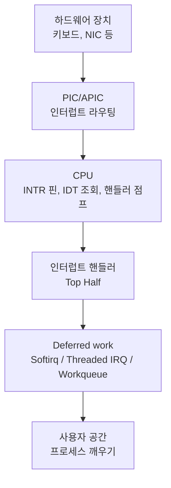
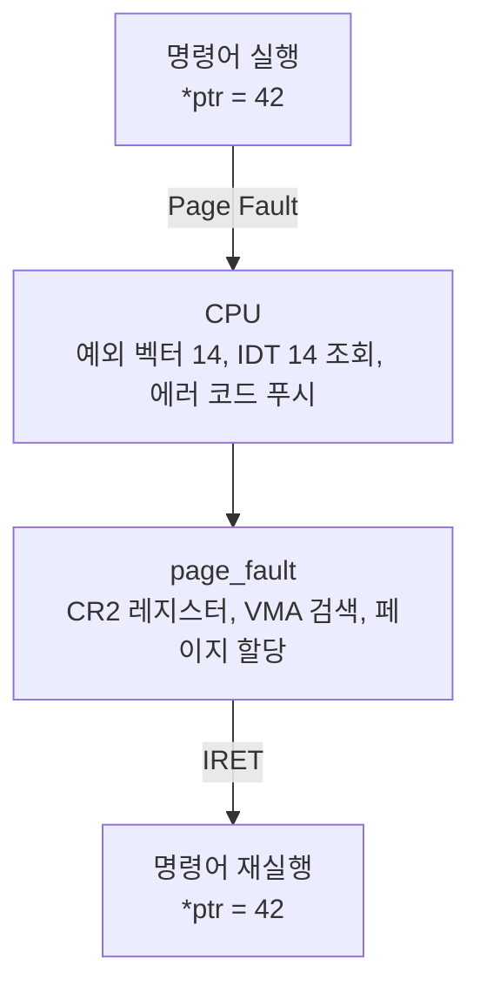

## 들어가며

> "An interrupt is usually defined as an event that alters the sequence of instructions executed by a processor."
> — Daniel P. Bovet, Marco Cesati, *Understanding the Linux Kernel*, Chapter 4


키보드를 누르면 문자가 화면에 나타난다. 네트워크 패킷이 도착하면 프로그램이 이를 처리한다. 디스크 읽기가 완료되면 블록된 프로세스가 깨어난다. 이 모든 일은 어떻게 가능할까?

CPU가 순차적으로 명령어를 실행하는 도중, 외부 하드웨어나 내부 예외 상황이 발생하면 **CPU는 멈춘다**. 정확히는, 현재 실행 흐름을 중단하고, 미리 정의된 핸들러 함수로 점프한다. 이것이 바로 **인터럽트(interrupt)**의 본질이다.

하지만 이 과정은 단순하지 않다. CPU는 어떻게 핸들러 함수의 주소를 찾는가? 인터럽트 발생 시 레지스터는 어떻게 보존되는가? 여러 인터럽트가 동시에 발생하면 어떻게 되는가? 그리고 왜 인터럽트 핸들러에서는 `sleep`을 호출할 수 없는가?

이 글은 인터럽트와 예외의 내부 메커니즘을 깊이 탐구한다. Intel의 IDT(Interrupt Descriptor Table)부터 PIC/APIC 하드웨어, Linux 커널의 인터럽트 처리, Top half/Bottom half 설계까지, CPU가 멈추는 순간부터 다시 돌아오는 순간까지의 전체 여정을 따라간다.


---

## 목차
1. [인터럽트, 예외, 트랩: 용어의 정리](#1-인터럽트-예외-트랩-용어의-정리)
2. [IDT: 인터럽트 디스크립터 테이블](#2-idt-인터럽트-디스크립터-테이블)
3. [하드웨어 인터럽트: PIC에서 APIC까지](#3-하드웨어-인터럽트-pic에서-apic까지)
4. [리눅스의 인터럽트 처리](#4-리눅스의-인터럽트-처리)
5. [Top Half vs Bottom Half](#5-top-half-vs-bottom-half)
6. [Threaded IRQ](#6-threaded-irq)
7. [/proc/interrupts 분석](#7-procinterrupts-분석)
8. [실전 예: 키보드 인터럽트 추적](#8-실전-예-키보드-인터럽트-추적)
9. [인터럽트 처리의 전체 그림](#9-인터럽트-처리의-전체-그림)


---

## 1. 인터럽트, 예외, 트랩: 용어의 정리

### 인터럽트의 분류

Intel 아키텍처에서는 실행 흐름을 변경하는 모든 이벤트를 **인터럽트(interrupt)**라는 포괄적 용어로 부른다. 하지만 발생 원인과 처리 방식에 따라 세밀하게 구분된다.

```text
인터럽트 (Interrupts)
├── 하드웨어 인터럽트 (Hardware Interrupts)
│   ├── Maskable Interrupts (INTR 핀)
│   └── Non-Maskable Interrupts (NMI 핀)
└── 동기 이벤트 (Synchronous Events)
    ├── 예외 (Exceptions)
    │   ├── Faults (복구 가능, 예: Page Fault)
    │   ├── Traps (의도적, 예: Breakpoint)
    │   └── Aborts (치명적, 예: Machine Check)
    └── 소프트웨어 인터럽트 (Programmed Interrupts)
        └── INT n 명령어
```

### 하드웨어 인터럽트

**하드웨어 인터럽트**는 CPU 외부의 장치가 발생시킨다. 이는 비동기적(asynchronous)이다. 즉, 현재 실행 중인 명령어와 무관하게 발생할 수 있다.

**예시:**
- 타이머 인터럽트 (Timer Interrupt): 일정 시간마다 발생
- 키보드 인터럽트: 키를 누를 때 발생
- 네트워크 카드 인터럽트: 패킷이 도착할 때 발생
- 디스크 인터럽트: I/O 작업이 완료될 때 발생

하드웨어 인터럽트는 다시 두 가지로 나뉜다:

**1) Maskable Interrupts**
- INTR 핀을 통해 전달된다
- CPU의 EFLAGS 레지스터의 IF(Interrupt Flag) 비트로 차단 가능하다
- `cli` 명령어로 비활성화, `sti` 명령어로 활성화한다

**2) Non-Maskable Interrupts (NMI)**
- NMI 핀을 통해 전달된다
- 일반적인 IF 비트로 마스크할 수 없다. NMI 처리 중 재진입 차단과 플랫폼별 제어는 별도다.
- 하드웨어 오류, 메모리 패리티 에러 등 치명적 상황에 사용된다

### 예외 (Exceptions)

**예외**는 CPU 내부에서 발생한다. 명령어 실행 중 문제가 생겼을 때 발생하므로, 동기적(synchronous)이다.

Intel SDM은 예외를 세 가지로 분류한다:

**1) Faults (폴트)**
- 복구 가능한 예외
- 예외를 발생시킨 명령어의 **이전 상태**로 복귀한다
- 예외를 처리한 후 **같은 명령어를 재실행**할 수 있다

```c
// Page Fault (#PF, 14번 벡터)
// 가상 주소에 접근했으나 페이지가 메모리에 없을 때
int *ptr = (int *)0x400000;
*ptr = 42;  // Page Fault 발생
            // 커널이 페이지를 로드한 후
            // 이 명령어를 재실행
```

**2) Traps (트랩)**
- 의도적으로 발생시킨 예외
- 예외를 발생시킨 명령어의 **다음 명령어**로 복귀한다
- 디버깅, 시스템 콜 등에 사용된다

```c
// Breakpoint (#BP, 3번 벡터)
__asm__ volatile("int3");  // 디버거가 잡아챈다
// 다음 명령어부터 실행 재개

// Debug Exception (#DB, 1번 벡터)
// 싱글 스텝 실행, 하드웨어 브레이크포인트
```

**3) Aborts (중단)**
- 복구 불가능한 치명적 오류
- 정확한 발생 지점을 특정할 수 없다
- 프로세스를 종료하거나 시스템을 재시작해야 한다

```c
// Machine Check Exception (#MC, 18번 벡터)
// 하드웨어 오류, CPU 과열, 메모리 손상 등
```

### 주요 예외 벡터

Intel x86-64는 0~31번까지 예외를 예약해두었다:

| 벡터 | 니모닉 | 설명 | 타입 | 에러 코드 |
|------|--------|------|------|-----------|
| 0 | #DE | Divide Error (0으로 나누기) | Fault | 없음 |
| 1 | #DB | Debug Exception | Fault/Trap | 없음 |
| 2 | — | NMI Interrupt | NMI | 없음 |
| 3 | #BP | Breakpoint (INT3) | Trap | 없음 |
| 4 | #OF | Overflow (INTO) | Trap | 없음 |
| 5 | #BR | BOUND Range Exceeded | Fault | 없음 |
| 6 | #UD | Invalid Opcode | Fault | 없음 |
| 7 | #NM | Device Not Available | Fault | 없음 |
| 8 | #DF | Double Fault | Abort | 있음 (0) |
| 10 | #TS | Invalid TSS | Fault | 있음 |
| 11 | #NP | Segment Not Present | Fault | 있음 |
| 12 | #SS | Stack-Segment Fault | Fault | 있음 |
| 13 | #GP | General Protection | Fault | 있음 |
| 14 | #PF | Page Fault | Fault | 있음 |
| 16 | #MF | x87 FPU Error | Fault | 없음 |
| 17 | #AC | Alignment Check | Fault | 있음 (0) |
| 18 | #MC | Machine Check | Abort | 없음 |
| 19 | #XM | SIMD FP Exception | Fault | 없음 |

**32~255번**은 사용자 정의 인터럽트로, 운영체제가 하드웨어 인터럽트나 소프트웨어 인터럽트에 할당한다.

### 소프트웨어 인터럽트

소프트웨어 인터럽트는 명시적으로 `INT n` 명령어를 실행하여 발생시킨다:

```c
// x86-64 이전: 시스템 콜을 위해 INT 0x80 사용
__asm__ volatile("int $0x80");  // Linux 32-bit 시스템 콜

// 현대: SYSCALL/SYSENTER 명령어 사용 (더 빠름)
__asm__ volatile("syscall");
```

하지만 `INT` 명령어는 느리다. Intel은 Pentium II부터 `SYSENTER`/`SYSEXIT`를, AMD는 `SYSCALL`/`SYSRETQ`를 도입했다. 이들은 IDT를 거치지 않고 MSR(Model-Specific Register)을 직접 사용한다.

## 2. IDT: 인터럽트 디스크립터 테이블

### IDT의 역할

인터럽트가 발생하면, CPU는 어떻게 해당 핸들러 함수를 찾을까? 답은 **IDT(Interrupt Descriptor Table)**에 있다.

IDT는 256개의 엔트리를 가진 테이블이다. 각 엔트리는 인터럽트 벡터 번호에 대응하는 핸들러 함수의 주소와 속성을 담고 있다.

```text
+-------------------+
| 인터럽트 발생     |
+-------------------+
         |
         v
+-------------------+
| 벡터 번호 추출    | (예: 14번 = Page Fault)
+-------------------+
         |
         v
+-------------------+
| IDT[14] 조회      |
+-------------------+
         |
         v
+-------------------+
| 핸들러 주소 획득  |
+-------------------+
         |
         v
+-------------------+
| 특권 레벨 전환    | (Ring 3 → Ring 0)
+-------------------+
         |
         v
+-------------------+
| 스택 전환         | (User Stack → Kernel Stack)
+-------------------+
         |
         v
+-------------------+
| 핸들러 실행       |
+-------------------+
```

### IDT 엔트리 구조

64비트 모드에서 IDT 엔트리는 **16바이트**다:

```c
/* arch/x86/include/asm/desc_defs.h */
struct gate_struct {
    u16 offset_low;      // 핸들러 주소의 하위 16비트
    u16 segment;         // 코드 세그먼트 셀렉터
    unsigned ist : 3;    // Interrupt Stack Table 인덱스
    unsigned zero : 5;   // 예약 (0)
    unsigned type : 5;   // 게이트 타입
    unsigned dpl : 2;    // Descriptor Privilege Level
    unsigned p : 1;      // Present 플래그
    u16 offset_middle;   // 핸들러 주소의 중간 16비트
    u32 offset_high;     // 핸들러 주소의 상위 32비트
    u32 reserved;        // 예약 (0)
} __attribute__((packed));
```

**주요 필드:**

**1) offset (64비트)**
핸들러 함수의 선형 주소. 인터럽트 발생 시 CPU가 이 주소로 점프한다.

**2) segment (16비트)**
핸들러가 속한 코드 세그먼트의 셀렉터. 64비트 모드에서는 대부분 무시되지만, DPL 검사에 사용된다.

**3) type (5비트)**
게이트 타입을 지정한다:
- `0xE` (1110b): 인터럽트 게이트 (IF 플래그를 자동으로 클리어)
- `0xF` (1111b): 트랩 게이트 (IF 플래그를 유지)

**4) DPL (2비트)**
Descriptor Privilege Level. 이 게이트를 호출할 수 있는 최소 권한 레벨.
- Ring 0 (커널): DPL = 0
- Ring 3 (사용자): DPL = 3

`INT n` 명령어 실행 시 수치 비교는 `CPL <= gate.DPL`이어야 한다. x86 privilege는 숫자가 작을수록 높으므로 Ring 3 코드가 호출할 수 있는 gate는 보통 DPL 3이다. 예외와 외부 하드웨어 인터럽트는 이 software-INT DPL 검사를 같은 방식으로 적용하지 않는다.

**5) IST (3비트)**
Interrupt Stack Table 인덱스. 0이 아니면, TSS에 정의된 IST[n] 스택으로 전환한다. 중첩 인터럽트나 NMI 처리에 사용된다.

### IDT 등록

부팅 시 커널은 `lidt` 명령어로 IDT를 등록한다:

```c
/* arch/x86/kernel/idt.c */
static gate_desc idt_table[IDT_ENTRIES] __page_aligned_bss;

void __init idt_setup_early_handler(void)
{
    int i;

    for (i = 0; i < NUM_EXCEPTION_VECTORS; i++)
        set_intr_gate(i, early_idt_handler_array[i]);

    load_idt(&idt_descr);
}

static inline void load_idt(const struct desc_ptr *dtr)
{
    asm volatile("lidt %0"::"m" (*dtr));
}
```

`lidt` 명령어는 IDTR(IDT Register)에 IDT의 주소와 크기를 저장한다:

```text
IDTR (80비트)
+-----------------------------------+
| Limit (16비트) | Base (64비트)   |
+-----------------------------------+
```

- **Limit**: IDT의 크기 - 1 (바이트 단위). 256개 엔트리 × 16바이트 = 4096바이트 → Limit = 4095
- **Base**: IDT의 선형 주소

### IDT 엔트리 설정

리눅스는 `set_intr_gate` 등의 헬퍼 함수로 IDT 엔트리를 설정한다:

```c
/* arch/x86/kernel/idt.c */
static void set_intr_gate(unsigned int n, const void *addr)
{
    struct idt_data data;

    BUG_ON(n > 0xFF);

    memset(&data, 0, sizeof(data));
    data.vector     = n;
    data.addr       = addr;
    data.segment    = __KERNEL_CS;  // 커널 코드 세그먼트
    data.bits.type  = GATE_INTERRUPT;  // 인터럽트 게이트
    data.bits.p     = 1;  // Present

    idt_setup_from_table(idt_table, &data, 1, false);
}
```

**예: Page Fault 핸들러 등록**

```c
/* arch/x86/kernel/idt.c */
static const __initconst struct idt_data def_idts[] = {
    INTG(X86_TRAP_DE,       divide_error),        // 0: Divide Error
    INTG(X86_TRAP_DB,       debug),               // 1: Debug
    INTG(X86_TRAP_NMI,      nmi),                 // 2: NMI
    SYSG(X86_TRAP_BP,       int3),                // 3: Breakpoint
    SYSG(X86_TRAP_OF,       overflow),            // 4: Overflow
    // ...
    INTG(X86_TRAP_PF,       page_fault),          // 14: Page Fault
    // ...
};
```

`INTG` 매크로는 인터럽트 게이트를 생성한다:

```c
#define INTG(_vector, _addr) \
    { .vector = _vector, .addr = _addr, .segment = __KERNEL_CS, \
      .bits.type = GATE_INTERRUPT, .bits.p = 1 }
```

### 인터럽트 발생 시 CPU 동작

인터럽트가 발생하면 CPU는 아래 순서로 상태를 전환한다(Intel SDM Volume 3, Chapter 6.12).

**1) 벡터 번호 결정**
- 하드웨어 인터럽트: PIC/APIC가 제공
- 예외: CPU가 내부적으로 결정
- INT n: 명령어에 명시

**2) IDT 엔트리 조회**
```c
gate = idt_table[vector];
```

**3) 권한 검사**
- 예외/하드웨어 인터럽트: 검사 없음
- INT n: CPL ≤ gate.DPL 확인

**4) 스택 결정**
- 권한 레벨 변경 (예: Ring 3 → Ring 0): TSS에서 커널 스택 획득
- IST 사용: TSS.IST[n] 스택 사용
- 권한 레벨 유지: 현재 스택 유지

**5) 스택에 현재 상태 저장**

인터럽트 게이트의 경우 (64비트 모드):
```text
+------------------------+  <-- 높은 주소
| SS                     |  (권한 레벨 변경 시)
| RSP                    |  (권한 레벨 변경 시, 복귀용 old/사용자 RSP 값)
| RFLAGS                 |
| CS                     |
| RIP                    |
| Error Code (선택적)    |  <-- 새로운 RSP (error code가 없으면 RIP)
+------------------------+  <-- 낮은 주소
```

프레임은 SS를 가장 높은 주소에, RIP와 error code를 가장 낮은 주소에 둔다. error code가 없는 인터럽트에서는 현재 커널 RSP가 RIP 슬롯을 가리키고, error code를 푸시하는 예외에서는 error code 슬롯을 가리킨다. `RSP` 슬롯에 들어 있는 값은 저장된 old(사용자) RSP이지 현재 RSP가 아니다.

**6) RFLAGS 수정**
- 인터럽트 게이트: IF = 0 (인터럽트 비활성화)
- 트랩 게이트: IF 유지

**7) 핸들러로 점프**
```c
CS = gate.segment;
RIP = gate.offset;
```

**8) 핸들러 실행**

## 3. 하드웨어 인터럽트: PIC에서 APIC까지

### PIC: Programmable Interrupt Controller

초기 x86 시스템은 **8259 PIC**를 사용했다. 이는 8개의 인터럽트 라인(IRQ0~IRQ7)을 지원하는 간단한 칩이다.

```text
           +--------+
IRQ0 ----->|        |
IRQ1 ----->|        |
IRQ2 ----->| 8259A  |---> INT (CPU의 INTR 핀)
  ...      |  PIC   |
IRQ7 ----->|        |
           +--------+
```

하지만 8개로는 부족했다. IBM PC AT는 두 개의 PIC를 **캐스케이드(cascade)** 방식으로 연결했다:

```text
           +--------+           +--------+
IRQ0 ----->|        |    IRQ8 ->|        |
IRQ1 ----->| Master |   IRQ9 -->| Slave  |
IRQ2 ----->|  PIC   |<--IRQ2----|  PIC   |
  ...      | 8259A  |    ...    | 8259A  |
IRQ7 ----->|        |   IRQ15-->|        |
           +--------+           +--------+
                |
                +---> INT (CPU)
```

- Master PIC: IRQ0~IRQ7
- Slave PIC: IRQ8~IRQ15
- Slave의 INT 출력은 Master의 IRQ2에 연결

**주요 IRQ:**
- IRQ0: System Timer (PIT)
- IRQ1: Keyboard
- IRQ2: Cascade from Slave PIC
- IRQ3: COM2 (Serial Port)
- IRQ4: COM1 (Serial Port)
- IRQ6: Floppy Disk Controller
- IRQ8: Real-Time Clock (RTC)
- IRQ14: Primary IDE Controller
- IRQ15: Secondary IDE Controller

### PIC의 한계

PIC는 여러 한계가 있었다:

**1) 제한된 IRQ 개수**
16개만 지원. 현대 시스템은 수십~수백 개의 장치를 가진다.

**2) 멀티프로세서 미지원**
단일 CPU만 지원. 모든 인터럽트가 하나의 CPU로 집중된다.

**3) 우선순위 고정**
IRQ0이 가장 높고 IRQ7이 가장 낮다. Slave PIC가 Master의 IRQ2에 물려 있어 IRQ8~IRQ15는 IRQ1과 IRQ3 사이의 우선순위를 물려받는다. 배선으로 고정된 순서라 유연한 우선순위 설정이 불가능하다.

**4) Edge-triggered 모드**
레벨 트리거 모드가 불완전하다. 인터럽트 손실 가능성이 있다.

### APIC: Advanced PIC

Intel은 Pentium 프로세서부터 **APIC(Advanced Programmable Interrupt Controller)**를 도입했다. APIC는 두 부분으로 구성된다:

**1) Local APIC (LAPIC)**
- 각 CPU 코어에 내장된 인터럽트 컨트롤러
- 로컬 인터럽트 처리: Timer, Performance Monitoring, Thermal Sensor
- IPI(Inter-Processor Interrupt) 송수신
- 메모리 맵 I/O로 접근 (기본 주소: 0xFEE00000)

**2) I/O APIC**
- 외부 장치의 인터럽트를 관리
- 최대 24개의 인터럽트 입력 (확장 가능)
- 인터럽트를 특정 CPU로 라우팅 가능
- 메모리 맵 I/O로 접근 (기본 주소: 0xFEC00000)

```text
+----------+    +----------+    +----------+
| CPU 0    |    | CPU 1    |    | CPU 2    |
| +------+ |    | +------+ |    | +------+ |
| |LAPIC | |    | |LAPIC | |    | |LAPIC | |
| +------+ |    | +------+ |    | +------+ |
+----+-----+    +----+-----+    +----+-----+
     |               |               |
     +---------------+---------------+
                     |
              System Bus
                     |
              +------+------+
              |  I/O APIC   |
              +------+------+
                     |
     +---------------+---------------+
     |               |               |
  Keyboard        NIC            Disk
```

### APIC의 장점

**1) 멀티프로세서 지원**
각 CPU가 자신의 LAPIC를 가진다. 인터럽트를 특정 CPU나 CPU 그룹으로 전달할 수 있다.

**2) 많은 인터럽트 벡터**
224개의 벡터 사용 가능 (32~255번).

**3) 유연한 라우팅**
I/O APIC의 각 입력은 개별적으로 설정 가능:
- 목적지 CPU 선택
- 전달 모드 (Fixed, Lowest Priority, SMI, NMI, INIT, ExtINT)
- 트리거 모드 (Edge/Level)
- 극성 (Active High/Low)

**4) IPI (Inter-Processor Interrupt)**
CPU 간 통신. TLB shootdown, 스케줄링, 시스템 종료 등에 사용된다.

```c
/* arch/x86/kernel/apic/ipi.c */
void native_send_call_func_ipi(const struct cpumask *mask)
{
    // 다른 CPU들에게 함수 실행 요청
    apic->send_IPI_mask(mask, CALL_FUNCTION_VECTOR);
}
```

### I/O APIC 리다이렉션 테이블

I/O APIC의 핵심은 **Redirection Table**이다. 각 엔트리는 하나의 인터럽트 입력을 어떻게 처리할지 정의한다:

```c
/* arch/x86/include/asm/io_apic.h */
struct IO_APIC_route_entry {
    __u32 vector        :  8;  // 인터럽트 벡터 (32~255)
    __u32 delivery_mode :  3;  // 전달 모드
    __u32 dest_mode     :  1;  // 목적지 모드 (Physical/Logical)
    __u32 delivery_status : 1; // 전달 상태
    __u32 polarity      :  1;  // 극성 (0=High, 1=Low)
    __u32 irr           :  1;  // Remote IRR
    __u32 trigger       :  1;  // 트리거 (0=Edge, 1=Level)
    __u32 mask          :  1;  // 마스크 (0=Enabled, 1=Disabled)
    __u32 __reserved_2  : 15;

    __u32 __reserved_3  : 24;
    __u32 dest          :  8;  // 목적지 APIC ID
} __attribute__ ((packed));
```

**설정 예:**

```c
/* 네트워크 카드 인터럽트를 CPU 2에 할당 */
entry.vector = 35;              // IRQ 벡터 35번
entry.delivery_mode = 0;        // Fixed 모드
entry.dest_mode = 0;            // Physical 모드
entry.trigger = 1;              // Level-triggered
entry.polarity = 0;             // Active High
entry.mask = 0;                 // 활성화
entry.dest = 2;                 // LAPIC ID 2 (CPU 2)
```

### MSI/MSI-X: Message Signaled Interrupts

PCI Express 시대에는 **MSI(Message Signaled Interrupts)**가 표준이 되었다. 기존 방식은 물리적 인터럽트 라인을 사용했지만, MSI는 **메모리 쓰기**로 인터럽트를 전달한다.

**장점:**
- 물리적 인터럽트 라인 불필요
- MSI-X 테이블은 장치당 최대 2048개 엔트리를 표현할 수 있다. 실제 할당 수는 장치·OS·CPU 벡터 자원에 제한된다.
- 더 나은 성능 (레이턴시 감소)
- 디바이스별 전용 인터럽트

```c
/* drivers/pci/msi.c */
int pci_enable_msix_range(struct pci_dev *dev,
                          struct msix_entry *entries,
                          int minvec, int maxvec)
{
    // MSI-X 활성화
    // 각 엔트리는 독립적인 인터럽트 벡터를 가진다
}
```

**MSI-X의 구조:**

```text
PCI Device
+---------------------------+
| MSI-X Capability          |
| +----------------------+  |
| | Message Address      |  |  (LAPIC 주소: 0xFEE00xxx)
| | Message Data         |  |  (벡터 번호)
| +----------------------+  |
+---------------------------+
         |
         | 메모리 쓰기
         v
+---------------------------+
| Local APIC (CPU)          |
| 0xFEE00000 + offset       |
+---------------------------+
```

디바이스가 특정 메모리 주소에 쓰면, LAPIC가 이를 인터럽트로 인식한다.

## 4. 리눅스의 인터럽트 처리

### 인터럽트 핸들러 등록

디바이스 드라이버는 `request_irq`로 인터럽트 핸들러를 등록한다:

```c
/* include/linux/interrupt.h */
int request_irq(unsigned int irq, irq_handler_t handler,
                unsigned long flags, const char *name, void *dev)
```

**파라미터:**
- `irq`: IRQ 번호 (논리적 번호, 하드웨어 IRQ와 다를 수 있음)
- `handler`: 인터럽트 핸들러 함수
- `flags`: 플래그
 - `IRQF_SHARED`: 다른 디바이스와 IRQ 공유
 - `IRQF_TRIGGER_RISING`: Rising edge 트리거
 - `IRQF_ONESHOT`: 핸들러 완료까지 IRQ 비활성화
- `name`: 인터럽트 이름 (`/proc/interrupts`에 표시)
- `dev`: 디바이스 식별자 (공유 IRQ에서 중요)

**예: 네트워크 드라이버**

```c
/* drivers/net/ethernet/intel/e1000/e1000_main.c */
static int e1000_request_irq(struct e1000_adapter *adapter)
{
    struct net_device *netdev = adapter->netdev;
    int err;

    err = request_irq(adapter->pdev->irq, e1000_intr,
                      IRQF_SHARED, netdev->name, netdev);
    if (err)
        netdev_err(netdev, "Unable to allocate interrupt\n");

    return err;
}

static irqreturn_t e1000_intr(int irq, void *data)
{
    struct net_device *netdev = data;
    struct e1000_adapter *adapter = netdev_priv(netdev);

    // 인터럽트 원인 확인
    u32 icr = er32(ICR);
    if (!icr)
        return IRQ_NONE;  // 이 디바이스의 인터럽트가 아님

    // 패킷 수신 처리
    if (icr & E1000_ICR_RXT0)
        e1000_clean_rx_irq(adapter);

    // 송신 완료 처리
    if (icr & E1000_ICR_TXDW)
        e1000_clean_tx_irq(adapter);

    return IRQ_HANDLED;
}
```

### 인터럽트 핸들러의 반환값

핸들러는 `irqreturn_t`를 반환한다:

```c
typedef enum irqreturn {
    IRQ_NONE        = (0 << 0),  // 이 디바이스의 인터럽트 아님
    IRQ_HANDLED     = (1 << 0),  // 처리 완료
    IRQ_WAKE_THREAD = (1 << 1),  // Threaded handler 깨우기
} irqreturn_t;
```

**IRQ_NONE의 중요성:**
공유 IRQ에서 여러 디바이스가 같은 IRQ 라인을 사용할 수 있다. 각 핸들러는 자신의 디바이스가 인터럽트를 발생시켰는지 확인하고, 아니면 `IRQ_NONE`을 반환해야 한다.

### 공유 인터럽트 (Shared IRQ)

PCI 시스템에서는 여러 디바이스가 같은 IRQ를 공유할 수 있다:

```c
/* kernel/irq/manage.c */
static int __setup_irq(unsigned int irq, struct irq_desc *desc,
                       struct irqaction *new)
{
    // 이미 등록된 핸들러가 있는가?
    if (old) {
        // 둘 다 IRQF_SHARED인가?
        if (!((old->flags & new->flags) & IRQF_SHARED)) {
            pr_err("IRQ %d not shareable\n", irq);
            return -EBUSY;
        }
        // 핸들러를 리스트에 추가
        old->next = new;
    } else {
        desc->action = new;
    }
}
```

인터럽트 발생 시 모든 핸들러가 순차적으로 호출된다:

```c
/* kernel/irq/handle.c */
irqreturn_t handle_irq_event(struct irq_desc *desc)
{
    irqreturn_t ret = IRQ_NONE;
    struct irqaction *action;

    for_each_action_of_desc(desc, action) {
        irqreturn_t res;

        res = action->handler(desc->irq_data.irq, action->dev_id);

        switch (res) {
        case IRQ_WAKE_THREAD:
            /* threaded handler를 실행할 IRQ thread를 깨운다 */
            __irq_wake_thread(desc, action);
            ret = IRQ_HANDLED;
            break;
        case IRQ_HANDLED:
            ret = IRQ_HANDLED;
            break;
        default:
            break;
        }
    }

    return ret;
}
```

### 인터럽트 컨텍스트의 제약

인터럽트 핸들러는 **인터럽트 컨텍스트**에서 실행된다. 이는 프로세스 컨텍스트와 다르며, 엄격한 제약이 있다:

**1) 슬립 불가**
```c
// 인터럽트 핸들러 안에서 절대 금지!
sleep();
msleep(100);
wait_event(queue, condition);
mutex_lock(&lock);  // 슬립 가능한 뮤텍스
down(&sem);         // 세마포어
```

**이유:** 인터럽트 컨텍스트는 프로세스가 아니다. `task_struct`는 있지만, 스케줄러가 "잠들게" 할 수 없다. 슬립하면 시스템이 패닉에 빠진다.

**2) 프로세스 컨텍스트 접근 불가**
```c
// 현재 프로세스의 정보를 가정하면 안 됨
struct task_struct *current;  // 이것은 인터럽트 시점의 '임의의' 프로세스
current->mm;  // 잘못된 가정
```

**3) 스택 공간 제한**
인터럽트 경로는 제한된 커널·entry stack 예산 안에서 실행된다. `THREAD_SIZE`와 별도 IRQ/IST stack의 크기·사용 조건은 아키텍처와 kernel config에 따라 다르므로 8KiB나 16KiB를 공통 계약으로 삼지 않는다. 큰 지역 배열과 재귀를 피하고 대상 빌드의 stack-usage 분석을 확인한다.

**4) 빠른 실행**
인터럽트는 다른 작업을 블록한다. 가능한 한 빨리 완료해야 한다.

**허용되는 것:**
```c
// 스핀락 (슬립하지 않음)
spin_lock(&lock);
spin_unlock(&lock);

// 원자적 변수
atomic_inc(&count);

// 메모리 할당 (GFP_ATOMIC)
ptr = kmalloc(size, GFP_ATOMIC);

// Wake-up
wake_up(&queue);
```

### 인터럽트 비활성화

때로는 인터럽트를 일시적으로 비활성화해야 한다:

**1) 로컬 인터럽트 비활성화 (현재 CPU만)**
```c
/* include/linux/irqflags.h */
unsigned long flags;

local_irq_save(flags);       // 인터럽트 비활성화 + 이전 상태 저장
// 크리티컬 섹션
local_irq_restore(flags);    // 이전 상태 복원

// 또는 (상태 저장 없이)
local_irq_disable();         // IF = 0
// 크리티컬 섹션
local_irq_enable();          // IF = 1
```

**2) 특정 IRQ 비활성화 (모든 CPU)**
```c
void disable_irq(unsigned int irq);     // 동기적 (진행 중인 핸들러 대기)
void disable_irq_nosync(unsigned int irq); // 비동기적 (즉시 반환)
void enable_irq(unsigned int irq);
```

**3) Bottom half 비활성화**
```c
local_bh_disable();
// 크리티컬 섹션
local_bh_enable();
```

**주의:** 인터럽트를 너무 오래 비활성화하면 시스템 응답성이 떨어진다. 타이머 인터럽트를 놓치면 스케줄링이 지연된다.

## 5. Top Half vs Bottom Half

### 문제의식

인터럽트 핸들러는 빨리 완료해야 한다. 하지만 실제 작업은 복잡하고 시간이 걸릴 수 있다. 예를 들어:

- **네트워크 카드**: 패킷을 읽어 프로토콜 스택을 통과시켜야 한다
- **디스크 컨트롤러**: 데이터를 사용자 버퍼로 복사해야 한다
- **키보드**: 입력을 버퍼링하고 프로세스를 깨워야 한다

모든 작업을 인터럽트 핸들러에서 하면:
- 인터럽트가 오래 비활성화된다
- 다른 인터럽트가 지연된다
- 시스템 응답성이 떨어진다

해결책은 **Top Half/Bottom Half** 분리다.

### Top Half와 Bottom Half

**Top Half (하드 IRQ 컨텍스트)**
- 인터럽트 핸들러 자체
- 최소한의 작업만 수행:
 1. 하드웨어 인터럽트 확인/클리어
 2. 데이터 읽기 (빠르게)
 3. Bottom half 스케줄링
- 인터럽트 비활성화 상태에서 실행 (인터럽트 게이트)

**Bottom Half / 지연 처리**
- 지연 가능한 작업 수행:
 1. 데이터 처리
 2. 프로토콜 스택 통과
 3. 사용자 공간에 데이터 전달
- softirq와 tasklet은 일반적으로 슬립할 수 없는 문맥에서 실행
- workqueue는 커널 워커 스레드의 프로세스 문맥에서 실행하므로 슬립 가능

```text
하드웨어 인터럽트 발생
         |
         v
+------------------+
| Top Half         |  <-- 인터럽트 핸들러 (빠름)
| - 하드웨어 확인  |
| - 데이터 읽기    |
| - BH 스케줄     |
+------------------+
         |
         | (나중에)
         v
+------------------+
| Bottom Half      |  <-- 소프트IRQ/Tasklet/Workqueue
| - 데이터 처리    |
| - 복잡한 로직    |
| - 느린 작업      |
+------------------+
```

### Softirq (소프트 인터럽트)

Softirq는 리눅스의 가장 기본적인 bottom half 메커니즘이다. 정적으로 정의된 10개의 softirq가 있다:

```c
/* include/linux/interrupt.h */
enum
{
    HI_SOFTIRQ=0,        // 높은 우선순위 tasklet
    TIMER_SOFTIRQ,       // 타이머
    NET_TX_SOFTIRQ,      // 네트워크 송신
    NET_RX_SOFTIRQ,      // 네트워크 수신
    BLOCK_SOFTIRQ,       // 블록 디바이스
    IRQ_POLL_SOFTIRQ,    // IRQ 폴링
    TASKLET_SOFTIRQ,     // 일반 tasklet
    SCHED_SOFTIRQ,       // 스케줄러
    HRTIMER_SOFTIRQ,     // 고해상도 타이머
    RCU_SOFTIRQ,         // RCU 콜백

    NR_SOFTIRQS
};
```

**Softirq 등록:**

```c
/* kernel/softirq.c */
void open_softirq(int nr, void (*action)(struct softirq_action *))
{
    softirq_vec[nr].action = action;
}

// 네트워크 서브시스템 초기화 시
open_softirq(NET_RX_SOFTIRQ, net_rx_action);
open_softirq(NET_TX_SOFTIRQ, net_tx_action);
```

**Softirq 발생:**

```c
void raise_softirq(unsigned int nr)
{
    unsigned long flags;

    local_irq_save(flags);
    raise_softirq_irqoff(nr);  // 비트 설정
    local_irq_restore(flags);
}
```

**Softirq 실행:**

Softirq는 다음 시점에 실행된다:
1. 하드웨어 인터럽트 핸들러 반환 시 (`irq_exit`)
2. `ksoftirqd` 커널 스레드에서
3. `local_bh_enable` 호출 시

```c
/* kernel/softirq.c */
asmlinkage __visible void do_softirq(void)
{
    __u32 pending;
    unsigned long flags;

    if (in_interrupt())  // 중첩 방지
        return;

    local_irq_save(flags);
    pending = local_softirq_pending();

    if (pending)
        __do_softirq();

    local_irq_restore(flags);
}

asmlinkage __visible void __do_softirq(void)
{
    struct softirq_action *h;
    __u32 pending;
    int max_restart = MAX_SOFTIRQ_RESTART;

    pending = local_softirq_pending();

restart:
    set_softirq_pending(0);
    local_irq_enable();  // 인터럽트 다시 활성화!

    h = softirq_vec;

    while (pending) {
        if (pending & 1)
            h->action(h);
        h++;
        pending >>= 1;
    }

    local_irq_disable();

    pending = local_softirq_pending();
    if (pending && --max_restart)
        goto restart;

    // 너무 많으면 ksoftirqd에 위임
    if (pending)
        wakeup_softirqd();
}
```

**주의:** Softirq는 동시에 여러 CPU에서 실행될 수 있다! 동기화가 필요하다.

### Tasklet (역사적 메커니즘, 신규 코드에서는 권장 안 함)

Tasklet은 softirq 위에 구축된 더 간단한 메커니즘이다. 같은 tasklet은 동시에 실행되지 않는다(단순화). 다만 현대 커널에서는 새 코드에 tasklet을 도입하는 것을 권장하지 않는다. 한 번 dispatch된 tasklet은 막을 수 없고, latency 보장이 약하며, 멀티큐 시대의 워크로드와 잘 맞지 않기 때문이다. 새 드라이버에서는 다음 대안을 사용한다.

- **threaded IRQ**: `request_threaded_irq`로 핸들러를 커널 스레드에서 실행. preemption 가능하고 RT 친화적.
- **workqueue / kworker**: 비긴급 후속 처리. CPU/cgroup 친화도와 batching이 가능.
- **NAPI / softirq**: 네트워크 등 처리량 위주 경로.
- **kthread**: 장시간 동작하는 커스텀 작업.

따라서 아래 tasklet 설명은 기존 코드 베이스를 읽기 위한 참고 자료로 본다.

```c
/* include/linux/interrupt.h */
struct tasklet_struct {
    struct tasklet_struct *next;
    unsigned long state;     // TASKLET_STATE_SCHED, TASKLET_STATE_RUN
    atomic_t count;          // disable 카운터 (0 = 활성화, >0 = 비활성화)
    void (*func)(unsigned long);
    unsigned long data;
};
```

**Tasklet 정의 및 초기화:**

```c
void my_tasklet_func(unsigned long data);

DECLARE_TASKLET(my_tasklet, my_tasklet_func, 0);

// 또는 동적 초기화
struct tasklet_struct my_tasklet;
tasklet_init(&my_tasklet, my_tasklet_func, 0);
```

**Tasklet 스케줄:**

```c
/* 인터럽트 핸들러에서 */
static irqreturn_t my_interrupt(int irq, void *dev_id)
{
    // Top half: 빠른 작업
    read_hardware_registers();

    // Bottom half 스케줄
    tasklet_schedule(&my_tasklet);

    return IRQ_HANDLED;
}

/* Bottom half */
void my_tasklet_func(unsigned long data)
{
    // 느린 작업
    process_data();
    update_buffers();
}
```

**Tasklet 내부 구조:**

Tasklet은 `TASKLET_SOFTIRQ`와 `HI_SOFTIRQ`를 사용한다:

```c
/* kernel/softirq.c */
static void tasklet_action(struct softirq_action *a)
{
    struct tasklet_struct *list;

    local_irq_disable();
    list = __this_cpu_read(tasklet_vec.head);
    __this_cpu_write(tasklet_vec.head, NULL);
    __this_cpu_write(tasklet_vec.tail, this_cpu_ptr(&tasklet_vec.head));
    local_irq_enable();

    while (list) {
        struct tasklet_struct *t = list;
        list = list->next;

        // 다른 CPU에서 실행 중?
        if (tasklet_trylock(t)) {
            if (atomic_read(&t->count) == 0) {
                // 실행 전에 SCHED를 지워야 다음 schedule이 pending으로 오판하지 않는다
                if (!test_and_clear_bit(TASKLET_STATE_SCHED, &t->state))
                    BUG();
                t->func(t->data);
                tasklet_unlock(t);
                continue;
            }
            tasklet_unlock(t);
        }

        // 다른 CPU가 실행 중이거나 count != 0(비활성)이면 다시 큐에 넣는다
        local_irq_disable();
        t->next = NULL;
        *__this_cpu_read(tasklet_vec.tail) = t;
        __this_cpu_write(tasklet_vec.tail, &t->next);
        __raise_softirq_irqoff(TASKLET_SOFTIRQ);
        local_irq_enable();
    }
}
```

**Tasklet vs Softirq:**

| 특성 | Softirq | Tasklet |
|------|---------|---------|
| 동시 실행 | 같은 vector가 여러 CPU에서 실행 가능 | 동일 tasklet instance의 동시 실행을 직렬화 |
| 실행 문맥 | atomic context, sleep 불가 | softirq 위의 atomic context, sleep 불가 |
| 소유 방식 | kernel subsystem이 정적으로 정의 | 역사적 driver 편의 wrapper |
| 신규 코드 | 기존 subsystem API를 통해 사용 | 도입하지 않고 threaded IRQ/workqueue 검토 |

### Workqueue

Tasklet은 여전히 인터럽트 컨텍스트의 제약을 받는다. **슬립할 수 없다**. 진짜 슬립이 필요하면 **Workqueue**를 사용한다.

Workqueue는 **커널 스레드**에서 작업을 실행한다. 프로세스 컨텍스트이므로 슬립, 뮤텍스, 스케줄링이 모두 가능하다.

```c
/* include/linux/workqueue.h */
struct work_struct {
    atomic_long_t data;
    struct list_head entry;
    work_func_t func;
};
```

**Work 정의 및 초기화:**

```c
void my_work_func(struct work_struct *work);

DECLARE_WORK(my_work, my_work_func);

// 또는 동적 초기화
struct work_struct my_work;
INIT_WORK(&my_work, my_work_func);
```

**Work 스케줄:**

```c
/* 인터럽트 핸들러에서 */
static irqreturn_t my_interrupt(int irq, void *dev_id)
{
    // Top half
    read_hardware();

    // Workqueue로 지연
    schedule_work(&my_work);

    return IRQ_HANDLED;
}

/* 워커 스레드에서 실행 */
void my_work_func(struct work_struct *work)
{
    // 슬립 가능!
    mutex_lock(&my_mutex);

    if (need_io())
        msleep(100);  // OK!

    process_data();

    mutex_unlock(&my_mutex);
}
```

**전용 Workqueue 생성:**

```c
struct workqueue_struct *my_wq;

my_wq = create_workqueue("my_queue");
// 또는
my_wq = alloc_workqueue("my_queue", WQ_UNBOUND | WQ_HIGHPRI, 0);

// Work 큐잉
queue_work(my_wq, &my_work);

// 정리
destroy_workqueue(my_wq);
```

**Delayed Work:**

```c
struct delayed_work my_delayed_work;

INIT_DELAYED_WORK(&my_delayed_work, my_work_func);

// 100ms 후 실행
schedule_delayed_work(&my_delayed_work, msecs_to_jiffies(100));

// 취소
cancel_delayed_work_sync(&my_delayed_work);
```

### Bottom Half 메커니즘 선택

| 요구사항 | 메커니즘 |
|----------|----------|
| subsystem이 소유한 높은 처리량 atomic path | Softirq/NAPI 같은 해당 subsystem API |
| 장치 IRQ의 지연 가능한 handler | Threaded IRQ |
| 슬립 가능한 후속 작업 | Workqueue |
| 지연 실행 필요 | Delayed Work |
| 주기적 실행 | Timer가 work를 예약하거나 delayed work 재예약 |
| 다른 프로세스 깨우기만 | wake_up in 인터럽트 핸들러 |

Tasklet은 기존 driver를 읽고 제거 경로를 유지하기 위한 항목이며 신규 설계의 선택지로 두지 않는다.

**일반적인 패턴:**

```c
/* 네트워크 드라이버 */
IRQ Handler (Top Half)
    → NAPI poll 스케줄 (Softirq)
        → 패킷 처리
            → 프로토콜 스택 (소프트IRQ 컨텍스트)

/* 블록 디바이스 드라이버 */
IRQ Handler (Top Half)
    → BLOCK_SOFTIRQ 또는 완료 IPI
        → 완료된 요청 처리
            → Bio 완료 콜백

/* 복잡한 드라이버 (슬립 필요) */
IRQ Handler (Top Half)
    → Workqueue에 큐잉
        → 데이터 처리 (뮤텍스 사용 가능)
        → I2C/SPI 통신 (슬립 가능)
```

## 6. Threaded IRQ

### Threaded IRQ의 등장

전통적인 Top Half/Bottom Half 모델은 복잡하다. 실시간 시스템에서는 인터럽트 레이턴시가 중요한데, 하드 IRQ가 다른 작업을 프리엠트하는 것이 문제가 될 수 있다.

**Threaded IRQ**는 이를 단순화한다. 인터럽트 핸들러를 커널 스레드에서 실행하는 것이다.

```c
/* include/linux/interrupt.h */
int request_threaded_irq(unsigned int irq,
                         irq_handler_t handler,           // Primary handler
                         irq_handler_t thread_fn,         // Threaded handler
                         unsigned long flags,
                         const char *name,
                         void *dev)
```

**동작 방식:**

1. 하드웨어 인터럽트 발생
2. **Primary handler** 실행 (하드 IRQ 컨텍스트, 선택적)
 - 빠른 확인
 - 하드웨어 인터럽트 비활성화
 - `IRQ_WAKE_THREAD` 반환
3. **Threaded handler** 깨우기 (커널 스레드)
4. Threaded handler 실행 (프로세스 컨텍스트)
 - 슬립 가능
 - 복잡한 처리
5. 하드웨어 인터럽트 재활성화

**예:**

```c
/* drivers/input/touchscreen/goodix.c */
static int goodix_ts_probe(struct i2c_client *client)
{
    // ...

    error = devm_request_threaded_irq(&client->dev, client->irq,
                                       NULL,              // Primary handler 없음
                                       goodix_ts_irq_handler,  // Threaded
                                       IRQF_TRIGGER_RISING | IRQF_ONESHOT,
                                       client->name, ts);
    // ...
}

static irqreturn_t goodix_ts_irq_handler(int irq, void *dev_id)
{
    struct goodix_ts_data *ts = dev_id;

    // 슬립 가능!
    goodix_i2c_read(...);  // I2C는 슬립할 수 있음

    // 터치 이벤트 처리
    goodix_process_events(ts);

    return IRQ_HANDLED;
}
```

**IRQF_ONESHOT:**
threaded handler가 완료될 때까지 IRQ 라인을 마스크하는 정책이다. primary handler가 없을 때 필요 여부는 IRQ 컨트롤러의 oneshot-safe 특성과 커널 검사에 따라 달라지며, 레벨 트리거 장치에서 반복 인터럽트를 막는 데 흔히 사용한다.

### 실시간 커널에서의 Threaded IRQ

`PREEMPT_RT`는 가능한 대부분의 interrupt handler를 선점 가능한 IRQ thread 문맥으로 옮겨 긴 비선점 구간을 줄인다. 그러나 `IRQF_NO_THREAD`로 표시된 handler, per-CPU timer 등 저수준 예외와 IRQ thread를 깨우기 위한 짧은 hard-IRQ 구간은 남는다.

```bash
$ ps aux | grep irq
root         3  0.0  0.0      0     0 ?        S    00:00   0:00 [ksoftirqd/0]
root        16  0.0  0.0      0     0 ?        S    00:00   0:00 [irq/9-acpi]
root        48  0.0  0.0      0     0 ?        S    00:00   0:00 [irq/12-i8042]
root        49  0.0  0.0      0     0 ?        S    00:00   0:00 [irq/1-i8042]
root        52  0.0  0.0      0     0 ?        S    00:00   0:00 [irq/14-ata_piix]
```

threaded IRQ에는 스케줄링 우선순위를 줄 수 있다. 애플리케이션 thread를 IRQ thread보다 높이면 장치 completion 처리가 굶을 수 있으므로, 우선순위는 end-to-end latency와 의존 관계를 보고 정해야 한다.

## 7. /proc/interrupts 분석

### /proc/interrupts 읽기

```bash
$ cat /proc/interrupts
           CPU0       CPU1       CPU2       CPU3
  0:         42          0          0          0  IR-IO-APIC    2-edge      timer
  1:          9          0          0          0  IR-IO-APIC    1-edge      i8042
  8:          0          0          0          0  IR-IO-APIC    8-edge      rtc0
  9:          0          0          0          0  IR-IO-APIC    9-fasteoi   acpi
 12:        155          0          0          0  IR-IO-APIC   12-edge      i8042
 14:          0          0          0          0  IR-IO-APIC   14-edge      ata_piix
 15:       3421          0          0          0  IR-IO-APIC   15-edge      ata_piix
 16:      12345       6789       1234       5678  IR-PCI-MSI  524288-edge   nvme0q0
 17:      98765      43210      87654      32109  IR-PCI-MSI  524289-edge   nvme0q1
 18:    1234567    2345678    3456789    4567890  IR-PCI-MSI  32768-edge    enp0s3
NMI:          1          2          3          4  Non-maskable interrupts
LOC:    5678901    6789012    7890123    8901234  Local timer interrupts
SPU:          0          0          0          0  Spurious interrupts
PMI:          1          2          3          4  Performance monitoring interrupts
IWI:      12345      23456      34567      45678  IRQ work interrupts
RTR:          0          0          0          0  APIC ICR read retries
RES:     123456     234567     345678     456789  Rescheduling interrupts
CAL:      12345      23456      34567      45678  Function call interrupts
TLB:      98765      87654      76543      65432  TLB shootdowns
TRM:          0          0          0          0  Thermal event interrupts
THR:          0          0          0          0  Threshold APIC interrupts
DFR:          0          0          0          0  Deferred Error APIC interrupts
MCE:          0          0          0          0  Machine check exceptions
MCP:          8          8          8          8  Machine check polls
ERR:          0
MIS:          0
PIN:          0          0          0          0  Posted-interrupt notification event
NPI:          0          0          0          0  Nested posted-interrupt event
PIW:          0          0          0          0  Posted-interrupt wakeup event
```

**컬럼 설명:**
- **IRQ 번호**: 논리적 IRQ 번호
- **CPU0~CPUn**: 각 CPU가 처리한 인터럽트 횟수
- **타입**: 인터럽트 컨트롤러 타입
 - `IR-IO-APIC`: I/O APIC (Interrupt Remapping 활성화)
 - `IR-PCI-MSI`: MSI (Interrupt Remapping 활성화)
 - `PCI-MSI`: MSI (Interrupt Remapping 비활성화)
- **이름**: 인터럽트 이름 (드라이버가 제공)

### 주요 인터럽트 해석

**LOC (Local Timer Interrupts)**
- 각 CPU의 LAPIC 타이머가 발생시킴
- 주기적 (보통 250Hz, 1000Hz, 또는 dynamic)
- 스케줄러 틱, 시간 갱신에 사용
- 숫자가 클수록 그 CPU가 더 활성화됨

**RES (Rescheduling Interrupts)**
- IPI (Inter-Processor Interrupt)
- 한 CPU가 다른 CPU에게 스케줄링 재평가를 요청
- 숫자가 많으면 멀티스레딩이 활발함

**TLB (TLB Shootdowns)**
- IPI
- 한 CPU가 페이지 테이블을 변경했을 때, 다른 CPU의 TLB를 무효화
- `mprotect`, `munmap` 등에서 발생

**CAL (Function Call Interrupts)**
- IPI
- 한 CPU가 다른 CPU에게 특정 함수 실행을 요청
- 예: `smp_call_function`

**NMI (Non-Maskable Interrupts)**
- 하드웨어 오류, 워치독, 프로파일링
- 숫자가 증가하면 하드웨어 문제 가능성

### 불균형 감지

```bash
$ cat /proc/interrupts | grep nvme
 16:   12000000     120000     110000     105000  IR-PCI-MSI  524288-edge   nvme0q0
```

큰 불균형은 다음을 의미할 수 있다:
- IRQ affinity 미설정 (모든 인터럽트가 CPU0으로)
- 워크로드가 특정 CPU에 집중
- NUMA 바인딩 문제

**IRQ Affinity 설정:**

```bash
# IRQ 16을 CPU 2-3에 바인딩
echo 0c > /proc/irq/16/smp_affinity  # 0c = 1100b = CPU 2, 3

# 또는 CPU 리스트 사용
echo 2,3 > /proc/irq/16/smp_affinity_list
```

## 8. 실전 예: 키보드 인터럽트 추적

### 키보드 IRQ 확인

```bash
$ cat /proc/interrupts | grep i8042
  1:      15234          0          0          0  IR-IO-APIC    1-edge      i8042
 12:      98765          0          0          0  IR-IO-APIC   12-edge      i8042
```

IRQ 1 = 키보드, IRQ 12 = PS/2 마우스

### 인터럽트 핸들러 코드

```c
/* drivers/input/serio/i8042.c */
static irqreturn_t i8042_interrupt(int irq, void *dev_id)
{
    struct i8042_port *port;
    unsigned long flags;
    unsigned char str, data;
    unsigned int dfl;

    spin_lock_irqsave(&i8042_lock, flags);

    // 상태 레지스터 읽기
    str = i8042_read_status();
    if (unlikely(~str & I8042_STR_OBF)) {
        // False alarm
        spin_unlock_irqrestore(&i8042_lock, flags);
        return IRQ_NONE;
    }

    // 데이터 읽기 (Top Half: 빠름)
    data = i8042_read_data();

    // 어떤 포트인가?
    port = &i8042_ports[port_no];

    spin_unlock_irqrestore(&i8042_lock, flags);

    // Serio 서브시스템으로 전달 (여전히 하드 IRQ 컨텍스트)
    serio_interrupt(port->serio, data, dfl);

    return IRQ_HANDLED;
}

/* drivers/input/serio/serio.c */
irqreturn_t serio_interrupt(struct serio *serio,
                             unsigned char data,
                             unsigned int dfl)
{
    // 드라이버의 interrupt 콜백 호출
    serio->drv->interrupt(serio, data, dfl);
    return IRQ_HANDLED;
}

/* drivers/input/keyboard/atkbd.c */
static irqreturn_t atkbd_interrupt(struct serio *serio,
                                    unsigned char data,
                                    unsigned int flags)
{
    struct atkbd *atkbd = serio_get_drvdata(serio);

    // 스캔 코드 처리
    atkbd_process_keycode(atkbd, data);

    return IRQ_HANDLED;
}
```

**흐름:**
1. 키를 누른다
2. 키보드 컨트롤러가 IRQ 1 발생
3. `i8042_interrupt` 실행 (하드 IRQ)
 - 스캔 코드 읽기
4. `serio_interrupt` 호출
5. `atkbd_interrupt` 호출
 - 스캔 코드 → 키 코드 변환
 - Input 서브시스템에 이벤트 전달
6. 사용자 공간 애플리케이션에 전달

### 인터럽트 추적 (ftrace)

```bash
# Ftrace로 인터럽트 추적
cd /sys/kernel/debug/tracing
echo 1 > events/irq/enable
echo 1 > tracing_on

# 키를 누른다

cat trace
# tracer: nop
#
#                              _-----=> irqs-off
#                             / _----=> need-resched
#                            | / _---=> hardirq/softirq
#                           || / _--=> preempt-depth
#                           ||| /     delay
#           TASK-PID   CPU#  ||||    TIMESTAMP  FUNCTION
#              | |       |   ||||       |         |
          <idle>-0     [000] d.h.  1234.567890: irq_handler_entry: irq=1 name=i8042
          <idle>-0     [000] d.h.  1234.567895: irq_handler_exit: irq=1 ret=handled
          <idle>-0     [000] ..s.  1234.567900: softirq_entry: vec=1 [action=TIMER]
          <idle>-0     [000] ..s.  1234.567905: softirq_exit: vec=1 [action=TIMER]
```

- `irq_handler_entry`: 하드 IRQ 진입
- `irq_handler_exit`: 하드 IRQ 종료
- `d`: 인터럽트 비활성화
- `h`: 하드 IRQ 컨텍스트
- `s`: 소프트 IRQ 컨텍스트

## 9. 인터럽트 처리의 전체 그림

### 하드웨어 인터럽트 경로



### 예외 처리 경로



### 핵심 원칙

1. 빠른 Top Half: 최소한의 작업만 한다.
2. 지연된 Bottom Half: 무거운 작업은 뒤로 미룬다.
3. 인터럽트 컨텍스트 제약: 슬립을 금지한다.
4. 우선순위와 공정성: 인터럽트 스톰을 방지한다.
5. 동기화: 공유 자원을 보호한다.


---

## 결론

인터럽트는 장치와 timer가 CPU 실행 흐름에 비동기 사건을 알리는 핵심 방법이다. CPU는 polling과 MMIO로도 장치 상태를 확인하고 DMA 결과를 memory에서 읽을 수 있으므로 유일한 통신 수단은 아니다. 인터럽트의 가치는 event가 없을 때 계속 polling하지 않고 필요한 시점에 처리 경로를 시작하는 데 있다. 빈도가 지나치면 entry·exit와 cache 비용이 커지고, service가 늦으면 device queue overflow와 tail latency가 발생할 수 있다.

Linux는 hardirq에서 장치의 즉시 요구만 처리하고, subsystem softirq/NAPI, threaded IRQ와 workqueue로 나머지 일을 옮길 수 있다. 올바른 선택은 초당 interrupt 수 자체가 아니라 interrupt coalescing, batch 크기, 처리 budget, dropped event와 p99 service latency를 함께 관측해 결정한다.

## 더 읽을거리

- Intel SDM Volume 3A, Chapter 7: Interrupt and Exception Handling (253668-092 기준, 옛 리비전에서는 Chapter 6) — https://www.intel.com/sdm
- 커널 소스: `arch/x86/kernel/idt.c`, `arch/x86/kernel/irq.c`, `arch/x86/kernel/apic/`, `kernel/irq/`, `kernel/softirq.c`
- `Documentation/core-api/genericirq.rst`
- `Documentation/core-api/workqueue.rst`
- Robert Love, *Linux Kernel Development*, Chapter 7
- Daniel P. Bovet, Marco Cesati, *Understanding the Linux Kernel*, Chapter 4
- M. K. McKusick et al., *The Design and Implementation of the 4.4BSD Operating System*, Chapter 3
