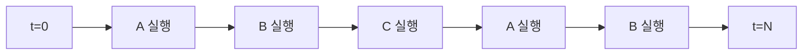
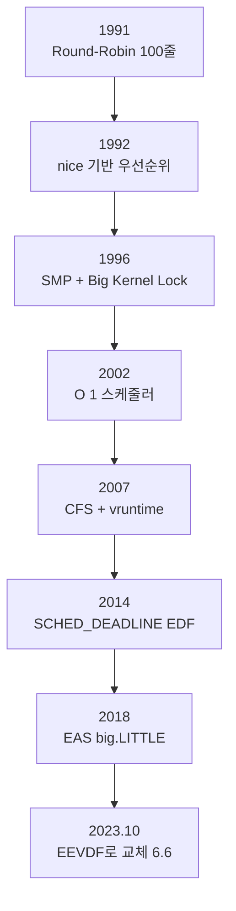
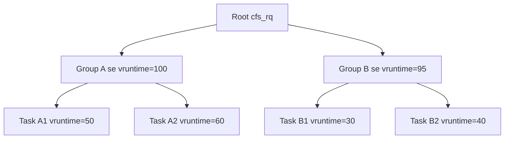
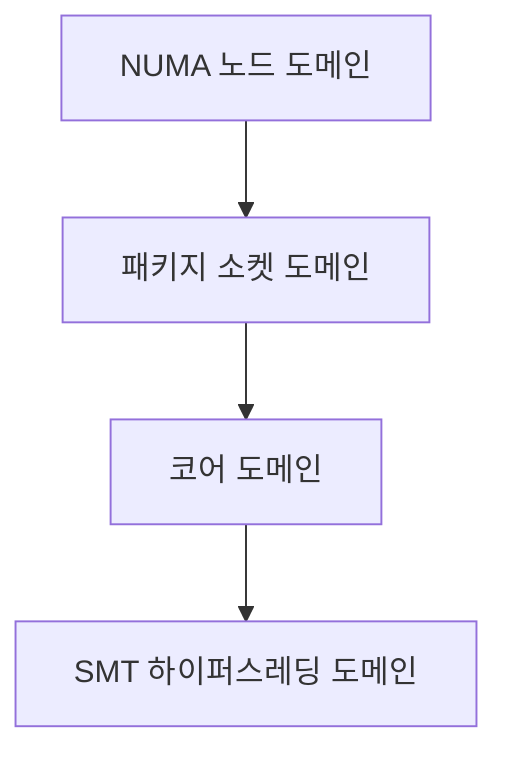

## 들어가며

지금 이 글이 읽히는 순간에도, 컴퓨터는 수십 개의 프로세스를 실행하고 있다. 브라우저, 음악 플레이어, 백그라운드 업데이트, 시스템 데몬. 하지만 CPU 코어는 한정되어 있다. 4코어 시스템에서 어떻게 50개의 프로세스가 "동시에" 실행될 수 있을까?

답은 시분할(Time-Sharing)이다. 커널의 스케줄러는 실행 가능한 태스크 사이에서 CPU 시간을 나누고 필요할 때 실행 주체를 전환한다. 실행 구간의 길이는 정책, 우선순위, 실행 가능 태스크 수, 선점 요청에 따라 달라지며 고정된 몇 밀리초로 정해지지 않는다.

이 환상을 유지하는 일은 쉽지 않다. 어떤 프로세스를 먼저 실행할지, 얼마나 오래 실행시킬지, 전환할 때 무엇을 저장하고 복원해야 하는지가 모두 풀어야 할 문제다. 게다가 멀티코어, NUMA, 이기종 CPU(big.LITTLE), 실시간 보장, 컨테이너 격리 같은 요구가 추가되면 단순한 큐 기반 알고리즘으로는 답이 나오지 않는다.

이 글의 범위는 Linux의 일반 태스크 스케줄링, 컨텍스트 스위치, 그룹·멀티코어·NUMA 스케줄링, 실시간 정책, 에너지 인식 배치, CPU 대역폭 제어와 관찰 방법이다. 일반 태스크 선택은 CFS가 확립한 가상 시간 모델과 Linux 6.6부터 도입된 EEVDF를 구분해 설명한다.


---

## 목차
1. [시분할의 환상](#1-시분할의-환상)
2. [선점형 vs 협력형](#2-선점형-vs-협력형)
3. [O(1), CFS, EEVDF: 스케줄러의 진화](#3-o1-cfs-eevdf-스케줄러의-진화)
4. [공정 스케줄링 내부: vruntime, lag, virtual deadline](#4-공정-스케줄링-내부-vruntime-lag-virtual-deadline)
5. [컨텍스트 스위칭과 __switch_to](#5-컨텍스트-스위칭과-__switch_to)
6. [그룹 스케줄링과 cgroup v2 CPU 컨트롤러](#6-그룹-스케줄링과-cgroup-v2-cpu-컨트롤러)
7. [멀티코어 로드 밸런싱과 NUMA](#7-멀티코어-로드-밸런싱과-numa)
8. [실시간 스케줄링: SCHED_FIFO, SCHED_RR](#8-실시간-스케줄링-sched_fifo-sched_rr)
9. [SCHED_DEADLINE과 EDF](#9-sched_deadline과-edf)
10. [에너지 인식 스케줄링](#10-에너지-인식-스케줄링)
11. [대역폭 제어](#11-대역폭-제어)
12. [실전 관찰과 튜닝](#12-실전-관찰과-튜닝)


---

## 1. 시분할의 환상

### 스케줄링의 목표

스케줄러는 여러 상충하는 목표를 동시에 달성해야 한다.

- 공정성(Fairness): 모든 프로세스에게 공평한 CPU 시간 할당
- 응답성(Responsiveness): 사용자 입력에 빠른 반응
- 처리량(Throughput): 단위 시간당 최대한 많은 작업 완료
- 효율성(Efficiency): 스케줄링 오버헤드 최소화

이 목표들은 종종 충돌한다. 공정성을 위해 프로세스를 자주 전환하면 컨텍스트 스위칭 오버헤드가 늘어 처리량이 줄어든다. 좋은 스케줄러는 트레이드오프를 적절히 균형 잡는다.

### 실행 요청과 선점 단위

실행 요청의 크기는 태스크가 한 번 선택되었을 때 확보하려는 service 양을 뜻한다. 너무 크면 다른 태스크의 응답성이 나빠지고, 너무 작으면 스케줄링과 컨텍스트 스위치 비용이 늘어난다.

고정 타임슬라이스를 사용한 과거 스케줄러와 달리 Linux의 공정 스케줄링 클래스는 runnable weight와 목표 service를 함께 고려한다. 다음 식은 CFS의 고전적인 설명 모델이지, 현재 커널의 고정 ABI나 튜닝 공식이 아니다.

```c
// 동일 weight 태스크만 있다고 가정한 고전적 CFS 설명 모델
nominal_slice = target_latency / nr_running;

// 목표 지연 시간이 20ms이고 실행 가능한 프로세스가 4개라면
// 각 프로세스는 5ms씩 실행한다.
```

과거 CFS 문서와 커널 버전에서는 `sched_latency`와 `sched_min_granularity`로 이 관계를 설명했다. 값과 노출 인터페이스는 커널 버전과 설정에 따라 달라지며, 최신 커널은 EEVDF의 request와 virtual deadline을 사용한다. 현재 시스템의 조정점을 확인하지 않고 특정 밀리초 값을 기본값으로 가정해서는 안 된다.

### 시분할의 시각화



CPU 코어 하나는 한 시점에 실행 문맥 하나를 수행하지만, 선점, blocking, wakeup과 per-CPU run queue가 여러 태스크의 진행을 교차시킨다.

## 2. 선점형 vs 협력형

### 협력형 멀티태스킹

초기 운영체제는 협력형 멀티태스킹(Cooperative Multitasking)을 사용했다. 프로세스가 자발적으로 CPU를 양보해야 다른 프로세스가 실행된다.

```c
// 협력형 멀티태스킹의 개념
while (1) {
    do_some_work();
    yield();  // 명시적으로 CPU를 양보한다
}
```

문제는 명확하다. 악의적이거나 버그가 있는 프로세스가 CPU를 독점할 수 있다. Windows 3.1과 초기 Mac OS가 자주 멈추던 이유다.

### 선점형 멀티태스킹

현대 운영체제는 선점형 멀티태스킹(Preemptive Multitasking)을 사용한다. 커널이 강제로 실행 중인 프로세스를 중단시키고 다른 프로세스를 실행할 수 있다.

Linux에서 재스케줄링 필요성은 여러 경로에서 생긴다.

- 실행 시간 회계: scheduler tick이나 고해상도 타이머가 현재 태스크의 service를 갱신하고 선점 필요성을 표시할 수 있다.
- wakeup: 더 이른 virtual deadline이나 더 높은 스케줄링 클래스의 태스크가 깨어날 수 있다.
- blocking·yield: 현재 태스크가 I/O, futex 등을 기다리거나 명시적으로 CPU를 양보한다.
- 커널·사용자 경계와 선점 가능 지점: `need_resched` 상태를 확인해 `schedule()`로 진입한다.

```c
// 타이머 인터럽트 핸들러 (간소화)
void timer_interrupt(void)
{
    update_process_times();
    scheduler_tick();  // 현재 프로세스의 vruntime 갱신

    if (need_resched()) {
        schedule();    // 다른 프로세스로 전환
    }
}
```

`CONFIG_HZ`는 periodic tick의 기준 빈도에 영향을 주지만, `HZ=1000`이 모든 CPU에서 정확히 1ms마다 스케줄러 선택을 강제한다는 뜻은 아니다. 고해상도 타이머, 동적 tick, `NO_HZ_IDLE`, `NO_HZ_FULL`과 이벤트 기반 wakeup이 함께 작동한다.

### 커널 선점

Linux 2.6부터는 커널 코드 자체도 선점 가능하게 만들 수 있다(`CONFIG_PREEMPT`). 이 옵션을 켜면 시스템 콜 도중에도 더 높은 우선순위의 태스크가 깨어나면 즉시 전환된다. 응답성은 좋아지지만 커널 데이터 구조의 동시성 보장이 까다로워진다.

| 구성 | 핵심 의미 | 일반적 영향 |
|---|---|---|
| `CONFIG_PREEMPT_NONE` | 커널의 명시적 스케줄링 지점 중심 | 처리량과 응답성의 결과는 워크로드 의존 |
| `CONFIG_PREEMPT_VOLUNTARY` | 자발적 선점 지점을 더 사용 | 긴 비선점 구간을 줄일 수 있음 |
| `CONFIG_PREEMPT` / `PREEMPT_DYNAMIC`의 full 모드 | 선점 가능한 커널 구간을 넓힘 | tail latency를 줄일 수 있지만 측정 필요 |
| `CONFIG_PREEMPT_RT` | 많은 interrupt·locking 경로를 선점 가능한 형태로 전환 | 결정성 개선이 목표이며 hard deadline을 자동 보장하지 않음 |

## 3. O(1), CFS, EEVDF: 스케줄러의 진화

Linux 스케줄러는 30년 동안 극적으로 진화했다. 각 세대는 이전 세대의 한계를 극복하기 위해 설계됐다.

### 1991-2001: 고전적 스케줄러

초기 Linux 스케줄러는 단순한 우선순위 기반 알고리즘이었다. 모든 실행 가능한 프로세스를 순회하며 가장 높은 우선순위를 가진 것을 선택했다. 시간 복잡도는 O(n)이다. 프로세스 수가 늘어나면 스케줄링 오버헤드도 함께 늘어난다.

### 2002-2007: O(1) 스케줄러

Ingo Molnar가 설계한 O(1) 스케줄러는 상수 시간에 다음 프로세스를 선택할 수 있었다. 핵심 아이디어는 140개의 우선순위 레벨마다 큐를 두고, 비트맵으로 어느 큐가 비어 있지 않은지 추적하는 것이다.

```c
// O(1) 스케줄러의 핵심 구조
struct prio_array {
    unsigned long bitmap[5];        // 140비트를 5개의 long으로 표현
    struct list_head queue[140];    // 우선순위별 실행 큐
};

// 다음 프로세스 선택: O(1)
int next_prio = find_first_bit(array->bitmap);
struct task_struct *next = list_first_entry(&array->queue[next_prio]);
```

문제는 두 가지였다.

- 복잡한 휴리스틱: 대화형(interactive) 프로세스를 추측하고 동적으로 우선순위를 조정하는 코드가 점점 비대해졌다.
- 공정성 결여: 같은 우선순위 안에서도 불균등한 CPU 시간 분배가 발생했고, 낮은 우선순위 프로세스는 기아(Starvation) 위험이 있었다.

Ingo Molnar는 CFS 발표 메일과 설계 문서에서, O(1) 스케줄러의 대화형 판별 휴리스틱이 점점 복잡해지고 예측 불가능해졌으며 이를 근본적으로 대체하기 위해 CFS를 설계했다고 밝혔다.

### 2007~2023: CFS

Ingo Molnar는 2007년 Linux 2.6.23에서 CFS를 발표했다. 핵심 질문은 단순했다.

> "각 태스크가 받은 정확한 CPU 시간을 추적하고, 항상 가장 적게 받은 태스크를 실행하면 어떨까?"

답은 vruntime(가상 실행 시간)이다. 프로세스가 "이상적인 멀티태스킹 CPU"에서 실행되었다면 받았을 시간을 추적한다. 가장 적게 실행된 프로세스가 다음에 실행된다. Red-Black Tree로 정렬해 O(log n) 삽입과 O(1) 최솟값 조회를 동시에 달성한다.

### 2023~현재: EEVDF

Linux는 6.6부터 기본 공정 스케줄링 클래스의 선택 규칙을 **EEVDF**(Earliest Eligible Virtual Deadline First)로 전환하기 시작했다. EEVDF는 CFS의 weighted virtual time 회계를 버리지 않는다. 각 엔티티의 실제 service가 이상적 service보다 뒤처졌는지를 lag로 판단하고, eligible한 엔티티 가운데 virtual deadline이 가장 이른 것을 선택한다. 선택 기준이 단순한 최소 vruntime에서 eligibility와 virtual deadline으로 확장된 것이다.

CFS라는 이름은 현재도 코드의 `cfs_rq`, `sched_entity` 같은 자료구조와 문서에 남아 있다. 따라서 “CFS가 완전히 삭제되었다”기보다, CFS가 만든 공정 스케줄링 인프라 위의 태스크 선택기가 EEVDF 규칙으로 바뀌었다고 이해하는 편이 정확하다.

### 진화 타임라인



## 4. 공정 스케줄링 내부: vruntime, lag, virtual deadline

### vruntime의 의미

vruntime은 프로세스가 가상의 이상적 CPU에서 실행된 시간을 나타낸다. 실제 실행 시간(`delta_exec`)에 가중치를 곱해 누적한다.

```c
// kernel/sched/fair.c (간소화)
static void update_curr(struct cfs_rq *cfs_rq)
{
    struct sched_entity *curr = cfs_rq->curr;
    u64 now = rq_clock_task(rq_of(cfs_rq));
    u64 delta_exec;

    delta_exec = now - curr->exec_start;
    curr->exec_start = now;

    curr->vruntime += calc_delta_fair(delta_exec, curr);
    update_min_vruntime(cfs_rq);
}

static inline u64 calc_delta_fair(u64 delta, struct sched_entity *se)
{
    if (unlikely(se->load.weight != NICE_0_LOAD))
        delta = __calc_delta(delta, NICE_0_LOAD, &se->load);
    return delta;
}
```

### nice 값과 weight

문제: nice 19(낮은 우선순위)와 nice 0(보통)이 같은 속도로 vruntime이 늘면, 둘이 똑같은 양의 CPU를 받는다. 우선순위가 무의미해진다.

해법은 weight 스케일링이다.

```c
// kernel/sched/core.c
const int sched_prio_to_weight[40] = {
 /* -20 */     88761,     71755,     56483,     46273,     36291,
 /* -15 */     29154,     23254,     18705,     14949,     11916,
 /* -10 */      9548,      7620,      6100,      4904,      3906,
 /*  -5 */      3121,      2501,      1991,      1586,      1277,
 /*   0 */      1024,       820,       655,       526,       423,
 /*   5 */       335,       272,       215,       172,       137,
 /*  10 */       110,        87,        70,        56,        45,
 /*  15 */        36,        29,        23,        18,        15,
};
```

nice 값 1 차이는 약 1.25배의 weight 차이를 만든다. 식으로는 다음과 같다.

$$\text{weight} = 1024 \times 1.25^{-\text{nice}}$$

vruntime 증가분은 가중치에 반비례한다.

$$\Delta \text{vruntime} = \Delta \text{exec} \times \frac{\text{NICE\_0\_LOAD}}{\text{weight}}$$

구체적인 예시는 다음과 같다.

- nice 0 (weight=1024): 10ms 실행 → vruntime += 10ms
- nice 19 (weight=15): 10ms 실행 → vruntime += 10ms × (1024/15) = 약 682ms
- nice -20 (weight=88761): 10ms 실행 → vruntime += 10ms × (1024/88761) = 약 0.115ms

nice 19 태스크의 vruntime은 빨리 커지므로 자주 선택되지 않는다. 반대로 nice -20 태스크는 vruntime이 천천히 커지므로 자주 선택된다.

### CFS의 Red-Black Tree 선택

EEVDF 도입 전 CFS는 최소 vruntime을 가진 태스크를 선택했다.

배열 기반 큐는 부적합하다. vruntime은 연속적인 값이라 고정 개수의 큐로 표현할 수 없고, 모든 큐를 순회하면 O(n)이 된다.

Red-Black Tree는 다음 특성 때문에 이 역사적 선택 규칙에 적합했다.

- 삽입/삭제: O(log n)
- 최솟값 조회: O(1) (가장 왼쪽 노드 캐싱)
- 균형 유지: 자동

```c
struct cfs_rq {
    struct rb_root_cached tasks_timeline;  // rb_root + leftmost 캐싱
    struct sched_entity *curr;
    u64 min_vruntime;
    // ...
};

static struct sched_entity *__pick_first_entity(struct cfs_rq *cfs_rq)
{
    struct rb_node *left = rb_first_cached(&cfs_rq->tasks_timeline);
    if (!left)
        return NULL;
    return rb_entry(left, struct sched_entity, run_node);
}
```

`rb_first_cached`는 캐시된 leftmost 포인터만 반환하므로 최소 vruntime 조회 자체는 O(1)이다. 이 코드는 EEVDF 이전 CFS 선택기를 설명하기 위한 축약본이다. 최신 `fair.c`는 augmented RB-tree의 subtree 정보를 이용해 eligible 후보와 earliest virtual deadline을 찾는다.

### min_vruntime과 새 태스크 배치

새로 생성된 태스크가 vruntime=0으로 시작하고 기존 태스크가 훨씬 큰 값에 있다면 새 태스크가 부당한 이점을 얻는다. 공정 스케줄링은 run queue의 virtual-time 기준점과 상대 lag를 보존하도록 새 엔티티를 배치한다.

다음 코드는 EEVDF 이전 CFS의 `min_vruntime` 배치 아이디어를 보여 주는 역사적 축약본이다.

```c
static void place_entity(struct cfs_rq *cfs_rq, struct sched_entity *se,
                         int initial)
{
    u64 vruntime = cfs_rq->min_vruntime;

    if (initial && sched_feat(START_DEBIT))
        vruntime += sched_vslice(cfs_rq, se);

    se->vruntime = max_vruntime(se->vruntime, vruntime);
}
```

새 태스크를 현재 virtual-time 기준점 부근에 놓아 기존 태스크가 쌓아 온 절대 vruntime과 직접 경쟁하지 않게 한다. 최신 EEVDF 구현에서는 lag 보존과 placement 규칙까지 함께 확인해야 하므로 이 코드 조각을 현재 커널의 그대로인 구현으로 사용해서는 안 된다.

### EEVDF의 lag와 eligibility

공정성은 단순히 “vruntime이 가장 작다”로 끝나지 않는다. 엔티티 $i$의 lag는 이상적인 weighted service와 실제 받은 service의 차이를 나타낸다.

$$\text{lag}_i = \text{ideal service}_i - \text{actual service}_i$$

양의 lag는 받아야 할 service보다 덜 받았다는 뜻이고, 음의 lag는 앞서 실행했다는 뜻이다. EEVDF는 원칙적으로 lag가 0 이상인 엔티티를 eligible 후보로 본다. 각 요청에는 virtual deadline이 붙으며, eligible 후보 가운데 deadline이 가장 이른 요청을 선택한다.

$$\text{virtual deadline}_i =
\text{virtual eligible time}_i +
\frac{\text{requested service}_i}{\text{weight}_i}$$

작은 요청은 더 이른 virtual deadline을 얻을 수 있어 짧고 latency-sensitive한 작업이 빠르게 실행될 여지가 생긴다. 그러나 높은 weight, 작은 요청, 양의 lag 중 하나만으로 실제 wall-clock deadline이 보장되지는 않는다.

### sleep, wakeup과 deferred dequeue

잠든 태스크를 즉시 공정성 계산에서 완전히 제거하면, 잠자는 동안 lag가 부자연스럽게 고정되거나 다시 깨어날 때 과도한 이점을 얻을 수 있다. EEVDF의 deferred dequeue는 일부 sleeping entity를 지연 제거 상태로 두고 lag가 시간에 따라 감쇠하도록 한다. 이 메커니즘은 과거 CFS의 고정 “sleeper bonus” 설명과 다르며, 세부 동작은 커널 버전과 feature 설정에 따라 달라진다.

### 공정성 보장

동일 weight의 CPU-bound 태스크가 계속 runnable하다면 장기적으로 비슷한 CPU share를 받는 것이 목표다. weight가 다르면 share도 그 비율을 따른다. 그러나 특정 태스크의 wall-clock 대기 시간이 단일 `sched_latency` 값 이하라는 hard bound는 없다. CPU affinity, 더 높은 스케줄링 클래스, cgroup throttle, interrupt, runnable 수와 topology가 모두 wakeup-to-run 지연에 영향을 준다.

## 5. 컨텍스트 스위칭과 __switch_to

프로세스 전환의 핵심은 컨텍스트 스위칭이다. 현재 태스크가 재개하는 데 필요한 아키텍처 상태를 보존하고 다음 태스크의 실행 상태와 주소 공간을 활성화한다.

### 컨텍스트의 구성

컨텍스트는 프로세스를 재개하는 데 필요한 모든 정보다.

- CPU 레지스터(범용, 스택 포인터, 프로그램 카운터)
- FPU/SIMD 레지스터
- 세그먼트 레지스터(x86)
- 주소 공간과 PCID/ASID 같은 address-space 식별 상태
- 커널 스택

### context_switch 흐름

```c
// kernel/sched/core.c (간소화)
static __always_inline struct rq *
context_switch(struct rq *rq, struct task_struct *prev,
               struct task_struct *next)
{
    // 1. 메모리 관리 컨텍스트 전환
    if (!next->mm) {
        // 커널 스레드는 이전 프로세스의 주소 공간을 빌린다
        next->active_mm = prev->active_mm;
    } else {
        // 사용자 프로세스: 페이지 테이블 전환
        switch_mm(prev->active_mm, next->mm, next);
    }

    // 2. 프로세서 상태 전환 (아키텍처 의존적)
    switch_to(prev, next, prev);

    return finish_task_switch(prev);
}
```

`switch_mm`은 CR3 레지스터(x86-64)에 새 페이지 테이블 베이스를 적재한다. 이 시점에 TLB가 일부 또는 전부 무효화된다. PCID(Process Context ID)가 켜져 있으면 일부 항목을 보존할 수 있다.

### __switch_to: 아키텍처 의존 코드

x86-64의 `__switch_to`는 어셈블리와 C의 조합이다.

```c
// arch/x86/kernel/process_64.c (간소화)
__visible __notrace_funcgraph struct task_struct *
__switch_to(struct task_struct *prev_p, struct task_struct *next_p)
{
    struct thread_struct *prev = &prev_p->thread;
    struct thread_struct *next = &next_p->thread;

    // FPU 상태 전환. 실제 정책과 함수는 커널 버전·아키텍처에 따라 다르다.
    fpu__switch(prev, next);

    // FS/GS 베이스, TLS 슬롯 적재
    load_seg_legacy(prev->tls_array, prev->gsindex, prev->fsindex);

    // 스택 포인터 전환 (인라인 어셈블리는 별도 함수에서 수행)

    if (unlikely(next->io_bitmap))
        load_io_bitmap(next);

    return prev_p;
}
```

이 함수의 흥미로운 점은 한 프로세스에서 호출되어 다른 프로세스에서 반환된다는 사실이다. `mov rsp,...` 이후의 명령은 `next_p`의 커널 스택에서 실행된다.

### 컨텍스트 스위칭의 비용

컨텍스트 스위치 비용은 직접 비용과 간접 비용을 나눠야 한다.

- **직접 비용**: scheduler 경로, 레지스터와 커널 스택 전환, 아키텍처별 thread state 복원
- **주소 공간 비용**: 다른 `mm`으로 바뀔 때 page-table root와 PCID/ASID 상태 처리
- **작업 집합 비용**: 새 태스크의 코드와 데이터가 캐시에 없으면 추가 miss 발생
- **예측 상태 비용**: 분기 예측기는 구현에 따라 상태가 남거나 공유되어 오염될 수 있으며, 보안 완화책이 추가 상태 정리를 요구할 수 있음

같은 프로세스의 스레드 전환은 주소 공간을 공유하지만 캐시 working set이 같다는 보장은 없다. 반대로 다른 프로세스로 전환해도 PCID/ASID와 warm cache 덕분에 모든 TLB가 항상 비워지는 것은 아니다. 비용은 `perf sched`, context-switch microbenchmark, hardware counters로 직접 경로와 이후 작업 집합 복구를 분리해 측정한다.

스케줄러의 최소 실행 단위와 선점 정책은 전환 오버헤드뿐 아니라 응답성, fairness와 runnable task 수의 균형을 다룬다. EEVDF 계열의 eligibility와 virtual deadline도 이 균형을 표현한다.

## 6. 그룹 스케줄링과 cgroup v2 CPU 컨트롤러

### 프로세스 vs 스케줄링 엔티티

CFS가 스케줄하는 단위는 프로세스가 아니라 스케줄링 엔티티(`sched_entity`)다.

```c
struct task_struct {
    struct sched_entity se;
    struct sched_rt_entity rt;
    struct sched_dl_entity dl;
    // ...
};
```

이렇게 추상화한 이유는 그룹 스케줄링을 위해서다.

### 그룹 스케줄링의 동기

프로세스별로 같은 weight를 주었을 때 사용자별 share가 달라지는 예시를 보자.

- 사용자 A: 프로세스 1개 → CPU의 약 1%
- 사용자 B: 프로세스 99개 → CPU의 약 99%

사용자 단위 공정성을 원한다면 프로세스 단위 vruntime으로는 부족하다.

### Task Group과 계층적 스케줄링

```c
struct task_group {
    struct sched_entity **se;  // CPU별 엔티티
    struct cfs_rq **cfs_rq;    // CPU별 런큐
    unsigned long shares;      // 그룹의 weight
};
```

스케줄링은 두 단계로 일어난다.

1. 그룹 간: 각 그룹의 `se`를 vruntime 기준으로 선택
2. 그룹 내: 선택된 그룹의 `cfs_rq`에서 최소 vruntime 태스크 선택



루트에서 vruntime이 더 작은 Group B가 먼저 선택되고, 그 안에서 vruntime이 가장 작은 B1이 최종 선택된다.

### cgroup v1을 통한 제어

```bash
# CPU controller 마운트
mount -t cgroup -o cpu none /sys/fs/cgroup/cpu

mkdir /sys/fs/cgroup/cpu/user_a
mkdir /sys/fs/cgroup/cpu/user_b

# Shares 설정 (기본 1024)
echo 1024 > /sys/fs/cgroup/cpu/user_a/cpu.shares
echo 2048 > /sys/fs/cgroup/cpu/user_b/cpu.shares  # 두 배 많은 CPU

echo $PID_A > /sys/fs/cgroup/cpu/user_a/cgroup.procs
echo $PID_B > /sys/fs/cgroup/cpu/user_b/cgroup.procs
```

두 그룹이 같은 부모 아래에서 동시에 CPU를 놓고 경쟁하고 다른 quota·affinity 제약이 없다면 user_b의 상대 weight는 user_a의 두 배다. 유휴 CPU가 있거나 다른 상한이 적용되면 실제 사용량이 정확히 2:1일 필요는 없다.

### cgroup v2의 통합 계층

cgroup v1은 컨트롤러마다 독립적인 계층을 두어 복잡했다. cgroup v2는 단일 계층으로 통합한다.

```bash
mount -t cgroup2 none /sys/fs/cgroup

mkdir /sys/fs/cgroup/workload
echo "+cpu +memory" > /sys/fs/cgroup/cgroup.subtree_control
```

CPU 관련 인터페이스가 다음과 같이 단순해진다.

```bash
# cpu.weight: v1의 cpu.shares를 대체. 기본 100, 범위 1~10000
echo 200 > /sys/fs/cgroup/workload/cpu.weight

# cpu.max: v1의 cpu.cfs_quota_us를 대체
# 형식: $MAX $PERIOD
echo "50000 100000" > /sys/fs/cgroup/workload/cpu.max  # 평균 0.5 CPU
echo "max 100000" > /sys/fs/cgroup/workload/cpu.max    # 무제한
```

`cpu.weight`와 v1 `cpu.shares`는 범위와 사용자 인터페이스가 다르다. 둘 다 상대 비율을 표현하지만, 단순한 선형 변환식을 영속 설정이나 API 계약으로 사용해서는 안 된다. 동일 계층의 sibling cgroup 사이에서는 weight의 비율이 경쟁 중인 CPU share에 반영된다.

### Pressure Stall Information

cgroup v2는 리소스 부족을 정량적으로 노출한다.

```bash
cat /sys/fs/cgroup/workload/cpu.pressure
# some avg10=15.23 avg60=8.12 avg300=3.45 total=1234567
# full avg10=0.00  avg60=0.00 avg300=0.00 total=0
```

- some: 적어도 한 태스크가 CPU 대기 중인 시간 비율
- full: 해당 cgroup의 non-idle 태스크가 모두 CPU를 기다린 시간 비율

PSI를 임계치로 설정해 `poll`로 알림을 받을 수 있어, 자동 스케일링 신호로 쓰기 좋다.

### CPU Affinity와 Isolation

cpuset 컨트롤러로 그룹의 CPU/NUMA 노드를 제한한다.

```bash
echo "0-3" > /sys/fs/cgroup/workload/cpuset.cpus  # CPU 0~3만 사용
echo "0"   > /sys/fs/cgroup/workload/cpuset.mems  # NUMA node 0만 사용
```

부팅 파라미터로 일반 스케줄링에서 아예 제외할 수도 있다.

```bash
# CPU 4~7을 isolcpus로 지정
isolcpus=4-7 nohz_full=4-7 rcu_nocbs=4-7
```

이 위에서 affinity를 제한하면 일반 태스크와의 경쟁을 줄일 수 있다. 그러나 interrupt, kernel thread, RCU callback, workqueue와 firmware 활동까지 자동으로 사라지는 것은 아니다. 저지연 CPU 격리는 IRQ affinity와 housekeeping CPU 구성까지 함께 검증해야 한다.

## 7. 멀티코어 로드 밸런싱과 NUMA

현대 시스템은 여러 CPU 코어를 가진다. 스케줄러는 작업을 코어 간에 균형 있게 분배해야 한다.

### Per-CPU 실행 큐

각 CPU는 자신만의 실행 큐를 가진다.

```c
struct rq {
    struct cfs_rq cfs;       // CFS 큐
    struct rt_rq rt;         // 실시간 큐
    struct dl_rq dl;         // Deadline 큐

    struct task_struct *curr;  // 현재 실행 중인 태스크
    // ...
};

DEFINE_PER_CPU(struct rq, runqueues);
```

장점은 CPU별 독립 스케줄링으로 락 경합이 줄고, 같은 CPU에서 같은 태스크가 계속 실행돼 캐시 친화성이 유지된다는 점이다. 단점은 한 CPU가 과부하인데 다른 CPU가 유휴 상태가 될 수 있다는 점이다.

### 스케줄링 도메인

Linux는 CPU를 계층적 스케줄링 도메인으로 구성한다.



2-소켓 시스템에서 각 소켓에 4코어 8 하이퍼스레드라면 도메인은 다음과 같이 구성된다.

```text
NODE0                        NODE1
- CPU 0,1  (core 0)          - CPU 8,9   (core 4)
- CPU 2,3  (core 1)          - CPU 10,11 (core 5)
- CPU 4,5  (core 2)          - CPU 12,13 (core 6)
- CPU 6,7  (core 3)          - CPU 14,15 (core 7)
```

도메인은 안쪽에서 바깥쪽으로 갈수록 공유 자원과 메모리 locality가 달라진다. SMT sibling은 일부 core 자원을 공유하지만 태스크 working set이 그대로 보존된다는 보장은 없다. NUMA 노드를 넘는 이동은 태스크가 주로 접근하는 페이지가 기존 노드에 남아 있을 때 원격 메모리 접근을 늘릴 수 있다.

### 로드 밸런싱 알고리즘

로드 밸런싱은 주기적으로 또는 CPU가 유휴 상태가 될 때 발생한다.

```c
static int load_balance(int this_cpu, struct rq *this_rq,
                        struct sched_domain *sd)
{
    struct rq *busiest_rq = find_busiest_queue(sd);

    if (!busiest_rq || busiest_rq == this_rq)
        return 0;

    struct task_struct *p = pick_task_to_move(busiest_rq, this_cpu);

    if (p) {
        detach_task(p, busiest_rq);
        attach_task(p, this_rq);
        return 1;
    }

    return 0;
}
```

밸런싱 시 고려 사항은 다음과 같다.

- 캐시 친화성: 다른 CPU로 옮기면 캐시 이점을 잃는다.
- NUMA 거리: 원격 노드로 옮기면 메모리 접근이 느려진다.
- CPU 친화성: `sched_setaffinity`로 설정된 제약을 어기지 않는다.
- 밸런싱 비용: 너무 자주 옮기면 오버헤드가 늘어난다.

### NUMA의 기본 문제

Non-Uniform Memory Access 시스템에서는 노드별로 메모리 접근 비용이 다르다.

```text
CPU 0 (Node 0)        CPU 1 (Node 1)
   |                     |
 RAM A                 RAM B

Local access:   해당 플랫폼의 local DRAM 경로
Remote access:  interconnect를 거치는 다른 NUMA 노드 경로
```

remote access의 추가 비용은 CPU 세대, socket topology, 메모리 부하와 access pattern에 따라 달라진다. 평균 지연 한 숫자보다 local/remote bandwidth, latency distribution, cache miss와 page placement를 같은 시스템에서 측정해야 한다.

### Automatic NUMA Balancing

Linux 3.8부터 추가됐다.

```bash
echo 1 > /proc/sys/kernel/numa_balancing
```

동작 원리는 다음과 같다.

1. 페이지 폴트 기반 추적

```c
// 주기적으로 페이지를 PROT_NONE으로 설정한다
void task_numa_work(struct callback_head *work)
{
    for_each_vma(vma, mm) {
        change_prot_numa(vma->vm_start, vma->vm_end);
    }
}

// 접근 시 폴트가 발생하고, 어느 노드에서 접근했는지 기록된다
void do_numa_page(struct vm_fault *vmf)
{
    int target_nid = numa_migrate_prep(page, vma, addr, page_nid);
    task_numa_fault(last_nid, target_nid, pages);
    migrate_misplaced_page(page, target_nid);
}
```

2. 태스크 마이그레이션

```c
static void task_numa_placement(struct task_struct *p)
{
    int max_nid = -1;
    unsigned long max_faults = 0;

    for_each_online_node(nid) {
        if (p->numa_faults[nid] > max_faults) {
            max_faults = p->numa_faults[nid];
            max_nid = nid;
        }
    }

    if (max_nid != numa_node_id())
        migrate_task_to(p, max_nid);
}
```

같은 메모리를 공유하는 태스크는 `numa_group`으로 묶여 같은 노드로 끌어 모인다. fork된 자식은 부모와 같은 그룹에서 시작한다.

### Tickless와 nohz_full

전통적으로 타이머 인터럽트는 모든 CPU에서 주기적으로 발생했다(예: 1000Hz면 1ms마다). 이는 전력 낭비와 성능 저하를 부른다.

- `CONFIG_NO_HZ_IDLE`: 유휴 CPU는 타이머 인터럽트를 끈다. 다음 예약된 이벤트까지 깊은 슬립 상태를 유지한다.
- `CONFIG_NO_HZ_FULL`: 단일 태스크만 실행 중인 CPU도 타이머 인터럽트를 끈다. 저지연 애플리케이션(HPC, 실시간)에 유용하다.

```bash
# 부팅 파라미터
nohz_full=1-7
```

CPU 1~7은 adaptive-tick 대상이 된다. 조건을 만족하면 scheduler tick을 줄일 수 있지만, POSIX CPU timer, perf event, clock 유지, interrupt와 housekeeping 의존성 때문에 모든 timer interrupt가 없어지는 것은 아니다.

## 8. 실시간 스케줄링: SCHED_FIFO, SCHED_RR

### 실시간의 정의

"실시간"은 빠름이 아니라 예측 가능함을 의미한다. Hard real-time 시스템에서 마감 시간을 못 지키면 재앙이다(예: 에어백 제어).

일반 Linux와 `SCHED_FIFO`/`RR` 우선순위만으로 hard deadline이 보장되지는 않는다. 높은 클래스의 runnable 태스크는 공정 스케줄링 태스크보다 먼저 선택되지만, non-preemptible section, interrupt, page fault, lock과 throttling이 지연을 만들 수 있다.

### 스케줄링 클래스 우선순위

```text
높음
1. stop_sched_class      - CPU stop 등 내부 최상위 작업
2. dl_sched_class        - SCHED_DEADLINE 정책
3. rt_sched_class        - SCHED_FIFO / SCHED_RR 정책
4. fair_sched_class      - SCHED_NORMAL / SCHED_BATCH / SCHED_IDLE 정책
5. idle_sched_class      - CPU별 idle task
낮음
```

스케줄링 **클래스**와 사용자에게 노출되는 **정책**을 구분해야 한다. FIFO와 RR은 같은 `rt_sched_class`에서 동일한 `rt_priority` 공간을 공유하며, 정책 이름의 나열 순서가 우선순위를 정하지 않는다. NORMAL·BATCH·IDLE도 fair class 안에서 서로 다른 동작 규칙을 선택하는 정책이다. 여기의 `idle_sched_class`는 `SCHED_IDLE` 정책과 다른, runnable task가 없을 때 실행되는 커널 내부 idle task 클래스다.

### SCHED_FIFO

```c
struct sched_rt_entity {
    struct list_head run_list;
    unsigned short time_slice;
    unsigned short on_rq;
    // ...
};
```

특징은 다음과 같다.

- 선점: 더 높은 우선순위 태스크만 선점 가능
- 타임슬라이스 없음: 자발적으로 yield하거나 block될 때까지 무한 실행
- 우선순위 범위: 1~99 (99가 최고)

```c
struct sched_param param;
param.sched_priority = 50;
sched_setscheduler(0, SCHED_FIFO, &param);

while (1) {
    // 이 루프는 영원히 계속된다
    // 같은 CPU의 낮은 클래스 태스크를 굶길 수 있다
}
```

CPU affinity와 RT throttling 구성에 따라 같은 CPU의 일반 태스크가 장시간 실행되지 못할 수 있다. 관리 shell과 kernel worker까지 영향을 받으면 시스템이 먹통처럼 보일 수 있다.

### SCHED_RR

FIFO에 타임슬라이스를 더한 것이다.

```c
// upstream의 통상적인 초기 RR quantum. sysctl로 확인·변경 가능
#define DEF_TIMESLICE (100 * HZ / 1000)  // 100ms
```

같은 우선순위의 RR 태스크들은 설정된 quantum을 소진하면 같은 우선순위 queue의 뒤로 이동한다. 실제 quantum은 `sched_rr_get_interval()`이나 해당 시스템의 sysctl로 확인해야 한다. 다른 우선순위와의 관계는 FIFO와 같다.

### RT Throttling

실시간 태스크가 CPU를 독점하면 CFS 태스크(예: ssh 세션)가 먹통이 된다. 방어책으로 RT throttling이 있다.

```bash
# 많은 upstream 구성에서 사용하는 값의 예. 실행 시스템에서 직접 확인한다.
cat /proc/sys/kernel/sched_rt_period_us    # 1000000
cat /proc/sys/kernel/sched_rt_runtime_us   # 950000
```

표시된 구성에서는 period마다 RT class가 사용할 수 있는 총 runtime이 제한되고, 한도를 소진한 run queue는 replenishment까지 throttle될 수 있다. 기본값과 적용 범위는 커널·cgroup 설정에 따라 달라진다. `-1`은 제한을 비활성화하므로 일반 태스크와 관리 경로를 굶길 위험을 별도로 감수해야 한다.

### Priority Inversion

실시간 시스템에서는 우선순위 역전이 발생할 수 있다.

```text
시나리오
1. 낮은 우선순위 L이 뮤텍스를 획득
2. 높은 우선순위 H가 깨어나 같은 뮤텍스를 원함
3. H는 블록됨
4. 중간 우선순위 M이 L을 선점하고 실행
   → H는 M보다 우선순위가 높지만, M이 끝날 때까지 기다려야 함
```

해결책은 Priority Inheritance다.

```c
// CONFIG_RT_MUTEXES
// L이 H가 기다리는 뮤텍스를 들고 있으면, L의 우선순위를 H로 일시 상승
if (waiter->prio < current->prio) {
    rt_mutex_adjust_prio(current);
}
```

`pthread_mutexattr_setprotocol(&attr, PTHREAD_PRIO_INHERIT)`로 사용자 공간에서도 활성화할 수 있다.

## 9. SCHED_DEADLINE과 EDF

### Earliest Deadline First

선점 가능한 단일 CPU, 독립적인 작업, 알려진 release time과 deadline 같은 가정 아래에서 EDF는 실행 가능한 job 집합을 스케줄하는 최적 알고리즘이다. 이 결과를 lock blocking, interrupt, multicore migration과 실행 시간 추정 오차가 있는 실제 시스템에 조건 없이 옮길 수는 없다.

Linux 3.14에서 추가된 SCHED_DEADLINE은 EDF를 구현한다.

### 파라미터: runtime, deadline, period

각 태스크는 세 파라미터를 선언한다.

```c
struct sched_attr {
    u32 size;
    u32 sched_policy;     // SCHED_DEADLINE
    u64 sched_runtime;    // 주기당 필요한 CPU 시간 (ns)
    u64 sched_deadline;   // 상대적 마감 시간 (ns)
    u64 sched_period;     // 주기 (ns)
};

// 10ms마다 2ms의 CPU 필요, 5ms 이내 완료
struct sched_attr attr = {
    .size           = sizeof(attr),
    .sched_policy   = SCHED_DEADLINE,
    .sched_runtime  = 2  * 1000 * 1000,
    .sched_deadline = 5  * 1000 * 1000,
    .sched_period   = 10 * 1000 * 1000,
};

sched_setattr(0, &attr, 0);
```

### Admission Control

implicit deadline처럼 `deadline = period`인 주기 태스크의 기본 이용률은 다음 식으로 표현할 수 있다.

$$U = \sum_{i} \frac{\text{runtime}_i}{\text{period}_i}$$

단일 CPU의 이상화된 implicit-deadline 모델에서는 $U \le 1$이 기본 가능성 조건이다. Linux의 실제 admission control은 root domain의 deadline bandwidth, CPU affinity, RT runtime 제한과 커널이 예약해 둔 비율을 반영한다. 따라서 아래 코드는 개념 모델이며 `U <= 1`만으로 모든 파라미터 조합의 허용이나 deadline 충족을 증명하지 않는다.

```c
static bool dl_task_can_attach(struct task_struct *p,
                               const struct cpumask *cs_cpus_allowed)
{
    unsigned long total_bw = 0;

    for_each_dl_entity(dl_se)
        total_bw += dl_se->dl_bw;

    if (total_bw + p->dl.dl_bw > dl_bw_capacity())
        return false;

    return true;
}
```

구체적인 예시는 다음과 같다.

- Task A: 3ms / 10ms = 0.3
- Task B: 2ms / 5ms = 0.4
- Task C: 1ms / 20ms = 0.05
- 합계: 0.75이므로 이상화된 단일 CPU 이용률 조건은 만족

### 절대 데드라인 추적

```c
struct sched_dl_entity {
    /* 선언된 파라미터 (sched_setattr로 설정) */
    u64 dl_runtime;   // 주기당 런타임
    u64 dl_deadline;  // 상대 마감 시간
    u64 dl_period;    // 주기

    /* 현재 상태 */
    s64 runtime;      // 남은 런타임
    u64 deadline;     // 절대 마감 시간
    // ...
};

static struct task_struct *pick_next_task_dl(struct rq *rq)
{
    struct sched_dl_entity *dl_se;
    struct rb_node *left = rb_first_cached(&rq->dl.root);

    if (!left)
        return NULL;

    dl_se = rb_entry(left, struct sched_dl_entity, rb_node);
    return dl_task_of(dl_se);
}
```

스케줄러는 실행 가능한 deadline entity 가운데 절대 데드라인이 가장 이른 대상을 선택한다. Linux의 스케줄링 클래스 선택 순서에서 deadline class가 RT class보다 먼저 검사되므로 `SCHED_DEADLINE` 태스크는 `SCHED_FIFO/RR`보다 앞선다. 이는 두 정책이 하나의 숫자 우선순위 공간을 공유한다는 뜻이 아니다.

### CBS: Constant Bandwidth Server

런타임을 소진한 태스크는 어떻게 될까?

```c
// 실제 커널 코드를 단순화한 CBS 상태 전이 의사 코드
static void update_curr_dl(struct rq *rq)
{
    struct task_struct *curr = rq->curr;
    u64 delta_exec = rq_clock_task(rq) - curr->se.exec_start;

    curr->dl.runtime -= delta_exec;

    if (curr->dl.runtime <= 0) {
        // 태스크를 throttle하고 CBS 규칙으로 다음 replenishment 시점과
        // absolute deadline을 계산한다.
        dequeue_task_dl(rq, curr, 0);
        arm_replenishment_timer(curr);
    }
}
```

replenishment 조건이 충족되면 `runtime` 예산과 절대 deadline이 CBS 규칙에 따라 갱신되고 태스크가 다시 실행 가능해진다. 실제 커널은 조기 wakeup, deadline miss, overrun signal, reclaim 플래그와 migration까지 처리하므로 단순히 `deadline += period` 한 줄로 모델링할 수 없다. CBS의 목적은 각 예약이 선언한 대역폭을 넘지 않게 격리해 다른 deadline 예약의 분석 가능성을 보존하는 것이다. 시스템 전체의 hard deadline은 WCET, blocking, interrupt와 admission 가정까지 별도로 검증해야 한다.

## 10. 에너지 인식 스케줄링

### big.LITTLE 아키텍처

ARM의 big.LITTLE(예: Cortex-A72 + Cortex-A53)는 성능과 효율이 다른 CPU를 혼합한다.

- big 코어: 빠르지만 전력 소모 큼
- LITTLE 코어: 느리지만 에너지 효율 좋음

어느 CPU에 태스크를 배치하는 것이 전체 에너지 면에서 유리한지 결정해야 한다.

### Energy Model

Linux 5.0부터 추가됐다.

```c
struct em_perf_domain {
    struct em_perf_state *table;  // 주파수별 성능/전력
    int nr_perf_states;
    unsigned long flags;
};

struct em_perf_state {
    unsigned long frequency;  // kHz
    unsigned long power;      // mW
    unsigned long cost;       // power / frequency
};
```

Device Tree에서 다음처럼 정의된다.

```dts
energy-costs {
    CPU_COST_A53: core-cost0 {
        busy-cost-data = <
            /* freq    power */
             408000      36
            1200000     150
        >;
    };

    CPU_COST_A72: core-cost1 {
        busy-cost-data = <
             500000     200
            2000000    1200
        >;
    };
};
```

### Task Utilization 추적: PELT

Per-Entity Load Tracking으로 태스크별 CPU 사용량을 평균낸다.

```c
struct sched_avg {
    u64 last_update_time;
    u64 load_sum;
    u32 util_sum;      // 누적 utilization
    u32 util_avg;      // 평균 utilization (0~1024)
    // ...
};
```

평균은 기하급수적으로 감쇠하는 가중 이동평균(EWMA)이다. 커널 PELT 모델은 약 1.024ms 단위를 사용하고 32개 단위마다 기여도가 절반이 되도록 설계되어, 시간으로는 약 32.8ms의 half-life를 갖는다. 주파수·CPU capacity 보정과 runnable/load/util 신호의 의미는 서로 구분해야 한다.

$$\text{util}_{\text{avg}} = \text{util}_{\text{sum}} \times \text{LOAD\_AVG\_MAX}^{-1}$$

### EAS 배치 알고리즘

```c
static int find_energy_efficient_cpu(struct task_struct *p, int prev_cpu)
{
    unsigned long best_energy = ULONG_MAX;
    int best_cpu = prev_cpu;

    for_each_possible_cpu(cpu) {
        unsigned long energy;
        energy = compute_energy(p, cpu);

        if (energy < best_energy) {
            best_energy = energy;
            best_cpu = cpu;
        }
    }

    return best_cpu;
}
```

`compute_energy`는 각 주파수 단계에서 태스크를 실행했을 때의 전력을 시뮬레이션해 가장 적은 에너지를 쓰는 CPU를 고른다.

### LITTLE 코어 우선 배치

Utilization이 낮은 태스크는 LITTLE 코어로 보낸다.

```c
if (task_util(p) < capacity_of(LITTLE_CPU))
    return select_idle_sibling(p, LITTLE_CPU);
else
    return select_idle_sibling(p, BIG_CPU);
```

에너지 최소화는 “항상 작은 코어”나 “항상 빨리 끝내기” 중 하나를 고르는 문제가 아니다. performance domain의 operating point, idle-state 진입 가능성, deadline과 thermal constraint를 포함한 전체 에너지를 비교해야 한다. EAS의 energy model도 실제 전력계가 아니라 플랫폼이 제공한 비용 모델이므로 thermal throttling과 측정 결과로 검증한다.

## 11. 대역폭 제어

### Shares만으로는 부족하다

`cpu.shares`(또는 `cpu.weight`)는 상대적 비율만 제어한다. "이 컨테이너는 CPU 2개를 절대 초과하지 못한다" 같은 절대 상한을 설정하려면 별도 수단이 필요하다.

### 공정 스케줄링 대역폭 컨트롤러

Linux 3.2부터 추가된 기능이다.

```c
struct cfs_bandwidth {
    u64 quota;    // 주기당 사용 가능한 시간 (μs)
    u64 period;   // 주기 길이 (μs)
    u64 runtime;  // 현재 주기에 남은 시간
    // ...
};
```

설정 예시는 다음과 같다.

```bash
# v1: 100ms 주기당 20ms만 사용 가능 (20% CPU)
echo 100000 > /sys/fs/cgroup/cpu/container/cpu.cfs_period_us
echo  20000 > /sys/fs/cgroup/cpu/container/cpu.cfs_quota_us

# v2: 동일한 의미를 cpu.max로
echo "20000 100000" > /sys/fs/cgroup/container/cpu.max
```

### Throttling 구현

```c
static void __account_cfs_rq_runtime(struct cfs_rq *cfs_rq, u64 delta_exec)
{
    cfs_rq->runtime_remaining -= delta_exec;

    if (cfs_rq->runtime_remaining > 0)
        return;

    throttle_cfs_rq(cfs_rq);
}

static void throttle_cfs_rq(struct cfs_rq *cfs_rq)
{
    struct rq *rq = rq_of(cfs_rq);

    dequeue_entity(/* ... */);
    start_cfs_bandwidth_timer();
}
```

Throttle된 태스크는 다음 주기가 시작될 때 `runtime`이 리필되고 재개된다.

### Burst 지원

문제: 일시적 부하 급증 시 throttle이 과도하게 발생한다.

Linux 5.14부터 burst를 허용한다.

```bash
# cgroup v1
echo 200000 > cpu.cfs_burst_us

# cgroup v2
echo 200000 > cpu.max.burst
```

burst는 장기 quota를 늘리지 않으면서 일시적으로 quota를 넘는 실행을 허용하는 상한이다. 사용하지 않은 runtime과 burst credit의 정확한 회계는 커널 구현을 따르며, 값을 키우면 짧은 spike의 throttling을 줄이는 대신 같은 CPU를 공유하는 다른 cgroup의 지연을 늘릴 수 있다.

### 컨테이너에서의 의미

Linux에서 쿠버네티스 CPU limit은 컨테이너 런타임과 cgroup 버전에 따라 CPU bandwidth limit으로 구현되는 것이 일반적이다. 예를 들어 period가 100ms인 구성에서 limit 1 CPU는 100ms의 quota로 표현될 수 있지만, period와 burst 정책을 고정값으로 가정해서는 안 된다. 짧은 병렬 spike가 quota를 먼저 소진하면 평균 CPU 사용률이 낮아 보여도 주기 안에서 throttling이 발생할 수 있으므로 `cpu.stat`의 `nr_throttled`와 `throttled_usec`, 서비스 latency를 함께 본다.

## 12. 실전 관찰과 튜닝

### 스케줄링 통계 확인

```bash
# 프로세스의 스케줄링 정보
cat /proc/$PID/sched
# 주요 필드:
# - se.exec_start: 마지막 실행 시작 시각
# - se.vruntime: 가상 실행 시간
# - se.sum_exec_runtime: 총 실행 시간
# - nr_switches: 컨텍스트 스위칭 횟수
# - nr_voluntary_switches: 자발적 스위칭
# - nr_involuntary_switches: 비자발적 스위칭(선점)
```

자발적 switch는 blocking·yield 경로, 비자발적 switch는 선점 경로를 집계한다. I/O bound와 CPU bound를 이 두 숫자만으로 판정할 수는 없으며, runnable time, off-CPU stack, CPU utilization과 wakeup 원인을 함께 본다.

### nice 값 조정

```bash
# nice 값 -20~19 (낮을수록 우선순위 높음)
nice -n 10 ./my_program        # nice 10으로 시작
renice -n 5 -p 12345           # 실행 중인 프로세스 조정

# 차이 확인
nice -n  0 stress -c 1 &
nice -n 19 stress -c 1 &
# weight 비율로 첫 번째가 두 번째보다 약 70배 많은 CPU를 받는다
```

### 실시간 스케줄링 설정

```c
// rt_priority.c
#define _GNU_SOURCE
#include <sched.h>
#include <stdio.h>
#include <unistd.h>

int main(void)
{
    struct sched_param param = { .sched_priority = 10 };

    if (sched_setscheduler(0, SCHED_FIFO, &param) == -1) {
        perror("sched_setscheduler");
        return 1;
    }

    printf("now running with SCHED_FIFO priority 10\n");
    for (int i = 0; i < 1000000; i++) {
        // 작업
    }
    return 0;
}
```

```bash
gcc rt_priority.c -o rt_priority
sudo ./rt_priority

# 정책과 우선순위 확인
ps -eo pid,class,rtprio,comm | grep rt_priority
# 예: 12345  FF  10 rt_priority
```

`chrt` 명령으로 외부에서 정책을 바꿀 수도 있다.

```bash
chrt -f -p 50 12345           # FIFO 우선순위 50으로 변경
chrt -d -T 2000000 -P 10000000 -D 5000000 -p 0 12345  # DEADLINE
```

### 컨텍스트 스위칭 측정

```bash
# 시스템 전체
vmstat 1
# 'cs' 컬럼이 초당 컨텍스트 스위칭 수다.

# 프로세스별
pidstat -w -p $PID 1
# cswch/s: 자발적 스위칭(I/O 대기 등)
# nvcswch/s: 비자발적 스위칭(선점)
```

### CPU affinity 설정

```c
// cpu_affinity.c
#define _GNU_SOURCE
#include <sched.h>
#include <stdio.h>

int main(void)
{
    cpu_set_t mask;
    CPU_ZERO(&mask);
    CPU_SET(2, &mask);

    if (sched_setaffinity(0, sizeof(mask), &mask) == -1) {
        perror("sched_setaffinity");
        return 1;
    }

    printf("process bound to CPU 2\n");
    while (1) ;
    return 0;
}
```

```bash
taskset -cp $PID
# 출력 예: pid 12345's current affinity list: 2
taskset -cp 0-3 12345
# CPU 0~3으로 제한
```

### perf sched로 추적

```bash
# 스케줄링 이벤트 기록
sudo perf sched record -- sleep 10

# 지연 시간 보고
sudo perf sched latency

# 타임라인 시각화
sudo perf sched timehist
```

`perf sched latency`는 wakeup부터 실제 실행까지의 지연을 태스크별로 요약한다. 배포판의 출력이 평균·최대 중심이면 원시 `sched_wakeup`/`sched_switch` trace를 수집해 원하는 percentile을 직접 계산해야 한다.

### cgroup v2 PSI 모니터링

```bash
# CPU pressure 실시간 확인
watch -n 1 cat /sys/fs/cgroup/workload/cpu.pressure

# 임계치 초과 시 알림
cat <<'EOF' > /tmp/psi_trigger.c
#include <fcntl.h>
#include <poll.h>
#include <unistd.h>
#include <stdio.h>

int main(void)
{
    int fd = open("/sys/fs/cgroup/workload/cpu.pressure", O_RDWR);
    write(fd, "some 150000 1000000", 19);  // 1초 중 150ms 초과 시 트리거

    struct pollfd pfd = { .fd = fd, .events = POLLPRI };
    while (poll(&pfd, 1, -1) > 0)
        printf("cpu pressure exceeded\n");
}
EOF
```

자동 스케일링 신호로 활용하기 좋다.

### 튜닝 시 주의 사항

| 시나리오 | 점검 포인트 |
|---|---|
| P99 응답이 튄다 | RT throttling, cfs_quota throttling, NUMA 미스배치 |
| CPU 사용률은 낮은데 느리다 | cgroup CPU limit, 코어 친화성 누락, sibling SMT 경쟁 |
| 모바일 발열 | EAS 활성화 여부, governor가 schedutil인지 |
| 실시간 워크로드 지터 | nohz_full + isolcpus + irqbalance 제외 설정 |
| 배치 작업이 대화형을 방해 | SCHED_BATCH 또는 SCHED_IDLE로 격리 |

스케줄러 튜닝은 워크로드별로 답이 다르다. 기본값에서 시작해 한 변수만 바꾸고 측정하는 절차를 반복하는 편이 안전하다.


---

## 결론

스케줄러는 컴퓨터의 시간 관리자다. 한정된 CPU 시간을 수십 개의 프로세스에게 공평하게 분배하면서도, 사용자는 모든 것이 동시에 실행되는 것처럼 느끼게 만든다.

Linux 스케줄러는 30년 동안 진화했다. 단순한 O(n) 알고리즘에서 복잡하지만 빠른 O(1) 스케줄러를 거쳐, 우아하고 공정한 CFS로 이어졌다. 그리고 6.6에서는 일반 태스크 선택을 *EEVDF(Earliest Eligible Virtual Deadline First)* 가 맡으면서, vruntime 기반 가상 시간 추적은 그대로 유지하되 *eligibility + virtual deadline* 로 응답성을 강화한 모델로 한 단계 더 진화했다. 6.6 이후 일반 태스크 선택은 EEVDF 기준이고, Per-CPU 실행 큐, 스케줄링 도메인, 그룹 스케줄링과 cgroup v2 같은 주변 인프라는 CFS 시절의 자산을 그대로 잇는다. 실시간 워크로드를 위해서는 SCHED_FIFO/RR/DEADLINE을 별도 클래스로 제공하고, 모바일을 위해서는 EAS로 에너지를 의식한다.

하지만 완벽한 스케줄러는 없다. 캐시 친화성, NUMA 지연, 전력 소비, 실시간 보장 같은 상충하는 목표 사이에서 균형을 잡아야 한다. 워크로드에 따라 답이 다르다. 대부분의 경우 기본 스케줄링 정책이 합리적이지만, 저지연이나 절대 보장이 필요하다면 적절한 정책 선택과 튜닝이 필요하다. 스케줄러가 실행 순서를 정해도, 동시에 깨어난 태스크들이 공유 자원을 안전하게 다루려면 별도의 동기화 계약이 필요하다.

## 더 읽을거리

- [EEVDF Scheduler](https://docs.kernel.org/scheduler/sched-eevdf.html)
- [CFS Design Document](https://docs.kernel.org/scheduler/sched-design-CFS.html) — Ingo Molnar
- [SCHED_DEADLINE](https://docs.kernel.org/scheduler/sched-deadline.html)
- [Energy Aware Scheduling](https://docs.kernel.org/scheduler/sched-energy.html)
- [cgroup v2 Documentation](https://docs.kernel.org/admin-guide/cgroup-v2.html)
- C.L. Liu, J.W. Layland, "Scheduling Algorithms for Multiprogramming in a Hard-Real-Time Environment", JACM 1973
- Robert Love, *Linux Kernel Development*, 3rd ed., Chapter 4
- Daniel P. Bovet, Marco Cesati, *Understanding the Linux Kernel*, 3rd ed., Chapter 7
- 커널 소스: `kernel/sched/core.c`, `kernel/sched/fair.c`, `kernel/sched/rt.c`, `kernel/sched/deadline.c`, `kernel/sched/topology.c`
- 도구: `chrt`, `taskset`, `pidstat`, `perf sched`, `cyclictest`
