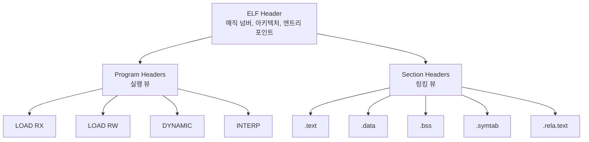
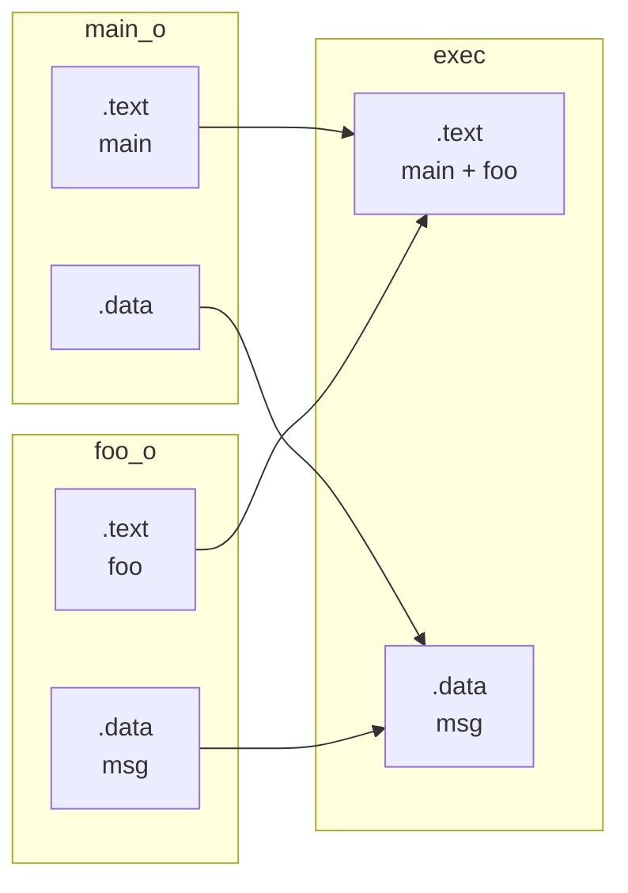

## 들어가며

John R. Levine은 *Linkers and Loaders*에서 링커를 모든 프로그램 빌드의 마지막 단계에서 묵묵히 일하는, 가장 덜 이해된 도구로 묘사한다.

C 파일을 작성하고 `gcc hello.c -o hello`를 실행하면 실행 파일이 생성된다. 그러나 여러 개의 오브젝트 파일이 어떻게 하나의 실행 파일로 합쳐지는가? `printf`를 호출하면 이 함수의 실제 주소는 어떻게 결정되는가? 컴파일 단위가 늘어날수록 이 질문은 단순하지 않다.

이 글은 리눅스의 실행 파일 포맷인 ELF(Executable and Linkable Format)와 정적 링커의 동작 원리를 다룬다. 심볼 해결, 재배치, 섹션과 세그먼트의 역할을 추적하며 범위는 빌드 시점에 결정되는 정적 링크 결과까지다. 런타임 symbol lookup은 이 글의 정확성 논증에 필요한 PLT/GOT 계약까지만 정의한다.

여기까지의 결과물은 컴파일된 오브젝트 파일에서 시작해 단일 실행 파일까지 도달하는 과정의 전 구조를 추적할 수 있는 지식이다. 이를 통해 `undefined reference` 에러, 심볼 충돌, 섹션 레이아웃 문제를 직접 진단할 수 있다.


---

## 목차
1. [ELF 이중 구조](#1-elf-이중-구조)
2. [ELF 헤더](#2-elf-헤더)
3. [섹션: 링커의 관점](#3-섹션-링커의-관점)
4. [심볼 테이블](#4-심볼-테이블)
5. [재배치](#5-재배치)
6. [정적 링킹](#6-정적-링킹)
7. [PLT/GOT의 정적 측면](#7-pltgot의-정적-측면)
8. [세그먼트: 로더의 관점](#8-세그먼트-로더의-관점)
9. [링커 스크립트](#9-링커-스크립트)
10. [실전 도구](#10-실전-도구)
11. [RELRO, PIE, ASLR](#11-relro-pie-aslr)


---

## 1. ELF 이중 구조

### ELF의 탄생

1980년대 UNIX 시스템들은 a.out과 COFF 계열 등 서로 다른 실행 파일 포맷을 사용했다. 1990년대 초 UNIX System Laboratories(USL)는 System V ABI의 일부로 ELF를 정의했고, 1995년 Tool Interface Standard(TIS) 위원회가 ELF 명세를 정리했다. ELF는 Linux, System V 계열과 여러 BSD·임베디드 환경에서 널리 쓰인다. 모든 UNIX 계열이 ELF인 것은 아니며 macOS와 iOS는 Mach-O를 사용한다.

ELF의 설계 목표는 네 가지다.

1. 통일성: 하나의 포맷으로 relocatable, executable, shared object를 표현한다.
2. 확장성: 새로운 프로세서 아키텍처를 쉽게 지원한다.
3. 효율성: 빠른 로딩과 실행을 지원한다.
4. 유연성: 동적 링킹과 위치 독립 코드를 지원한다.

### 링킹 뷰와 실행 뷰

ELF의 독특한 점은 두 가지 관점을 동시에 제공한다는 것이다.

- 링킹 뷰(Linking View): 섹션(Section) 중심. 링커가 오브젝트 파일을 조작할 때 사용한다. 코드, 데이터, 심볼, 재배치 정보를 섹션 단위로 구분한다.
- 실행 뷰(Execution View): 세그먼트(Segment) 중심. 로더가 프로그램을 메모리에 적재할 때 사용한다. 메모리 보호 속성(읽기/쓰기/실행)을 기준으로 세그먼트를 구성한다.

ELF 파일의 두 뷰는 다음과 같이 분리된다.



같은 파일이지만 링커는 섹션을 보고, 로더는 세그먼트를 본다. 이 이중 구조가 ELF의 핵심 설계 철학이다.

### ELF 파일의 종류

`e_type`에는 다음과 같은 주요 타입이 정의되어 있다.

1. `ET_REL`: relocatable object(`.o`). 아직 주소가 결정되지 않은 코드와 데이터, 재배치 정보를 포함한다.
2. `ET_EXEC`: 전통적인 실행 파일. 로더가 정해진 가상 주소 배치를 기준으로 적재한다.
3. `ET_DYN`: shared object와 PIE. 둘 다 위치 독립적으로 적재할 수 있는 같은 ELF 타입이며 program header와 동적 태그의 형태로 역할을 구분한다.
4. `ET_CORE`: 프로세스 상태를 기록한 core 파일.

여기에 `ET_NONE`과 OS·프로세서별 예약 범위도 있다. 따라서 확장자만으로 ELF 타입이나 실제 용도를 확정하지 말고 헤더와 program header를 함께 확인해야 한다.

## 2. ELF 헤더

### ELF 헤더 구조

모든 ELF 파일은 ELF 헤더로 시작한다. 이 헤더는 파일의 구조를 설명하는 메타데이터다.

```c
/* /usr/include/elf.h */
typedef struct {
    unsigned char e_ident[16];     /* 매직 넘버와 기본 정보 */
    Elf64_Half    e_type;          /* 오브젝트 파일 타입 */
    Elf64_Half    e_machine;       /* 아키텍처 */
    Elf64_Word    e_version;       /* ELF 버전 */
    Elf64_Addr    e_entry;         /* 엔트리 포인트 주소 */
    Elf64_Off     e_phoff;         /* Program header 테이블 오프셋 */
    Elf64_Off     e_shoff;         /* Section header 테이블 오프셋 */
    Elf64_Word    e_flags;         /* 프로세서 특화 플래그 */
    Elf64_Half    e_ehsize;        /* ELF 헤더 크기 */
    Elf64_Half    e_phentsize;     /* Program header 엔트리 크기 */
    Elf64_Half    e_phnum;         /* Program header 개수 */
    Elf64_Half    e_shentsize;     /* Section header 엔트리 크기 */
    Elf64_Half    e_shnum;         /* Section header 개수 */
    Elf64_Half    e_shstrndx;      /* 섹션 이름 문자열 테이블 인덱스 */
} Elf64_Ehdr;
```

### e_ident 식별 영역

`e_ident` 배열의 첫 16바이트는 파일을 식별하는 정보를 담는다.

```c
#define EI_MAG0    0    /* 0x7F */
#define EI_MAG1    1    /* 'E' */
#define EI_MAG2    2    /* 'L' */
#define EI_MAG3    3    /* 'F' */
#define EI_CLASS   4    /* 32비트(1) 또는 64비트(2) */
#define EI_DATA    5    /* 리틀 엔디안(1) 또는 빅 엔디안(2) */
#define EI_VERSION 6    /* 객체 파일 버전, 현재 유효 값은 EV_CURRENT */
#define EI_OSABI   7    /* OS/ABI 식별 */
```

실제 바이너리에서 첫 16바이트를 보면 다음과 같다.

```bash
$ hexdump -C /bin/ls | head -n 1
00000000  7f 45 4c 46 02 01 01 00  00 00 00 00 00 00 00 00  |.ELF............|
```

`7f 45 4c 46`은 매직 넘버(0x7F, 'E', 'L', 'F')이고, `02`는 64비트, `01`은 리틀 엔디안, `01`은 ELF 버전 1이다.

### 헤더 읽기 관찰

간단한 C 프로그램으로 헤더 구조를 직접 확인할 수 있다.

```c
/* hello.c */
#include <stdio.h>

int main() {
    printf("Hello, ELF!\n");
    return 0;
}
```

```bash
$ gcc -o hello hello.c
$ readelf -h hello
ELF Header:
  Magic:   7f 45 4c 46 02 01 01 00 00 00 00 00 00 00 00 00
  Class:                             ELF64
  Data:                              2's complement, little endian
  Version:                           1 (current)
  OS/ABI:                            UNIX - System V
  Type:                              DYN (Position-Independent Executable file)
  Machine:                           Advanced Micro Devices X86-64
  Entry point address:               0x1060
  Start of program headers:          64 (bytes into file)
  Start of section headers:          14696 (bytes into file)
  Number of program headers:         13
  Number of section headers:         31
```

최근 다수의 Linux 배포판이 GCC를 PIE로 빌드해서 배포하기 때문에 결과 바이너리 Type이 `DYN`으로 나오는 경우가 많다. 단 GCC 자체의 보편 규칙은 아니며, 디스트로 패치/configure 옵션(`--enable-default-pie`)에 의존한다. 13개의 program headers는 실행 뷰, 31개의 section headers는 링킹 뷰를 구성한다.

## 3. 섹션: 링커의 관점

### 주요 섹션

ELF 파일은 다양한 섹션으로 구성된다. 각 섹션은 특정한 목적을 가진다.

| 섹션 이름 | 목적 | 속성 |
|----------|------|------|
| `.text` | 실행 코드 | ALLOC, EXEC |
| `.rodata` | 읽기 전용 데이터(문자열 리터럴 등) | ALLOC |
| `.data` | 초기화된 전역/정적 변수 | ALLOC, WRITE |
| `.bss` | 초기화되지 않은 전역/정적 변수 | ALLOC, WRITE |
| `.symtab` | 심볼 테이블(전체) | - |
| `.dynsym` | 동적 심볼 테이블 | ALLOC |
| `.strtab` | 문자열 테이블 | - |
| `.dynstr` | 동적 문자열 테이블 | ALLOC |
| `.rela.text` |.text 섹션의 재배치 정보 | - |
| `.rela.plt` | PLT 재배치 정보 | ALLOC |
| `.plt` | Procedure Linkage Table | ALLOC, EXEC |
| `.got` | Global Offset Table | ALLOC, WRITE |
| `.dynamic` | 동적 링킹 정보 | ALLOC, WRITE |

### 섹션 헤더 구조

각 섹션은 섹션 헤더로 기술된다.

```c
typedef struct {
    Elf64_Word  sh_name;       /* 섹션 이름 (문자열 테이블 인덱스) */
    Elf64_Word  sh_type;       /* 섹션 타입 */
    Elf64_Xword sh_flags;      /* 섹션 속성 플래그 */
    Elf64_Addr  sh_addr;       /* 메모리 주소 */
    Elf64_Off   sh_offset;     /* 파일 오프셋 */
    Elf64_Xword sh_size;       /* 섹션 크기 */
    Elf64_Word  sh_link;       /* 링크된 섹션 인덱스 */
    Elf64_Word  sh_info;       /* 추가 정보 */
    Elf64_Xword sh_addralign;  /* 정렬 */
    Elf64_Xword sh_entsize;    /* 엔트리 크기 (테이블인 경우) */
} Elf64_Shdr;
```

### 섹션 분석 관찰

`readelf -S`로 섹션 정보를 확인한다.

```bash
$ readelf -S hello
Section Headers:
  [Nr] Name              Type             Address           Offset
       Size              EntSize          Flags  Link  Info  Align
  [14] .text             PROGBITS         0000000000001060  00001060
       0000000000000185  0000000000000000  AX       0     0     16
  [16] .rodata           PROGBITS         0000000000002000  00002000
       0000000000000011  0000000000000000   A       0     0     4
  [24] .data             PROGBITS         0000000000004000  00003000
       0000000000000010  0000000000000000  WA       0     0     8
  [25] .bss              NOBITS           0000000000004010  00003010
       0000000000000008  0000000000000000  WA       0     0     1
```

플래그는 다음을 의미한다. `A`(ALLOC)는 프로세스 메모리에 로드, `X`(EXEC)는 실행 가능, `W`(WRITE)는 쓰기 가능을 뜻한다. `.bss`는 `NOBITS` 타입이라 파일에 공간을 차지하지 않으며, `.text`는 `AX`로 읽기와 실행만 허용된다.

###.bss의 비밀

`.bss`는 "Block Started by Symbol"의 약자로, 초기화되지 않은 전역 변수를 위한 공간이다. 실제 파일에는 공간을 차지하지 않는다.

```c
/* test_bss.c */
int initialized = 42;      /* .data */
int uninitialized;         /* .bss */
int array[1000000];        /* .bss - 4MB */

int main() {
    return 0;
}
```

```bash
$ gcc -o test_bss test_bss.c
$ size test_bss
   text    data     bss     dec     hex filename
   1605     612 4000020 4002237  3d11bd test_bss

$ ls -lh test_bss
-rwxr-xr-x 1 user user 17K Dec 23 10:00 test_bss
```

`.bss`가 약 4MB인데 파일에는 그 0바이트 배열의 내용이 들어 있지 않다. `PT_LOAD`에서 `p_memsz`가 `p_filesz`보다 큰 꼬리 영역을 로더가 0으로 보이게 매핑한다. 이는 파일 크기와 해당 바이트의 파일 I/O를 줄인다. 실제 물리 페이지가 언제 할당되는지는 demand paging과 커널의 zero-page 정책에 달려 있다.

## 4. 심볼 테이블

### 심볼의 정의

심볼은 이름을 가진 프로그램 엔티티다. 함수, 전역 변수, 섹션도 심볼이다. 링커의 핵심 작업은 심볼 해결(Symbol Resolution)이다. 함수 호출 `foo`를 `foo`의 실제 주소로 연결하고, 전역 변수 참조 `extern int x`를 `x`의 위치와 연결한다.

### 심볼 테이블 엔트리

```c
typedef struct {
    Elf64_Word    st_name;     /* 심볼 이름 (문자열 테이블 인덱스) */
    unsigned char st_info;     /* 타입과 바인딩 */
    unsigned char st_other;    /* 가시성 */
    Elf64_Half    st_shndx;    /* 섹션 인덱스 */
    Elf64_Addr    st_value;    /* 심볼 값 (주소) */
    Elf64_Xword   st_size;     /* 심볼 크기 */
} Elf64_Sym;
```

`st_info` 필드는 두 부분으로 나뉜다.

- Binding(상위 4비트): `LOCAL`, `GLOBAL`, `WEAK`
- Type(하위 4비트): `NOTYPE`, `OBJECT`, `FUNC`, `SECTION`, `FILE`

###.symtab vs.dynsym

ELF는 두 개의 심볼 테이블을 가질 수 있다.

- `.symtab`: 정적 링킹과 분석용 심볼 테이블. 로컬 심볼을 포함할 수 있으며 최종 실행 파일에서는 `strip`으로 제거해도 로딩에 필요하지 않은 경우가 많다.
- `.dynsym`: 동적 로더가 검색할 import/export 심볼의 부분집합. 동적 링킹되는 객체에서는 관련 동적 태그와 함께 계약을 이루므로 임의로 제거하면 로딩이나 심볼 해결이 깨진다. 정적 ELF에는 아예 없을 수 있다.

### 심볼 테이블 분석

```c
/* symbols.c */
#include <stdio.h>

static int local_var = 1;        /* LOCAL */
int global_var = 2;               /* GLOBAL */
extern int extern_var;            /* GLOBAL UNDEF */

static void local_func() {        /* LOCAL */
    printf("Local\n");
}

void global_func() {              /* GLOBAL */
    printf("Global\n");
    local_func();
}
```

```bash
$ gcc -c symbols.c
$ readelf -s symbols.o

Symbol table '.symtab' contains 14 entries:
   Num:    Value          Size Type    Bind   Vis      Ndx Name
     0: 0000000000000000     0 NOTYPE  LOCAL  DEFAULT  UND
     1: 0000000000000000     0 FILE    LOCAL  DEFAULT  ABS symbols.c
     4: 0000000000000000     4 OBJECT  LOCAL  DEFAULT    3 local_var
     5: 0000000000000000    21 FUNC    LOCAL  DEFAULT    1 local_func
     6: 0000000000000004     4 OBJECT  GLOBAL DEFAULT    3 global_var
     7: 0000000000000000     0 NOTYPE  GLOBAL DEFAULT  UND extern_var
     8: 0000000000000000     0 NOTYPE  GLOBAL DEFAULT  UND printf
     9: 0000000000000015    37 FUNC    GLOBAL DEFAULT    1 global_func
```

`local_var`, `local_func`은 `LOCAL` 바인딩이고, `global_var`, `global_func`은 `GLOBAL`이다. `extern_var`, `printf`는 `UND`(undefined)로, 다른 오브젝트 파일에서 해결해야 한다. `ET_REL`에서 정의된 심볼의 `st_value`는 보통 해당 섹션 시작에 대한 오프셋이고, undefined 심볼은 0이다.

`nm` 명령은 심볼을 더 읽기 쉽게 출력한다.

```bash
$ nm symbols.o
0000000000000000 t local_func
0000000000000000 d local_var
0000000000000015 T global_func
0000000000000004 D global_var
                 U extern_var
                 U printf
```

소문자는 LOCAL, 대문자는 GLOBAL이다. `T`/`t`는 `.text`(코드), `D`/`d`는 `.data`(초기화된 데이터), `U`는 undefined를 가리킨다.

## 5. 재배치

### 재배치가 필요한 이유

컴파일러는 각 `.c` 파일을 독립적으로 컴파일한다. 이때 다른 파일의 함수나 변수의 주소를 알 수 없다. 따라서 컴파일러는 플레이스홀더를 남기고, 링커가 나중에 실제 주소로 채운다.

```c
/* main.c */
extern void foo();

int main() {
    foo();
    return 0;
}
```

```c
/* foo.c */
#include <stdio.h>

void foo() {
    printf("foo called\n");
}
```

`main.c`를 컴파일할 때 컴파일러는 `foo`의 주소를 모른다. 디스어셈블하면 다음과 같다.

```bash
$ gcc -c main.c
$ objdump -d main.o

0000000000000000 <main>:
   0:   55                      push   %rbp
   1:   48 89 e5                mov    %rsp,%rbp
   4:   b8 00 00 00 00          mov    $0x0,%eax
   9:   e8 00 00 00 00          call   e <main+0xe>
   e:   b8 00 00 00 00          mov    $0x0,%eax
  13:   5d                      pop    %rbp
  14:   c3                      ret
```

오프셋 `0x9`의 `call` 명령어는 `e8 00 00 00 00`이다. `e8`은 `call` opcode이고, `00 00 00 00`은 상대 주소인데 아직 채워지지 않았다.

### 재배치 엔트리 구조

재배치 정보는 `.rela.text` 같은 섹션에 저장된다.

```c
typedef struct {
    Elf64_Addr  r_offset;   /* 재배치할 위치 */
    Elf64_Xword r_info;     /* 심볼 인덱스와 재배치 타입 */
    Elf64_Sxword r_addend;  /* 추가할 상수 */
} Elf64_Rela;
```

`r_info`는 두 부분으로 나뉜다. 상위 32비트는 심볼 테이블 인덱스, 하위 32비트는 재배치 타입(예: `R_X86_64_PC32`, `R_X86_64_PLT32`)이다.

### x86-64 재배치 타입

| 타입 | 의미 | 계산식 |
|------|------|--------|
| `R_X86_64_64` | 절대 64비트 주소 | S + A |
| `R_X86_64_PC32` | PC 상대 32비트 | S + A - P |
| `R_X86_64_PLT32` | PLT 엔트리 상대 | L + A - P |
| `R_X86_64_GLOB_DAT` | GOT 엔트리 설정 | S |
| `R_X86_64_JUMP_SLOT` | PLT 엔트리 설정 | S |

S는 심볼의 값(주소), A는 addend, P는 재배치할 위치(`r_offset`), L은 PLT 엔트리 주소다.

### 재배치 정보 확인

```bash
$ readelf -r main.o

Relocation section '.rela.text' at offset 0x1f0 contains 1 entry:
  Offset          Info           Type           Sym. Value    Sym. Name + Addend
00000000000a  000a00000004 R_X86_64_PLT32    0000000000000000 foo - 4
```

이 엔트리는 오프셋 `0xa`의 위치(`call` 다음 바이트)에 `foo`까지의 PC-relative 32-bit 변위를 채우라는 지시다. `R_X86_64_PLT32`라는 타입 이름이 있지만, 링커가 항상 PLT 엔트리를 거쳐가게 만드는 것은 아니다. 정적 링킹이거나 같은 모듈 내에서 정의가 보이는 경우 링커는 PLT을 거치지 않고 직접 `foo`까지의 PC-relative call로 해소한다. 외부 공유 라이브러리의 심볼이거나 lazy binding이 필요한 경우에 한해 PLT 엔트리로 향하게 한다.

링킹 후를 확인한다.

```bash
$ gcc -o main main.o foo.o
$ objdump -d main

0000000000001149 <main>:
    1149:   55                      push   %rbp
    114a:   48 89 e5                mov    %rsp,%rbp
    114d:   b8 00 00 00 00          mov    $0x0,%eax
    1152:   e8 08 00 00 00          call   115f <foo>
    1157:   b8 00 00 00 00          mov    $0x0,%eax
    115c:   5d                      pop    %rbp
    115d:   c3                      ret

000000000000115f <foo>:
    115f:   55                      push   %rbp
```

이 예에서는 `foo`가 같은 실행 파일 안에 정의되어 있어 링커가 PLT을 거치지 않고 `foo` 자체로 직접 call을 만들었다. `e8 08 00 00 00`의 `0x08`은 다음 명령어(`0x1157`)에서 `foo`(`0x115f`)까지의 거리다.

## 6. 정적 링킹

### 링커의 동작 과정

링커는 두 단계로 동작한다.

1단계: 심볼 해결(Symbol Resolution)
- 모든 오브젝트 파일과 라이브러리를 스캔한다.
- 각 심볼의 정의를 찾는다.
- 중복 정의나 미정의 심볼 에러를 검출한다.

2단계: 재배치(Relocation)
- 섹션들을 병합하여 메모리 레이아웃을 결정한다.
- 각 심볼에 최종 주소를 할당한다.
- 재배치 엔트리를 사용하여 참조를 실제 주소로 패치한다.

### 섹션 병합

여러 오브젝트 파일의 같은 이름 섹션이 하나로 병합된다.



### 정적 라이브러리

정적 라이브러리(`.a`)는 오브젝트 파일의 아카이브다.

```bash
$ ar t /usr/lib/x86_64-linux-gnu/libc.a | head
init-first.o
libc-start.o
sysdep.o
version.o
check_fds.o
libc-tls.o
elf-init.o
```

링커는 라이브러리에서 필요한 오브젝트 파일만 추출한다. `printf`를 사용하면 `printf.o`만 링크된다.

### 정적 링킹 관찰

```bash
$ gcc -static -o hello_static hello.c
$ ls -lh hello_static
-rwxr-xr-x 1 user user 872K Dec 23 10:30 hello_static

$ ldd hello_static
        not a dynamic executable
```

`printf` 하나를 위해 libc 전체가 들어가서 872KB가 된다. 정적 링킹의 단점은 다음과 같다.

- 실행 파일 크기 증가
- 라이브러리 업데이트 시 재컴파일 필요
- 메모리 낭비(각 프로세스가 사본을 보유)

## 7. PLT/GOT의 정적 측면

ELF 정적 구조 안에 PLT와 GOT가 어떻게 배치되는지를 본다. 런타임에는 동적 링커가 GOT 항목을 채우고, PLT가 그 항목을 거쳐 실제 함수로 점프한다.

### 정적 빌드 시 생성되는 PLT 엔트리

`gcc -o hello hello.c`로 동적 링크된 실행 파일을 빌드하면, 링커는 `printf` 같은 외부 함수마다 PLT 엔트리와 GOT 엔트리를 생성한다.

```bash
$ objdump -d hello | grep -A3 '<printf@plt>'
0000000000001040 <printf@plt>:
    1040:   ff 25 d2 2f 00 00       jmp    *0x2fd2(%rip)        # 4018 <printf@GLIBC_2.2.5>
    1046:   68 00 00 00 00          push   $0x0
    104b:   e9 e0 ff ff ff          jmp    1030 <_init+0x20>
```

이 PLT 엔트리는 컴파일/링킹 단계에서 만들어진 정적 코드다. 첫 명령은 GOT 엔트리로 점프하고, 둘째 명령은 인덱스를 푸시하며, 셋째 명령은 첫 PLT 슬롯으로 점프한다.

### GOT의 초기 상태

링커는 GOT에 재배치 항목을 만들어 둔다. 동적 링커가 런타임에 이 항목을 채울 것이라는 약속이다.

```bash
$ readelf -r hello | grep printf
000000004018  000100000007 R_X86_64_JUMP_SLO 0000000000000000 printf@GLIBC_2.2.5 + 0
```

`R_X86_64_JUMP_SLOT` 타입은 동적 링커에게 "이 GOT 엔트리를 `printf` 주소로 채우라"고 지시한다. 정적 링커가 만들어 둔 슬롯과, 동적 링커가 런타임에 채우는 값이 분리되어 있는 구조다.

### 위치 독립 코드(PIC)

공유 라이브러리는 서로 다른 프로세스에서 다른 주소에 로드될 수 있다. 따라서 위치 독립 코드(Position Independent Code)로 컴파일되어야 한다.

PIC가 아닌 코드는 절대 주소를 사용한다.

```asm
mov $0x12345678, %rax    # 절대 주소 - 재배치 필요
```

PIC는 PC 상대 주소를 사용한다.

```asm
lea 0x1234(%rip), %rax   # PC 상대 주소 - 재배치 불필요
```

공유 라이브러리는 다음과 같이 컴파일한다.

```bash
$ gcc -fPIC -shared -o libfoo.so foo.c
```

`-fPIC`는 Position Independent Code 생성을, `-shared`는 공유 라이브러리 생성을 지시한다.

## 8. 세그먼트: 로더의 관점

### Program Header

섹션이 링커를 위한 것이라면, 세그먼트는 로더를 위한 것이다. Program header 테이블은 세그먼트를 기술한다.

```c
typedef struct {
    Elf64_Word  p_type;     /* 세그먼트 타입 */
    Elf64_Word  p_flags;    /* 세그먼트 플래그 (R/W/X) */
    Elf64_Off   p_offset;   /* 파일 오프셋 */
    Elf64_Addr  p_vaddr;    /* 가상 주소 */
    Elf64_Addr  p_paddr;    /* 물리 주소 (대부분 무시됨) */
    Elf64_Xword p_filesz;   /* 파일에서의 크기 */
    Elf64_Xword p_memsz;    /* 메모리에서의 크기 */
    Elf64_Xword p_align;    /* 정렬 */
} Elf64_Phdr;
```

### 주요 세그먼트 타입

| 타입 | 목적 |
|------|------|
| `PT_LOAD` | 메모리에 로드할 세그먼트 |
| `PT_DYNAMIC` | 동적 링킹 정보 |
| `PT_INTERP` | 동적 링커 경로 |
| `PT_NOTE` | 노트 정보 |
| `PT_PHDR` | Program header 테이블 자체 |
| `PT_GNU_STACK` | 스택 실행 가능 여부 |
| `PT_GNU_RELRO` | 재배치 후 읽기 전용으로 |

### 세그먼트 분석

```bash
$ readelf -l hello

Program Headers:
  Type           Offset             VirtAddr           PhysAddr
                 FileSiz            MemSiz              Flags  Align
  PHDR           0x0000000000000040 0x0000000000000040 0x0000000000000040
                 0x00000000000002d8 0x00000000000002d8  R      0x8
  INTERP         0x0000000000000318 0x0000000000000318 0x0000000000000318
                 0x000000000000001c 0x000000000000001c  R      0x1
      [Requesting program interpreter: /lib64/ld-linux-x86-64.so.2]
  LOAD           0x0000000000000000 0x0000000000000000 0x0000000000000000
                 0x0000000000000628 0x0000000000000628  R      0x1000
  LOAD           0x0000000000001000 0x0000000000001000 0x0000000000001000
                 0x00000000000001f5 0x00000000000001f5  R E    0x1000
  LOAD           0x0000000000002000 0x0000000000002000 0x0000000000002000
                 0x0000000000000160 0x0000000000000160  R      0x1000
  LOAD           0x0000000000002db8 0x0000000000003db8 0x0000000000003db8
                 0x0000000000000258 0x0000000000000260  RW     0x1000

 Section to Segment mapping:
  Segment Sections...
   01     .interp
   03     .init .plt .plt.got .text .fini
   04     .rodata .eh_frame_hdr .eh_frame
   05     .init_array .fini_array .dynamic .got .data .bss
```

4개의 `LOAD` 세그먼트가 각기 다른 권한(R, RX, R, RW)을 가지고, 섹션들이 세그먼트에 매핑된다. `.text`는 RX(읽기+실행) 세그먼트에, `.data`와 `.bss`는 RW(읽기+쓰기) 세그먼트에 들어간다.

### 메모리 보호

세그먼트 기반 권한 분리는 보안의 핵심이다.

- W^X(Write XOR Execute): 쓰기 가능한 영역은 실행 불가능하다.
- 코드 섹션을 수정하려는 시도는 Segmentation Fault로 차단된다.
- 스택에서 코드 실행 시도도 마찬가지로 차단된다.

```bash
$ readelf -l hello | grep GNU_STACK
  GNU_STACK      0x0000000000000000 0x0000000000000000 0x0000000000000000
                 0x0000000000000000 0x0000000000000000  RW     0x10
```

`RW`(실행 불가)는 스택 버퍼 오버플로우 공격을 방어한다.

## 9. 링커 스크립트

### 링커 스크립트의 역할

링커는 기본 규칙에 따라 섹션을 배치하지만, 링커 스크립트로 완전한 제어가 가능하다. 임베디드 시스템이나 커널 개발에서 필수적이다.

기본 링커 스크립트는 다음 명령으로 확인한다.

```bash
$ ld --verbose | grep "^SECTIONS" -A 50
```

### 링커 스크립트 예제

```ld
/* custom.ld */
OUTPUT_FORMAT("elf64-x86-64")
ENTRY(_start)

SECTIONS
{
    . = 0x400000;                    /* 시작 주소 */

    .text : {
        *(.text .text.*)             /* 모든 .text 섹션 */
    }

    . = ALIGN(4096);                 /* 페이지 정렬 */

    .rodata : {
        *(.rodata .rodata.*)
    }

    .data : {
        *(.data .data.*)
    }

    .bss : {
        *(.bss .bss.*)
        *(COMMON)
    }

    /DISCARD/ : {                    /* 버릴 섹션들 */
        *(.comment)
        *(.note.*)
    }
}
```

다음 명령으로 사용한다.

```bash
$ ld -T custom.ld -o myapp obj1.o obj2.o
```

### 심볼 정의

링커 스크립트에서 심볼을 정의할 수 있다.

```ld
SECTIONS
{
    .text : {
        _text_start = .;
        *(.text)
        _text_end = .;
    }
    text_size = _text_end - _text_start;
}
```

코드에서 다음과 같이 사용한다.

```c
extern char _text_start[], _text_end[];
size_t text_size = _text_end - _text_start;
```

리눅스 커널은 이 방식으로 `__start_rodata`, `__end_rodata` 등을 정의한다.

### 임베디드 예제: ROM과 RAM 분리

```ld
MEMORY
{
    ROM (rx)  : ORIGIN = 0x00000000, LENGTH = 256K
    RAM (rwx) : ORIGIN = 0x20000000, LENGTH = 64K
}

SECTIONS
{
    .text : {
        *(.text*)
    } > ROM

    .data : {
        _data_start = .;
        *(.data*)
        _data_end = .;
    } > RAM AT > ROM

    .bss : {
        _bss_start = .;
        *(.bss*)
        _bss_end = .;
    } > RAM
}
```

`.text`는 ROM에 배치되고, `.data`는 ROM에 저장되지만 RAM에서 실행된다(`AT > ROM`). 부트 코드가 ROM의 `.data`를 RAM으로 복사한다.

## 10. 실전 도구

### readelf

```bash
# ELF 헤더
$ readelf -h binary

# 섹션 헤더
$ readelf -S binary

# 프로그램 헤더
$ readelf -l binary

# 심볼 테이블
$ readelf -s binary

# 재배치 정보
$ readelf -r binary

# 동적 섹션
$ readelf -d binary

# 모든 정보
$ readelf -a binary
```

### objdump

```bash
# 모든 섹션 디스어셈블
$ objdump -d binary

# 특정 섹션만
$ objdump -d -j .text binary

# 소스 코드 인터리빙(디버그 정보 필요)
$ objdump -S binary

# 재배치 정보 포함
$ objdump -dr binary

# 전체 헤더 정보
$ objdump -x binary
```

### nm

```bash
# 심볼 목록
$ nm binary

# 정렬: 주소순
$ nm -n binary

# 동적 심볼만
$ nm -D binary

# demangling(C++ 이름)
$ nm -C binary

# 크기 포함
$ nm -S binary
```

### ldd와 그 위험성

```bash
$ ldd /bin/ls
        linux-vdso.so.1 (0x00007ffd12bc8000)
        libselinux.so.1 => /lib/x86_64-linux-gnu/libselinux.so.1 (0x00007f8a2f3e0000)
        libc.so.6 => /lib/x86_64-linux-gnu/libc.so.6 (0x00007f8a2f1f0000)
        /lib64/ld-linux-x86-64.so.2 (0x00007f8a2f450000)
```

`ldd`는 동적 링커를 실행하므로 신뢰할 수 없는 바이너리에 사용하면 위험하다. 더 안전한 방법은 다음과 같다.

```bash
$ objdump -p binary | grep NEEDED
  NEEDED               libc.so.6
```

### 분석 워크플로우

미스터리 바이너리를 분석하는 절차의 예다.

```bash
# 1. 타입 확인
$ file mystery

# 2. 헤더 정보
$ readelf -h mystery

# 3. 섹션 구조
$ readelf -S mystery

# 4. 동적 의존성
$ readelf -d mystery | grep NEEDED

# 5. 심볼 목록
$ nm mystery | grep ' T '

# 6. 디스어셈블
$ objdump -d mystery | less

# 7. 문자열 추출
$ strings mystery
```

## 11. RELRO, PIE, ASLR

### RELRO (Relocation Read-Only)

재배치 후 GOT를 읽기 전용으로 만들어 GOT overwrite 공격을 방어한다.

```bash
# Partial RELRO (기본)
$ gcc -Wl,-z,relro -o binary source.c

# Full RELRO (즉시 바인딩 + 읽기 전용)
$ gcc -Wl,-z,relro,-z,now -o binary source.c
```

Full RELRO는 지연 바인딩을 비활성화하므로 시작 시간이 증가한다.

```bash
$ readelf -l binary | grep GNU_RELRO
  GNU_RELRO      0x0000000000002db8 0x0000000000003db8 0x0000000000003db8
```

### PIE (Position Independent Executable)

실행 파일을 위치 독립적으로 컴파일한다.

```bash
$ gcc -fPIE -pie -o binary source.c
```

최근 다수의 Linux 배포판은 GCC를 PIE 기본으로 설정해 배포한다(예: Debian, Ubuntu, Fedora). 따라서 별다른 옵션 없이 `gcc`로 빌드해도 PIE가 나오는 경우가 흔하지만, 이는 디스트로 설정 차원이지 GCC 표준 동작은 아니다. PIE는 ASLR과 결합하여 보안을 강화하며, 코드 영역도 랜덤 주소에 로드된다.

```bash
$ readelf -h binary | grep Type
  Type:                              DYN (Position-Independent Executable file)
```

### ASLR

커널이 프로세스마다 메모리 레이아웃을 랜덤화한다.

```bash
# ASLR 상태 확인
$ cat /proc/sys/kernel/randomize_va_space
2    # 0=비활성, 1=부분, 2=전체

# 비활성화(테스트 목적)
$ echo 0 | sudo tee /proc/sys/kernel/randomize_va_space
```

같은 프로그램을 여러 번 실행하여 차이를 확인할 수 있다.

```c
/* test_aslr.c */
#include <stdio.h>

int main() {
    printf("main: %p\n", main);
    return 0;
}
```

```bash
$ ./test_aslr
main: 0x5650ab12c169
$ ./test_aslr
main: 0x559c7d8e8169
```

ASLR + PIE + RELRO는 현대 시스템의 기본 방어 메커니즘을 구성한다.


---

## 결론

ELF 포맷과 정적 링킹 과정을 추적하면, 컴파일러가 생성한 오브젝트 파일이 실행 파일로 변환되는 전 과정을 직접 다룰 수 있다. 핵심 통찰은 다음 다섯 가지다.

1. ELF의 이중 뷰: 섹션(링킹)과 세그먼트(실행)는 같은 데이터를 다른 관점으로 본다.
2. 재배치: 링커는 플레이스홀더를 실제 주소로 채운다.
3. 정적 링킹의 PLT/GOT: 링커는 슬롯을 만들고 동적 링커가 채울 자리를 준비한다.
4. 메모리 보호: 세그먼트별 권한 설정으로 보안을 강화한다.
5. 도구의 활용: `readelf`, `objdump`, `nm`은 시스템 프로그래머의 핵심 도구다.

여기까지의 결과물은 빌드 타임에 결정되는 ELF 구조의 전체 이해다. 런타임 동적 링킹은 이 정적 결과를 입력으로 받아 `ld.so`가 의존 객체를 적재하고 재배치를 해소하며, 필요하면 PLT의 지연 바인딩을 수행하는 프로세스 시작 단계다.

## 더 읽을거리

- System V Application Binary Interface — ELF 공식 명세: https://refspecs.linuxfoundation.org/elf/elf.pdf
- John R. Levine, *Linkers and Loaders*
- Bryant & O'Hallaron, *Computer Systems: A Programmer's Perspective* (3rd ed.) Chapter 7: Linking
- Ulrich Drepper, "How To Write Shared Libraries": https://www.akkadia.org/drepper/dsohowto.pdf
- GNU ld 매뉴얼: https://sourceware.org/binutils/docs/ld/
- 리눅스 커널 소스: `arch/x86/kernel/vmlinux.lds.S`
