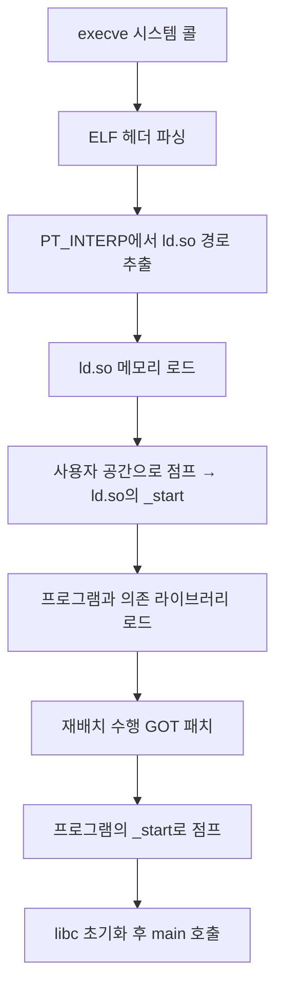

## 들어가며

동적 링커는 모든 프로그램 실행의 첫 순간마다 동작하지만 가장 주목받지 못하는 구성 요소다. 동적 링킹이 없다면 모든 프로그램은 라이브러리 전체를 끌어안은 모놀리스가 됐을 것이다.

프로그램을 실행할 때 단순히 바이너리 파일을 로드하고 `main`을 호출한다고 생각하기 쉽다. 그러나 현실은 더 복잡하다. `printf`를 호출하면 어떻게 libc의 코드가 실행되는가? `libssl.so`는 언제 메모리에 올라가는가? 같은 라이브러리를 사용하는 수백 개의 프로세스가 어떻게 메모리를 공유하는가?

답은 동적 링킹(dynamic linking)에 있다. 동적 링커는 프로그램 실행 시점에 필요한 공유 라이브러리를 찾아 메모리에 적재하고, 심볼을 해석하여 연결한다. 이 글은 `.so` 파일이 메모리에 올라가기까지의 전체 여정을 다룬다. PIC(Position Independent Code)의 원리, GOT/PLT의 런타임 동작, ld.so의 내부 구조, 라이브러리 검색 경로, 그리고 LD_PRELOAD를 이용한 함수 인터포지션까지 추적한다.

ELF의 섹션 구조와 정적 링킹의 결과물에 대한 이해를 전제한다. 이 글에서 도달할 결과는 동적 링커가 실행 직전부터 첫 함수 호출 직후까지 어떤 일을 하는지를 단계별로 추적할 수 있는 능력이다.


---

## 목차
1. [정적 링킹의 한계](#1-정적-링킹의-한계)
2. [PIC: 위치 독립 코드](#2-pic-위치-독립-코드)
3. [GOT: 전역 오프셋 테이블](#3-got-전역-오프셋-테이블)
4. [PLT: 프로시저 연결 테이블](#4-plt-프로시저-연결-테이블)
5. [ld.so: 동적 링커/로더](#5-ldso-동적-링커로더)
6. [LD_PRELOAD와 함수 인터포지션](#6-ld_preload와-함수-인터포지션)
7. [라이브러리 검색 경로](#7-라이브러리-검색-경로)
8. [동적 링킹의 성능과 보안](#8-동적-링킹의-성능과-보안)
9. [고급 주제](#9-고급-주제)


---

## 1. 정적 링킹의 한계

### 정적 링킹의 문제

초기 Unix 시스템은 정적 링킹(static linking)을 사용했다. 정적 archive의 모든 byte가 무조건 복사되는 것은 아니며, linker는 참조를 해결하는 object member와 section을 실행 파일에 포함한다. 어떤 코드가 남는지는 archive 구성, symbol reference, LTO와 section garbage collection에 따라 달라진다.

```bash
$ gcc -static hello.c -o hello
$ ls -lh hello

$ gcc hello.c -o hello_dynamic
$ ls -lh hello_dynamic
```

두 결과의 크기는 libc 구현, debug symbol, PIE, stripping, linker와 build option에 따라 달라진다. `size`, `readelf -S`, `readelf -d`, `ldd`를 함께 사용해 file size뿐 아니라 어떤 code/data와 runtime dependency가 결과에 들어갔는지 비교한다.

정적 링킹의 문제점은 다음과 같다.

1. 디스크 footprint: 여러 실행 파일이 같은 library code를 각각 포함할 수 있다.
2. 물리 메모리 공유 단위: 서로 다른 정적 실행 파일의 code page는 같은 shared object의 page cache를 자연스럽게 공유하지 않는다.
3. 업데이트 단위: library 보안 수정은 영향을 받는 정적 실행 파일을 다시 link하고 배포해야 한다.
4. 시작 비용의 이동: 큰 file I/O가 늘 수 있지만 dynamic loader, dependency mapping, symbol relocation 비용은 줄 수 있다. 어느 쪽이 빠른지는 working set과 cache 상태에 따라 측정한다.

### 동적 링킹의 등장

1980년대 중반 Sun Microsystems가 SunOS에 공유 라이브러리(shared library)를 도입했다. 핵심 아이디어는 단순하다. 라이브러리 코드를 별도 파일(`.so`)로 분리하고, 실행 파일은 라이브러리 참조만 포함하며, 런타임에 동적 링커가 라이브러리를 로드하고 연결한다.

동적 실행 파일들은 같은 shared object의 file-backed read-only page를 page cache에서 공유할 수 있다. 반면 relocation으로 수정되는 page, process별 data, TLS와 allocator state는 공유되지 않는다. RSS를 단순 합산하면 shared page를 중복 계산하므로 PSS(Proportional Set Size)와 `smaps`를 이용해 비교한다.

### 동적 링킹의 도전 과제

동적 링킹은 새로운 문제를 제기한다.

- 주소 독립성: 라이브러리는 어떤 프로세스에서든, 어떤 주소에서든 동작해야 한다. 컴파일 타임에 주소를 하드코딩할 수 없다.
- 심볼 해석: `printf` 호출을 libc의 실제 함수로 연결해야 한다. libc의 주소는 런타임에만 알 수 있다.
- 성능: 모든 함수 호출마다 간접 참조(indirection)가 필요하면 성능 저하가 발생한다.

이 문제를 해결하기 위해 PIC, GOT, PLT라는 메커니즘이 고안되었다.

## 2. PIC: 위치 독립 코드

### 주소 독립성 문제

일반적인 코드는 절대 주소를 사용한다.

```c
// global.c
int global_var = 42;

int get_global() {
    return global_var;
}
```

```asm
# 비-PIC 코드 (gcc -fno-pic)
get_global:
    mov    0x404020, %eax    # 절대 주소
    ret
```

`0x404020`은 컴파일 타임에 결정된 고정 주소다. 이 코드는 정확히 그 주소에 로드되어야만 동작한다. 그러나 공유 라이브러리는 프로세스마다 다른 주소에 로드될 수 있다.

```text
Process A: libc loaded at 0x7f1234000000
Process B: libc loaded at 0x7f5678000000
Process C: libc loaded at 0x7f9abc000000
```

절대 주소를 사용하면 라이브러리가 특정 주소에만 로드될 수 있다. 이는 ASLR(Address Space Layout Randomization)과도 충돌한다.

### PIC의 핵심 원리

PIC(Position Independent Code)는 모든 주소 참조를 상대 주소(relative address) 또는 간접 참조(indirect reference)로 변환한다.

```asm
# PIC 코드 (gcc -fPIC)
get_global:
    mov    0x2fe0(%rip), %rax    # PC-relative 주소
    mov    (%rax), %eax
    ret
```

`%rip`는 명령어 포인터(Instruction Pointer)다. `0x2fe0(%rip)`는 "현재 위치에서 0x2fe0 바이트 떨어진 곳"을 의미한다. 코드가 어디에 로드되든 상대 거리는 변하지 않는다.

### PIC의 세 가지 케이스

PIC는 참조 대상에 따라 다른 전략을 사용한다.

**케이스 1: 함수 내부 참조**

함수 내에서 지역 변수나 스택 변수를 참조하는 경우, 이미 `%rsp` 또는 `%rbp` 기준의 상대 주소다. 추가 작업이 필요 없다.

```c
int func() {
    int local = 10;
    return local + 5;
}
```

```asm
func:
    push   %rbp
    mov    %rsp, %rbp
    movl   $10, -4(%rbp)      # 스택 기준 상대 주소
    mov    -4(%rbp), %eax
    add    $5, %eax
    pop    %rbp
    ret
```

**케이스 2: 같은 모듈 내 함수 호출**

같은 `.so` 내의 함수 호출은 PC-relative call로 처리된다.

```asm
main_func:
    call   helper         # 실제로는 "call <offset>"로 인코딩
    ret
```

x86-64의 `call` 명령어는 기본적으로 RIP-relative다. 호출 대상까지의 오프셋을 인코딩한다.

**케이스 3: 다른 모듈의 심볼 참조**

다른 라이브러리의 함수나 전역 변수를 참조할 때, 컴파일 타임에는 주소를 알 수 없다. 해결책은 GOT(Global Offset Table)다.

## 3. GOT: 전역 오프셋 테이블

### GOT의 개념

GOT는 외부 심볼의 실제 주소를 저장하는 테이블이다. 각 엔트리는 8바이트(64비트 포인터)다.

```text
GOT (Global Offset Table)
+-------------------+
| printf의 주소     | <- GOT[0]
+-------------------+
| malloc의 주소     | <- GOT[1]
+-------------------+
| free의 주소       | <- GOT[2]
+-------------------+
| global_var의 주소 | <- GOT[3]
+-------------------+
```

GOT 자체는 라이브러리의 데이터 섹션에 위치한다. 따라서 PC-relative로 접근 가능하다.

### GOT를 통한 함수 호출

```c
// mylib.c
extern int external_func();

int my_func() {
    return external_func();
}
```

PIC로 컴파일하면 다음과 같다.

```asm
my_func:
    call   *external_func@GOT(%rip)    # GOT를 통한 간접 호출
    ret
```

단계별로 보면 다음과 같다.

```text
1. %rip = 0x7f1234001000 (my_func의 call 명령어)
2. offset = 0x2f50 (GOT 엔트리까지의 거리)
3. GOT entry address = 0x7f1234001000 + 0x2f50 = 0x7f1234003f50
4. *GOT[external_func] = 0x7f5678005000 (런타임에 채워짐)
5. call 0x7f5678005000
```

### GOT 초기화

프로그램 로드 시 GOT는 0 또는 PLT 주소로 초기화되어 있다. 동적 링커가 라이브러리를 로드한 후 GOT를 실제 주소로 패치한다.

```c
// ld.so의 의사 코드
void relocate_got(struct link_map *map) {
    for (each relocation in map->l_relocs) {
        if (reloc.type == R_X86_64_GLOB_DAT) {
            void **got_entry = map->l_addr + reloc.offset;
            void *sym_addr = lookup_symbol(reloc.sym_name);
            *got_entry = sym_addr;
        }
    }
}
```

### GOT 분석

```bash
$ cat test.c
#include <stdio.h>
int main() {
    printf("Hello\n");
    return 0;
}

$ gcc -o test test.c
$ objdump -R test

DYNAMIC RELOCATION RECORDS
OFFSET           TYPE              VALUE
0000000000403fe8 R_X86_64_GLOB_DAT  __libc_start_main@GLIBC_2.34
0000000000403ff0 R_X86_64_GLOB_DAT  __gmon_start__
0000000000404018 R_X86_64_JUMP_SLOT  printf@GLIBC_2.2.5
```

`R_X86_64_GLOB_DAT`는 "이 위치에 심볼의 절대 주소를 써라"라는 재배치 타입이다.

### GOT vs GOT.PLT

실제로 GOT는 두 부분으로 나뉜다.

1. `.got`: 전역 변수용
2. `.got.plt`: 함수 호출용(PLT와 함께 사용)

```bash
$ readelf -S test | grep got
  [20] .got              PROGBITS         0000000000403fc0  00003fc0
       0000000000000040  0000000000000008  WA       0     0     8
  [21] .got.plt          PROGBITS         0000000000404000  00004000
       0000000000000020  0000000000000008  WA       0     0     8
```

`.got.plt`는 지연 바인딩(lazy binding)을 위해 PLT와 협력한다.

## 4. PLT: 프로시저 연결 테이블

### PLT의 필요성

GOT만으로도 외부 함수 호출이 가능하다. 그러나 모든 함수를 프로그램 시작 시 해석하면 초기 로딩 시간이 길어진다. 대부분의 프로그램은 라이브러리 함수의 일부만 사용한다. libc는 2,000개 이상의 함수를 제공하지만, 일반 프로그램은 10~20개만 호출한다.

해결책은 지연 바인딩(Lazy Binding)이다. 함수는 처음 호출될 때 해석하며, 해석 전까지 GOT는 PLT를 가리킨다. PLT는 동적 링커를 호출하여 실제 주소를 찾는다.

### PLT의 구조

PLT는 작은 코드 스텁(code stub)들의 배열이다. 각 외부 함수마다 하나의 PLT 엔트리가 있다.

```asm
.plt:
PLT0:   # 특수 엔트리 (동적 링커 호출용)
    push   *GOT[1]              # link_map 푸시
    jmp    *GOT[2]              # _dl_runtime_resolve로 점프
    nop

PLT1:   # printf용 엔트리
    jmp    *GOT[printf]         # GOT에서 주소 로드 후 점프
    push   $0                   # 재배치 인덱스
    jmp    PLT0                 # PLT0로 점프

PLT2:   # malloc용 엔트리
    jmp    *GOT[malloc]
    push   $1
    jmp    PLT0
```

### 첫 호출: 지연 바인딩

`printf`를 처음 호출할 때의 흐름을 시퀀스로 정리하면 다음과 같다.

```mermaid
sequenceDiagram
    participant U as 사용자 코드
    participant P1 as PLT[printf]
    participant P0 as PLT0
    participant L as ld.so
    participant G as GOT[printf]
    participant F as printf 본체

    U->>P1: call printf@plt
    P1->>G: jmp *GOT[printf]
    G-->>P1: 초기값(PLT의 다음 명령)
    P1->>P0: push idx; jmp PLT0
    P0->>L: _dl_runtime_resolve
    L->>L: 심볼 검색
    L->>G: GOT[printf] = 실제 주소
    L->>F: jmp printf
    F-->>U: 결과 반환
```

### 두 번째 호출: 직접 점프

`printf`를 다시 호출하면 PLT 엔트리의 첫 명령에서 GOT를 따라가 곧바로 `printf` 본체로 점프한다. PLT0와 `_dl_runtime_resolve`를 거치지 않는다. 단 한 번의 간접 점프로 함수에 도달한다.

### 실제 PLT 덤프

```bash
$ objdump -d test | grep -A 10 "\.plt:"

0000000000401020 <printf@plt>:
  401020:       ff 25 f2 2f 00 00       jmp    *0x2ff2(%rip)  # 404018 <printf@GLIBC_2.2.5>
  401026:       68 00 00 00 00          push   $0x0
  40102b:       e9 e0 ff ff ff          jmp    401010 <.plt>

0000000000401010 <.plt>:
  401010:       ff 35 f2 2f 00 00       push   0x2ff2(%rip)   # 404008 <_GLOBAL_OFFSET_TABLE_+0x8>
  401016:       ff 25 f4 2f 00 00       jmp    *0x2ff4(%rip)  # 404010 <_GLOBAL_OFFSET_TABLE_+0x10>
  40101c:       0f 1f 40 00             nopl   0x0(%rax)
```

`0x401020`이 `printf@plt` 엔트리다. `jmp *0x2ff2(%rip)`는 GOT 엔트리(`0x401020 + 6 + 0x2ff2 = 0x404018`)를 참조한다. 이어서 `push $0x0`로 재배치 인덱스를 푸시하고 PLT0로 점프한다.

### GDB로 GOT 변화 추적

```bash
$ gdb ./hello
(gdb) break main
(gdb) run
(gdb) x/gx 0x4018        # 초기 GOT 엔트리
0x4018: 0x0000000000001046  # PLT의 push 명령어
(gdb) continue
Hello, ELF!
(gdb) x/gx 0x4018        # 호출 후
0x4018: 0x00007ffff7e3d8a0  # libc의 printf
```

첫 호출 후 GOT가 업데이트되었다.

### 지연 바인딩 비활성화

보안이나 디버깅을 위해 지연 바인딩을 끌 수 있다.

```bash
# 환경변수로 비활성화
$ LD_BIND_NOW=1 ./test

# 컴파일 시 비활성화
$ gcc -Wl,-z,now -o test test.c
```

`LD_BIND_NOW=1`을 설정하면 모든 GOT 엔트리가 프로그램 시작 시 한 번에 해석된다.

## 5. ld.so: 동적 링커/로더

### ld.so의 정체

프로그램을 실행하면 커널은 바로 `main`을 호출하지 않는다. 동적 링커를 먼저 실행한다.

```bash
$ readelf -l test | grep interpreter
      [Requesting program interpreter: /lib64/ld-linux-x86-64.so.2]
```

`/lib64/ld-linux-x86-64.so.2`가 ld.so다. glibc의 일부이며 프로그램 로딩의 핵심이다.

실행 흐름은 다음과 같다.



### ld.so의 주요 작업

**작업 1: 의존 라이브러리 로딩**

ELF 파일의 `DT_NEEDED` 엔트리를 순회하며 필요한 라이브러리를 찾는다.

```bash
$ readelf -d test | grep NEEDED
 0x0000000000000001 (NEEDED)             Shared library: [libc.so.6]
```

```c
// ld.so의 의사 코드
void load_dependencies(struct link_map *map) {
    for (each DT_NEEDED entry in map->l_ld) {
        char *libname = strtab + entry->d_un.d_val;
        char *path = search_library(libname);
        struct link_map *dep = load_library(path);
        add_dependency(map, dep);
    }
}
```

**작업 2: 심볼 테이블 구축**

모든 라이브러리의 심볼을 해시 테이블에 등록한다.

```c
struct link_map {
    void *l_addr;               // 로드 주소
    char *l_name;               // 라이브러리 이름
    ElfW(Dyn) *l_ld;            // 동적 섹션
    struct link_map *l_next;
    struct link_map *l_prev;

    ElfW(Sym) *l_symtab;
    const char *l_strtab;

    Elf32_Word *l_gnu_buckets;
    Elf32_Word *l_gnu_chain_zero;
};
```

**작업 3: 재배치 수행**

모든 `R_X86_64_*` 타입의 재배치를 처리한다.

```c
void do_relocations(struct link_map *map) {
    ElfW(Rela) *relocs = map->l_relocs;

    for (int i = 0; i < map->l_reloc_count; i++) {
        ElfW(Rela) *rel = &relocs[i];
        int type = ELF64_R_TYPE(rel->r_info);
        int sym_idx = ELF64_R_SYM(rel->r_info);

        void **target = (void **)(map->l_addr + rel->r_offset);

        switch (type) {
        case R_X86_64_GLOB_DAT:
        case R_X86_64_JUMP_SLOT:
            ElfW(Sym) *sym = &map->l_symtab[sym_idx];
            const char *sym_name = map->l_strtab + sym->st_name;
            void *sym_addr = lookup_symbol(sym_name);
            *target = sym_addr;
            break;

        case R_X86_64_RELATIVE:
            *target = map->l_addr + rel->r_addend;
            break;
        }
    }
}
```

**작업 4: 초기화 함수 실행**

`.init_array`의 함수들을 실행한다. C++의 전역 생성자도 여기서 호출된다.

```c
void call_init_functions(struct link_map *map) {
    if (map->l_init)
        ((void (*)(void))map->l_init)();

    void (**init_array)(void) = map->l_init_array;
    for (int i = 0; i < map->l_init_array_sz / sizeof(void*); i++) {
        init_array[i]();
    }
}
```

### ld.so 자신의 부트스트랩

ld.so 자체도 공유 라이브러리다. ld.so는 자기 자신을 부트스트랩한다.

```c
// ld.so의 _start (glibc/elf/rtld.c)
void _start(void) {
    // 1. 스택에서 argc, argv, envp 추출
    // 2. 자기 자신의 재배치 수행 (bootstrap_map)
    // 3. 의존 라이브러리 로딩
    // 4. 모든 재배치 수행
    // 5. 프로그램으로 점프
}
```

ld.so는 PIC로 컴파일되며, 최소한의 외부 의존성만 가진다. 자기 자신을 재배치한 후 다른 라이브러리를 로드한다.

### 심볼 검색 순서

같은 이름의 심볼이 여러 객체에 있으면 전역 검색 범위(global search scope)를 다음 순서로 검색한다.

1. 실행 파일 자체
2. LD_PRELOAD로 지정된 라이브러리
3. DT_NEEDED 의존성들 (너비 우선 탐색 순서)

```text
LD_PRELOAD=hack.so ./program

검색 순서:
1. program 자체
2. hack.so
3. program의 DT_NEEDED (예: libfoo.so, libc.so)
4. 그 다음 단계의 DT_NEEDED (너비 우선)
```

첫 번째로 발견된 심볼이 사용된다. LD_PRELOAD 라이브러리가 일반 라이브러리들보다 앞서므로 라이브러리 함수를 가로챌 수 있다 — 이것이 인터포지션의 원리다. 단, 실행 파일 자체가 정의하고 있는 심볼은 LD_PRELOAD로 가로챌 수 없다.

## 6. LD_PRELOAD와 함수 인터포지션

### LD_PRELOAD의 동작

LD_PRELOAD는 가장 강력한 디버깅과 분석 도구 중 하나다. 단, 보안상 secure-execution 모드(`AT_SECURE` 플래그가 1)에서는 ld.so가 LD_PRELOAD/LD_LIBRARY_PATH 같은 환경 변수를 무시하거나 표준 시스템 디렉토리 안의 라이브러리만 허용한다. setuid/setgid 비트가 설정된 바이너리, 파일 capability를 가진 바이너리, MAC(SELinux/AppArmor) 정책에 의해 보호된 실행 파일이 이에 해당한다. 따라서 setuid 프로그램에 LD_PRELOAD로 후크를 끼우는 것은 동작하지 않는다.

다음 코드는 인터포지션 원리만 보이는 **의도적으로 불완전한 예제**다.

```c
// malloc_hook.c
#define _GNU_SOURCE
#include <dlfcn.h>
#include <stdio.h>

void *malloc(size_t size) {
    static void *(*real_malloc)(size_t) = NULL;

    if (!real_malloc)
        real_malloc = dlsym(RTLD_NEXT, "malloc");

    void *ptr = real_malloc(size);
    fprintf(stderr, "malloc(%zu) = %p\n", size, ptr);
    return ptr;
}
```

```bash
$ gcc -shared -fPIC malloc_hook.c -o malloc_hook.so -ldl
$ LD_PRELOAD=./malloc_hook.so ls
malloc(472) = 0x55a4b2c012a0
malloc(120) = 0x55a4b2c01480
malloc(1024) = 0x55a4b2c01500
```

출력에 보이는 호출은 동적 심볼 검색을 거쳐 이 정의에 바인딩된 `malloc` 호출이다. 정적 링크된 코드, 숨겨진 심볼, libc 내부의 비인터포즈 호출, compiler builtin이나 직접 시스템 콜까지 모두 잡는다는 뜻은 아니다.

이 예제를 프로파일러에 그대로 쓰면 안 된다. 첫 `malloc` 안의 `dlsym`과 매 호출의 `fprintf`가 다시 메모리를 할당하면 재귀 호출, 초기화 교착 또는 무한 재귀가 생길 수 있다. 완성된 allocator interposer는 재진입 방지, bootstrap allocator나 미리 확보한 버퍼, allocation-free 로깅, thread-safe 통계, 종료 중 수명 문제를 해결해야 한다. `LD_AUDIT`, eBPF, sanitizer·profiler API처럼 목적에 더 맞는 관찰 경로도 비교해야 한다.

### dlsym과 RTLD_NEXT

`dlsym(RTLD_NEXT, "malloc")`은 "현재 라이브러리 다음에 있는 malloc을 찾으라"는 의미다.

아래 코드도 핵심 아이디어만 보이는 의사 코드다. `total_allocated`에는 원자성 또는 thread-local 집계가 필요하고, `malloc_usable_size`는 요청 크기와 다르며 glibc 확장이다.

```c
// glibc/dlfcn/dlsym.c
void *dlsym(void *handle, const char *name) {
    if (handle == RTLD_NEXT) {
        struct link_map *caller = _dl_find_caller();
        return _dl_lookup_symbol(name, caller->l_next);
    }
    // ...
}
```

이렇게 하면 원본 함수를 호출할 수 있다.

### 인터포지션의 응용

**메모리 프로파일링**

```c
static size_t total_allocated = 0;

void *malloc(size_t size) {
    void *ptr = real_malloc(size);
    total_allocated += size;
    return ptr;
}

void free(void *ptr) {
    size_t size = malloc_usable_size(ptr);
    total_allocated -= size;
    real_free(ptr);
}
```

**보안 감사**

```c
int open(const char *path, int flags, ...) {
    if (strstr(path, "/etc/passwd")) {
        fprintf(stderr, "SECURITY: Attempt to open %s\n", path);
    }
    return real_open(path, flags);
}
```

**함수 추적**

```c
int pthread_create(pthread_t *thread, const pthread_attr_t *attr,
                   void *(*start_routine)(void *), void *arg) {
    fprintf(stderr, "pthread_create: %p\n", start_routine);
    return real_pthread_create(thread, attr, start_routine, arg);
}
```

### LD_PRELOAD의 한계

LD_PRELOAD는 만능이 아니다.

1. 정적 링크 프로그램에는 동작하지 않는다.
2. setuid 프로그램에서는 보안상 무시된다.
3. `syscall` 직접 호출은 가로챌 수 없다.
4. GNU의 `dlopen(RTLD_DEEPBIND)`나 숨겨진 visibility처럼 심볼 검색 범위를 바꾸는 기능을 사용한 호출은 예상과 다르게 바인딩될 수 있다.
5. 생성자 호출 이전과 종료 중, 재귀 호출, 다른 할당 API까지 다루려면 단순 래퍼보다 훨씬 강한 수명 규약이 필요하다.

## 7. 라이브러리 검색 경로

### 검색 순서

다음 순서는 Linux의 glibc 동적 로더를 기준으로 단순화한 것이다. musl, Android linker, 다른 ELF 운영체제는 세부 규칙이 다를 수 있으며 secure-execution 모드와 `-z nodefaultlib` 같은 옵션도 검색 경로를 바꾼다. glibc `ld.so`는 ELF 파일의 동적 태그에 따라 다음처럼 동작한다.

**케이스 A — DT_RPATH는 있고 DT_RUNPATH는 없을 때 (레거시)**

1. DT_RPATH (실행 파일과 그 실행 파일을 로드한 모든 객체의 RPATH가 외부 라이브러리에도 영향을 준다)
2. LD_LIBRARY_PATH 환경 변수
3. /etc/ld.so.cache
4. 기본 시스템 경로 (`/lib`, `/usr/lib`)

**케이스 B — DT_RUNPATH가 있을 때 (현대)**

1. LD_LIBRARY_PATH 환경 변수
2. DT_RUNPATH (단, 해당 태그가 적힌 객체 자신의 직접 의존성에만 적용. 전이적으로 다른 객체의 의존성에는 영향을 주지 않는다)
3. /etc/ld.so.cache
4. 기본 시스템 경로 (`/lib`, `/usr/lib`)

핵심 차이는 두 가지다. 첫째, DT_RUNPATH는 LD_LIBRARY_PATH보다 우선순위가 낮다. 둘째, DT_RUNPATH는 자기 객체의 직접 의존성에만 영향을 준다. DT_RPATH는 양쪽 모두 그 반대로 동작했고, 그래서 보안과 빌드 분리 측면에서 RUNPATH가 도입되었다. 동일 ELF 파일에 두 태그가 모두 있는 경우 glibc ld.so는 DT_RPATH를 무시하고 DT_RUNPATH만 사용한다.

### RPATH vs RUNPATH

둘 다 ELF 파일에 포함된 검색 경로지만 차이가 있다.

```bash
# RPATH 설정 (레거시)
$ gcc -Wl,-rpath,/opt/mylib -o test test.c

# RUNPATH 설정 (modern)
$ gcc -Wl,-rpath,/opt/mylib -Wl,--enable-new-dtags -o test test.c
```

| 특성 | RPATH | RUNPATH |
|------|-------|---------|
| 우선순위 | LD_LIBRARY_PATH보다 높음 | LD_LIBRARY_PATH보다 낮음 |
| 하위 의존성 | 전파됨 | 전파 안 됨 |
| 덮어쓰기 | LD_LIBRARY_PATH로 불가능 | LD_LIBRARY_PATH로 가능 |

```bash
$ readelf -d test | grep PATH
 0x000000000000000f (RPATH)              Library rpath: [/opt/mylib]
 0x000000000000001d (RUNPATH)            Library runpath: [/opt/mylib]
```

### LD_LIBRARY_PATH의 함정

LD_LIBRARY_PATH는 편리하지만 위험하다.

```bash
$ export LD_LIBRARY_PATH=/my/custom/lib:$LD_LIBRARY_PATH
$ ./some_program
Segmentation fault  # 버전 충돌
```

문제점은 다음과 같다.

1. 전역 영향: 모든 프로그램에 영향을 미친다.
2. 버전 충돌: 다른 libc 버전이 로드될 수 있다.
3. 보안 위험: 악의적인 라이브러리 주입이 가능하다.
4. 디버깅 어려움: 예상치 못한 라이브러리가 로드된다.

더 나은 방법은 다음과 같다.

```bash
# 특정 프로그램에만 적용
$ LD_LIBRARY_PATH=/my/lib ./myprogram

# 또는 RUNPATH 사용
$ patchelf --set-rpath /my/lib ./myprogram
```

### ld.so.cache

매번 디렉토리를 탐색하면 느리다. 해결책은 캐시다.

```bash
$ cat /etc/ld.so.conf
include /etc/ld.so.conf.d/*.conf

$ cat /etc/ld.so.conf.d/x86_64-linux-gnu.conf
/usr/lib/x86_64-linux-gnu

$ sudo ldconfig  # 캐시 재생성

$ ldconfig -p | grep libc
        libc.so.6 (libc6,x86-64) => /lib/x86_64-linux-gnu/libc.so.6
```

`ldconfig`는 모든 라이브러리를 스캔하여 `/etc/ld.so.cache` 파일을 생성한다. 이 파일은 바이너리 해시 테이블로 빠른 검색을 제공한다.

### $ORIGIN 상대 경로

RPATH에 절대 경로를 하드코딩하면 이식성이 떨어진다. 해결책은 `$ORIGIN`이다.

```bash
$ gcc -Wl,-rpath,'$ORIGIN/../lib' -o myapp myapp.c

$ readelf -d myapp | grep RUNPATH
 0x000000000000001d (RUNPATH)            Library runpath: [$ORIGIN/../lib]
```

`$ORIGIN`은 그 동적 문자열을 해석하는 프로그램 또는 shared object가 놓인 디렉토리로 확장된다. 실행 파일의 RUNPATH에 있으면 실행 파일 디렉토리이고, shared object 자신의 의존성을 위한 RUNPATH에 있으면 그 shared object의 디렉토리다.

```text
myapp_install/
├── bin/
│   └── myapp          (RUNPATH: $ORIGIN/../lib)
└── lib/
    └── libmylib.so
```

설치 위치와 무관하게 동작한다.

## 8. 동적 링킹의 성능과 보안

### 성능 오버헤드

동적 링킹은 공짜가 아니다.

1. 프로그램 시작 시간: 라이브러리 로딩과 재배치
2. 함수 호출 오버헤드: PLT/GOT 간접 참조
3. 캐시 미스: 코드가 분산되어 있어 locality 저하

벤치마크 예시는 다음과 같다.

```c
#include <stdio.h>
#include <time.h>

int main() {
    clock_t start = clock();
    for (int i = 0; i < 100000000; i++) {
        printf("");  // PLT를 통한 호출
    }
    clock_t end = clock();
    printf("Time: %f\n", (double)(end - start) / CLOCKS_PER_SEC);
}
```

```bash
$ gcc -O2 -o dynamic test.c
$ gcc -O2 -static -o static test.c

$ time ./dynamic
Time: 0.15

$ time ./static
Time: 0.14
```

차이는 미미하다. 현대 CPU의 분기 예측기가 PLT 점프를 잘 처리하기 때문이다.

### 보안: RELRO

GOT는 쓰기 가능한 메모리다. 공격자가 GOT를 덮어쓰면 임의 코드를 실행할 수 있다.

```c
// 취약한 코드
char buffer[64];
gets(buffer);  // 버퍼 오버플로우
printf("Done\n");
```

공격자는 `buffer` 오버플로우로 `GOT[printf]`를 덮어써서 임의 코드를 실행할 수 있다.

RELRO(Relocation Read-Only)는 이를 방지한다.

```bash
# Partial RELRO (기본)
$ gcc -o test test.c

# Full RELRO
$ gcc -Wl,-z,relro,-z,now -o test test.c
```

Full RELRO는 모든 재배치를 프로그램 시작 시 수행하고(lazy binding 비활성화), GOT를 읽기 전용으로 변경한다(`mprotect(GOT, PROT_READ)`). 대가는 초기 로딩 시간 증가다.

### ASLR과 PIE

ASLR(Address Space Layout Randomization)은 라이브러리를 매번 다른 주소에 로드한다.

```bash
$ cat /proc/self/maps | grep libc
7f8a2e000000-7f8a2e1e0000 r-xp 00000000 08:01 libc-2.31.so

$ cat /proc/self/maps | grep libc
7f3c1a000000-7f3c1a1e0000 r-xp 00000000 08:01 libc-2.31.so
```

주소가 다르다. ROP(Return-Oriented Programming) 공격을 어렵게 만든다.

PIE(Position Independent Executable)는 프로그램 자체도 PIC로 컴파일한다.

```bash
$ gcc -fPIE -pie -o test test.c
$ readelf -h test | grep Type
  Type:                              DYN (Shared object file)
```

이제 프로그램도 랜덤 주소에 로드된다.

## 9. 고급 주제

### Symbol Versioning

같은 라이브러리의 다른 버전이 공존할 수 있다.

```bash
$ objdump -T /lib/x86_64-linux-gnu/libc.so.6 | grep " malloc"
00000000000a7050 g    DF .text  0000000000000340  GLIBC_2.2.5 malloc
```

`malloc@@GLIBC_2.2.5`는 "GLIBC 2.2.5 버전의 malloc"을 의미한다. 프로그램은 특정 버전에 바인딩된다.

```bash
$ readelf -V test

Version needs section '.gnu.version_r' contains 1 entry:
  000000: Version: 1  File: libc.so.6  Cnt: 1
  0x0010:   Name: GLIBC_2.2.5  Flags: none  Version: 2
```

Symbol versioning은 라이브러리가 여러 심볼 구현을 함께 제공하고 소비자가 요구한 버전에 바인딩되게 한다. 그러나 함수 signature, 자료구조 layout, 호출 규약과 의미가 실제로 호환되게 유지되어야 하며, 필요한 버전을 라이브러리에서 제거하면 로딩은 실패한다. 따라서 호환성을 **표현하고 선택하는 장치**이지 ABI 호환성을 자동으로 만들어 주는 보장은 아니다.

### Thread-Local Storage (TLS)

스레드마다 다른 값을 가지는 변수를 정의할 수 있다.

```c
__thread int my_errno = 0;

void func() {
    my_errno = 42;
}
```

TLS는 특수한 GOT 메커니즘을 사용한다.

```asm
mov    %fs:0x0, %rax           # FS는 TLS 베이스
add    my_errno@tpoff, %rax
mov    (%rax), %eax
```

`%fs`는 스레드-로컬 스토리지 베이스를 가리키는 특수 레지스터다.

### dlopen: 런타임 로딩

라이브러리를 프로그램 실행 중에 로드할 수 있다.

```c
#include <dlfcn.h>

void *handle = dlopen("libfoo.so", RTLD_LAZY);
if (!handle) {
    fprintf(stderr, "dlopen failed: %s\n", dlerror());
    return;
}

void (*func)(void) = dlsym(handle, "foo_init");
if (func)
    func();

dlclose(handle);
```

플러그인 시스템의 핵심이다.

### Deep Binding

일반적으로 심볼은 전역으로 공유된다.

```text
Program: foo()
LibA.so: foo() { return 1; }  // 이게 사용됨
LibB.so: foo() { return 2; }
        bar() { return foo(); }  // LibA의 foo() 호출
```

GNU 확장인 `RTLD_DEEPBIND`는 새 객체의 자체 심볼 검색 범위를 전역 범위보다 앞세운다.

```c
void *handle = dlopen("libB.so", RTLD_LAZY | RTLD_DEEPBIND);
// 이제 LibB.so의 bar()는 자신의 foo()를 호출
```

이 옵션은 심볼 인터포지션을 피하는 데 쓰일 수 있지만, 한 프로세스 안에 allocator, C++ runtime, 전역 singleton의 서로 다른 사본이 섞여 객체를 한 사본에서 만들고 다른 사본에서 파괴하는 문제를 만들 수 있다. 플러그인 격리는 명시적인 C ABI 경계, symbol visibility, versioned interface, 필요하면 별도 linker namespace나 프로세스 경계를 우선 검토한다.

---

## 결론

동적 링킹은 Linux 사용자 공간의 핵심 기반이다. 프로그램마다 의존 라이브러리 수, relocation 수, lazy binding 여부, 저장장치·page cache 상태가 다르므로 시작 비용을 고정된 라이브러리 개수나 밀리초 수로 일반화할 수 없다. `LD_DEBUG=statistics`, loader trace와 실제 시작 시간으로 해당 바이너리를 측정해야 한다.

이 메커니즘을 이해하면 다음이 가능해진다.

- 디버깅이 쉬워진다(symbol not found, version conflicts 등).
- 성능 최적화가 가능하다(BIND_NOW, static linking 등).
- 보안 강화를 할 수 있다(RELRO, PIE, LD_PRELOAD 통제 등).
- 강력한 도구를 만들 수 있다(프로파일러, 샌드박스, 디버거 등).

`ldd`를 실행하거나 "error while loading shared libraries"를 마주할 때 그 에러 메시지 뒤에는 PIC, GOT, PLT, ld.so의 협업이 있다.

## 더 읽을거리

- John Levine, *Linkers and Loaders* (1999)
- Ulrich Drepper, *How To Write Shared Libraries* (2011)
- glibc의 `elf/rtld.c` — ld.so의 핵심 구현
- glibc의 `elf/dl-runtime.c` — lazy binding 구현
- `man ld.so`, `man dlopen`, `man elf`
- 디버깅 명령:

```bash
# ld.so의 모든 동작 추적
$ LD_DEBUG=all ./test 2>&1 | less

# 특정 심볼 바인딩 과정 보기
$ LD_DEBUG=bindings ./test 2>&1 | grep printf

# 라이브러리 검색 과정 보기
$ LD_DEBUG=libs ./test 2>&1
```
