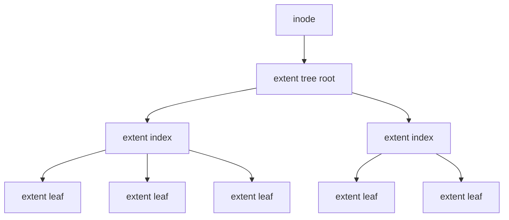
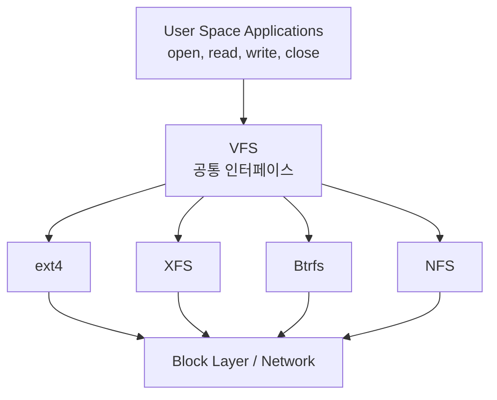
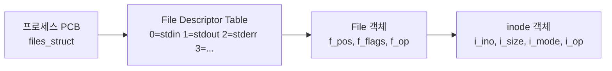

## 들어가며

"모든 것은 파일이다(Everything is a file)" — UNIX 설계 철학을 압축한 격언이다.

프로그램을 저장하고, 데이터를 읽고, 설정을 기록한다. `open`을 호출하는 순간 커널은 디스크의 수백만 개 블록 중에서 정확히 그 파일을 찾아낸다. 더 나아가 파일 이름은 사람을 위한 편의일 뿐인데, 커널은 무엇으로 파일을 식별하는가?

이 글은 운영체제의 가장 지속적인 추상화인 파일시스템의 본질을 다룬다. inode가 무엇을 저장하는지, 디렉토리가 실제로 무엇인지, 리눅스 커널이 어떻게 다양한 파일시스템을 통일된 인터페이스로 제공하는지를 추적한다. 범위는 이름·메타데이터·VFS·저널 복구 계약이며, 저장 장치 요청의 세부 스케줄링은 이 추상화의 하위 구현으로만 다룬다.

여기까지의 결과물은 `open`, `read`, `write`, `close`라는 단순한 API 뒤에서 일어나는 inode 조회, 경로 탐색, VFS 디스패치의 전 과정을 추적할 수 있는 지식이다.


---

## 목차
1. [파일이란 무엇인가](#1-파일이란-무엇인가)
2. [inode: 메타데이터의 저장소](#2-inode-메타데이터의-저장소)
3. [디렉토리: 이름과 inode의 매핑](#3-디렉토리-이름과-inode의-매핑)
4. [VFS: Virtual File System](#4-vfs-virtual-file-system)
5. [Superblock과 File 객체](#5-superblock과-file-객체)
6. [파일 디스크립터 테이블](#6-파일-디스크립터-테이블)
7. [파일시스템 비교: ext4, XFS, Btrfs](#7-파일시스템-비교-ext4-xfs-btrfs)
8. [저널링: 크래시 복구](#8-저널링-크래시-복구)
9. [추적과 분석](#9-추적과-분석)


---

## 1. 파일이란 무엇인가

### 파일의 정의

UNIX 철학의 핵심은 "모든 것은 파일이다"라는 명제다. 디스크의 텍스트 파일, 네트워크 소켓, 키보드 입력, 프린터 출력 모두 파일로 추상화된다.

파일의 본질은 바이트의 선형 배열이다. 그 이상도, 그 이하도 아니다.

```text
[byte0][byte1][byte2][byte3]...[byteN]
```

이 추상화는 다음을 숨긴다.

- 데이터가 디스크의 어느 섹터에 저장되는가
- 파일이 연속적인 블록에 있는가, 흩어져 있는가
- SSD인가, HDD인가, 네트워크 드라이브인가

프로그래머는 `read`와 `write`만 알면 된다.

### 파일의 탄생

1970년대 초, UNIX 이전의 시스템들은 파일 타입마다 다른 시스템 콜을 사용했다. 테이프 파일을 읽는 것과 디스크 파일을 읽는 것이 달랐다.

Ken Thompson과 Dennis Ritchie는 이를 단순화했다. 1974년 논문 "The UNIX Time-Sharing System"에서 제시한 설계는 일반 파일, 장치, 프로세스 간 통신 채널을 모두 동일한 파일 인터페이스로 통일하는 것이었다.

파이프(`|`)는 파일이다. 터미널(`/dev/tty`)은 파일이다. `/proc`의 프로세스 정보도 파일이다.

### 데이터와 메타데이터

파일은 두 가지를 가진다.

1. 데이터(Data): 파일의 실제 내용(바이트들)
2. 메타데이터(Metadata): 파일에 대한 정보

메타데이터의 예시는 다음과 같다.

- 파일 크기
- 생성 시간, 수정 시간, 접근 시간
- 소유자(UID), 그룹(GID)
- 권한(rwxrwxrwx)
- 파일 타입(일반 파일, 디렉토리, 심볼릭 링크 등)

이 메타데이터의 저장 위치는 inode다.

## 2. inode: 메타데이터의 저장소

### inode의 정의

inode(index node)는 UNIX 파일시스템의 핵심 개념이다. inode는 파일의 메타데이터를 저장하는 데이터 구조다.

중요한 사실은 inode가 파일 이름을 저장하지 않는다는 것이다. 파일 이름은 디렉토리에 저장된다. inode는 메타데이터와 데이터 블록의 위치만 알고 있다.

### inode 구조

리눅스 ext4 파일시스템의 inode는 다음과 같다.

```c
// fs/ext4/ext4.h
struct ext4_inode {
    __le16  i_mode;         /* 파일 모드 (타입 + 권한) */
    __le16  i_uid;          /* 소유자 UID (하위 16비트) */
    __le32  i_size_lo;      /* 파일 크기 (하위 32비트) */
    __le32  i_atime;        /* 접근 시간 */
    __le32  i_ctime;        /* inode 변경 시간 */
    __le32  i_mtime;        /* 수정 시간 */
    __le32  i_dtime;        /* 삭제 시간 */
    __le16  i_gid;          /* 그룹 GID (하위 16비트) */
    __le16  i_links_count;  /* 하드 링크 카운터 */
    __le32  i_blocks_lo;    /* 블록 수 (하위 32비트) */
    __le32  i_flags;        /* 파일 플래그 */

    /* 데이터 블록 포인터 배열 */
    __le32  i_block[EXT4_N_BLOCKS];  /* 15개 포인터 */

    __le32  i_generation;   /* 파일 버전 (NFS용) */
    __le32  i_file_acl_lo;  /* 확장 속성 블록 */
    __le32  i_size_high;    /* 파일 크기 (상위 32비트) */
    /* ... 더 많은 필드들 ... */
};
```

ext4에서 inode는 256바이트 크기다(설정에 따라 128바이트 또는 512바이트도 가능).

### inode 번호

파일시스템 내에서 파일은 inode 번호로 식별된다. 파일 이름 `"report.txt"`는 사람을 위한 별명일 뿐이다. 커널은 inode 번호로 파일을 찾는다.

```bash
$ ls -i report.txt
1234567 report.txt
```

`1234567`이 inode 번호다.

### 데이터 블록 포인터: i_block

inode의 가장 중요한 부분은 `i_block` 배열이다. 파일 데이터가 저장된 디스크 블록을 가리킨다.

ext4는 extent 기반 시스템을 사용한다. 이전 ext2/ext3는 블록 포인터 기반이었다.

```c
// fs/ext4/ext4_extents.h
struct ext4_extent {
    __le32  ee_block;       /* 파일 내 논리 블록 번호 */
    __le16  ee_len;         /* extent 길이 (블록 수) */
    __le16  ee_start_hi;    /* 물리 블록 번호 (상위 16비트) */
    __le32  ee_start_lo;    /* 물리 블록 번호 (하위 32비트) */
};
```

Extent는 연속된 블록들의 범위다. 예를 들어 "논리 블록 0~99는 물리 블록 5000~5099에 저장됨" 같은 식이다. 큰 파일도 적은 메타데이터로 표현할 수 있다.

### 큰 파일과 extent tree

파일이 너무 커서 inode의 extent 엔트리로 표현할 수 없다면 ext4는 extent tree를 사용한다.



extent header의 `eh_depth`는 root에서 leaf까지의 깊이를 저장하고 실제 최대 깊이는 block 크기, inode 내부 root 공간과 구현 검증 한계에 달려 있다. 파일의 논리 block 번호 `ee_block`이 32비트이므로 4KiB block에서 논리 주소 범위의 산술 상한은 $2^{32}\times4\text{KiB}=16\text{TiB}$다. 이 값은 extent tree fan-out만으로 나온 것이 아니며 kernel·filesystem feature와 `i_size` 검증 한계도 함께 적용된다.

### inode 조회 관찰

```bash
$ stat report.txt
  File: report.txt
  Size: 4096            Blocks: 8          IO Block: 4096   regular file
Device: 801h/2049d      Inode: 1234567     Links: 1
Access: (0644/-rw-r--r--)  Uid: ( 1000/   user)   Gid: ( 1000/   user)
Access: 2025-12-23 10:30:00.000000000 +0900
Modify: 2025-12-23 10:25:00.000000000 +0900
Change: 2025-12-23 10:25:00.000000000 +0900
 Birth: 2025-12-22 15:00:00.000000000 +0900
```

커널 레벨에서는 다음과 같이 확인한다.

```bash
$ sudo debugfs /dev/sda1
debugfs: stat <1234567>
Inode: 1234567   Type: regular    Mode:  0644   Flags: 0x80000
User:  1000   Group:  1000   Size: 4096
Links: 1   Blockcount: 8
EXTENTS:
(0):5000
```

`(0):5000`은 "논리 블록 0이 물리 블록 5000에 저장됨"을 의미한다.

## 3. 디렉토리: 이름과 inode의 매핑

### 디렉토리의 본질

디렉토리도 파일이다. 다만 특별한 종류의 파일이다. 디렉토리 파일의 데이터는 디렉토리 엔트리(directory entry, dentry)의 목록이다. 각 엔트리는 파일 이름과 inode 번호를 매핑한다.

```c
struct directory_entry {
    ino_t   inode_number;
    char    filename[256];
};
```

### ext4 디렉토리 엔트리

```c
// fs/ext4/ext4.h
struct ext4_dir_entry_2 {
    __le32  inode;          /* inode 번호 */
    __le16  rec_len;        /* 디렉토리 엔트리 길이 */
    __u8    name_len;       /* 파일 이름 길이 */
    __u8    file_type;      /* 파일 타입 */
    char    name[EXT4_NAME_LEN];  /* 파일 이름 (최대 255) */
};
```

디렉토리를 읽으면 다음과 같은 엔트리들의 나열이 나온다.

```text
inode=2     name="."
inode=2     name=".."
inode=12    name="file1.txt"
inode=13    name="file2.txt"
inode=14    name="subdir"
```

`.`은 현재 디렉토리 자신의 inode를 가리키고, `..`은 부모 디렉토리의 inode를 가리킨다.

### 경로 탐색

`/home/user/report.txt`를 열 때 커널이 하는 일은 다음과 같다.

1. 현재 프로세스의 루트 디렉토리(`current->fs->root`, `chroot`로 바뀔 수 있다)에서 탐색을 시작한다. ext 계열 on-disk 형식의 root inode 번호는 2지만, VFS pathname resolution의 보편 규칙이 “모든 파일시스템의 inode 2”인 것은 아니다.
2. `/`의 디렉토리 엔트리에서 `"home"`을 찾아 inode 번호를 얻는다.
3. `home`의 inode를 읽고, 디렉토리 데이터를 읽는다.
4. `home`의 디렉토리 엔트리에서 `"user"`를 찾아 inode 번호를 얻는다.
5. `user`의 inode를 읽고, 디렉토리 데이터를 읽는다.
6. `user`의 디렉토리 엔트리에서 `"report.txt"`를 찾아 inode 번호를 얻는다.
7. `report.txt`의 inode를 읽는다.

이것이 경로명 탐색(pathname resolution)이다. 각 경로 컴포넌트마다 디렉토리 읽기와 검색이 필요하다.

성능 최적화를 위해 커널은 dentry 캐시(dcache)를 유지한다. 최근에 접근한 경로는 메모리에 캐시된다.

### 하드 링크와 심볼릭 링크

하드 링크는 같은 inode를 가리키는 또 다른 디렉토리 엔트리다.

```bash
$ ln report.txt report_link.txt
$ ls -i
1234567 report.txt
1234567 report_link.txt
```

두 이름은 같은 inode를 가리킨다. 실제로는 하나의 파일이다. inode의 `i_links_count`가 2가 된다. 한 이름을 삭제해도 `i_links_count`가 1로 줄어들 뿐, inode는 남아있다. 마지막 이름을 지워 `i_links_count`가 0이 되어도, 그 inode를 참조하는 열린 fd나 mmap이 남아 있으면 파일 객체와 데이터는 즉시 회수되지 않는다. 실제 데이터 회수는 마지막 참조가 해제된 뒤에 일어난다.

심볼릭 링크는 다른 파일의 경로를 저장하는 특별한 파일이다.

```bash
$ ln -s report.txt report_symlink.txt
$ ls -li
1234567 -rw-r--r-- 2 user user 4096 Dec 23 10:25 report.txt
7654321 lrwxrwxrwx 1 user user   10 Dec 23 11:00 report_symlink.txt -> report.txt
```

심볼릭 링크는 자신의 inode(7654321)를 가지며, 데이터는 타겟 경로 문자열 `"report.txt"`다.

## 4. VFS: Virtual File System

### 추상화의 필요성

리눅스는 다양한 파일시스템을 지원한다.

- ext4, XFS, Btrfs(네이티브)
- FAT32, NTFS(다른 OS 호환)
- NFS, CIFS(네트워크)
- procfs, sysfs, tmpfs(가상)

각 파일시스템은 내부 구조가 다르다. 그런데 `open`, `read`, `write`는 모든 파일시스템에서 동일하게 작동한다. VFS(Virtual File System)가 추상화 레이어를 제공하기 때문이다.

### VFS 아키텍처



VFS는 4개의 핵심 객체 타입을 정의한다.

1. superblock: 파일시스템 전체의 메타데이터
2. inode: 파일의 메타데이터
3. dentry: 디렉토리 엔트리(이름과 inode 매핑)
4. file: 열린 파일의 상태

### VFS inode

VFS의 inode는 모든 파일시스템에 공통적인 인터페이스다.

```c
// include/linux/fs.h
struct inode {
    umode_t         i_mode;
    kuid_t          i_uid;
    kgid_t          i_gid;
    unsigned int    i_flags;

    const struct inode_operations *i_op;
    struct super_block  *i_sb;

    loff_t          i_size;
    struct timespec64 i_atime;
    struct timespec64 i_mtime;
    struct timespec64 i_ctime;

    unsigned long   i_ino;
    unsigned int    i_nlink;

    const struct file_operations *i_fop;

    void            *i_private;
};
```

각 파일시스템은 자신만의 inode 구조체를 가지지만, VFS inode로 감싸진다.

```c
// ext4의 경우 (fs/ext4/ext4.h, 필드 다수 생략)
struct ext4_inode_info {
    __le32 i_data[15];              /* ext4 전용: 블록 포인터 */
    __u32  i_flags;
    /* ... */
    struct inode vfs_inode;         /* VFS inode (구조체 끝에 내장) */
};
```

VFS inode 포인터에서 `container_of`로 바깥의 `ext4_inode_info`를 복원하는 패턴이다(`EXT4_I` 매크로).

### VFS 연산 구조체

VFS는 연산 구조체를 통해 파일시스템별 함수를 호출한다.

```c
struct inode_operations {
    int (*create) (struct inode *, struct dentry *, umode_t, bool);
    struct dentry * (*lookup) (struct inode *, struct dentry *, unsigned int);
    int (*link) (struct dentry *, struct inode *, struct dentry *);
    int (*unlink) (struct inode *, struct dentry *);
    int (*mkdir) (struct inode *, struct dentry *, umode_t);
    int (*rmdir) (struct inode *, struct dentry *);
};

struct file_operations {
    loff_t (*llseek) (struct file *, loff_t, int);
    ssize_t (*read) (struct file *, char __user *, size_t, loff_t *);
    ssize_t (*write) (struct file *, const char __user *, size_t, loff_t *);
    int (*open) (struct inode *, struct file *);
    int (*release) (struct inode *, struct file *);
    int (*fsync) (struct file *, loff_t, loff_t, int);
};
```

ext4는 자신의 함수들을 등록한다.

```c
// fs/ext4/file.c
const struct file_operations ext4_file_operations = {
    .llseek     = ext4_llseek,
    .read_iter  = ext4_file_read_iter,
    .write_iter = ext4_file_write_iter,
    .open       = ext4_file_open,
    .release    = ext4_release_file,
    .fsync      = ext4_sync_file,
};
```

사용자가 `read(fd, buf, size)`를 호출하면 다음 흐름이 일어난다.

1. VFS가 `fd`에서 `file` 구조체를 찾는다.
2. VFS는 `file->f_op->read`가 있으면 그것을 호출하고, 없을 때만 `file->f_op->read_iter`로 떨어진다(`new_sync_read` 경유). 현대 파일시스템은 거의 모두 `read`를 구현하지 않고 `read_iter`/`write_iter`만 구현하므로 ext4의 경우 `ext4_file_read_iter`로 곧장 들어간다.
3. `read_iter`는 `iov_iter`(scatter-gather + 사용자/커널/매핑 추상화)를 인자로 받아 page cache 또는 direct I/O 경로로 데이터를 옮긴다.
4. ext4가 실제 읽기를 수행한다.

다형성이다. C언어로 객체지향을 구현한 것이다.

### dentry 캐시

디렉토리 엔트리는 자주 접근되므로 VFS는 dentry 캐시(dcache)를 유지한다.

```c
struct dentry {
    struct dentry *d_parent;
    struct qstr d_name;
    struct inode *d_inode;

    struct hlist_bl_node d_hash;
    struct list_head d_child;
    struct list_head d_subdirs;

    const struct dentry_operations *d_op;
    struct super_block *d_sb;

    unsigned long d_time;
    void *d_fsdata;
};
```

경로 탐색 시 dentry 캐시를 먼저 확인한다. 캐시 히트 시 디스크 I/O 없이 즉시 inode를 얻을 수 있다.

## 5. Superblock과 File 객체

### Superblock

Superblock은 파일시스템 전체의 정보를 저장한다.

```c
struct super_block {
    dev_t           s_dev;
    unsigned long   s_blocksize;
    loff_t          s_maxbytes;
    struct file_system_type *s_type;
    const struct super_operations *s_op;

    unsigned long   s_flags;
    unsigned long   s_magic;
    struct dentry   *s_root;

    struct list_head s_inodes;

    void            *s_fs_info;
};
```

ext4의 슈퍼블록은 다음과 같다.

```c
struct ext4_super_block {
    __le32  s_inodes_count;
    __le32  s_blocks_count_lo;
    __le32  s_r_blocks_count_lo;
    __le32  s_free_blocks_count_lo;
    __le32  s_free_inodes_count;
    __le32  s_first_data_block;
    __le32  s_log_block_size;
    __le16  s_magic;                /* 0xEF53 */
    __le16  s_state;
    __le32  s_lastcheck;
};
```

슈퍼블록은 디스크의 특정 위치(보통 첫 번째 블록 그룹)에 저장된다. 파일시스템 마운트 시 커널은 슈퍼블록을 읽어 메모리에 로드한다.

### File 객체

File 객체는 프로세스가 열린 파일의 상태를 표현한다.

```c
struct file {
    struct path             f_path;
    struct inode            *f_inode;
    const struct file_operations *f_op;

    atomic_long_t           f_count;
    unsigned int            f_flags;
    fmode_t                 f_mode;
    loff_t                  f_pos;

    struct fown_struct      f_owner;
    const struct cred       *f_cred;

    void                    *private_data;
};
```

중요한 필드는 다음과 같다.

- `f_pos`: 현재 읽기/쓰기 위치(파일 오프셋)
- `f_flags`: `open` 시 전달한 플래그(`O_RDONLY`, `O_WRONLY`, `O_APPEND` 등)
- `f_op`: 이 파일에 대한 연산 함수들

File 객체는 `open` 호출마다 존재한다(open file description). 같은 파일을 두 프로세스가 각각 `open`하면 두 개의 File 객체가 생성된다. 각자 독립적인 `f_pos`를 가진다. 반면 inode는 공유된다. 여러 프로세스가 같은 파일을 열어도 inode는 하나다.

## 6. 파일 디스크립터 테이블

### 파일 디스크립터의 정체

`open`은 파일 디스크립터(file descriptor, fd)를 반환한다.

```c
int fd = open("/home/user/report.txt", O_RDONLY);
// fd = 3
```

파일 디스크립터는 정수 인덱스다. 프로세스의 파일 디스크립터 테이블의 인덱스다.

### 3단계 구조

파일을 열면 커널에 3단계 데이터 구조가 생성된다.



1. 파일 디스크립터: 프로세스별 정수 인덱스
2. File 객체: 열린 파일의 상태(오프셋, 플래그 등)
3. inode 객체: 파일 자체의 메타데이터

### files_struct

프로세스의 파일 디스크립터 테이블은 `files_struct`에 저장된다.

```c
struct files_struct {
    atomic_t count;
    struct fdtable __rcu *fdt;
    struct fdtable fdtab;

    spinlock_t file_lock;
    unsigned int next_fd;
};

struct fdtable {
    unsigned int max_fds;
    struct file __rcu **fd;
    unsigned long *close_on_exec;
    unsigned long *open_fds;
};
```

`fd` 배열이 핵심이다. fd 번호로 인덱싱하면 `file` 구조체 포인터를 얻는다.

```c
struct file *f = current->files->fdt->fd[fd];
```

### fork와 파일 디스크립터

`fork` 후 자식 프로세스는 부모의 파일 디스크립터를 공유한다.

```c
int fd = open("test.txt", O_RDWR);
write(fd, "hello", 5);

if (fork() == 0) {
    write(fd, " world", 6);  // 같은 fd, 같은 file 객체
    exit(0);
}
wait(NULL);
// test.txt: "hello world"
```

자식과 부모는 같은 `file` 객체를 가리킨다. `f_pos`를 공유한다. 부모가 5바이트를 쓰면 `f_pos = 5`. 자식이 이어서 쓰면 오프셋 5부터 쓴다.

`open`을 다시 호출하면 새로운 `file` 객체가 생성되고, 독립적인 `f_pos`를 가진다.

### dup2와 리다이렉션

`dup2(oldfd, newfd)`는 파일 디스크립터를 복제한다.

```c
// 기존 파일을 새 출력으로 대체하려면 O_TRUNC가 필요하다
int fd = open("output.txt", O_WRONLY | O_CREAT | O_TRUNC, 0644);
if (fd >= 0) {
    if (fd != STDOUT_FILENO) {
        dup2(fd, STDOUT_FILENO);
        close(fd);  // dup2가 복제한 별도 fd만 닫는다
    }
    // fd == STDOUT_FILENO이면 dup2는 no-op이고 close는 대상을 닫으므로 생략한다

    printf("This goes to output.txt\n");
}
```

`dup2(fd, 1)`은 fd 1(stdout)이 `fd`와 같은 `file` 객체를 가리키게 한다. 이제 `printf`는 파일에 쓴다. `open`이 원래 stdout과 같은 fd 1을 반환하면 `dup2(1, 1)`는 no-op이고 `close(1)`은 새 stdout을 닫아 버리므로, `fd == STDOUT_FILENO`일 때는 닫지 않는다. 또한 `O_CREAT`만으로는 기존 파일 뒤쪽의 옛 내용이 지워지지 않으므로, 셸 `>`처럼 대체하려면 `O_TRUNC`를 추가한다.

셸의 리다이렉션 `>`도 다음 절차로 구현된다.

1. 셸이 `fork`한다.
2. 자식이 `open("output.txt")`로 파일을 열어 fd 3을 얻는다.
3. 자식이 `dup2(3, 1)`로 stdout을 파일로 리다이렉트한다.
4. 자식이 `exec("ls")`를 호출한다.
5. `ls`의 출력이 파일로 간다.

## 7. 파일시스템 비교: ext4, XFS, Btrfs

### ext4

ext4(Fourth Extended Filesystem)는 Debian/Ubuntu 계열을 비롯한 다수의 리눅스 배포판에서 기본 파일시스템으로 사용된다. RHEL/Fedora 계열은 XFS, openSUSE는 Btrfs를 기본으로 채택해 왔으므로 "리눅스의 기본"이라고 단정하기는 어렵다.

특징은 다음과 같다.

- Extent 기반: 연속 블록을 효율적으로 표현
- Journal: 선택한 data mode와 flush 계약 안에서 crash 뒤 metadata 구조 복구를 도움. 마지막 사용자 데이터의 내구성을 자동 보장하지 않음
- Delayed allocation: 쓰기 지연으로 성능 향상
- 최대 파일·볼륨 크기: block size, feature flag, kernel과 userspace 도구의 지원 범위에 따라 달라짐

ext4는 성숙한 도구와 넓은 배포 경험이 장점이다. 내장 snapshot·투명 압축 같은 기능은 제공하지 않으며, XFS나 Btrfs와의 성능 우열은 파일 크기 분포, sync 빈도, queue depth, storage와 mount option에 따라 달라진다.

### XFS

XFS는 SGI가 1994년 개발한 파일시스템으로 allocation group과 B+tree를 이용해 큰 파일시스템과 병렬 할당을 지원한다. 일부 enterprise Linux 배포판이 기본으로 채택하지만 제품·버전별 설치 정책은 변할 수 있다.

특징은 다음과 같다.

- B+ tree 기반: 확장성이 뛰어남
- Allocation groups: 병렬 처리 최적화
- Delayed allocation: 쓰기 시점과 block 배치를 분리
- 최대 파일·볼륨 크기: on-disk 형식뿐 아니라 kernel page cache, block device와 도구의 한도에 의해 제한

XFS는 allocation group을 이용한 병렬성과 online grow를 제공한다. online shrink 지원 여부와 reflink 같은 기능은 kernel·tool version에서 확인해야 한다. 작은 파일과 큰 순차 파일에서의 상대 성능은 format·mount option과 workload에 종속된다.

### Btrfs

Btrfs(B-tree File System)는 Oracle이 주도하여 개발한 차세대 파일시스템이다. Copy-on-Write(CoW) 기반이다.

특징은 다음과 같다.

- Copy-on-Write: 기본 metadata와 일반 file data 갱신에서 새 extent를 만든 뒤 root를 교체. NOCOW 속성·일부 direct I/O 등 예외 경로가 있음
- Snapshot: 즉시 스냅샷 생성(CoW 덕분)
- Subvolume: 독립적인 파일시스템 트리
- 투명 압축: zlib, lzo, zstd 압축
- RAID: 소프트웨어 RAID 내장
- 체크섬: 손상 감지. 중복된 정상 copy가 있는 profile에서만 자동 복구 가능

장점은 snapshot, subvolume, checksum, compression과 online resize를 한 파일시스템에 통합한다는 점이다. 반면 CoW와 metadata tree가 write amplification·단편화·복구 복잡성을 만들 수 있고 RAID profile별 제약도 다르다. 사용 전 해당 kernel과 btrfs-progs의 status 문서를 확인해야 한다.

### 선택 기준과 측정

파일시스템 이름만으로 “최고”를 정하는 표는 재현 가능한 지식이 아니다. 먼저 필요한 기능 계약을 분리한다.

| 질문 | 확인할 내용 |
|---|---|
| 크래시 뒤 무엇이 남아야 하는가 | application의 `fsync`/rename protocol, journal mode, drive cache와 flush |
| snapshot·compression이 필요한가 | native 기능, reflink, 외부 volume manager의 책임 |
| 데이터 손상을 탐지·복구해야 하는가 | data checksum 범위, metadata checksum, redundant copy와 scrub |
| 작업 집합은 무엇인가 | file-size 분포, create/unlink, random/squential I/O, sync 빈도 |
| 운영 중 변경해야 하는가 | grow/shrink, quota, repair, kernel·tool version 호환성 |

후보마다 같은 block device와 mount option을 사용하고 cold/warm cache를 분리해 throughput뿐 아니라 p95/p99 latency, write amplification, recovery time과 CPU 사용량을 측정한다.

## 8. 저널링: 크래시 복구

### 일관성 문제

파일시스템 연산은 여러 디스크 쓰기를 수반한다. 파일 생성의 예시는 다음과 같다.

1. 빈 inode 할당
2. inode 메타데이터 쓰기
3. 데이터 블록 할당
4. 데이터 블록 쓰기
5. 부모 디렉토리에 엔트리 추가
6. 슈퍼블록의 빈 블록 카운터 갱신

3번과 4번 사이에 전원이 꺼지면 inode는 데이터 블록을 가리키지만 데이터 블록은 쓰이지 않은 쓰레기 데이터 상태가 된다. 블록 비트맵은 그 블록이 사용 중이라고 기록하지만 디렉토리는 그 inode를 가리키지 않는다. 고아 inode(orphan inode)가 발생한다. 파일시스템이 불일치(inconsistency) 상태가 된다.

### fsck

초기 UNIX는 fsck(file system check)로 불일치를 복구했다.

```bash
$ fsck /dev/sda1
```

fsck는 파일시스템 전체의 inode·directory·allocation metadata 관계를 검사할 수 있어 비용이 사용된 metadata 양, device 성능과 손상 형태에 따라 크게 늘어난다. 용량만으로 “1TB면 수십 분”이라는 고정 시간을 예측할 수 없으며 실제 복구 목표는 대표 손상 시나리오와 장치에서 측정해야 한다.

### 저널링

저널링은 home location을 갱신하기 전에 복구에 필요한 filesystem 변경 기록을 별도 journal transaction으로 남기는 방식이다. 데이터베이스 WAL과 유사한 write-ahead 원리를 사용하지만 transaction 격리나 application record의 의미까지 제공하는 것은 아니다.

핵심 아이디어는 다음과 같다.

1. journal 대상 metadata와 선택한 mode의 data를 transaction에 모은다.
2. ordering과 flush 계약을 지켜 commit record를 durable하게 만든다.
3. home location에 checkpoint하고, 크래시 후 commit된 transaction을 replay한다.

### ext4 저널링

ext4는 JBD2(Journaling Block Device 2)를 사용한다. 저널 쓰기 과정은 다음과 같다.

```text
1. 트랜잭션 시작
   [Journal: BEGIN transaction T1]

2. 메타데이터를 저널에 쓰기
   [Journal: inode data, directory entry, bitmap updates]

3. 커밋 레코드 쓰기
   [Journal: COMMIT T1]
   (이 순간 트랜잭션이 "커밋됨")

4. 실제 위치에 쓰기
   [Disk: inode, directory, bitmaps]

5. 저널에서 제거
   [Journal: remove T1]
```

크래시 시나리오는 다음과 같다.

- 3번 이전에 크래시: 저널에 커밋 레코드가 없으므로 T1은 무시(롤백)된다.
- 3번과 4번 사이에 크래시: 저널에 커밋 레코드가 있다. 재부팅 시 T1을 재생(redo)한다.
- 4번 이후에 크래시: 이미 쓰기 완료. 문제없다.

정상적인 journal replay는 전체 allocation graph를 스캔하는 fsck보다 확인 범위가 작을 수 있다. 복구 시간은 journal 크기, pending transaction, device와 손상 여부에 따라 달라지며 journal 자체나 그 밖의 metadata가 손상되면 별도 fsck가 필요할 수 있다.

### 저널링 모드

ext4는 3가지 저널링 모드를 지원한다.

1. journal(`data=journal`): 메타데이터와 file data를 모두 저널에 기록한 뒤 home location으로 checkpoint한다. 더 강한 데이터 저널링을 제공하지만 write amplification이 커진다.
2. ordered(`data=ordered`, 흔한 기본 mode): 메타데이터만 저널에 쓰고, 새로 dirtied된 file data가 관련 metadata commit보다 먼저 writeback되도록 ordering한다. 이것만으로 application이 `fsync` 없이 기대한 최신 논리 상태의 내구성이 보장되지는 않는다.
3. writeback(`data=writeback`): 메타데이터만 저널에 쓰고 file data와 관련 메타데이터의 순서를 강제하지 않는다. ordered보다 빠를 수 있지만 crash 뒤 새 메타데이터가 이전 또는 초기화되지 않은 file data를 가리킬 위험이 커진다.

### 저널 구조

ext4 저널은 순환 버퍼다.

```text
+----------------------------------------------------+
| Block 0: Journal Superblock                        |
+----------------------------------------------------+
| Block 1-N: Journal Data                            |
| | Descriptor Block (어떤 블록들이 이어지는가)     |
| | Data Block 1                                    |
| | Data Block 2                                    |
| | ...                                             |
| | Commit Block (트랜잭션 끝)                      |
+----------------------------------------------------+
```

저널의 head와 tail이 순환한다. 커밋된 트랜잭션이 실제로 쓰이면 해당 공간은 재사용된다.

### 저널링 동작 관찰

```bash
$ sudo dumpe2fs /dev/sda1 | grep -i journal
Journal inode:            8
Journal features:         journal_incompat_revoke journal_64bit
Journal size:             128M
Journal length:           32768
Journal sequence:         0x00012345
```

저널 모드 변경은 다음과 같이 한다.

```bash
$ sudo tune2fs -o journal_data /dev/sda1
$ sudo tune2fs -o journal_data_ordered /dev/sda1
$ sudo tune2fs -o journal_data_writeback /dev/sda1
```

## 9. 추적과 분석

### 시스템 콜 추적

`strace`로 파일 연산을 추적한다.

```bash
$ strace -e openat,read,write,close cat test.txt
openat(AT_FDCWD, "test.txt", O_RDONLY) = 3
read(3, "Hello, World!\n", 131072)     = 14
write(1, "Hello, World!\n", 14)        = 14
read(3, "", 131072)                    = 0
close(3)                               = 0
```

흐름은 다음과 같다.

1. `openat`: `test.txt` 열기, fd = 3 반환
2. `read`: fd 3에서 14바이트 읽기
3. `write`: fd 1(stdout)에 14바이트 쓰기
4. `read`: 다시 읽기 시도, 0 반환(EOF)
5. `close`: fd 3 닫기

### 페이지 캐시와의 관계

파일을 읽을 때 디스크 I/O가 곧바로 일어나지는 않는다. 커널은 페이지 캐시(page cache)를 사이에 두고, 같은 데이터에 대한 반복 접근을 메모리 히트로 처리한다. 파일시스템 레이어는 `i_mapping` 같은 필드를 통해 페이지 캐시 자료구조와 연결되며, 실제 캐시 메커니즘과 LRU 회수, writeback 흐름은 블록 I/O 레이어가 주관한다. 여기서는 파일시스템이 페이지 캐시 위에 얹혀 있다는 사실만 짚고 넘어간다.

### VFS 통계

`/proc/sys/fs` 디렉토리는 파일시스템 통계를 제공한다.

```bash
$ cat /proc/sys/fs/file-nr
1024    0       9223372036854775807
# 현재 열린 파일 수 | 빈 슬롯 | 최대 파일 수

$ cat /proc/sys/fs/inode-nr
47123   1234
# 할당된 inode 수 | 빈 inode 수

$ cat /proc/sys/fs/dentry-state
57123  45678  45  0  0  0
```

### 마운트 정보

`/proc/mounts`는 현재 마운트된 파일시스템을 보여준다.

```bash
$ cat /proc/mounts
/dev/sda1 / ext4 rw,relatime 0 0
/dev/sda2 /home xfs rw,relatime,attr2,inode64 0 0
tmpfs /tmp tmpfs rw,nosuid,nodev 0 0
```

VFS는 이 정보를 `mount` 시스템 콜로 관리한다.


---

## 결론

파일시스템의 핵심을 정리하면 다음 일곱 가지다.

1. 파일은 바이트 시퀀스다. 단순하지만 강력한 추상화다.
2. inode는 파일의 진짜 정체다. 메타데이터와 데이터 블록 위치를 저장한다. 파일 이름은 inode의 별명일 뿐이다.
3. 디렉토리는 이름과 inode를 매핑하는 특별한 파일이다. 경로 탐색은 디렉토리 체인을 따라가는 것이다.
4. VFS는 다양한 파일시스템을 통일된 인터페이스로 제공한다. Superblock, inode, dentry, file 객체가 핵심이다.
5. 파일 디스크립터는 3단계 구조다. fd → file → inode. 프로세스는 fd로 파일을 참조하고, 커널은 이를 통해 file 객체와 inode를 찾는다.
6. ext4, XFS, Btrfs의 적합성은 workload, kernel·filesystem version, mount option, 복구·운영 요구를 함께 측정해 판단한다. 이름만으로 안정성이나 성능의 승자를 고정할 수 없다.
7. 저널링은 크래시 복구를 빠르게 한다. 메타데이터를 로그에 먼저 쓰고 크래시 시 로그를 재생한다.

파일시스템은 영속성의 추상화다. 전원이 꺼져도 데이터는 남는다. 프로그래머는 복잡한 디스크 구조를 몰라도 된다. `open`, `read`, `write`, `close`만 알면 된다. Ken Thompson과 Dennis Ritchie가 50년 전에 설계한 이 추상화는 여전히 모든 현대 운영체제의 기반이다.

## 더 읽을거리

- Maurice J. Bach, *The Design of the UNIX Operating System* (Prentice Hall, 1986)
- Robert Love, *Linux Kernel Development*, 3rd Edition (Addison-Wesley, 2010) Chapter 13: The Virtual Filesystem
- Linux 커널 소스: `fs/`, `include/linux/fs.h`, `fs/ext4/`, `Documentation/filesystems/`
- Ext4 설계 문서: https://ext4.wiki.kernel.org/
- Stephen Tweedie, "Journaling the Linux ext2fs Filesystem" (LinuxExpo, 1998)
- Marshall Kirk McKusick, George V. Neville-Neil, Robert N. M. Watson, *The Design and Implementation of the FreeBSD Operating System* (Addison-Wesley, 2014)
