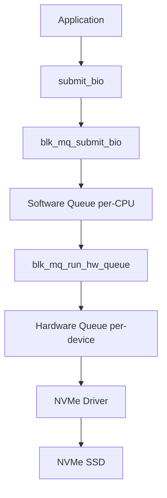
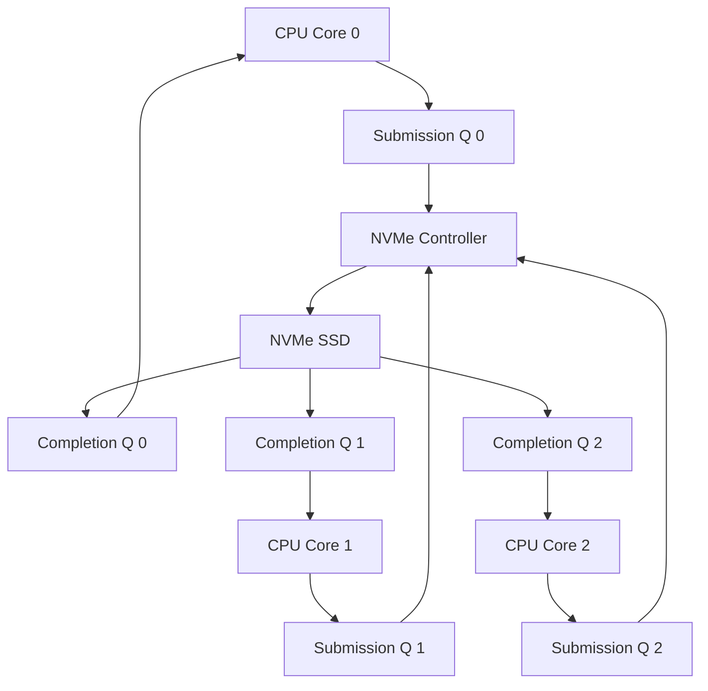

## 들어가며

디스크는 언제나 병목이었고, 커널의 대답은 캐시와 배칭이었다. 리눅스 블록 레이어의 역사는 이 두 단어를 하드웨어 세대마다 다시 구현해 온 역사다.

사용자가 파일을 읽는다. `read` 시스템 콜을 호출하면 데이터가 메모리에 나타난다. 그러나 이 단순한 작업의 이면에는 복잡한 여정이 있다. 데이터는 디스크에서 출발해 I/O 스케줄러를 거치고, 페이지 캐시에 저장되며, 마침내 사용자 공간에 도달한다.

이 글은 리눅스의 블록 I/O 서브시스템을 다룬다. 디스크 읽기 요청이 커널을 통과하는 전 과정을 따라가며, bio 구조, I/O 스케줄러, 페이지 캐시, writeback, 멀티큐 아키텍처와 NVMe를 추적한다. 비동기 제출 인터페이스는 블록 요청으로 변환되는 경계와 polling이 장치 큐에 미치는 영향까지만 범위에 포함한다.

여기까지의 결과물은 디스크 읽기 한 번이 어떤 자료구조와 단계를 거쳐 사용자 버퍼에 도달하는지를 추적할 수 있는 능력이다. 페이지 캐시 메커니즘과 writeback 흐름의 정본도 이 글 안에 둔다.


---

## 목차
1. [블록 디바이스](#1-블록-디바이스)
2. [bio 구조체](#2-bio-구조체)
3. [요청 큐와 I/O 스케줄링](#3-요청-큐와-io-스케줄링)
4. [페이지 캐시](#4-페이지-캐시)
5. [Direct I/O vs Buffered I/O](#5-direct-io-vs-buffered-io)
6. [Readahead](#6-readahead)
7. [Writeback](#7-writeback)
8. [NVMe와 멀티큐](#8-nvme와-멀티큐)
9. [성능 측정과 최적화](#9-성능-측정과-최적화)


---

## 1. 블록 디바이스

### 블록과 문자 디바이스

리눅스에서 모든 디바이스는 파일로 표현된다. 블록 디바이스는 고정된 크기의 블록 단위로 데이터를 읽고 쓰며 랜덤 액세스가 가능하다. 하드 디스크, SSD, USB 드라이브가 예시다. 디바이스 파일 타입은 `b`다. 문자 디바이스는 바이트 스트림으로 데이터를 읽고 쓰며 순차 액세스만 가능하다. 터미널, 시리얼 포트, `/dev/null` 등이 예시이며 디바이스 파일 타입은 `c`다.

```bash
$ ls -l /dev/sda /dev/tty
brw-rw---- 1 root disk 8, 0 Dec 23 10:00 /dev/sda
crw-rw-rw- 1 root tty  5, 0 Dec 23 10:00 /dev/tty
```

블록 디바이스는 버퍼링과 캐싱이 가능하다는 점에서 특별하다. 커널은 블록 디바이스에서 읽은 데이터를 메모리에 캐시해두고, 나중에 같은 데이터를 요청하면 디스크 접근 없이 즉시 반환한다.

### 블록 크기와 섹터

디스크는 섹터(sector) 단위로 데이터를 저장한다. 전통적으로 섹터는 512바이트였다. 현대의 디스크는 4KB 섹터(Advanced Format)를 사용한다.

리눅스 블록 레이어는 논리 블록 개념을 사용한다.

- 논리 블록: 파일시스템이 다루는 기본 단위(보통 4KB)
- 물리 블록: 디바이스의 실제 블록 크기
- 섹터: 디스크 하드웨어의 최소 단위(512B 또는 4KB)

```c
/* include/linux/blkdev.h */
struct queue_limits {
    unsigned int            logical_block_size;
    unsigned int            physical_block_size;
    unsigned int            max_hw_sectors;
    unsigned short          max_segments;
};

struct request_queue {
    struct queue_limits     limits;   /* q->limits.logical_block_size */
};
```

블록 크기는 성능에 영향을 미친다. 작은 블록은 메모리를 절약하지만 메타데이터 오버헤드가 크다. 큰 블록은 대용량 순차 읽기에 유리하지만 작은 파일에 비효율적이다.

### 블록 디바이스 드라이버

블록 디바이스는 `gendisk` 구조체로 표현된다.

```c
/* include/linux/blkdev.h */
struct gendisk {
    int major;
    int first_minor;
    int minors;

    char disk_name[DISK_NAME_LEN];

    struct request_queue *queue;
    const struct block_device_operations *fops;

    struct xarray part_tbl;

    unsigned long state;
    atomic_t sync_io;
};
```

디바이스 드라이버는 `block_device_operations`와 multi-queue 기반 큐 콜백(`blk_mq_ops`)을 구현한다. 과거의 `request_fn` 기반 단일 큐 모델은 Linux 5.0(2019)에서 제거되었고, 현재 request 기반 블록 드라이버는 모두 multi-queue 경로(blk-mq)를 통과한다. 드라이버는 보통 두 가지 진입점 중 하나를 채운다.

- `submit_bio` (`block_device_operations.submit_bio`): 큐를 거치지 않고 bio를 직접 받아 처리. brd, zram 같은 단순 드라이버와 dm/md 같은 스택 드라이버가 사용한다.
- `queue_rq` (`blk_mq_ops.queue_rq`): blk-mq가 만들어 준 `struct request`를 받아 처리. 대부분의 실제 디스크/SSD 드라이버 경로다.

```c
struct block_device_operations {
    int  (*open)(struct gendisk *, blk_mode_t);
    void (*release)(struct gendisk *);
    int  (*ioctl)(struct block_device *, blk_mode_t,
                  unsigned int, unsigned long);

    /* 단순 드라이버: bio를 직접 받는 경로 */
    void (*submit_bio)(struct bio *bio);
};

/* blk-mq 기반 드라이버용 콜백 (요약) */
struct blk_mq_ops {
    blk_status_t (*queue_rq)(struct blk_mq_hw_ctx *hctx,
                             const struct blk_mq_queue_data *bd);
    /* ... timeout, init_request, complete 등 */
};
```

## 2. bio 구조체

### bio의 등장

2002년 Jens Axboe가 리눅스 2.5 커널에 새로운 블록 레이어를 도입했다. 핵심은 bio(block I/O) 구조체였다. 이전에는 `buffer_head`가 I/O의 기본 단위였지만 무겁고 비효율적이었다.

`bio`는 메모리에서 디스크로 또는 디스크에서 메모리로 데이터를 전송하는 단일 I/O 작업을 나타낸다.

```c
/* include/linux/blk_types.h */
struct bio {
    struct bio              *bi_next;
    struct block_device     *bi_bdev;
    unsigned int            bi_opf;

    blk_status_t            bi_status;
    atomic_t                __bi_remaining;

    struct bvec_iter        bi_iter;

    unsigned short          bi_vcnt;
    unsigned short          bi_max_vecs;

    struct bio_vec          *bi_io_vec;

    bio_end_io_t            *bi_end_io;
    void                    *bi_private;
};
```

### bio_vec

`bio`는 `bio_vec` 배열을 포함한다. 각 `bio_vec`는 물리 메모리의 한 페이지를 가리킨다.

```c
struct bio_vec {
    struct page     *bv_page;
    unsigned int    bv_len;
    unsigned int    bv_offset;
};
```

이 설계는 scatter-gather I/O를 가능하게 한다. 하나의 `bio`가 메모리의 여러 불연속 페이지를 참조할 수 있다. 복사 없이 효율적인 I/O를 구현한다.

```text
bio
  ├─ bio_vec[0] -> Page 1 (offset 0, len 4096)
  ├─ bio_vec[1] -> Page 5 (offset 0, len 4096)
  └─ bio_vec[2] -> Page 9 (offset 0, len 2048)
```

### bio 생성과 제출

파일시스템이 디스크에서 데이터를 읽으려면 `bio`를 생성하고 제출한다.

```c
/* block/bio.c, block/blk-core.c - 블록 레이어 API (요약) */
struct bio *bio_alloc(struct block_device *bdev,
                      unsigned int nr_vecs,
                      unsigned int opf,
                      gfp_t gfp_mask)
{
    struct bio *bio = bio_alloc_bioset(bdev, nr_vecs, opf, gfp_mask, &fs_bio_set);
    return bio;
}

int bio_add_page(struct bio *bio, struct page *page,
                 unsigned int len, unsigned int offset)
{
    struct bio_vec *bv = &bio->bi_io_vec[bio->bi_vcnt];
    bv->bv_page = page;
    bv->bv_len = len;
    bv->bv_offset = offset;
    bio->bi_vcnt++;
    return len;
}

void submit_bio(struct bio *bio)
{
    submit_bio_noacct(bio);
}
```

`submit_bio`는 `bio`를 블록 레이어에 전달한다. 블록 레이어는 이를 요청 큐에 넣고, I/O 스케줄러가 처리한다.

### bio 완료 콜백

I/O가 완료되면 커널은 `bio->bi_end_io` 콜백을 호출한다.

```c
static void end_bio_read(struct bio *bio)
{
    struct page *page;
    struct bio_vec *bvec;
    struct bvec_iter_all iter_all;

    bio_for_each_segment_all(bvec, bio, iter_all) {
        page = bvec->bv_page;

        if (bio->bi_status) {
            SetPageError(page);
            ClearPageUptodate(page);
        } else {
            SetPageUptodate(page);
        }

        unlock_page(page);
    }

    bio_put(bio);
}
```

## 3. 요청 큐와 I/O 스케줄링

### bio에서 request로

`bio`는 블록 레이어의 입력이다. 디바이스 드라이버는 `request` 단위로 작업한다. 블록 레이어는 여러 `bio`를 하나의 `request`로 병합한다.

```c
/* include/linux/blkdev.h */
struct request {
    struct request_queue    *q;
    struct bio              *bio;
    struct bio              *biotail;

    unsigned int            cmd_flags;
    enum req_op             op;

    sector_t                __sector;
    unsigned int            __data_len;
    unsigned short          nr_phys_segments;

    ktime_t                 start_time_ns;

    void                    (*end_io)(struct request *, blk_status_t);
    void                    *end_io_data;
};
```

`request`는 연속된 섹터에 대한 여러 `bio`를 묶을 수 있다.

```text
Request: 섹터 100~200
  ├─ bio 1: 섹터 100~132
  ├─ bio 2: 섹터 132~164
  └─ bio 3: 섹터 164~200
```

### I/O 스케줄러

I/O 스케줄러는 `request`를 재정렬하고 병합하여 디스크 성능을 최적화한다. 주요 목표는 다음과 같다.

1. 처리량 극대화: 디스크 헤드 이동을 최소화한다.
2. 지연 시간 최소화: 요청이 오래 기다리지 않게 한다.
3. 공정성: 모든 프로세스에게 공정한 I/O 기회를 제공한다.

리눅스는 여러 I/O 스케줄러를 제공한다.

**CFQ(레거시)**

CFQ(Completely Fair Queuing)는 2000년대 중반부터 2010년대까지 리눅스의 기본 I/O 스케줄러였다. 프로세스마다 큐를 할당하고 라운드로빈으로 서비스한다. 큐 관리와 컨텍스트 스위칭 비용 때문에 SSD에서는 비효율적이고, 멀티코어 환경에서 락 경합이 발생한다.

**Deadline**

Deadline 계열 스케줄러는 요청을 sector 순서와 FIFO 만료 순서로 함께 관리해 locality와 starvation 방지를 절충한다. 일부 커널·scheduler 구성에서 read/write expiry의 초기값으로 각각 500ms와 5초가 사용되어 왔지만, 이는 영구 ABI가 아니라 sysfs로 확인·조정하는 정책값이다.

```c
/* block/deadline-iosched.c */
struct deadline_data {
    struct rb_root sort_list[2];
    struct list_head fifo_list[2];

    unsigned int batching;
    sector_t last_sector;

    int fifo_expire[2];
    int fifo_batch;
};
```

Deadline은 두 가지 큐를 유지한다. 정렬 큐(섹터 번호로 정렬, seek 최소화)와 FIFO 큐(제출 시간 순서, starvation 방지)다. 스케줄러는 정렬 큐에서 요청을 꺼내지만 FIFO 큐의 헤드가 데드라인을 넘으면 즉시 처리한다.

**BFQ**

BFQ(Budget Fair Queueing)는 CFQ의 후계자로, bandwidth 기반 공정성을 제공한다. 각 프로세스에게 예산(budget)을 할당하고 예산을 소진하면 다음 프로세스로 전환한다. 낮은 지연 시간으로 대화형 작업에 유리하며, 백그라운드 작업이 포그라운드를 방해하지 않는다.

**none**

NVMe 같은 초고속 디바이스에서는 스케줄링 오버헤드가 성능을 해친다. `none` 스케줄러는 재정렬 없이 요청을 즉시 디스패치한다.

```bash
# 현재 I/O 스케줄러 확인
$ cat /sys/block/nvme0n1/queue/scheduler
[none] mq-deadline

# I/O 스케줄러 변경
$ echo bfq | sudo tee /sys/block/sda/queue/scheduler
```

### 멀티큐 블록 레이어 (blk-mq)

2013년 Jens Axboe가 blk-mq(multi-queue block layer)를 도입했다. 전통적인 단일 요청 큐는 멀티코어 시스템에서 락 경합 병목이었다.

blk-mq의 핵심 아이디어는 다음과 같다.

- 소프트웨어 큐: CPU당 하나씩 할당, 락 없이 접근
- 하드웨어 큐: 디바이스의 하드웨어 큐에 직접 매핑

blk-mq의 I/O 경로는 다음과 같다.



`mq-deadline`은 blk-mq 경로에 맞춘 deadline 계열 elevator다. software staging과 hardware dispatch context의 정확한 공유 범위는 커널 구현에 달려 있으므로 “hardware queue마다 완전히 독립된 scheduler”로 단순화하지 않는다.

## 4. 페이지 캐시

### 페이지 캐시의 필요성

storage와 DRAM은 access latency, bandwidth, queueing, persistence라는 서로 다른 축을 가진다. NVMe read latency는 DRAM cache miss보다 대체로 훨씬 크지만 순차 bandwidth의 비율과 random-read latency의 비율은 같은 숫자가 아니다. device model, queue depth, block size와 cache 상태 없이 “항상 100배”로 환산하지 않는다.

페이지 캐시는 디스크 데이터를 메모리에 캐시한다. 리눅스는 사용 가능한 메모리의 대부분을 페이지 캐시로 사용한다.

```bash
$ free -h
              total        used        free      shared  buff/cache   available
Mem:           15Gi       3.2Gi       8.1Gi       412Mi       4.2Gi        11Gi
```

`buff/cache`가 페이지 캐시와 버퍼 캐시다. 리눅스는 남는 메모리를 캐시로 사용하며 필요시 즉시 회수한다.

### address_space

페이지 캐시는 `address_space` 구조체로 관리된다.

```c
/* include/linux/fs.h */
struct address_space {
    struct inode            *host;
    struct xarray           i_pages;

    const struct address_space_operations *a_ops;

    atomic_t                i_mmap_writable;
    struct rb_root_cached   i_mmap;

    unsigned long           nrpages;

    pgoff_t                 writeback_index;

    spinlock_t              private_lock;
    struct list_head        private_list;

    errseq_t                wb_err;
};
```

각 파일의 inode는 하나의 `address_space`를 갖는다. `i_pages`는 xarray(확장 가능 배열)로, 파일 오프셋을 페이지로 매핑한다.

### 페이지 캐시 읽기

파일을 읽을 때 커널은 먼저 페이지 캐시를 확인한다.

```c
/* mm/filemap.c */
struct page *find_get_page(struct address_space *mapping, pgoff_t index)
{
    struct page *page;

    rcu_read_lock();
    page = xas_load(&xas, index);
    if (page && !xa_is_value(page)) {
        if (!page_cache_get_speculative(page))
            goto repeat;
    }
    rcu_read_unlock();

    return page;
}
```

캐시 히트면 페이지를 즉시 반환한다. 캐시 미스면 디스크에서 읽는다.

### 페이지 캐시 추가

새로 읽은 페이지는 캐시에 추가된다.

```c
/* mm/filemap.c */
int add_to_page_cache_lru(struct page *page,
                          struct address_space *mapping,
                          pgoff_t index, gfp_t gfp_mask)
{
    int ret;

    ret = __add_to_page_cache_locked(page, mapping, index, gfp_mask);
    if (unlikely(ret))
        return ret;

    lru_cache_add(page);

    return 0;
}
```

### LRU 리스트

메모리가 부족하면 커널은 페이지 캐시에서 페이지를 회수한다. LRU(Least Recently Used) 알고리즘을 사용한다.

리눅스는 여러 LRU 리스트를 유지한다.

```c
/* include/linux/mmzone.h */
enum lru_list {
    LRU_INACTIVE_ANON = LRU_BASE,
    LRU_ACTIVE_ANON = LRU_BASE + LRU_ACTIVE,
    LRU_INACTIVE_FILE = LRU_BASE + LRU_FILE,
    LRU_ACTIVE_FILE = LRU_BASE + LRU_FILE + LRU_ACTIVE,
    LRU_UNEVICTABLE,
    NR_LRU_LISTS
};

struct lruvec {
    struct list_head lists[NR_LRU_LISTS];
    unsigned long anon_cost;
    unsigned long file_cost;
};
```

페이지는 처음에 비활성 리스트에 추가된다. 다시 접근되면 활성 리스트로 승격된다. 메모리 압박 시 비활성 리스트의 페이지가 먼저 회수된다.

### 버퍼 캐시

페이지 캐시는 파일 단위로 캐싱한다. 버퍼 캐시는 블록 단위로 캐싱한다. 현대 리눅스에서 둘은 통합되었다. 버퍼 캐시는 페이지 캐시 위에 구현된다.

```c
/* include/linux/buffer_head.h */
struct buffer_head {
    unsigned long b_state;
    struct buffer_head *b_this_page;
    struct page *b_page;

    sector_t b_blocknr;
    size_t b_size;
    char *b_data;

    struct block_device *b_bdev;
    bh_end_io_t *b_end_io;
    void *b_private;

    struct list_head b_assoc_buffers;
};
```

하나의 페이지는 여러 `buffer_head`로 나뉠 수 있다(블록 크기가 페이지보다 작은 경우).

```text
Page (4KB)
  ├─ buffer_head (1KB, block 100)
  ├─ buffer_head (1KB, block 101)
  ├─ buffer_head (1KB, block 102)
  └─ buffer_head (1KB, block 103)
```

## 5. Direct I/O vs Buffered I/O

### Buffered I/O

일반적으로 파일을 읽고 쓸 때 페이지 캐시를 거친다. 이를 Buffered I/O라 한다.

```c
ssize_t generic_file_read_iter(struct kiocb *iocb, struct iov_iter *iter)
{
    struct file *file = iocb->ki_filp;
    struct address_space *mapping = file->f_mapping;
    pgoff_t index;
    struct page *page;

    index = iocb->ki_pos >> PAGE_SHIFT;

    page = find_get_page(mapping, index);
    if (!page) {
        /* 캐시 미스: readahead 트리거 */
        page_cache_sync_readahead(mapping, &file->f_ra, file, index, ...);
        page = find_get_page(mapping, index);
    }

    if (PageUptodate(page)) {
        copy_page_to_iter(page, offset, bytes, iter);
    }

    put_page(page);
    return bytes;
}
```

장점은 다음과 같다.

- 빠른 재접근: 캐시 히트 시 디스크 접근 없음
- Readahead: 순차 읽기 감지 시 미리 읽기
- 쓰기 병합: 여러 쓰기를 모아서 한 번에 처리

단점은 다음과 같다.

- 이중 복사: 디스크 → 페이지 캐시 → 사용자 버퍼
- 메모리 오버헤드: 페이지 캐시가 메모리를 차지
- 제어 불가: 애플리케이션이 캐싱을 제어할 수 없음

### Direct I/O

데이터베이스 같은 애플리케이션은 자체 캐싱 전략을 갖는다. Direct I/O는 페이지 캐시를 우회하고 디스크와 직접 통신한다.

```c
int fd = open("/path/to/file", O_RDWR | O_DIRECT);

/* 정렬된 버퍼 할당 (필수) */
void *buf;
posix_memalign(&buf, 4096, 4096);

/* 읽기 (페이지 캐시 우회) */
ssize_t n = read(fd, buf, 4096);
```

Direct I/O 요구사항은 다음과 같다.

- 버퍼 주소는 블록 크기로 정렬되어야 한다.
- 읽기/쓰기 크기는 블록 크기의 배수여야 한다.
- 파일 오프셋은 블록 크기로 정렬되어야 한다.

```c
/* fs/direct-io.c */
ssize_t __blockdev_direct_IO(struct kiocb *iocb, struct inode *inode,
                             struct block_device *bdev, struct iov_iter *iter,
                             get_block_t get_block, dio_iodone_t end_io,
                             dio_submit_t submit_io, int flags)
{
    struct bio *bio;
    sector_t blocknr;
    unsigned blocksize = i_blocksize(inode);

    /* 정렬 검증 */
    if ((unsigned long)iter->iov_base & (blocksize - 1))
        return -EINVAL;
    if (iocb->ki_pos & (blocksize - 1))
        return -EINVAL;

    /* bio 생성 및 제출 */
    while (iov_iter_count(iter)) {
        bio = bio_alloc(bdev, nr_pages, iocb->ki_flags & IOCB_WRITE ?
                        REQ_OP_WRITE : REQ_OP_READ, GFP_KERNEL);

        iov_iter_get_pages(iter, pages, bytes, &start);
        for (i = 0; i < nr_pages; i++)
            bio_add_page(bio, pages[i], PAGE_SIZE, 0);

        submit_bio(bio);
    }

    blk_finish_plug(&plug);

    return transferred;
}
```

Direct I/O 사용 사례는 다음과 같다.

- 데이터베이스: 자체 버퍼 풀 관리
- 대용량 스트리밍: 캐시 오염 방지
- page cache 이중 저장 회피와 application-controlled caching. 저장장치 queue와 media tail latency는 그대로 남으므로 지연 상한을 보장하지 않음

## 6. Readahead

### Readahead의 필요성

순차 파일 읽기를 생각해본다.

```c
for (int i = 0; i < 1000; i++) {
    read(fd, buf, 4096);  /* 4KB씩 1000번 읽기 */
}
```

Readahead 없이는 매번 페이지 폴트가 발생하고, 블록 레이어를 거치고, 디스크를 읽는다. Readahead가 있으면 커널은 패턴을 감지하고 미리 여러 페이지를 읽어둔다.

### Readahead 알고리즘

```c
/* mm/readahead.c */
void page_cache_sync_readahead(struct address_space *mapping,
                               struct file_ra_state *ra,
                               struct file *file,
                               pgoff_t index,
                               unsigned long req_count)
{
    if (!ra->ra_pages)
        return;

    /* 순차 접근 감지 */
    if (index - ra->prev_pos <= 1UL) {
        ondemand_readahead(mapping, ra, file, false, index, req_count);
    }

    ra->prev_pos = index;
}
```

Readahead 상태는 `file_ra_state`에 저장된다.

```c
struct file_ra_state {
    pgoff_t start;
    unsigned int size;
    unsigned int async_size;

    unsigned int ra_pages;
    unsigned int mmap_miss;

    loff_t prev_pos;
};
```

### Ondemand Readahead

```c
static unsigned long ondemand_readahead(struct address_space *mapping,
                                        struct file_ra_state *ra,
                                        struct file *file,
                                        bool hit_readahead_marker,
                                        pgoff_t index,
                                        unsigned long req_size)
{
    unsigned long max = ra->ra_pages;

    /* 순차 읽기 감지 */
    if (index - ra->start <= ra->size) {
        ra->start += ra->size;
        ra->size = min(ra->size * 2, max);  /* 지수적 증가 */
        ra->async_size = ra->size;
    } else {
        /* 랜덤 읽기: readahead 창 초기화 */
        ra->start = index;
        ra->size = req_size;
    }

    __do_page_cache_readahead(mapping, file, ra->start, ra->size, ra->async_size);

    return ra->size;
}
```

Linux ondemand readahead는 감지한 연속 접근과 현재 window를 바탕으로 window를 늘릴 수 있지만, 시작 크기·증가 방식·상한은 kernel version, backing device와 `file_ra_state`에 따라 달라진다. `4 → 8 → 16 page`, `최대 128 page`를 알고리즘의 고정 계약으로 사용하지 않는다.

### Readahead 튜닝

```bash
# Readahead 크기 확인 (KB 단위)
$ cat /sys/block/sda/queue/read_ahead_kb
128  # 이 장치에서 관측한 예시 값

# Readahead 크기 변경
$ echo 256 | sudo tee /sys/block/sda/queue/read_ahead_kb

# 파일별 readahead 제어
$ posix_fadvise(fd, offset, len, POSIX_FADV_SEQUENTIAL);
$ posix_fadvise(fd, offset, len, POSIX_FADV_RANDOM);
$ posix_fadvise(fd, offset, len, POSIX_FADV_WILLNEED);
```

## 7. Writeback

### Dirty 페이지

파일에 쓸 때 데이터는 즉시 디스크로 가지 않는다. 페이지 캐시에 쓰고 페이지를 dirty로 표시한다. 나중에 writeback 스레드가 dirty 페이지를 디스크로 플러시한다.

```c
/* mm/page-writeback.c */
void set_page_dirty(struct page *page)
{
    struct address_space *mapping = page_mapping(page);

    if (!TestSetPageDirty(page)) {
        __xa_set_mark(&mapping->i_pages, page_index(page), PAGECACHE_TAG_DIRTY);

        __inc_node_page_state(page, NR_FILE_DIRTY);
        __inc_zone_page_state(page, NR_ZONE_WRITE_PENDING);

        if (mapping->host)
            __mark_inode_dirty(mapping->host, I_DIRTY_PAGES);
    }
}
```

### Writeback 트리거

Writeback은 다음 경우에 트리거된다.

1. 주기적 writeback: flusher는 `vm.dirty_writeback_centisecs`에 따른 간격으로 dirty 페이지를 점검하고, `vm.dirty_expire_centisecs`보다 오래된 데이터를 후보로 삼는다. 흔한 배포 기본값의 예가 500(5초)과 3000(30초)이지만 실행 중인 커널의 sysctl 값을 확인해야 한다. expire 값은 저장장치 완료 시각의 엄격한 상한도 아니다.
2. 메모리 압박: dirty 페이지가 임계치 초과
3. 명시적 sync: `sync`, `fsync` 호출

일반 파일의 `close()`는 성공하더라도 dirty data가 stable storage에 도달했다는 보장이 아니다. durability가 필요하면 file data·metadata와 directory entry의 변경 종류에 맞는 `fsync`/`fdatasync`/directory `fsync` protocol을 사용하고 오류를 확인한다.

```c
static void wb_workfn(struct work_struct *work)
{
    struct bdi_writeback *wb = container_of(work, struct bdi_writeback, dwork.work);
    struct wb_writeback_work work_item;

    while (!list_empty(&wb->work_list)) {
        work_item = list_first_entry(&wb->work_list, ...);
        wb_do_writeback(wb, &work_item);
    }

    if (dirty_writeback_interval)
        queue_delayed_work(bdi_wq, &wb->dwork,
                           msecs_to_jiffies(dirty_writeback_interval * 10));
}
```

### Flusher 흐름

writeback은 BDI(backing device info)별 `bdi_writeback` 객체와 unbound writeback workqueue(`bdi_wq`)에서 동작한다. 디바이스별로 전용 데몬 스레드가 늘 떠 있는 모델은 아니고, 필요한 시점에 unbound workqueue가 깨어나 처리한다. 위 `wb_workfn`이 그 work item이다. dmesg/ps에서 보이는 `kworker/uN:M-flush-...` 같은 이름의 스레드는 그 unbound workqueue를 처리하는 일반 kworker다.

```bash
$ ps aux | grep flush
root         125  0.0  0.0      0     0 ?        S<   Dec22   0:00 [kworker/u8:5-flush-8:0]
```

```c
/* fs/fs-writeback.c */
static void wb_do_writeback(struct bdi_writeback *wb, struct wb_writeback_work *work)
{
    struct inode *inode;

    while (!list_empty(&wb->b_io)) {
        inode = list_entry(wb->b_io.prev, struct inode, i_io_list);
        __writeback_single_inode(inode, &wbc);

        if (!(inode->i_state & I_DIRTY_ALL))
            list_del_init(&inode->i_io_list);
    }
}
```

### Writeback 튜닝

```bash
# Dirty 페이지 임계치 (백분율)
$ sysctl vm.dirty_ratio
vm.dirty_ratio = 20  # 이 시스템에서 관측한 예시 값

$ sysctl vm.dirty_background_ratio
vm.dirty_background_ratio = 10  # 예시

# Writeback 간격 (centiseconds, 1/100초)
$ sysctl vm.dirty_writeback_centisecs
vm.dirty_writeback_centisecs = 500  # 5초

# Dirty 페이지 최대 수명
$ sysctl vm.dirty_expire_centisecs
vm.dirty_expire_centisecs = 3000  # 30초

# 데이터베이스 서버 튜닝 예시
$ sudo sysctl -w vm.dirty_ratio=5
$ sudo sysctl -w vm.dirty_background_ratio=2
$ sudo sysctl -w vm.dirty_expire_centisecs=500
```

### fsync와 fdatasync

애플리케이션이 데이터 영속성을 보장하려면 명시적으로 플러시해야 한다.

```c
/* fsync(): 데이터와 메타데이터 모두 플러시 */
int fsync(int fd);

/* fdatasync(): 데이터와 이후 읽기에 필요한 metadata를 동기화 */
int fdatasync(int fd);

/* sync(): 시스템 전체 dirty 페이지 플러시 */
void sync(void);
```

성공한 `fsync`/`fdatasync`의 내구성 범위는 filesystem, mount option, device write cache와 flush 지원에 달려 있다. 새 파일 생성이나 rename의 directory entry까지 crash 뒤 보존하려면 해당 directory fd의 `fsync`가 추가로 필요할 수 있다. 호출 반환만으로 전원 차단 내구성을 추측하지 말고 대상 storage stack의 persistence 계약과 fault-injection test로 확인한다.

```c
/* fs/sync.c */
SYSCALL_DEFINE1(fsync, unsigned int, fd)
{
    struct fd f = fdget(fd);
    struct file *file = f.file;

    ret = vfs_fsync(file, 0);

    fdput(f);
    return ret;
}

int vfs_fsync_range(struct file *file, loff_t start, loff_t end, int datasync)
{
    struct address_space *mapping = file->f_mapping;
    int ret;

    ret = filemap_write_and_wait_range(mapping, start, end);
    if (ret)
        return ret;

    if (file->f_op->fsync)
        ret = file->f_op->fsync(file, start, end, datasync);

    return ret;
}
```

데이터베이스 WAL(Write-Ahead Logging) 예시는 다음과 같다.

```c
write(wal_fd, wal_record, sizeof(wal_record));
fdatasync(wal_fd);  /* WAL이 디스크에 안전하게 기록됨 */

write(data_fd, data, sizeof(data));  /* 실제 데이터 쓰기 */
```

## 8. NVMe와 멀티큐

### NVMe의 등장

전통적인 SATA 인터페이스는 HDD 시대에 설계되었다. 회전 디스크의 느린 속도에 맞춰진 프로토콜이다. NVMe SSD는 수십만 IOPS를 처리할 수 있다. SATA는 병목이 되었다.

NVMe(Non-Volatile Memory Express)는 SSD를 위해 처음부터 설계된 프로토콜이다.

- PCIe 인터페이스: 높은 대역폭(PCIe 3.0 x4: 4GB/s)
- 저지연: 프로토콜 오버헤드 최소화
- 멀티큐: 최대 65,535개 I/O 큐, 각 큐당 65,536개 명령

### NVMe 아키텍처

NVMe 디바이스는 submission queue와 completion queue 쌍을 갖는다.



각 CPU 코어는 독립적인 큐를 가지므로 락 경합이 없다.

### NVMe 드라이버

```c
/* drivers/nvme/host/pci.c */
static const struct blk_mq_ops nvme_mq_ops = {
    .queue_rq       = nvme_queue_rq,
    .complete       = nvme_complete_rq,
    .init_hctx      = nvme_init_hctx,
    .timeout        = nvme_timeout,
    .poll           = nvme_poll,
};

static blk_status_t nvme_queue_rq(struct blk_mq_hw_ctx *hctx,
                                  const struct blk_mq_queue_data *bd)
{
    struct nvme_queue *nvmeq = hctx->driver_data;
    struct request *req = bd->rq;
    struct nvme_command cmd;

    cmd.rw.opcode = rq_data_dir(req) == WRITE
                  ? nvme_cmd_write : nvme_cmd_read;
    cmd.rw.nsid = cpu_to_le32(ns->head->ns_id);
    cmd.rw.slba = cpu_to_le64(blk_rq_pos(req));
    cmd.rw.length = cpu_to_le16((blk_rq_bytes(req) >> 9) - 1);

    /* Submission Queue에 명령 추가 */
    memcpy(&nvmeq->sq_cmds[nvmeq->sq_tail], &cmd, sizeof(cmd));

    /* Tail 포인터 업데이트 (디바이스에 알림) */
    if (++nvmeq->sq_tail == nvmeq->q_depth)
        nvmeq->sq_tail = 0;
    writel(nvmeq->sq_tail, nvmeq->q_db);

    return BLK_STS_OK;
}
```

### 인터럽트 vs 폴링

전통적으로 I/O 완료는 인터럽트로 알린다. NVMe는 너무 빨라서 인터럽트 오버헤드가 병목이 될 수 있다. 폴링 모드를 사용하면 지연 시간을 더 줄일 수 있다.

```c
/* drivers/nvme/host/pci.c */
static int nvme_poll(struct blk_mq_hw_ctx *hctx)
{
    struct nvme_queue *nvmeq = hctx->driver_data;
    u16 old_head = nvmeq->cq_head;

    /* Completion Queue 확인 (인터럽트 없이) */
    while (nvme_cqe_pending(nvmeq)) {
        nvme_handle_cqe(nvmeq, nvmeq->cq_head);
        nvme_update_cq_head(nvmeq);
    }

    if (nvmeq->cq_head != old_head)
        writel(nvmeq->cq_head, nvmeq->q_db + nvmeq->dev->db_stride);

    return nvmeq->cq_head != old_head;
}
```

폴링과 인터럽트의 트레이드오프는 다음과 같다.

- 폴링: completion을 즉시 확인할 기회를 늘리는 대신 CPU 시간을 계속 사용
- 인터럽트: idle CPU 효율이 좋지만 interrupt 전달·스케줄링 지연이 추가될 수 있음

### 비동기 I/O와 io_uring

리눅스에는 여러 비동기 I/O 인터페이스가 있다. POSIX AIO는 glibc 구현이 유저스페이스 스레드 풀을 쓰고 커널 지원도 제한적이라 진정한 비동기로 보기 어렵다. 대안으로 2019년에 도입된 io_uring은 공유 링 버퍼로 시스템 콜을 최소화하면서 파일과 소켓을 모두 다룬다. NVMe의 멀티큐 구조와 결합하면 폴링 모드까지 활용해 매우 낮은 지연을 얻을 수 있다.

블록 레이어 관점에서 필요한 계약은 `IORING_SETUP_IOPOLL`이 buffered I/O를 빠르게 만드는 일반 스위치가 아니라, polling을 지원하는 파일과 `O_DIRECT` 같은 조건을 요구하며 completion을 회수하는 CPU 비용과 interrupt 지연을 교환한다는 점이다. Submission/completion queue의 opcode와 등록 자원은 이 블록 요청 계약 밖의 사용자-커널 인터페이스다.

## 9. 성능 측정과 최적화

### 측정 도구

**iostat**

```bash
$ iostat -x 1
Device            r/s     w/s     rkB/s   wkB/s  rrqm/s  wrqm/s  %util
sda              12.3   145.2    492.8  5808.4    0.0    23.4    45.2
nvme0n1        1234.5   234.1  49380.0  9364.0    0.0     0.0    78.5
```

주요 지표는 다음과 같다.

- `r/s`, `w/s`: 초당 읽기/쓰기 횟수
- `rkB/s`, `wkB/s`: 초당 읽기/쓰기 바이트
- `rrqm/s`, `wrqm/s`: 초당 병합된 요청 수
- `%util`: 디바이스 사용률

**fio**

```bash
# 순차 읽기 테스트
$ fio --name=seqread --rw=read --bs=128k --size=1G --numjobs=4 --direct=1

# 랜덤 읽기 테스트(IOPS 측정)
$ fio --name=randread --rw=randread --bs=4k --size=1G --numjobs=8 --direct=1

# 혼합 워크로드
$ fio --name=mixed --rw=randrw --rwmixread=70 --bs=4k --size=1G --direct=1
```

**blktrace**

```bash
$ sudo blktrace -d /dev/sda -o trace
$ dd if=/dev/sda of=/dev/null bs=4k count=10000
$ blkparse -i trace
  8,0    1        1     0.000000000  1234  Q  RS 2048 + 8 [dd]
  8,0    1        2     0.000002134  1234  G  RS 2048 + 8 [dd]
  8,0    1        3     0.000003221  1234  I  RS 2048 + 8 [dd]
  8,0    1        4     0.000004567  1234  D  RS 2048 + 8 [dd]
  8,0    1        5     0.000123456     0  C  RS 2048 + 8 [0]
```

이벤트 타입은 다음과 같다.

- `Q`: 큐에 요청 도착
- `G`: get request(요청 할당)
- `I`: insert(I/O 스케줄러에 삽입)
- `D`: dispatch(디바이스로 전송)
- `C`: complete(완료)

### 최적화 전략

**I/O 스케줄러 선택**

```bash
# HDD: BFQ (낮은 지연, 공정성)
$ echo bfq | sudo tee /sys/block/sda/queue/scheduler

# SATA SSD: mq-deadline (균형)
$ echo mq-deadline | sudo tee /sys/block/sda/queue/scheduler

# NVMe: none (스케줄링 오버헤드 제거)
$ echo none | sudo tee /sys/block/nvme0n1/queue/scheduler
```

**큐 깊이 조정**

```bash
$ cat /sys/block/nvme0n1/queue/nr_requests
256

$ echo 1024 | sudo tee /sys/block/nvme0n1/queue/nr_requests
```

**병합 제어**

```bash
# 0: 모든 merge lookup, 1: simple one-hit merge만, 2: merge 비활성
$ echo 2 | sudo tee /sys/block/sda/queue/nomerges

$ cat /sys/block/sda/queue/max_segments
128
```

**Readahead 튜닝**

```bash
# 순차 읽기 워크로드: readahead 증가
$ echo 512 | sudo tee /sys/block/sda/queue/read_ahead_kb

# 랜덤 읽기 워크로드: readahead 감소
$ echo 32 | sudo tee /sys/block/sda/queue/read_ahead_kb
```

**Writeback 튜닝**

```bash
# 쓰기 집약적 워크로드: dirty ratio 증가
$ sudo sysctl -w vm.dirty_ratio=40
$ sudo sysctl -w vm.dirty_background_ratio=20

# 읽기 집약적 워크로드: dirty ratio 감소 (메모리 확보)
$ sudo sysctl -w vm.dirty_ratio=5
$ sudo sysctl -w vm.dirty_background_ratio=2
```


---

## 결론

리눅스 블록 I/O 서브시스템은 30년 이상의 진화를 거쳤다. HDD의 느린 회전 디스크에서 NVMe의 초고속 flash까지, 커널은 계속 적응해왔다. 핵심 정리는 다음과 같다.

1. 레이어 분리: bio → request → 디바이스 드라이버. 각 레이어는 독립적으로 최적화된다.
2. 비동기와 배칭: I/O는 본질적으로 느리다. 병렬 처리와 배칭이 필수다.
3. 캐싱: 페이지 캐시는 성능의 핵심이다. 메모리는 최고의 스토리지다.
4. 멀티큐: 현대 하드웨어는 병렬성을 요구한다. 락 없는 설계가 승리한다.
5. 하드웨어 진화: 소프트웨어는 하드웨어 변화에 적응한다.

미래의 방향은 다음과 같다.

- Persistent Memory(PMEM): 바이트 단위 접근 가능한 비휘발성 메모리
- Computational Storage: 스토리지 디바이스 내부에서 연산 수행
- eBPF 기반 I/O: 커널 재컴파일 없이 I/O 경로 커스터마이징

블록 I/O는 운영체제의 성능을 결정하는 핵심 요소다. 디스크가 병목인 한, 블록 I/O 최적화는 계속된다.

## 더 읽을거리

### 커널 소스
- `block/`: 블록 레이어 구현
- `mm/filemap.c`: 페이지 캐시
- `mm/page-writeback.c`: Writeback 메커니즘
- `mm/readahead.c`: Readahead 알고리즘
- `drivers/nvme/`: NVMe 드라이버
- `fs/direct-io.c`: Direct I/O

### 논문 및 문서
- Jens Axboe, "Linux Block IO – present and future" (2004)
- Jens Axboe, "Efficient IO with io_uring" (2019)
- "NVMe Specification" (NVM Express, Inc.)
- Linux kernel documentation: `block/`

### 도서
- Robert Love, *Linux Kernel Development* (3rd Edition)
- Mel Gorman, *Understanding the Linux Virtual Memory Manager*
- Michael Kerrisk, *The Linux Programming Interface*
