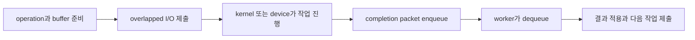
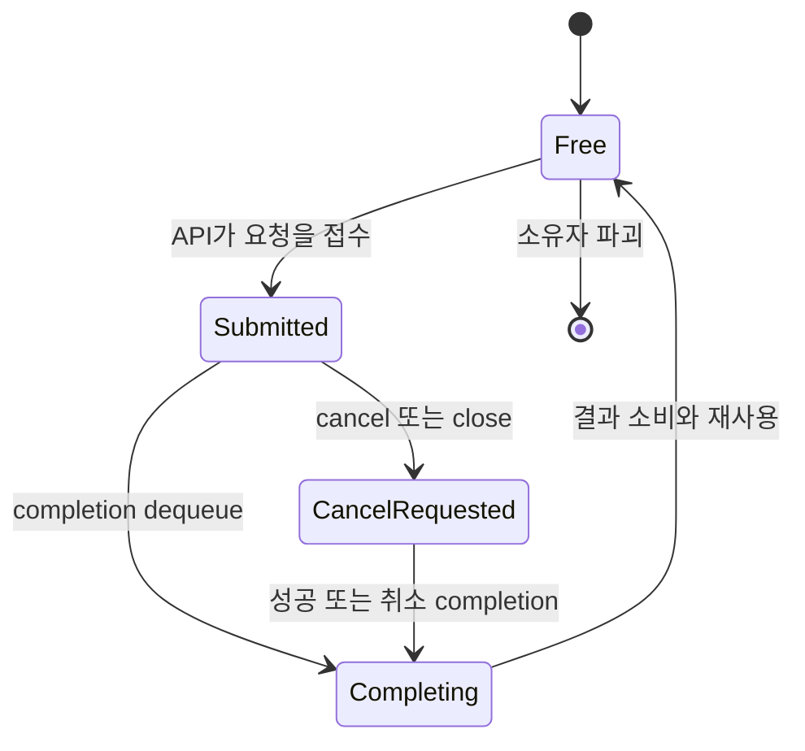
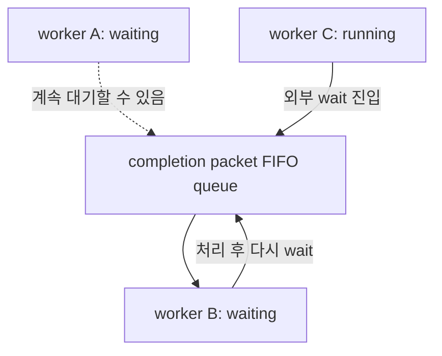
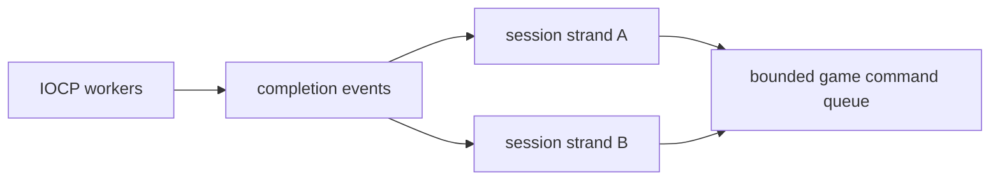
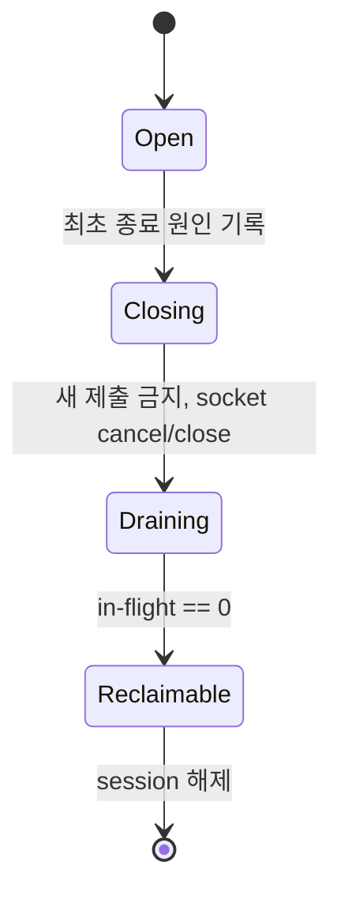

## 들어가며

비동기 I/O의 핵심은 스레드를 많이 만드는 데 있지 않다. 요청을 제출한 실행 흐름과 결과를 소비하는 실행 흐름을 분리하고, 그 사이에서 작업·버퍼·대상 객체의 수명을 보존하는 데 있다. Windows의 I/O Completion Port(IOCP)는 파일, 소켓, 파이프처럼 overlapped I/O를 지원하는 여러 handle의 완료 통지를 하나의 커널 큐로 모은다.

IOCP는 Linux의 `epoll`과 같은 API가 아니다. `epoll`은 descriptor가 블로킹 없이 처리될 가능성을 알리는 readiness 모델이고, IOCP는 제출한 작업의 결과를 돌려주는 completion 모델이다. Linux에서 의미가 더 가까운 구조는 submission queue와 completion queue를 가진 `io_uring`이다. 그러나 IOCP에는 port에 대기하는 worker의 실행 동시성을 제한하는 스케줄링 의미가 있고, `io_uring`에는 사용자 공간과 커널이 공유하는 ring과 명시적인 SQE 제출 의미가 있다. 둘은 같은 문제군을 서로 다른 ABI와 스케줄링 정책으로 푼다.

이 글은 IOCP를 고성능 서버용 주문처럼 다루지 않는다. overlapped operation의 상태 전이, completion packet의 식별 정보, worker concurrency, 취소와 종료 경쟁, Winsock 확장 함수, 메모리 소유권을 하나의 운영체제 계약으로 분석한다.

---

## 목차
1. [Readiness와 Completion](#1-readiness와-completion)
2. [Overlapped I/O의 상태 기계](#2-overlapped-io의-상태-기계)
3. [Completion Port의 객체 모델](#3-completion-port의-객체-모델)
4. [완료 큐와 Worker Concurrency](#4-완료-큐와-worker-concurrency)
5. [Winsock과 IOCP](#5-winsock과-iocp)
6. [작업과 버퍼의 수명](#6-작업과-버퍼의-수명)
7. [완료 순서와 응용 순서](#7-완료-순서와-응용-순서)
8. [취소와 종료의 경쟁 조건](#8-취소와-종료의-경쟁-조건)
9. [오류 판정과 진단](#9-오류-판정과-진단)
10. [epoll·io_uring·IOCP 비교](#10-epollio_uringiocp-비교)
11. [용량과 성능 모델](#11-용량과-성능-모델)
12. [설계 불변식](#12-설계-불변식)

---

## 1. Readiness와 Completion

비동기 I/O API는 크게 readiness와 completion 모델로 나눌 수 있다. 두 모델 모두 하나의 스레드가 여러 I/O 대상을 다루게 하지만, 응용에 전달하는 사실이 다르다.

### Readiness

readiness는 "이 descriptor에서 지금 nonblocking I/O를 시도하면 진행할 가능성이 있다"는 통지다. Linux의 `epoll`, BSD 계열의 `kqueue`, 일반적인 `poll`이 이 범주에 들어간다.

```cpp
for (;;) {
    int count = epoll_wait(epollFd, events, kMaxEvents, timeoutMs);
    for (int i = 0; i < count; ++i) {
        int fd = events[i].data.fd;
        for (;;) {
            ssize_t n = recv(fd, buffer, sizeof(buffer), 0);
            if (n > 0) Consume(buffer, static_cast<size_t>(n));
            else if (n == 0) { Close(fd); break; }
            else if (errno == EAGAIN || errno == EWOULDBLOCK) break;
            else { Fail(fd, errno); break; }
        }
    }
}
```

이벤트와 실제 byte 전송은 별개다. 다른 스레드가 먼저 데이터를 소비하거나 상태가 변할 수 있으므로 `recv`가 다시 `EAGAIN`을 반환하는 상황도 정상이다. edge-triggered 모드에서는 다시 통지받기 위해 가능한 작업을 고갈될 때까지 수행해야 한다.

### Completion

completion은 "미리 제출한 작업이 이 결과로 끝났다"는 통지다. 응용은 작업마다 operation context를 만들고, 대상 handle과 버퍼를 지정해 요청을 제출한다. 완료 큐에서는 전송 byte 수, handle 식별 정보, operation 식별 정보를 회수한다.



completion 통지는 I/O 결과가 응용 상태에 이미 적용됐다는 뜻이 아니다. worker가 packet을 꺼내 operation을 식별하고, 오류를 판정하고, 세션 상태를 갱신해야 응용 수준 처리가 끝난다.

### 비동기는 Zero-Copy가 아니다

readiness와 completion의 차이는 통지 계약의 차이다. 둘 중 어느 것도 payload 복사를 자동으로 없애지 않는다. 소켓 수신에서는 NIC DMA, 커널 socket buffer, 사용자 buffer 사이의 데이터 이동이 별도 문제다. registered buffer, receive coalescing, scatter/gather 같은 기능을 사용해도 어떤 경계가 공유되고 어떤 경계가 복사되는지 따로 계산해야 한다.

## 2. Overlapped I/O의 상태 기계

Windows의 overlapped I/O는 요청마다 `OVERLAPPED` 구조체를 전달하는 방식으로 동기 호출과 다른 수명을 표현한다. API 호출이 반환된 뒤에도 커널이 그 구조체와 연결된 사용자 buffer를 사용할 수 있다.

```cpp
enum class OperationKind : std::uint8_t {
    Accept,
    Receive,
    Send,
};

struct IoOperation {
    OVERLAPPED overlapped{};
    OperationKind kind{};
    WSABUF wsabuf{};
    std::array<std::byte, 4096> storage{};
};
```

`OVERLAPPED`를 첫 필드에 두면 completion에서 받은 `OVERLAPPED*`를 enclosing operation으로 되돌릴 수 있다. 이 패턴을 사용할 때는 표준 레이아웃과 주소 동일성 전제를 지키거나 `CONTAINING_RECORD`와 명시적인 container 구조를 사용해야 한다. 더 안전한 설계는 `OVERLAPPED*`를 key로 operation registry에서 찾는 방식이지만 추가 조회 비용과 registry 수명 관리가 생긴다.

### 제출 결과의 세 가지 분기

Winsock overlapped 호출은 일반적으로 다음 세 분기를 만든다.

1. 호출이 성공을 반환한다. 작업이 즉시 완료됐을 수 있지만 IOCP 통지를 생략하도록 별도 설정하지 않았다면 completion packet도 처리해야 한다.
2. `SOCKET_ERROR`를 반환하고 `WSAGetLastError()`가 `WSA_IO_PENDING`이다. 요청은 정상적으로 접수됐으며 결과는 completion에서 온다.
3. `SOCKET_ERROR`를 반환하고 다른 오류가 나온다. 요청은 제출되지 않았으므로 그 operation에 대한 정상 completion을 기대해서는 안 된다.

```cpp
DWORD flags = 0;
DWORD received = 0;
int rc = WSARecv(socket, &op.wsabuf, 1, &received,
                 &flags, &op.overlapped, nullptr);

if (rc == 0) {
    // 기본 IOCP 계약에서는 completion을 기다린다.
    return SubmitResult::Accepted;
}

int error = WSAGetLastError();
if (error == WSA_IO_PENDING) return SubmitResult::Accepted;
return SubmitResult::Rejected;
```

즉시 성공을 즉석에서 처리하면서 같은 요청의 completion도 처리하면 이중 완료가 된다. 반대로 즉시 성공이면 packet이 오지 않는다고 가정하면 operation과 buffer가 영구히 남을 수 있다. completion 생략 최적화를 사용하려면 `SetFileCompletionNotificationModes`의 설정과 각 API의 지원 범위를 코드 계약으로 고정해야 한다.

### 상태 전이

operation의 최소 상태 기계는 다음과 같다.



취소 요청은 `Submitted`를 곧바로 `Free`로 만들지 않는다. 커널이 요청을 완료하거나 취소 결과를 반환하고 그 completion을 소비할 때까지 operation은 in-flight 상태다.

## 3. Completion Port의 객체 모델

`CreateIoCompletionPort`는 새 port를 만들거나 overlapped I/O handle을 기존 port에 연결한다. 함수 이름은 두 동작을 함께 표현하므로 호출 인자를 구분해야 한다.

```cpp
HANDLE port = CreateIoCompletionPort(
    INVALID_HANDLE_VALUE,
    nullptr,
    0,
    concurrency);

if (port == nullptr) ThrowLastError("CreateIoCompletionPort");
```

`INVALID_HANDLE_VALUE`와 null port를 전달하면 연결 대상 없이 port만 만든다. 이후 소켓을 연결한다.

```cpp
HANDLE associated = CreateIoCompletionPort(
    reinterpret_cast<HANDLE>(socket),
    port,
    reinterpret_cast<ULONG_PTR>(session),
    0);

if (associated != port) ThrowLastError("associate socket");
```

### 두 종류의 식별자

IOCP completion에는 두 식별 축이 있다.

| 값 | 결합 단위 | 일반적인 용도 |
|---|---|---|
| completion key | handle | 세션·파일·연결 식별 |
| `OVERLAPPED*` | operation | accept·receive·send와 개별 요청 식별 |

completion key는 handle을 port에 연결할 때 정해지고 그 handle의 모든 completion에 따라온다. `OVERLAPPED*`는 요청마다 다르다. 연결 객체 하나에 여러 receive와 send가 동시에 in-flight일 수 있으므로 두 값은 서로 대체할 수 없다.

completion key에 raw pointer를 저장하면 객체 수명이 port의 지연된 packet보다 길어야 한다. 안전한 대안은 세대 번호가 포함된 handle ID를 넣고 registry에서 검증하는 방식이다. raw pointer를 쓰더라도 session이 `closing`이 된 뒤 in-flight operation 수가 0이 될 때까지 메모리를 유지해야 한다.

### Handle 연결의 수명

한 handle은 한 completion port에만 연결할 수 있으며 연결은 handle을 닫을 때까지 유지된다. port handle과 연결된 각 I/O handle은 모두 커널 객체의 수명에 영향을 준다. 종료 순서를 설계하지 않고 port부터 닫으면 worker가 `ERROR_ABANDONED_WAIT_0`로 깨어나는 동안 연결별 completion과 사용자 메모리가 남을 수 있다.

## 4. 완료 큐와 Worker Concurrency

IOCP는 단순한 thread-safe queue보다 강한 실행 의미를 갖는다. completion packet은 port의 큐에 들어가고, `GetQueuedCompletionStatus` 또는 `GetQueuedCompletionStatusEx`에서 대기하는 worker가 이를 꺼낸다.

### FIFO packet과 LIFO waiter

커널은 completion packet을 FIFO 순서로 queue에 넣지만, 대기 worker는 LIFO 방식으로 깨울 수 있다. 가장 최근에 대기한 hot thread가 연속해서 packet을 처리하면 cache locality와 context switch 측면에서 유리하다. 그러나 여러 worker가 병렬 처리하므로 응용이 관측하는 완료 처리 순서는 제출 순서나 wire 순서와 일치한다고 보장할 수 없다.



### Concurrency 값의 의미

port 생성 시 지정하는 concurrency 값은 worker thread의 개수가 아니다. 해당 port와 연결된 worker 가운데 동시에 runnable 상태로 completion을 처리하도록 허용할 수 있는 수의 상한이다. thread pool 크기는 이보다 클 수 있다.

concurrency를 논리 CPU 수로 고정하는 규칙도 절대적이지 않다. completion handler가 짧은 CPU 작업만 하고 즉시 port로 돌아오면 CPU 수 근처가 자연스럽다. handler가 mutex, 파일 I/O, RPC 같은 외부 wait에 들어가면 다른 worker가 실행될 수 있지만, 이는 network completion 계층에서 blocking 작업을 허용해야 한다는 뜻이 아니다. blocking 작업은 별도 executor로 넘기는 편이 queue 지연을 예측하기 쉽다.

### 단건 회수와 Batch 회수

`GetQueuedCompletionStatus`는 packet 하나를 회수하고, `GetQueuedCompletionStatusEx`는 미리 할당한 배열로 여러 entry를 회수한다. batch는 dequeue 호출과 스케줄링 경계를 amortize하지만 한 worker가 너무 긴 batch를 독점하면 다른 연결의 tail latency가 증가할 수 있다.

```cpp
std::array<OVERLAPPED_ENTRY, 64> entries{};
ULONG removed = 0;

BOOL ok = GetQueuedCompletionStatusEx(
    port, entries.data(), static_cast<ULONG>(entries.size()),
    &removed, timeoutMs, FALSE);

if (!ok) {
    DWORD error = GetLastError();
    if (error != WAIT_TIMEOUT) HandlePortFailure(error);
}

for (ULONG i = 0; i < removed; ++i) {
    Dispatch(entries[i]);
}
```

batch 크기는 처리량만 보고 키우지 않는다. dequeue batch 크기 분포, packet queue 체류 시간, worker당 처리 시간, 연결별 공정성을 함께 측정한다.

## 5. Winsock과 IOCP

Winsock 소켓은 overlapped I/O endpoint로 만들고 IOCP에 연결할 수 있다. `WSASocket`에 `WSA_FLAG_OVERLAPPED`를 지정하는 것이 명시적인 생성 방식이다.

```cpp
SOCKET socket = WSASocketW(
    AF_INET6,
    SOCK_STREAM,
    IPPROTO_TCP,
    nullptr,
    0,
    WSA_FLAG_OVERLAPPED);
```

IPv4와 IPv6를 하나의 listen socket으로 받을지는 `IPV6_V6ONLY`와 배포 환경에 따라 결정한다. dual-stack 동작을 플랫폼 기본값에 맡기지 않고 socket option과 주소 정규화 계약을 명시해야 한다.

### AcceptEx

`AcceptEx`는 accept 작업도 overlapped operation으로 제출하게 하는 Winsock 확장 함수다. 함수 포인터는 provider별 확장 함수 조회인 `WSAIoctl(SIO_GET_EXTENSION_FUNCTION_POINTER)`로 얻는다. 정적 심볼처럼 직접 호출할 수 있다고 가정해서는 안 된다.

한 accept operation에는 다음 자원이 필요하다.

- listen socket
- 미리 생성했지만 아직 연결되지 않은 accept socket
- `OVERLAPPED`
- local·remote 주소와 선택적인 초기 payload를 받을 output buffer

```cpp
struct AcceptOperation {
    OVERLAPPED overlapped{};
    SOCKET accepted = INVALID_SOCKET;
    std::array<std::byte,
        2 * (sizeof(sockaddr_storage) + 16)> addressBuffer{};
};
```

accept completion 뒤에는 accepted socket에 `SO_UPDATE_ACCEPT_CONTEXT`를 설정해 listen socket의 context를 반영한다. 주소는 `GetAcceptExSockaddrs`로 해석한다. accept socket은 다음 accept에 바로 재사용하는 객체가 아니라 새 connection의 socket이 된다. accept pipeline 깊이를 유지하려면 별도 socket과 operation을 즉시 보충해야 한다.

### 선제 제출 깊이

연결 폭주에서 accept를 completion마다 하나씩 다시 제출하면 순간적으로 대기 중 accept가 0개가 되는 구간이 생긴다. 여러 `AcceptEx`를 선제 제출해 backlog에서 사용자 공간으로 연결을 가져오는 pipeline을 만든다.

필요한 최소 in-flight accept 수를 고정 상수로 단정할 수는 없다. Little의 법칙을 적용하면 대략적인 출발점을 얻는다.

$$
L = \lambda W
$$

$\lambda$가 초당 accept 완료 수이고 $W$가 완료를 처리해 새 accept를 보충하기까지의 평균 시간이라면, pipeline이 비지 않기 위한 평균 in-flight 수는 $L$ 이상이다. burst와 tail latency를 흡수하려면 p95 또는 p99 보충 지연과 도착 분포를 사용해 여유를 둔다.

### Receive와 Send

`WSARecv`와 `WSASend`는 scatter/gather buffer 배열을 받는다. API가 반환된 뒤에도 실제 payload buffer는 completion까지 살아 있어야 한다. `WSABUF` 구조 배열을 operation 안에 보존하면 operation과 payload의 소유권을 한 단위로 묶을 수 있다.

TCP receive completion의 byte 수가 0이면 peer의 orderly shutdown을 뜻한다. UDP는 길이 0인 datagram이 유효하므로 같은 판정을 적용할 수 없다. 소켓 종류와 operation kind를 모르는 공통 completion handler가 `bytes == 0`만으로 연결을 닫으면 올바른 UDP packet을 연결 종료로 오해한다.

## 6. 작업과 버퍼의 수명

IOCP 코드에서 가장 위험한 오류는 함수 호출 자체보다 수명 불변식 위반이다. 제출 시점의 stack 변수, 이동 가능한 `std::vector` 내부 주소, 조기 반환으로 파괴되는 session을 operation에 연결하면 비동기 완료가 use-after-free를 만든다.

### Operation이 소유해야 하는 것

operation context는 적어도 다음 정보를 completion까지 보존한다.

- `OVERLAPPED`
- operation kind
- 실제 payload buffer 또는 그 안정적인 소유권
- 총 요청 byte와 현재 진행량
- 대상 session의 안정적인 참조
- 취소·종료 중에도 유효한 진단 ID

```cpp
struct SendOperation {
    OVERLAPPED overlapped{};
    std::shared_ptr<Session> session;
    std::shared_ptr<const Packet> packet;
    WSABUF buffer{};
    std::size_t offset = 0;
};
```

`shared_ptr`는 수명을 단순화하지만 completion마다 atomic reference count 비용을 만든다. 침입형 in-flight counter와 세대 handle을 쓰면 비용을 줄일 수 있으나 종료 프로토콜의 증명 책임이 커진다. 어느 방식을 택하든 "socket close 시 session 즉시 delete"는 허용되지 않는다.

### 안정적인 주소

in-flight operation을 `std::vector<IoOperation>`에 값으로 저장한 뒤 vector가 재할당되면 커널이 기억한 `OVERLAPPED*` 주소가 무효화된다. 다음 저장 방식 가운데 하나가 필요하다.

- 주소가 안정적인 pool에서 operation을 할당한다.
- `std::unique_ptr<IoOperation>`를 vector에 저장해 pointee 주소를 고정한다.
- 최대 개수가 정해진 slab과 free list를 사용한다.
- operation을 session 내부의 고정 필드로 두고 동시에 하나만 in-flight라는 계약을 둔다.

pool은 해제를 빠르게 만들지만 ABA와 세대 재사용 문제를 없애지 않는다. 취소된 옛 completion이 늦게 도착한 뒤 같은 주소에 재사용된 새 operation으로 해석되면 논리적 use-after-free가 된다. operation을 completion 전에 free list로 돌려보내지 않는 것이 일차 불변식이다.

### 수신 선제 제출과 Backpressure

receive를 여러 개 선제 제출하면 kernel과 사용자 공간 사이 pipeline 깊이가 증가한다. 처리량은 좋아질 수 있지만 연결당 예약 buffer와 동시에 도착 가능한 message 수가 늘어난다.

연결 수를 $C$, 연결당 receive operation 수를 $R$, operation당 buffer 크기를 $B$라고 하면 receive buffer만의 상한은 다음과 같다.

$$
M_{recv} = C \times R \times B
$$

50,000개 연결에 2개의 4KiB buffer를 선제 제출하면 payload buffer만 409,600,000 byte, 즉 약 390.6MiB(409.6MB)다. operation metadata, allocator overhead, kernel socket buffer는 포함되지 않는다. 높은 동시 접속 수에서는 buffer 크기와 선제 제출 깊이를 독립적으로 정할 수 없다.

## 7. 완료 순서와 응용 순서

completion packet이 queue에 들어가는 순서, worker가 꺼내는 순서, handler가 끝나는 순서는 서로 다를 수 있다. 이 차이를 무시하면 send queue와 session state machine이 race를 일으킨다.

### 한 연결의 직렬화

가장 단순한 방법은 연결당 mutable state를 한 실행 흐름만 갱신하게 하는 것이다. IOCP worker는 byte 결과를 immutable event로 바꾸어 session executor에 넘기고, session executor가 receive parser·send queue·종료 상태를 직렬화한다.



연결별 mutex를 쓰는 방식도 가능하다. 그러나 completion handler 안에서 긴 critical section을 유지하면 IOCP concurrency의 실행 슬롯을 점유한 채 다른 packet을 막는다. parser와 queue 조작은 bounded work로 제한하고 무거운 압축·DB·게임 simulation은 다른 실행 경계로 넘긴다.

### 여러 Receive를 동시에 제출할 때

여러 receive operation을 동시에 제출하면 처리량과 pipeline 깊이는 증가하지만, stream parser에 byte 순서를 전달하는 방법이 복잡해진다. completion 처리 순서를 wire 순서라고 가정할 수 없으므로 operation sequence나 명시적인 직렬 receive 계약이 필요하다.

TCP connection당 receive 하나만 in-flight로 두고 완료 뒤 다음 receive를 제출하면 순서 추론은 단순해진다. 대신 handler 지연 동안 kernel에서 사용자 buffer로의 다음 receive가 제출되지 않는다. 다중 receive가 실제로 이득인지 connection당 throughput, message 크기, worker queue 지연으로 측정해야 한다.

### Send 직렬화

응용 message 순서를 보존해야 한다면 연결마다 send queue를 두고 head operation만 제출하는 방식이 가장 명확하다. 한 send가 끝나면 남은 byte 또는 다음 packet을 제출한다. 여러 `WSASend`를 병렬 제출해도 stream byte 순서와 operation completion 처리 순서를 같은 개념으로 취급해서는 안 된다.

send queue는 반드시 byte 상한을 가져야 한다. 생산 속도가 socket 전송 속도보다 크면 queue는 메모리를 소비해 지연을 무한히 늘린다. 오래된 실시간 상태를 합치거나 버리고, 신뢰 message는 producer에 backpressure를 전달하거나 연결을 종료하는 정책이 필요하다.

## 8. 취소와 종료의 경쟁 조건

연결 종료는 하나의 `closesocket` 호출이 아니라 여러 소유자의 합의다. peer close, local policy, timeout, protocol error, process shutdown이 동시에 같은 session을 닫으려 할 수 있다.

### Close는 완료 회수를 생략하지 않는다

`CancelIoEx`는 대상 handle의 일치하는 pending operation에 취소를 요청한다. 반환 성공은 각 operation의 callback이나 completion이 이미 사라졌다는 뜻이 아니다. 취소된 작업도 `ERROR_OPERATION_ABORTED` 결과로 completion 경로에 나타날 수 있다. operation memory는 그 결과를 회수하기 전에 해제하면 안 된다.

권장 종료 상태는 다음과 같다.



`Open`에서 `Closing`으로의 전이만 원자적으로 성공한 실행 흐름이 종료 원인을 기록하고 socket을 닫는다. 다른 흐름은 이미 종료 중임을 확인하고 참조만 반환한다. 각 accepted operation은 in-flight를 증가시키고 각 dequeued completion은 정확히 한 번 감소시킨다.

### 종료 packet

worker pool을 멈추기 위해 `PostQueuedCompletionStatus`로 사용자 정의 packet을 넣을 수 있다. 이 함수는 전달한 key와 `OVERLAPPED*` 값을 커널 I/O 결과처럼 검증하지 않는다. 따라서 null pointer 하나만으로 정상 I/O·timeout·shutdown을 구분하는 느슨한 규약보다 명시적인 control key와 worker 수만큼의 종료 packet을 쓰는 편이 안전하다.

port를 닫아 worker를 깨우는 방식만 사용하면 `GetQueuedCompletionStatus`의 실패와 아직 처리하지 않은 connection completion이 섞인다. 일반적인 shutdown은 새 accept 중단, 연결 drain 또는 cancel, in-flight completion 회수, worker 종료 packet, worker join, port close 순으로 소유권을 줄인다.

## 9. 오류 판정과 진단

`GetQueuedCompletionStatus`의 Boolean 반환만 보고 timeout, port 종료, 실패한 I/O를 한 종류로 처리하면 안 된다. `lpOverlapped`가 null인지와 `GetLastError`를 함께 본다.

| 반환 | `OVERLAPPED*` | 의미 |
|---|---|---|
| `TRUE` | non-null | 성공한 I/O completion을 회수 |
| `FALSE` | non-null | 실패한 I/O completion을 회수 |
| `FALSE` | null | timeout 또는 port 자체의 wait 실패 |

```cpp
DWORD bytes = 0;
ULONG_PTR key = 0;
OVERLAPPED* overlapped = nullptr;

BOOL ok = GetQueuedCompletionStatus(
    port, &bytes, &key, &overlapped, timeoutMs);

if (overlapped != nullptr) {
    DWORD error = ok ? ERROR_SUCCESS : GetLastError();
    Complete(key, overlapped, bytes, error);
} else if (!ok && GetLastError() != WAIT_TIMEOUT) {
    HandlePortFailure(GetLastError());
}
```

오류 로그에는 Windows 오류 번호만 남기지 않는다. operation kind, connection ID, socket generation, 요청 byte, 실제 byte, submit 시각, dequeue 시각, 종료 상태를 함께 기록해야 경쟁 조건을 재현할 수 있다.

### 관측할 지표

다음 지표는 처리량 수치보다 원인을 잘 드러낸다.

- in-flight accept·receive·send 수와 상한
- completion dequeue batch 크기
- submit부터 completion까지의 I/O 지연
- completion enqueue를 직접 볼 수 없다면 dequeue 전후의 queueing proxy
- completion handler 실행 시간과 p99
- 연결별 send queue byte와 drop·disconnect 사유
- `WSA_IO_PENDING`, 즉시 성공, 즉시 실패 비율
- 취소 요청 수와 `ERROR_OPERATION_ABORTED` completion 수
- worker runnable 수, context switch, CPU별 분포

완료율이 같아도 queueing 지연이 증가하면 worker가 consumer를 따라가지 못하는 상태다. network throughput만 보면 socket은 정상인데 명령이 게임 틱에 늦게 도착하는 문제를 놓친다.

## 10. epoll·io_uring·IOCP 비교

세 API는 모두 많은 I/O를 적은 수의 thread로 처리할 수 있지만 상태 기계가 다르다.

| 항목 | `epoll` | `io_uring` | IOCP |
|---|---|---|---|
| 기본 모델 | readiness | submission/completion | overlapped completion |
| 요청 표현 | fd interest 등록 | SQE | API 인자 + `OVERLAPPED` |
| 결과 식별 | `epoll_event.data` | CQE `user_data` | completion key + `OVERLAPPED*` |
| 실제 I/O | event 뒤 `recv`/`send` | SQE가 작업 자체 | `WSARecv`/`WSASend` 등으로 선제 제출 |
| queue 공유 | kernel ready list | mmap된 SQ/CQ | kernel completion port queue |
| worker 조절 | 응용이 thread model 구성 | 응용이 consumer 구성 | port concurrency 값이 runnable worker 제한 |
| batch | `epoll_wait` events | SQE/CQE batch | `GetQueuedCompletionStatusEx` |

`epoll`의 event는 byte 결과가 아니므로 반드시 nonblocking I/O를 다시 수행한다. `io_uring`과 IOCP는 작업마다 안정적인 사용자 context가 필요하다. `io_uring`의 SQE/CQE `user_data`와 IOCP의 `OVERLAPPED*`는 역할이 비슷하지만 메모리 배치와 커널 ABI는 다르다.

### IOCP와 io_uring은 동형이 아니다

IOCP는 여러 handle의 completion을 port 하나로 모으고 port에 연결된 worker의 runnable concurrency를 조절한다. `io_uring`은 ring마다 submission과 completion 구조를 제공하며 SQPOLL, registered file·buffer, linked operation 같은 명시적인 제출 최적화를 가진다. IOCP에는 SQ를 사용자 공간에서 직접 채우는 ABI가 없고, `io_uring`의 CQ에는 IOCP의 worker concurrency와 같은 scheduler 계약이 없다.

이 차이 때문에 공통 추상화를 `Poll()` 하나로 축소하면 중요한 정보가 사라진다. 공통 계층은 operation identity, completion result, cancellation, buffer ownership, bounded queue를 표현하고, backend별 batch·registration·concurrency 손잡이는 capability로 노출해야 한다.

### Windows Thread Pool I/O

raw IOCP가 항상 첫 선택인 것은 아니다. Windows thread pool I/O는 IOCP를 내부에서 사용하면서 worker 수명과 callback dispatch를 관리한다. 명시적인 port concurrency, 자체 scheduler 통합, completion batching이 필요하지 않다면 더 작은 상태 공간으로 같은 비동기 계약을 얻을 수 있다. 교육용으로 raw IOCP를 이해하는 것과 제품에서 가장 낮은 수준의 API를 고집하는 것은 다른 판단이다.

## 11. 용량과 성능 모델

IOCP의 성능은 연결 수만으로 결정되지 않는다. 초당 operation 수, operation당 byte, in-flight 깊이, completion handler 비용, worker queueing, allocator와 cache locality가 함께 결정한다.

### Little의 법칙으로 보는 In-Flight

안정 상태에서 평균 in-flight operation 수 $L$, 초당 완료율 $\lambda$, 평균 I/O 지연 $W$ 사이에는 다음 관계가 있다.

$$
L = \lambda W
$$

초당 200,000개 operation을 처리하고 submit부터 completion까지 평균 2ms가 걸리면 평균 약 400개가 in-flight다.

$$
200{,}000 \times 0.002 = 400
$$

평균만으로 pool을 400개에 맞추면 burst와 p99 지연에서 고갈된다. operation pool 용량은 최대 연결 수와 선제 제출 정책으로 계산한 hard bound, 실측 in-flight 분포, overload 시 거부 정책을 함께 사용한다.

### Handler 예산

worker가 초당 $\lambda$개 completion을 처리하고 completion 하나의 평균 CPU 시간이 $S$초라면 필요한 CPU 병렬도 하한은 대략 다음과 같다.

$$
P \ge \lambda S
$$

초당 500,000개 completion에 handler가 평균 1μs를 쓰면 CPU 시간은 초당 0.5초, 즉 평균 0.5 core다. 하지만 p99 handler가 lock 경합으로 100μs까지 늘면 queue 지연은 평균식보다 훨씬 빠르게 악화된다. 평균 CPU 사용률이 낮다는 사실은 tail latency 안전을 보장하지 않는다.

### 실험 조건

API 비교는 다음 조건을 고정해야 한다.

- 같은 protocol과 message 크기 분포
- 같은 연결 수와 active 비율
- 같은 socket buffer와 Nagle 설정
- 같은 handler 작업량
- 같은 allocator와 operation pool 정책
- 같은 batch 상한과 worker affinity
- loopback과 실제 NIC 결과의 분리
- warm-up 이후 p50·p95·p99 측정

IOCP가 thread-per-connection보다 빠르다는 문장은 조건 없이 참이 아니다. 연결 수가 작고 각 연결이 오래 blocking되는 단순 도구에서는 동기 코드가 더 작고 충분히 빠르다. IOCP의 이점은 다수의 in-flight operation을 bounded worker와 안정적인 수명 모델로 표현할 때 나타난다.

## 12. 설계 불변식

IOCP 구현은 API 호출 목록보다 불변식으로 검토하는 편이 정확하다.

1. 접수된 operation은 정확히 한 completion 경로에서 회수한다.
2. operation과 payload buffer는 completion 회수 전까지 주소와 소유권이 안정적이다.
3. session은 socket close가 아니라 in-flight 0에서 회수 가능해진다.
4. 즉시 성공과 `WSA_IO_PENDING`을 모두 accepted submission으로 처리한다.
5. 실패한 제출은 in-flight에 남기지 않는다.
6. completion 처리 순서를 protocol 순서로 가정하지 않는다.
7. 새 I/O 제출은 `Open` 상태에서만 허용한다.
8. send·receive·command queue는 byte 또는 item 상한을 가진다.
9. IOCP worker에서는 무제한 parsing, blocking RPC, 게임 simulation을 실행하지 않는다.
10. 종료는 accept 중단, connection cancel, completion drain, worker join, port close의 소유권 순서를 가진다.

이 불변식을 테스트하려면 정상 echo만으로는 부족하다. 즉시 성공과 pending 경로, fragment된 stream, peer reset, local cancel, accept 폭주, 느린 receiver, worker shutdown, operation pool 고갈을 강제로 만든다. 각 test가 끝난 뒤 accepted submission 수와 completion 회수 수, in-flight count, session allocation 수가 보존되는지 확인한다.

---

## 결론

IOCP는 소켓을 빠르게 만드는 단일 함수가 아니라 overlapped operation의 완료를 중앙 queue로 모으고 worker 실행 동시성을 조절하는 운영체제 객체다. completion key는 handle을, `OVERLAPPED*`는 operation을 식별하며, 둘의 수명은 socket close보다 길 수 있다. 따라서 핵심 설계 문제는 API 호출보다 operation·buffer·session의 소유권과 종료 상태 기계다.

Linux의 `epoll`은 readiness 모델이고 `io_uring`은 completion 모델이다. IOCP와 `io_uring`은 제출·완료 분리를 공유하지만 queue ABI와 worker scheduling 의미가 다르다. 공통 서버 구조는 두 API를 같은 함수 이름으로 가리는 데서 끝나지 않고 completion identity, 취소, bounded queue, 수명 불변식을 보존해야 한다.

## 더 읽을거리

- Microsoft, [I/O Completion Ports](https://learn.microsoft.com/en-us/windows/win32/fileio/i-o-completion-ports)
- Microsoft, [`CreateIoCompletionPort`](https://learn.microsoft.com/en-us/windows/win32/api/ioapiset/nf-ioapiset-createiocompletionport)
- Microsoft, [`GetQueuedCompletionStatus`](https://learn.microsoft.com/en-us/windows/win32/api/ioapiset/nf-ioapiset-getqueuedcompletionstatus)
- Microsoft, [`AcceptEx`](https://learn.microsoft.com/en-us/windows/win32/api/mswsock/nf-mswsock-acceptex)
- Microsoft, [Overlapped I/O](https://learn.microsoft.com/en-us/windows/win32/winsock/overlapped-i-o-2)
- liburing 프로젝트(Jens Axboe), [`io_uring(7)`](https://man7.org/linux/man-pages/man7/io_uring.7.html)
- Michael Kerrisk, [`epoll(7)`](https://man7.org/linux/man-pages/man7/epoll.7.html)
