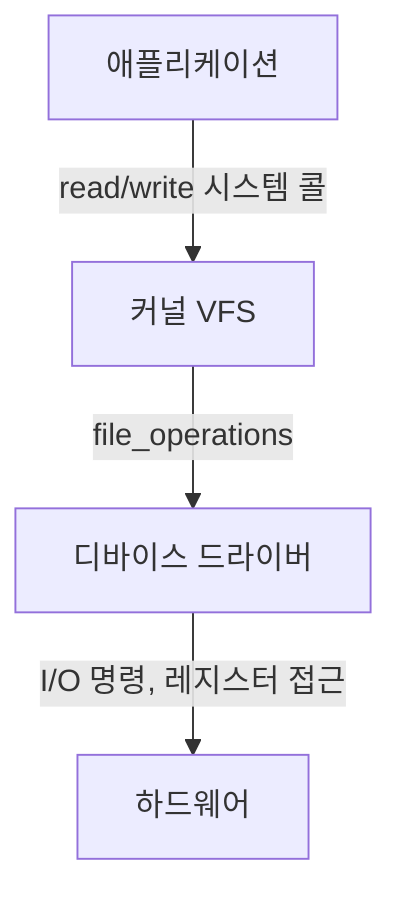
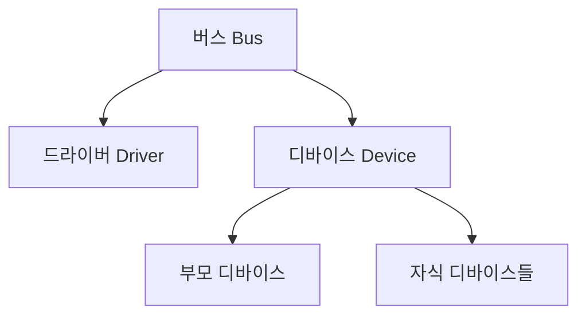

## 들어가며

*Linux Device Drivers*(Corbet, Rubini, Kroah-Hartman)는 드라이버의 역할을 이렇게 정리한다. 커널이 하드웨어를 사용자로부터 추상화한다면, 디바이스 드라이버는 개별 하드웨어의 세부 사항을 커널의 나머지 부분으로부터 추상화한다.

키보드를 누르면 문자가 화면에 나타난다. 마우스를 움직이면 커서가 따라온다. USB를 꽂으면 파일시스템이 마운트된다. 이 동작들은 운영체제가 수천 가지 다른 하드웨어와 대화하는 결과다.

이 글은 커널과 하드웨어 사이의 중개자인 디바이스 드라이버의 본질을 다룬다. 리눅스 커널이 드라이버를 어떻게 구성하는지, 하드웨어와 어떻게 통신하는지, 인터럽트를 어떻게 처리하는지를 단계별로 추적한다. 가장 단순한 문자 디바이스 드라이버를 직접 구현하는 절차까지 포함한다.

목표는 `/dev/mydev` 같은 단순 인터페이스를 출발점으로 MMIO, 인터럽트, DMA, sysfs, 모듈 수명을 하나의 장치 상태 기계로 연결하는 것이다.


---

## 목차
1. [드라이버의 역할](#1-드라이버의-역할)
2. [디바이스 분류](#2-디바이스-분류)
3. [file_operations](#3-file_operations)
4. [major/minor 번호](#4-majorminor-번호)
5. [하드웨어 접근: MMIO와 Port I/O](#5-하드웨어-접근-mmio와-port-io)
6. [인터럽트 처리](#6-인터럽트-처리)
7. [DMA](#7-dma)
8. [sysfs와 디바이스 모델](#8-sysfs와-디바이스-모델)
9. [간단한 드라이버 작성](#9-간단한-드라이버-작성)
10. [고급 주제](#10-고급-주제)
11. [실제 드라이버 분석](#11-실제-드라이버-분석)
12. [모듈 수명과 제거 안전성](#12-모듈-수명과-제거-안전성)


---

## 1. 드라이버의 역할

### 하드웨어 다양성 문제

컴퓨터 시스템은 수많은 하드웨어 장치로 구성된다. Intel CPU, AMD CPU, NVIDIA GPU, Samsung SSD, Realtek 네트워크 카드. 같은 종류의 장치라도 제조사와 모델에 따라 제어 방법이 완전히 다르다.

각 애플리케이션이 하드웨어를 직접 제어해야 한다면 다음 문제가 생긴다.

- 같은 기능의 프로그램을 하드웨어마다 다시 작성해야 한다.
- 하드웨어가 바뀌면 모든 프로그램을 수정해야 한다.
- 여러 프로그램이 동시에 하드웨어를 사용하려 할 때 충돌이 발생한다.
- 잘못된 명령으로 하드웨어를 손상시킬 수 있다.

### 추상화 계층

해결책은 추상화다. 운영체제가 하드웨어와 애플리케이션 사이에서 중개자 역할을 한다.



애플리케이션은 단순히 `open`, `read`, `write`, `close`를 호출한다. 파일이든, 디스크든, 네트워크 카드든, 프린터든 동일한 인터페이스로 접근한다. UNIX의 "Everything is a file" 철학이다.

### 디바이스 드라이버의 역할

디바이스 드라이버는 커널의 일부로서 특정 하드웨어 장치를 제어하는 소프트웨어다. 다음 역할을 수행한다.

1. 추상화: 하드웨어의 복잡성을 숨기고 표준 인터페이스를 제공한다.
2. 조정: 여러 프로세스의 하드웨어 접근을 직렬화한다.
3. 보호: 잘못된 접근으로부터 하드웨어를 보호한다.
4. 효율성: DMA, 인터럽트 등을 활용한 최적화를 수행한다.

Ritchie와 Thompson은 1974년 논문 "The UNIX Time-Sharing System"에서 입출력 장치를 파일시스템 안의 특수 파일(special file)로 표현하는 설계를 제시했다. 장치가 무엇이든 동일한 파일 인터페이스로 접근한다는 이 설계는 50년이 지난 지금도 유효하다.

## 2. 디바이스 분류

### 문자 디바이스

문자 디바이스(Character Device)는 블록 단위 캐시·I/O 인터페이스가 아니라 `file_operations`를 통해 바이트 스트림 또는 장치별 명령을 제공한다. 흔히 순차 스트림이지만 필수 조건은 아니다. 드라이버가 `llseek`를 구현하면 seek 가능한 문자 디바이스도 만들 수 있다.

예시는 다음과 같다.

- 시리얼 포트(`/dev/ttyS0`)
- 콘솔(`/dev/console`)
- 마우스(`/dev/input/mouse0`)
- 사운드 카드(`/dev/snd/*`)
- `/dev/null`, `/dev/zero`, `/dev/random`

특징은 다음과 같다.

- `read`와 `write`가 커널 버퍼를 거치지 않고 직접 장치에 전달될 수 있다.
- 데이터를 버퍼링하거나 재배치하지 않는다.
- 구조가 단순하다.

### 블록 디바이스

블록 디바이스(Block Device)는 고정 크기 블록 단위로 데이터를 주고받는 장치다. 임의 접근이 가능하다.

예시는 하드 디스크(`/dev/sda`), SSD(`/dev/nvme0n1`), USB 드라이브(`/dev/sdb`), CD-ROM(`/dev/sr0`)이다. 커널의 블록 I/O 서브시스템을 거치며, 요청을 큐에 쌓고 재배치하여 성능을 최적화한다. 페이지 캐시를 사용하며 파일시스템이 이 위에 구축된다.

### 네트워크 디바이스

네트워크 디바이스는 패킷을 주고받는다. 파일 인터페이스(`read`/`write`)가 아닌 소켓 인터페이스를 사용한다. 이더넷 카드(`eth0`), 무선 LAN(`wlan0`), 루프백(`lo`) 등이 있다. `/dev`에 파일로 나타나지 않으며 `socket`, `send`, `recv` 등의 시스템 콜을 사용한다.

이 글에서는 가장 단순한 문자 디바이스 드라이버를 중심으로 설명한다.

## 3. file_operations

### file_operations 구조체

리눅스 커널에서 드라이버는 `file_operations` 구조체로 표현된다. 이 구조체는 드라이버가 제공하는 연산들의 함수 포인터를 담는다.

```c
/* include/linux/fs.h */
struct file_operations {
    struct module *owner;
    loff_t (*llseek) (struct file *, loff_t, int);
    ssize_t (*read) (struct file *, char __user *, size_t, loff_t *);
    ssize_t (*write) (struct file *, const char __user *, size_t, loff_t *);
    ssize_t (*read_iter) (struct kiocb *, struct iov_iter *);
    ssize_t (*write_iter) (struct kiocb *, struct iov_iter *);
    int (*mmap) (struct file *, struct vm_area_struct *);
    int (*open) (struct inode *, struct file *);
    int (*flush) (struct file *, fl_owner_t id);
    int (*release) (struct inode *, struct file *);
    int (*fsync) (struct file *, loff_t, loff_t, int datasync);
    long (*unlocked_ioctl) (struct file *, unsigned int, unsigned long);
    __poll_t (*poll) (struct file *, struct poll_table_struct *);
    /* ... */
};
```

### 핵심 연산

**open과 release**

```c
int (*open)(struct inode *inode, struct file *filp);
int (*release)(struct inode *inode, struct file *filp);
```

`open`은 디바이스를 열 때 호출된다. 하드웨어 초기화, 자원 할당 등을 수행한다. `release`는 디바이스를 닫을 때 호출되어 자원을 해제한다.

`close` 시스템 콜이 호출되어도 `release`가 즉시 호출되지 않을 수 있다. 파일 디스크립터가 여러 프로세스에 의해 공유되면 마지막 참조가 사라질 때 호출된다.

**read와 write**

```c
ssize_t (*read)(struct file *filp, char __user *buff, size_t count, loff_t *offp);
ssize_t (*write)(struct file *filp, const char __user *buff, size_t count, loff_t *offp);
```

`__user` 어노테이션은 포인터가 사용자 공간을 가리킨다는 것을 나타낸다. 커널은 이 메모리를 직접 역참조할 수 없고, `copy_to_user`/`copy_from_user` 함수를 사용해야 한다.

**ioctl**

```c
long (*unlocked_ioctl)(struct file *filp, unsigned int cmd, unsigned long arg);
```

`ioctl`은 "Input/Output Control"의 약자로, 표준 `read`/`write`로 표현할 수 없는 장치별 명령을 수행한다. 터미널 크기 변경(`TIOCGWINSZ`), 사운드 카드 볼륨 조절(`MIXER_WRITE`), 디스크 파티션 정보 조회(`BLKGETSIZE`) 등이 예시다.

### 사용자 공간과 커널 공간 사이의 데이터 전송

커널은 사용자 공간 메모리를 직접 역참조할 수 없다. 보안과 안정성을 위해 다음 함수들을 사용해야 한다.

```c
/* include/linux/uaccess.h */

/* 커널 → 사용자 */
unsigned long copy_to_user(void __user *to, const void *from, unsigned long n);

/* 사용자 → 커널 */
unsigned long copy_from_user(void *to, const void __user *from, unsigned long n);

/* 단일 값 전송 */
int get_user(x, ptr);
int put_user(x, ptr);
```

이 함수들은 페이지 폴트를 처리하고(페이지가 스왑아웃되었을 수 있음), 주소가 유효한지 검사하며, 아키텍처별 최적화를 수행한다. `copy_to_user`/`copy_from_user`는 실패 시 복사되지 않은 바이트 수를 반환하고, `get_user`/`put_user`는 실패 시 `-EFAULT`를 반환한다. 둘 다 0이면 성공이다.

## 4. major/minor 번호

### 디바이스 번호의 필요성

리눅스 시스템에는 수백 개의 디바이스 파일이 존재한다. 커널은 각 디바이스를 다음 정보로 구분한다.

```bash
$ ls -l /dev/sda /dev/ttyS0 /dev/null
brw-rw---- 1 root disk    8, 0 Dec 23 10:00 /dev/sda
crw-rw-rw- 1 root root    1, 3 Dec 23 10:00 /dev/null
crw-rw---- 1 root dialout 4, 64 Dec 23 10:00 /dev/ttyS0
```

첫 번째 문자는 디바이스 타입이다(`c`는 character, `b`는 block). 날짜 앞의 두 숫자가 major와 minor 번호다.

### Major 번호: 드라이버 식별

Major 번호는 어떤 드라이버가 이 디바이스를 처리하는지 식별한다.

```c
/* fs/char_dev.c */
static struct char_device_struct {
    struct char_device_struct *next;
    unsigned int major;
    unsigned int baseminor;
    int minorct;
    char name[64];
    struct cdev *cdev;
} *chrdevs[CHRDEV_MAJOR_HASH_SIZE];
```

예시는 다음과 같다.

- Major 1: 메모리 장치(`/dev/null`, `/dev/zero`, `/dev/random`)
- Major 4: TTY 장치(`/dev/tty*`)
- Major 8: SCSI 디스크(`/dev/sda`, `/dev/sdb`)
- Major 10: 기타 문자 장치

커널 소스의 `Documentation/admin-guide/devices.txt`에 할당된 major 번호들이 나열되어 있다.

### Minor 번호: 장치 인스턴스 식별

Minor 번호는 같은 드라이버가 관리하는 여러 장치를 구분한다.

- `/dev/sda`(major=8, minor=0): 첫 번째 SCSI 디스크
- `/dev/sda1`(major=8, minor=1): 첫 번째 SCSI 디스크의 첫 번째 파티션
- `/dev/sdb`(major=8, minor=16): 두 번째 SCSI 디스크

드라이버는 minor 번호를 보고 어떤 물리적 장치에 접근해야 하는지 결정한다.

### dev_t와 디바이스 번호 할당

커널 내부에서 major/minor 번호는 `dev_t` 타입으로 결합되어 저장된다.

```c
/* include/linux/types.h */
typedef u32 dev_t;

/* include/linux/kdev_t.h */
#define MINORBITS    20
#define MINORMASK    ((1U << MINORBITS) - 1)

#define MAJOR(dev)   ((unsigned int) ((dev) >> MINORBITS))
#define MINOR(dev)   ((unsigned int) ((dev) & MINORMASK))
#define MKDEV(ma,mi) (((ma) << MINORBITS) | (mi))
```

현재 구현에서는 12비트를 major에, 20비트를 minor에 할당한다. 즉, 최대 4,096개의 드라이버와 각 드라이버당 1,048,576개의 장치를 지원한다.

드라이버는 다음 함수로 major 번호를 할당받는다.

```c
/* 정적 할당 */
int register_chrdev_region(dev_t first, unsigned int count, const char *name);

/* 동적 할당 */
int alloc_chrdev_region(dev_t *dev, unsigned int firstminor,
                        unsigned int count, const char *name);

/* 해제 */
void unregister_chrdev_region(dev_t first, unsigned int count);
```

현대적인 드라이버는 대부분 동적 할당을 사용한다. 정적 할당은 충돌 위험이 있다.

## 5. 하드웨어 접근: MMIO와 Port I/O

### 하드웨어 레지스터 접근

디바이스와 통신하려면 디바이스의 레지스터에 접근해야 한다. 레지스터는 다음 용도로 사용된다.

- 제어 레지스터: 디바이스에 명령을 내린다.
- 상태 레지스터: 디바이스의 현재 상태를 읽는다.
- 데이터 레지스터: 데이터를 주고받는다.

하드웨어 레지스터에 접근하는 방법은 두 가지다.

### Port I/O

Port I/O는 x86 아키텍처의 전통적인 방식이다. CPU는 메모리 주소 공간과 별도로 I/O 주소 공간을 가진다. x86에는 전용 I/O 명령어(`in`, `out`)가 있다.

```c
/* arch/x86/include/asm/io.h */

u8  inb(unsigned long port);
u16 inw(unsigned long port);
u32 inl(unsigned long port);

void outb(u8 value, unsigned long port);
void outw(u16 value, unsigned long port);
void outl(u32 value, unsigned long port);

void insb(unsigned long port, void *addr, unsigned long count);
void outsb(unsigned long port, const void *addr, unsigned long count);
```

PC 스피커 제어 예시는 다음과 같다.

```c
/* 스피커를 켠다(0x61 포트의 비트 0과 1 설정) */
u8 tmp = inb(0x61);
outb(tmp | 0x03, 0x61);

/* 특정 주파수로 비프음을 낸다 */
unsigned int frequency = 1000; /* Hz */
unsigned int divisor = 1193180 / frequency;
outb(0xb6, 0x43);
outb(divisor & 0xff, 0x42);
outb(divisor >> 8, 0x42);
```

### MMIO

MMIO(Memory-Mapped I/O)는 현대적인 방식이다. 디바이스 레지스터가 물리 메모리 주소 공간에 매핑된다. CPU는 메모리 읽기/쓰기 명령어로 레지스터에 접근한다.

**주소 매핑**

커널은 물리 주소를 가상 주소로 매핑해야 한다.

```c
void __iomem *ioremap(phys_addr_t phys_addr, size_t size);
void iounmap(void __iomem *addr);
```

일반 MMIO에는 `ioremap()`을 사용한다. 오래된 `ioremap_nocache()`는 Linux 5.6에서 제거되었으며, 아키텍처별 cache attribute가 필요하면 해당 mapping API의 현재 계약을 확인해야 한다. `__iomem` 어노테이션은 이 포인터가 I/O 메모리를 가리킨다는 것을 나타낸다.

**MMIO 접근 함수**

```c
/* include/asm-generic/io.h */

u8  readb(const volatile void __iomem *addr);
u16 readw(const volatile void __iomem *addr);
u32 readl(const volatile void __iomem *addr);
u64 readq(const volatile void __iomem *addr);

void writeb(u8 value, volatile void __iomem *addr);
void writew(u16 value, volatile void __iomem *addr);
void writel(u32 value, volatile void __iomem *addr);
void writeq(u64 value, volatile void __iomem *addr);

void memcpy_fromio(void *dst, const volatile void __iomem *src, size_t count);
void memcpy_toio(volatile void __iomem *dst, const void *src, size_t count);
```

PCI 디바이스의 레지스터 읽기 예시는 다음과 같다.

```c
struct my_device {
    void __iomem *regs;
};

static int my_device_probe(struct pci_dev *pdev, const struct pci_device_id *id)
{
    struct my_device *dev;
    unsigned long mmio_start, mmio_len;

    dev = kzalloc(sizeof(*dev), GFP_KERNEL);

    /* PCI BAR(Base Address Register)에서 MMIO 영역 정보 가져오기 */
    mmio_start = pci_resource_start(pdev, 0);
    mmio_len = pci_resource_len(pdev, 0);

    /* 물리 주소를 가상 주소로 매핑 */
    dev->regs = ioremap(mmio_start, mmio_len);
    if (!dev->regs) {
        kfree(dev);
        return -ENOMEM;
    }

    /* 디바이스 ID 레지스터 읽기(오프셋 0x00) */
    u32 device_id = readl(dev->regs + 0x00);
    printk(KERN_INFO "Device ID: 0x%08x\n", device_id);

    /* 제어 레지스터에 쓰기(오프셋 0x10) */
    writel(0x00000001, dev->regs + 0x10);

    return 0;
}
```

### 메모리 배리어

MMIO는 일반 메모리 포인터 역참조가 아니라 Linux I/O accessor로 접근한다. `readl`/`writel`이 제공하는 ordering은 아키텍처의 I/O 모델에 맞춰 정의되며, relaxed accessor, write-combining mapping, DMA buffer와 device doorbell 사이에는 별도의 ordering 요구가 생길 수 있다. 어떤 barrier가 필요한지는 장치 프로토콜과 accessor 계약에서 결정한다.

```c
/* 일반 메모리 ordering primitive */
mb();
rmb();
wmb();

/* DMA descriptor를 장치에 공개하기 전의 대표 primitive */
dma_wmb();
```

예를 들어 CPU가 coherent DMA 메모리에 descriptor를 쓴 뒤 MMIO doorbell을 울리는 장치는 descriptor가 먼저 관측되어야 한다.

```c
descriptor->address = dma_addr;
descriptor->length = length;
dma_wmb();  /* descriptor store가 doorbell보다 먼저 보이게 한다 */
writel(queue_index, dev->regs + REG_DOORBELL);

/* 장치가 요구하면 posted write 완료를 readback으로 확인한다. */
readl(dev->regs + REG_STATUS);
```

## 6. 인터럽트 처리

### 인터럽트의 필요성

드라이버가 하드웨어의 상태를 계속 폴링하면 CPU 시간을 낭비한다.

```c
/* 비효율적인 폴링 방식 */
while (!(readl(dev->regs + STATUS_REG) & DATA_READY)) {
    /* 데이터가 준비될 때까지 대기 */
}
data = readl(dev->regs + DATA_REG);
```

대신 하드웨어가 준비되었을 때 CPU에 인터럽트를 보내면, CPU는 다른 작업을 하다가 인터럽트가 발생하면 드라이버의 핸들러를 실행한다.

### 인터럽트 핸들러 등록

```c
/* include/linux/interrupt.h */
int request_irq(unsigned int irq,
                irq_handler_t handler,
                unsigned long flags,
                const char *name,
                void *dev_id);

void free_irq(unsigned int irq, void *dev_id);
```

매개변수는 다음과 같다.

- `irq`: 인터럽트 번호
- `handler`: 인터럽트 발생 시 호출될 함수
- `flags`: 동작 옵션(`IRQF_SHARED`, `IRQF_TRIGGER_RISING` 등)
- `name`: `/proc/interrupts`에 표시될 이름
- `dev_id`: 핸들러에 전달될 컨텍스트 포인터

### 인터럽트 핸들러 작성

```c
typedef irqreturn_t (*irq_handler_t)(int irq, void *dev_id);
```

반환 값은 다음과 같다.

- `IRQ_HANDLED`: 이 디바이스의 인터럽트를 처리했다.
- `IRQ_NONE`: 이 디바이스의 인터럽트가 아니었다(공유 IRQ에서 중요).

```c
static irqreturn_t my_interrupt_handler(int irq, void *dev_id)
{
    struct my_device *dev = dev_id;
    u32 status;

    status = readl(dev->regs + REG_STATUS);

    if (!(status & MY_DEVICE_IRQ_FLAG))
        return IRQ_NONE;

    /* 인터럽트 플래그 클리어 */
    writel(MY_DEVICE_IRQ_FLAG, dev->regs + REG_STATUS);

    if (status & DATA_READY) {
        u32 data = readl(dev->regs + REG_DATA);
        dev->buffer[dev->head++] = data;
        wake_up_interruptible(&dev->wait_queue);
    }

    return IRQ_HANDLED;
}
```

### 인터럽트 컨텍스트의 제약

인터럽트 핸들러는 인터럽트 컨텍스트에서 실행된다. 다음 제약이 있다.

1. 슬립 불가: `sleep`, `wait_event`, `mutex_lock` 등 블로킹 함수 사용 불가
2. 사용자 공간 접근 불가: `copy_to_user`/`copy_from_user` 사용 불가
3. 빠르게 실행: hardirq/atomic context를 길게 점유하면 local latency와 후속 interrupt 처리가 악화되므로 최소한의 작업만 수행. 모든 interrupt가 전역으로 비활성화된다는 뜻은 아님
4. 스택 제한: kernel·entry stack 예산은 architecture와 build config에 따라 달라지므로 큰 지역 배열과 재귀를 피함

### Top Half와 Bottom Half

복잡한 작업을 인터럽트 핸들러에서 모두 수행하면 시스템이 느려진다. 해결책은 작업을 두 부분으로 나누는 것이다.

- Top Half(Hard IRQ): 인터럽트 핸들러 자체. 시간이 중요한 최소한의 작업만 수행한다.
- Deferred work: 나중에 실행할 작업이다. softirq는 여전히 atomic context라 sleep할 수 없고, workqueue/threaded IRQ는 schedulable kernel-thread context를 제공한다.

Bottom Half 메커니즘은 다음과 같다.

- Softirq: 가장 빠르지만 SMP에서 동기화 복잡
- Tasklet: Softirq 기반의 역사적 인터페이스. 신규 driver에는 사용하지 않음
- Workqueue: 프로세스 컨텍스트에서 실행, 슬립 가능

새 driver의 일반적인 deferred-work 예시는 `work_struct`를 장치 객체에 포함하는 방식이다.

```c
struct my_device {
    /* ... */
    struct work_struct work;
};

static void my_work_handler(struct work_struct *work)
{
    struct my_device *dev =
        container_of(work, struct my_device, work);
    process_large_data(dev);
}

/* probe/init 경로 */
INIT_WORK(&dev->work, my_work_handler);

static irqreturn_t my_interrupt_handler(int irq, void *dev_id)
{
    struct my_device *dev = dev_id;
    u32 status = readl(dev->regs + REG_STATUS);

    if (!(status & MY_DEVICE_IRQ_FLAG))
        return IRQ_NONE;

    writel(MY_DEVICE_IRQ_FLAG, dev->regs + REG_STATUS);

    schedule_work(&dev->work);

    return IRQ_HANDLED;
}

static void my_remove(struct my_device *dev)
{
    /* dev를 해제하기 전에 in-flight work와 수명을 합류시킨다. */
    cancel_work_sync(&dev->work);
    /* IRQ/DMA와 나머지 자원도 역순으로 해제한다. */
}
```

## 7. DMA

### DMA의 필요성

CPU가 직접 데이터를 전송하면 비효율적이다.

```c
/* CPU가 직접 4KB 데이터를 전송 */
for (i = 0; i < 4096; i++) {
    writeb(buffer[i], dev->regs + DATA_REG);
}
```

이 방식의 문제점은 다음과 같다.

- CPU가 전송 동안 다른 작업을 할 수 없다.
- 각 바이트마다 I/O 버스 트랜잭션이 발생한다.
- 대용량 전송(디스크, 네트워크)에서 심각한 성능 저하가 발생한다.

DMA(Direct Memory Access)는 CPU를 거치지 않고 메모리와 디바이스 간에 직접 데이터를 전송한다.

### DMA 매핑

DMA 컨트롤러에 넘기는 주소는 CPU의 물리 주소가 아니라 `dma_addr_t` 타입의 **DMA(bus) 주소**다. IOMMU가 있는 시스템에서는 IOMMU가 디바이스 관점의 주소를 별도 페이지 테이블로 매핑하기 때문에 CPU physical address와 다른 값이 된다. 또한 32비트 DMA만 지원하는 디바이스를 위한 bounce buffer, 캐시 일관성 유지 같은 작업도 매핑 함수가 함께 처리한다. 따라서 드라이버는 가상 주소를 직접 물리 주소로 변환하지 않고, 반드시 DMA API를 통해 `dma_addr_t`를 얻는다.

```c
/* 일관성 있는(coherent) DMA 버퍼 할당 */
void *dma_alloc_coherent(struct device *dev, size_t size,
                         dma_addr_t *dma_handle, gfp_t gfp);

void dma_free_coherent(struct device *dev, size_t size,
                       void *cpu_addr, dma_addr_t dma_handle);

/* 기존 버퍼를 DMA용으로 매핑 */
dma_addr_t dma_map_single(struct device *dev, void *ptr, size_t size,
                          enum dma_data_direction dir);

void dma_unmap_single(struct device *dev, dma_addr_t dma_addr, size_t size,
                      enum dma_data_direction dir);
```

`dma_data_direction`은 다음과 같다.

- `DMA_TO_DEVICE`: CPU → 디바이스
- `DMA_FROM_DEVICE`: 디바이스 → CPU
- `DMA_BIDIRECTIONAL`: 양방향

### DMA 전송 예시

```c
static int my_device_send_data(struct my_device *dev, void *buffer, size_t len)
{
    dma_addr_t dma_handle;
    /* DMA API의 첫 인자는 struct device *. PCI 드라이버라면 &pdev->dev 같이 꺼낸다. */
    struct device *ddev = &dev->pdev->dev;

    dma_handle = dma_map_single(ddev, buffer, len, DMA_TO_DEVICE);
    if (dma_mapping_error(ddev, dma_handle)) {
        printk(KERN_ERR "DMA mapping failed\n");
        return -ENOMEM;
    }

    /* DMA 컨트롤러에 물리 주소와 길이 설정 */
    writel(lower_32_bits(dma_handle), dev->regs + DMA_ADDR_LOW);
    writel(upper_32_bits(dma_handle), dev->regs + DMA_ADDR_HIGH);
    writel(len, dev->regs + DMA_LENGTH);

    /* DMA 전송 시작 */
    writel(DMA_START, dev->regs + DMA_CONTROL);

    /* 전송 완료를 기다린다(보통 인터럽트로 통지받는다) */
    wait_for_completion(&dev->dma_complete);

    dma_unmap_single(ddev, dma_handle, len, DMA_TO_DEVICE);

    return 0;
}
```

### Scatter-Gather DMA

물리적으로 불연속적인 메모리를 한 번에 전송하려면 Scatter-Gather DMA를 사용한다.

```c
struct scatterlist {
    unsigned long page_link;
    unsigned int offset;
    unsigned int length;
    dma_addr_t dma_address;
};

int dma_map_sg(struct device *dev, struct scatterlist *sg,
               int nents, enum dma_data_direction dir);

void dma_unmap_sg(struct device *dev, struct scatterlist *sg,
                  int nents, enum dma_data_direction dir);
```

네트워크 패킷이나 파일 I/O에서 자주 사용된다.

## 8. sysfs와 디바이스 모델

### sysfs

`/sys`는 커널의 내부 구조를 파일시스템으로 노출한다. 디바이스, 드라이버, 버스 등이 디렉토리와 파일로 표현된다.

```bash
$ ls /sys/class/net/eth0/
address  carrier  device  duplex  operstate  speed  statistics  type

$ cat /sys/class/net/eth0/address
00:1a:2b:3c:4d:5e

$ cat /sys/class/net/eth0/speed
1000
```

### sysfs 속성 추가

드라이버는 sysfs에 파일을 추가하여 디바이스 정보를 노출하거나 설정을 변경할 수 있다.

```c
/* 읽기 전용 속성 */
static ssize_t my_show(struct device *dev, struct device_attribute *attr, char *buf)
{
    struct my_device *mydev = dev_get_drvdata(dev);
    return sprintf(buf, "%d\n", mydev->some_value);
}
static DEVICE_ATTR_RO(my);

/* 쓰기 가능 속성 */
static ssize_t threshold_show(struct device *dev, struct device_attribute *attr, char *buf)
{
    struct my_device *mydev = dev_get_drvdata(dev);
    return sprintf(buf, "%d\n", mydev->threshold);
}

static ssize_t threshold_store(struct device *dev, struct device_attribute *attr,
                                const char *buf, size_t count)
{
    struct my_device *mydev = dev_get_drvdata(dev);
    int ret;

    ret = kstrtoint(buf, 10, &mydev->threshold);
    if (ret)
        return ret;

    writel(mydev->threshold, mydev->regs + THRESHOLD_REG);

    return count;
}
static DEVICE_ATTR_RW(threshold);

/* 속성 그룹 */
static struct attribute *my_attrs[] = {
    &dev_attr_my.attr,
    &dev_attr_threshold.attr,
    NULL,
};
ATTRIBUTE_GROUPS(my);

static struct platform_driver my_driver = {
    .probe = my_probe,
    .remove = my_remove,
    .driver = {
        .name = "my_device",
        .dev_groups = my_groups,
    },
};
```

이제 사용자 공간에서 접근할 수 있다.

```bash
$ cat /sys/devices/.../my_device/threshold
42

$ echo 100 > /sys/devices/.../my_device/threshold
```

### 디바이스 모델

리눅스 커널의 디바이스 모델은 하드웨어를 계층적으로 표현한다.



PCI 버스에 이더넷 카드가 연결되거나 USB 버스에 허브가 연결되고 허브에 마우스가 연결되는 식이다.

핵심 구조체는 다음과 같다.

```c
struct bus_type {
    const char *name;
    int (*match)(struct device *dev, struct device_driver *drv);
    int (*probe)(struct device *dev);
    void (*remove)(struct device *dev);
};

struct device_driver {
    const char *name;
    struct bus_type *bus;
    int (*probe)(struct device *dev);
    void (*remove)(struct device *dev);
};

struct device {
    struct device *parent;
    struct device_driver *driver;
    struct bus_type *bus;
    void *driver_data;
    struct kobject kobj;
};
```

드라이버를 등록하면 커널은 `match` 함수로 호환되는 디바이스를 찾아 `probe`를 호출한다.

## 9. 간단한 드라이버 작성

### 요구사항

가장 단순한 문자 디바이스 드라이버를 작성한다. 이 드라이버는 다음을 만족한다.

- `/dev/mydev`로 접근 가능하다.
- `read` 시 "Hello from kernel\n"을 반환한다.
- `write` 시 데이터를 커널 로그에 출력한다.

### 전체 코드

```c
/* mydev.c */
#include <linux/module.h>
#include <linux/kernel.h>
#include <linux/fs.h>
#include <linux/cdev.h>
#include <linux/device.h>
#include <linux/uaccess.h>

#define DEVICE_NAME "mydev"
#define CLASS_NAME "mydev_class"

static int major_number;
static struct class *mydev_class = NULL;
static struct device *mydev_device = NULL;
static struct cdev mydev_cdev;

static const char *hello_msg = "Hello from kernel\n";

static int mydev_open(struct inode *inode, struct file *filp)
{
    printk(KERN_INFO "mydev: Device opened\n");
    return 0;
}

static int mydev_release(struct inode *inode, struct file *filp)
{
    printk(KERN_INFO "mydev: Device closed\n");
    return 0;
}

static ssize_t mydev_read(struct file *filp, char __user *buffer,
                          size_t len, loff_t *offset)
{
    size_t msg_len = strlen(hello_msg);
    size_t to_copy;

    if (*offset >= msg_len)
        return 0;

    to_copy = min(len, msg_len - (size_t)*offset);

    if (copy_to_user(buffer, hello_msg + *offset, to_copy)) {
        return -EFAULT;
    }

    *offset += to_copy;
    printk(KERN_INFO "mydev: Sent %zu bytes to user\n", to_copy);

    return to_copy;
}

static ssize_t mydev_write(struct file *filp, const char __user *buffer,
                           size_t len, loff_t *offset)
{
    char kbuf[256];
    size_t to_copy;

    to_copy = min(len, sizeof(kbuf) - 1);

    if (copy_from_user(kbuf, buffer, to_copy)) {
        return -EFAULT;
    }

    kbuf[to_copy] = '\0';
    printk(KERN_INFO "mydev: Received from user: %s\n", kbuf);

    return to_copy;
}

static struct file_operations fops = {
    .owner = THIS_MODULE,
    .open = mydev_open,
    .release = mydev_release,
    .read = mydev_read,
    .write = mydev_write,
};

static int __init mydev_init(void)
{
    dev_t dev;
    int ret;

    printk(KERN_INFO "mydev: Initializing module\n");

    ret = alloc_chrdev_region(&dev, 0, 1, DEVICE_NAME);
    if (ret < 0) {
        printk(KERN_ALERT "mydev: Failed to allocate major number\n");
        return ret;
    }
    major_number = MAJOR(dev);

    cdev_init(&mydev_cdev, &fops);
    mydev_cdev.owner = THIS_MODULE;

    ret = cdev_add(&mydev_cdev, dev, 1);
    if (ret < 0) {
        unregister_chrdev_region(dev, 1);
        return ret;
    }

    /*
     * 본 글의 드라이버 예제는 Linux 5.15(LTS) 기준이다.
     *
     * Linux 6.4부터 class_create의 시그니처가
     *   class_create(const char *name)
     * 로 바뀌어 첫 인자 THIS_MODULE이 제거되었다. 6.4 이상 커널에서 빌드한다면
     *   mydev_class = class_create(CLASS_NAME);
     * 와 같이 호출해야 컴파일된다.
     */
    mydev_class = class_create(THIS_MODULE, CLASS_NAME);
    if (IS_ERR(mydev_class)) {
        cdev_del(&mydev_cdev);
        unregister_chrdev_region(dev, 1);
        return PTR_ERR(mydev_class);
    }

    mydev_device = device_create(mydev_class, NULL, dev, NULL, DEVICE_NAME);
    if (IS_ERR(mydev_device)) {
        class_destroy(mydev_class);
        cdev_del(&mydev_cdev);
        unregister_chrdev_region(dev, 1);
        return PTR_ERR(mydev_device);
    }

    printk(KERN_INFO "mydev: Device created successfully\n");
    return 0;
}

static void __exit mydev_exit(void)
{
    dev_t dev = MKDEV(major_number, 0);

    device_destroy(mydev_class, dev);
    class_destroy(mydev_class);
    cdev_del(&mydev_cdev);
    unregister_chrdev_region(dev, 1);

    printk(KERN_INFO "mydev: Module removed\n");
}

module_init(mydev_init);
module_exit(mydev_exit);

MODULE_LICENSE("GPL");
MODULE_AUTHOR("Your Name");
MODULE_DESCRIPTION("A simple character device driver");
MODULE_VERSION("1.0");
```

### Makefile

```makefile
obj-m += mydev.o

KDIR := /lib/modules/$(shell uname -r)/build
PWD := $(shell pwd)

all:
	$(MAKE) -C $(KDIR) M=$(PWD) modules

clean:
	$(MAKE) -C $(KDIR) M=$(PWD) clean
```

### 빌드와 테스트

```bash
# 1. 드라이버 빌드
$ make

# 2. 모듈 로드
$ sudo insmod mydev.ko

# 3. 커널 로그 확인
$ dmesg | tail
[12345.678901] mydev: Initializing module
[12345.678903] mydev: Device created successfully

# 4. 디바이스 파일 확인
$ ls -l /dev/mydev
crw------- 1 root root 243, 0 Dec 23 10:00 /dev/mydev

# 5. 테스트
$ sudo cat /dev/mydev
Hello from kernel

$ echo "Test message" | sudo tee /dev/mydev
Test message

# 6. 모듈 언로드
$ sudo rmmod mydev
```

### 코드 분석

**초기화 순서**

1. `alloc_chrdev_region`: Major/minor 번호 할당
2. `cdev_init` 및 `cdev_add`: Character device 등록
3. `class_create`: `/sys/class/` 아래에 클래스 생성
4. `device_create`: `/dev/` 아래에 디바이스 파일 자동 생성(udev가 처리)

**사용자 공간 인터페이스**

사용자가 `open("/dev/mydev", O_RDONLY)`를 호출하면 다음 흐름이 일어난다.

1. VFS가 inode를 찾는다.
2. inode의 `i_cdev`를 통해 `mydev_cdev`를 찾는다.
3. `mydev_cdev.ops`(즉, `fops`)를 찾는다.
4. `fops.open`(즉, `mydev_open`)을 호출한다.

## 10. 고급 주제

### poll/select/epoll

디바이스가 준비될 때까지 블로킹하려면 `poll` 연산을 구현한다.

```c
static __poll_t mydev_poll(struct file *filp, poll_table *wait)
{
    struct my_device *dev = filp->private_data;
    __poll_t mask = 0;

    poll_wait(filp, &dev->read_queue, wait);
    poll_wait(filp, &dev->write_queue, wait);

    if (dev->data_available)
        mask |= EPOLLIN | EPOLLRDNORM;

    if (dev->space_available)
        mask |= EPOLLOUT | EPOLLWRNORM;

    return mask;
}
```

사용자 공간 코드는 다음과 같다.

```c
struct pollfd fds[1];
fds[0].fd = fd;
fds[0].events = POLLIN;

poll(fds, 1, -1);
read(fd, buffer, sizeof(buffer));
```

### mmap

사용자 공간이 드라이버의 메모리를 직접 접근하게 하려면 `mmap`을 구현한다.

```c
static int mydev_mmap(struct file *filp, struct vm_area_struct *vma)
{
    struct my_device *dev = filp->private_data;
    unsigned long size = vma->vm_end - vma->vm_start;
    unsigned long pfn;

    if (size > dev->buffer_size)
        return -EINVAL;

    pfn = virt_to_phys(dev->buffer) >> PAGE_SHIFT;

    if (remap_pfn_range(vma, vma->vm_start, pfn, size, vma->vm_page_prot))
        return -EAGAIN;

    return 0;
}
```

`read`/`write` 없이 직접 메모리 접근으로 고성능 전송이 가능하다.

### 플랫폼 드라이버

SoC(System on Chip)의 내장 장치는 PCI 버스에 연결되지 않는다. 대신 플랫폼 드라이버로 구현한다.

```c
static int my_platform_probe(struct platform_device *pdev)
{
    struct resource *res;
    void __iomem *base;
    int irq;

    res = platform_get_resource(pdev, IORESOURCE_MEM, 0);
    base = devm_ioremap_resource(&pdev->dev, res);
    if (IS_ERR(base))
        return PTR_ERR(base);

    irq = platform_get_irq(pdev, 0);
    if (irq < 0)
        return irq;

    return 0;
}

static const struct of_device_id my_of_match[] = {
    { .compatible = "vendor,my-device", },
    { /* sentinel */ }
};
MODULE_DEVICE_TABLE(of, my_of_match);

static struct platform_driver my_platform_driver = {
    .probe = my_platform_probe,
    .remove = my_platform_remove,
    .driver = {
        .name = "my-device",
        .of_match_table = my_of_match,
    },
};

module_platform_driver(my_platform_driver);
```

디바이스 트리(Device Tree)가 하드웨어 구성을 기술하면 커널이 자동으로 매칭하여 `probe`를 호출한다.

### 전원 관리

모바일 기기에서 중요한 전원 관리를 구현하는 방법은 다음과 같다.

```c
static int my_suspend(struct device *dev)
{
    struct my_device *mydev = dev_get_drvdata(dev);

    flush_workqueue(mydev->workqueue);
    writel(POWER_DOWN, mydev->regs + POWER_REG);

    return 0;
}

static int my_resume(struct device *dev)
{
    struct my_device *mydev = dev_get_drvdata(dev);

    writel(POWER_UP, mydev->regs + POWER_REG);
    my_device_reinit(mydev);

    return 0;
}

static const struct dev_pm_ops my_pm_ops = {
    .suspend = my_suspend,
    .resume = my_resume,
};

static struct platform_driver my_driver = {
    .driver = {
        .name = "my-device",
        .pm = &my_pm_ops,
    },
};
```

시스템이 슬립 모드에 들어가거나 깨어날 때 자동으로 호출된다.

## 11. 실제 드라이버 분석

### /dev/null 드라이버

가장 단순한 드라이버 중 하나인 `/dev/null`을 본다. `drivers/char/mem.c`다.

```c
static ssize_t read_null(struct file *file, char __user *buf,
                         size_t count, loff_t *ppos)
{
    return 0;  /* 항상 EOF */
}

static ssize_t write_null(struct file *file, const char __user *buf,
                          size_t count, loff_t *ppos)
{
    return count;  /* 모든 데이터를 버리고 성공 반환 */
}

static const struct file_operations null_fops = {
    .llseek     = null_lseek,
    .read       = read_null,
    .write      = write_null,
    .splice_write = splice_write_null,
};
```

`/dev/null`은 읽으면 즉시 EOF를, 쓰면 데이터를 버리고 성공을 반환한다. 짧은 구현이지만 VFS의 `file_operations` 계약을 그대로 따른다.

### 시리얼 포트 드라이버

`drivers/tty/serial/8250/8250_port.c`의 `serial8250_do_startup` 함수를 골자만 남겨 단순화한 것이다(실제 IRQ 등록은 `up->ops->setup_irq`를 거친다).

```c
static int serial8250_do_startup(struct uart_port *port)
{
    struct uart_8250_port *up = up_to_u8250p(port);
    int retval;

    /* 인터럽트 비활성화 */
    serial_port_out(port, UART_IER, 0);

    /* FIFO 활성화 */
    serial8250_clear_and_reinit_fifos(up);

    /* 인터럽트 핸들러 등록 */
    retval = request_irq(port->irq, serial8250_interrupt,
                         up->port.irqflags, dev_name(port->dev), up);

    /* 데이터 포맷 설정(8N1: 8 bits, No parity, 1 stop bit) */
    serial_port_out(port, UART_LCR, UART_LCR_WLEN8);

    /* 인터럽트 활성화 */
    serial_port_out(port, UART_IER, UART_IER_RDI);

    return 0;
}
```

실제 하드웨어 레지스터를 직접 설정하는 모습을 볼 수 있다.

### NVMe SSD 드라이버

`drivers/nvme/host/pci.c`의 DMA 전송 코드다.

```c
static blk_status_t nvme_map_data(struct nvme_dev *dev, struct request *req,
                                  struct nvme_command *cmnd)
{
    struct nvme_iod *iod = blk_mq_rq_to_pdu(req);
    int ret;

    /* Scatter-Gather 리스트 매핑 */
    ret = dma_map_sg(dev->dev, iod->sg, iod->nents, dma_dir);
    if (ret == 0)
        return BLK_STS_RESOURCE;

    /* PRP(Physical Region Page) 리스트 생성 */
    ret = nvme_setup_prps(dev, req, iod);

    /* 명령 큐에 추가 */
    cmnd->rw.dptr.prp1 = cpu_to_le64(sg_dma_address(iod->sg));

    return BLK_STS_OK;
}
```

NVMe는 고성능 SSD 인터페이스로, DMA와 명령 큐를 활용하여 수백만 IOPS를 달성한다.

## 12. 모듈 수명과 제거 안전성

### 로드 가능한 코드는 자원 수명을 바꾼다

Loadable module은 커널 주소 공간에 code/data section을 배치하고 재배치와 symbol resolution을 수행한 뒤 `module_init` 함수를 호출한다. 초기화가 성공하면 드라이버 callback 주소가 VFS, IRQ table, bus, timer, workqueue 같은 커널 자료구조에 남는다.

따라서 `module_exit` 반환 뒤 module text를 해제하려면 어떤 CPU도 callback을 실행하거나 실행할 가능성이 없어야 한다. 사용자 공간의 객체 소멸과 달리, 단순히 등록 함수를 반대로 호출하는 것만으로는 in-flight 작업이 사라지지 않는다.

### 참조 계수

`file_operations.owner = THIS_MODULE`은 open file이 module reference를 잡도록 해 사용 중인 문자 드라이버의 unload를 막는다. 직접 만든 callback registration은 해당 subsystem이 module 수명을 어떻게 보호하는지 확인해야 한다.

```c
static const struct file_operations my_fops = {
    .owner = THIS_MODULE,
    .open = my_open,
    .read = my_read,
    .release = my_release,
};
```

Reference count는 새 진입을 막는 정책과 함께 사용해야 한다. 제거 상태인데 새 `open`이나 I/O가 계속 reference를 얻으면 unload가 끝나지 않는다.

### 제거 상태 기계

안전한 제거 순서는 일반적으로 아래 방향을 따른다.

```text
RUNNING
  -> QUIESCING: 새 I/O와 새 callback 예약 차단
  -> DETACHED: user/bus interface에서 제거
  -> DRAINING: in-flight IRQ, DMA, work, timer 완료
  -> FREED: memory, MMIO mapping, module text 회수
```

구체적인 동기화 함수는 자원마다 다르다.

| 자원 | 제거 시 필요한 대표 동작 |
|---|---|
| IRQ handler | 장치 IRQ 차단, `free_irq`/`synchronize_irq` |
| workqueue | 새 enqueue 차단, `cancel_work_sync` 또는 `flush_workqueue` |
| timer | `del_timer_sync`/해당 동기 취소 API |
| tasklet | kill API로 실행·예약 상태 drain |
| RCU callback/readers | `synchronize_rcu` 또는 callback barrier |
| DMA | 장치 중단, completion 확인, unmap 뒤 buffer free |
| character device | 새 open 차단, device/cdev unregister, 열린 file reference drain |

동기 취소 함수를 lock을 잡은 채 호출하면 callback이 같은 lock을 기다리면서 deadlock이 날 수 있다. "취소 전에 어떤 lock을 놓아야 하는가"도 shutdown protocol의 일부다.

### 초기화 실패 unwind

초기화 중간 실패는 성공한 자원을 정확히 역순으로 해제해야 한다.

```c
ret = alloc_chrdev_region(...);
if (ret)
    return ret;

ret = cdev_add(...);
if (ret)
    goto err_chrdev;

ret = request_irq(...);
if (ret)
    goto err_cdev;

return 0;

err_cdev:
    cdev_del(&my_cdev);
err_chrdev:
    unregister_chrdev_region(dev, 1);
return ret;
```

각 label의 사후조건을 적으면 double free와 누락을 줄일 수 있다. 예를 들어 `err_cdev`에 도달했을 때 IRQ는 등록되지 않았고 cdev와 device number만 살아 있다는 식이다.

### 서명과 taint

Module signature는 신뢰된 key로 서명된 code만 kernel에 적재하도록 제한할 수 있다. Secure Boot와 배포 정책에 따라 unsigned module이 거부되거나 kernel이 tainted 상태로 표시될 수 있다. 서명은 module code의 출처·무결성을 확인하지만 logic bug, race, 잘못된 DMA를 막지는 않는다.

Kernel version과 configuration에 따라 internal symbol과 구조체 layout이 바뀔 수 있다. 외부 module은 stable in-kernel ABI를 가정하지 말고 목표 kernel build와 함께 검증해야 한다.


---

## 결론

디바이스 드라이버는 운영체제에서 가장 복잡하고 버그가 발생하기 쉬운 부분 중 하나다. 소스 트리에서 드라이버 디렉터리가 차지하는 비율은 kernel version과 집계 기준에 따라 달라지며, 코드 비율이 곧 실행 시간이나 결함 비율을 뜻하지 않는다. 중요한 사실은 다양한 장치의 수명·동시성·DMA 계약을 커널 인터페이스에 맞게 구현해야 한다는 점이다.

이 글에서 다룬 핵심은 다음 여덟 가지다.

1. 드라이버의 본질: 하드웨어를 추상화하여 표준 인터페이스를 제공한다.
2. file_operations: 드라이버가 구현하는 연산들의 집합이다.
3. major/minor 번호: 디바이스 식별 메커니즘이다.
4. MMIO와 Port I/O: 하드웨어 레지스터 접근 방법이다.
5. 인터럽트: 폴링 없이 하드웨어 이벤트를 처리한다.
6. DMA: CPU를 우회한 고속 데이터 전송이다.
7. sysfs: 디바이스 정보와 설정의 파일시스템 인터페이스다.
8. 실전 예제: 단순한 문자 디바이스 드라이버 작성이다.

드라이버의 정확성은 정상 `read`/`write`보다 수명 경계에서 결정된다. 장치 제거와 모듈 언로드 중에는 새 진입을 차단하고 IRQ·DMA·work·timer를 drain한 뒤 메모리와 module text를 회수해야 한다. 초기화 실패도 성공한 자원을 역순으로 되돌리는 명시적 unwind 계약을 가져야 한다.

## 더 읽을거리

- Jonathan Corbet, Alessandro Rubini, Greg Kroah-Hartman, *Linux Device Drivers*, 3rd Edition (O'Reilly, 2005): https://lwn.net/Kernel/LDD3/
- Linux Kernel Source Code의 `drivers/` 디렉토리
- Greg Kroah-Hartman, *Linux Kernel in a Nutshell* (O'Reilly, 2006)
- 커널 소스 트리의 `Documentation/driver-api/`
- 커널 소스 트리의 `Documentation/core-api/workqueue.rst`, `Documentation/RCU/`, `Documentation/admin-guide/module-signing.rst`
- LWN.net: https://lwn.net/
- Bootlin의 교육 자료(*Embedded Linux system development*, *Linux kernel and driver development* 등): https://bootlin.com/docs/
