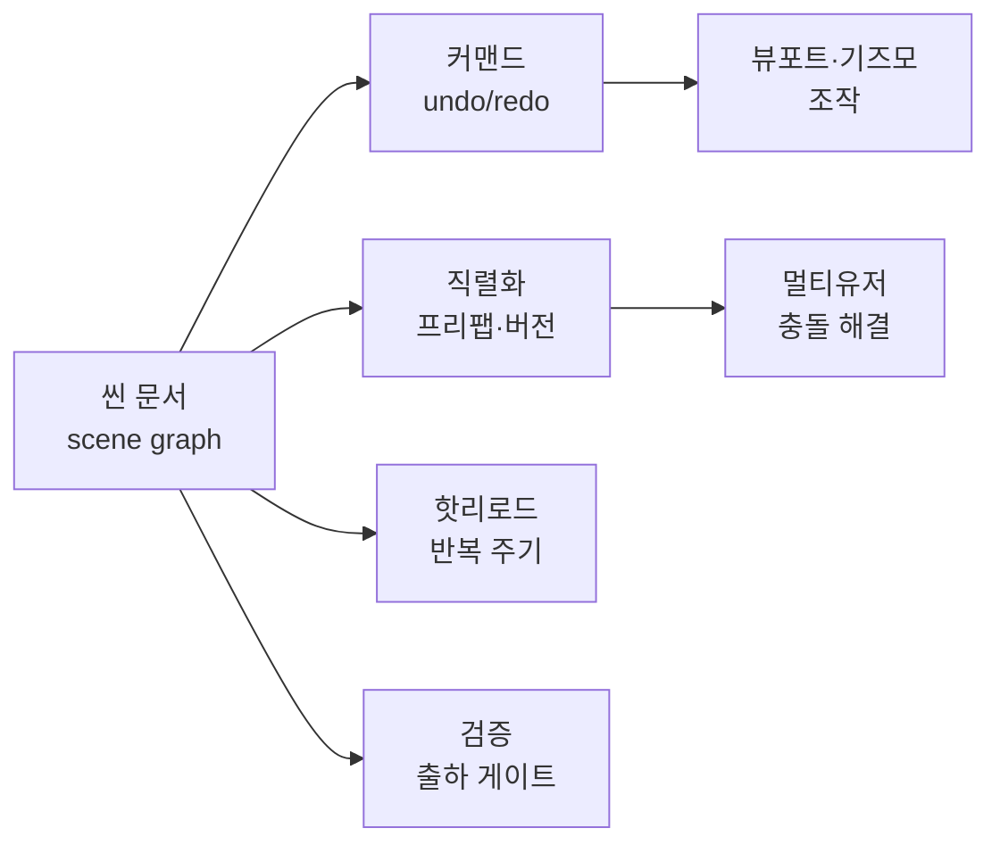
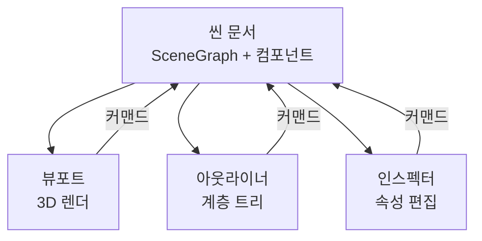
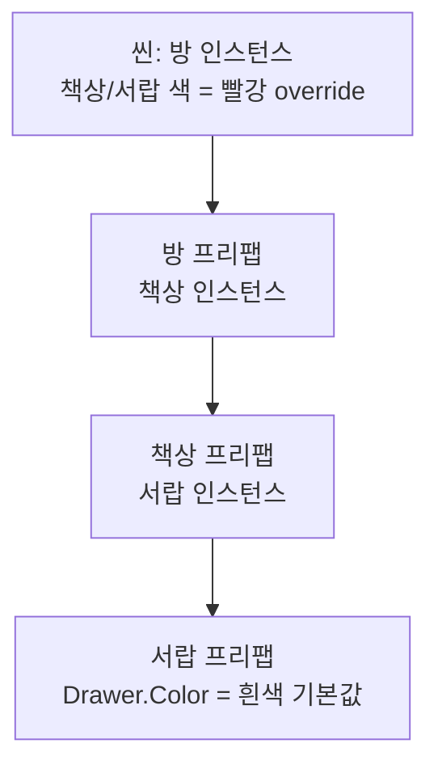
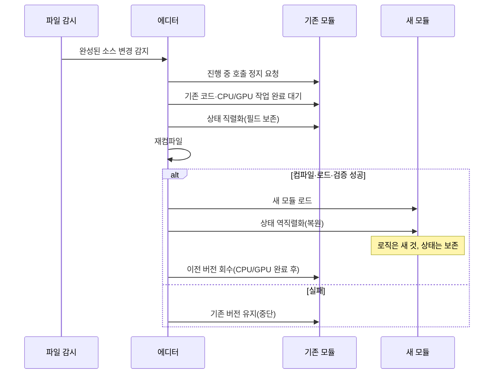
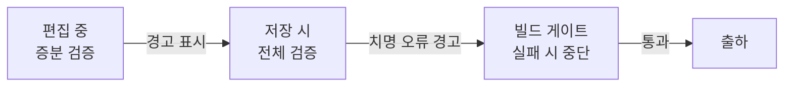

## 들어가며

레벨 에디터는 *디자이너의 생산성* 과 *시스템의 복잡도* 사이의 끝없는 줄다리기다. 디자이너는 오브젝트를 마우스로 끌어 1px 단위로 배치하고, 100번 실수해도 100번 되돌리며, 동료와 같은 맵을 동시에 편집하고, 코드를 고치자마자 게임을 껐다 켜지 않고도 결과를 보고 싶어 한다. 이 모든 요구는 에디터 내부에 *상태 일관성·되돌림·직렬화·동기화* 의 복잡한 기계장치를 요구한다. 기능을 하나 늘릴 때마다 그 기계장치가 커지고, 커진 만큼 버그·지연·혼란이 따라온다.

이 글은 그 트레이드오프를 따라 레벨 에디터의 핵심 구조를 한 흐름으로 정리한다. 편집 대상인 씬 그래프를 어떻게 모델링하고 뷰와 분리하는지, 기즈모와 스냅으로 조작을 어떻게 제공하는지, 모든 변경을 커맨드 패턴으로 감싸 undo/redo를 어떻게 만드는지, 씬을 어떤 포맷으로 직렬화하고 버전을 어떻게 마이그레이션하는지, 프리팹으로 재사용·오버라이드·중첩을 어떻게 다루는지, 여러 사용자가 한 씬을 동시에 편집할 때 충돌을 어떻게 푸는지, 핫리로드로 반복 주기를 어떻게 줄이는지, 그리고 잘못된 씬을 출하 전에 어떻게 검증하는지를 다룬다.



이 글의 목표.

1. **에디터 아키텍처와 씬 그래프** — 문서/뷰 분리, 안정 ID, 컴포넌트 모델.
2. **커맨드 패턴과 Undo/Redo** — 변경의 객체화, 합치기, 트랜잭션.
3. **기즈모와 조작** — 이동/회전/스케일, 피킹, 스냅, 드래그 루프.
4. **직렬화와 버전 마이그레이션** — 텍스트 대 바이너리, 참조, 증분 저장.
5. **프리팹 시스템** — 인스턴스·오버라이드·중첩·전파·배리언트.
6. **멀티유저 편집** — 락 대 OT/CRDT, 충돌 해결, 프레즌스.
7. **핫리로드** — 데이터·코드 리로드, 상태 보존, 안전망.
8. **검증과 진단** — 스키마·참조·플레이 가능성, 운영 진단.


---

## 목차
1. [에디터 아키텍처와 씬 그래프](#1-에디터-아키텍처와-씬-그래프)
2. [커맨드 패턴과 Undo/Redo](#2-커맨드-패턴과-undoredo)
3. [기즈모와 조작](#3-기즈모와-조작)
4. [직렬화와 버전 마이그레이션](#4-직렬화와-버전-마이그레이션)
5. [프리팹 시스템](#5-프리팹-시스템)
6. [멀티유저 편집](#6-멀티유저-편집)
7. [핫리로드](#7-핫리로드)
8. [검증과 진단](#8-검증과-진단)


---

## 1. 에디터 아키텍처와 씬 그래프

### 문서와 뷰의 분리

에디터의 첫 번째 결정은 *무엇이 진실인가* 다. 화면에 보이는 3D 오브젝트가 진실이 아니라, 그 뒤의 *씬 문서(scene document)* 가 진실이고 뷰포트·아웃라이너·인스펙터는 모두 그 문서의 *읽기 전용 투영* 이다. 이 분리가 없으면 "뷰포트에서 옮긴 위치"와 "인스펙터에 표시된 위치"가 어긋나고, 어느 쪽이 맞는지 아무도 모르게 된다.



뷰는 문서를 *읽고 그린다*. 사용자가 뷰에서 무언가를 바꾸면, 뷰가 직접 문서를 건드리지 않고 *커맨드를 발행* 한다(2절). 커맨드가 문서를 바꾸면 문서가 *변경 이벤트* 를 쏘고, 모든 뷰가 그 이벤트를 받아 자신을 갱신한다. 이 단방향 흐름이 "뷰가 여럿이어도 항상 같은 상태를 본다"를 보장한다.

```cpp
class SceneDocument {
    SceneGraph graph_;
    Signal<PersistentEntityId> onChanged_;   // 뷰들이 구독
public:
    const SceneGraph& Graph() const { return graph_; }  // 뷰는 const로만 접근
    void Apply(const Command& cmd);       // 변경은 오직 커맨드로
    Signal<PersistentEntityId>& OnChanged() { return onChanged_; }
};
```

### 씬 그래프와 변환 계층

씬 그래프는 엔티티의 *부모-자식 계층* 이다. 자식의 월드 변환은 부모의 월드 변환에 자신의 로컬 변환을 곱한 것이다.

$$M_{world}^{child} = M_{world}^{parent} \cdot M_{local}^{child}$$

부모를 옮기면 자식이 따라 움직인다 — "테이블 위의 컵들"을 한 번에 옮기는 그룹 이동이 이 계층에서 공짜로 나온다. 구현은 각 엔티티가 *로컬 변환만 저장* 하고, 월드 변환은 *필요할 때 계산하거나 캐시* 한다. 캐시할 경우 부모가 바뀌면 자손의 캐시를 *더티(dirty)* 로 표시해 다음 접근 때 재계산한다.

```cpp
struct Transform {
    Vec3 localPos, localScale;
    Quat localRot;
    Mat4 cachedWorld;        // 캐시
    bool worldDirty = true;  // 부모 변경 시 자손까지 전파
};
```

### 안정 ID — 모든 것의 전제

엔티티를 가리키는 방법으로 *포인터·배열 인덱스* 를 쓰면 안 된다. undo로 엔티티가 삭제됐다 되살아나거나, 직렬화로 디스크를 왕복하거나, 멀티유저로 다른 사람이 같은 엔티티를 가리킬 때, 포인터·인덱스는 전부 깨진다. 대신 *안정 ID(stable id)* 를 부여한다 — 엔티티가 생성될 때 한 번 발급되고, 삭제 전까지 변하지 않으며, 직렬화·네트워크를 건너도 같은 값인 식별자다.

```cpp
struct PersistentEntityId {              // 직렬화·네트워크를 건너 보존되는 ID
    uint64_t value;                      // GUID 또는 단조 증가 + 세션 prefix
    bool operator==(PersistentEntityId o) const { return value == o.value; }
};
struct LocalEntityHandle {               // 프로세스 안에서만 유효한 슬롯 핸들
    uint32_t index;
    uint32_t generation;
};
// 참조는 항상 PersistentEntityId로. 포인터는 한 프레임 안에서만 유효한 캐시.
struct Reference { PersistentEntityId target; };
```

저장 ID와 로컬 슬롯은 *다른 계층* 이다. 두 프로세스가 같은 객체를 다른 슬롯에 두거나 재로딩이 슬롯을 재배치해도 저장 ID는 변하지 않아야 하므로, persistent ID를 슬롯 인덱스로 직접 해석하지 않는다. SceneDocument가 `PersistentEntityId → LocalEntityHandle` 매핑을 소유하고, 로컬 조회는 핸들을 슬롯 기반 자료구조로 푼다. 슬롯을 재사용할 때는 *세대(generation)* 카운터로 "죽은 핸들로 산 슬롯을 가리키는" 오류를 잡는다.

```cpp
struct Slot { uint32_t generation; Entity* entity; };
// 로컬 조회: 인덱스 범위·generation wrap·null을 검사
Entity* Resolve(LocalEntityHandle h) {
    if (h.index >= slots_.size()) return nullptr;       // 범위 밖 핸들
    Slot& s = slots_[h.index];
    if (s.generation != h.generation || !s.entity) return nullptr;
    return s.entity;
}
Entity* ResolvePersistent(PersistentEntityId id) {
    auto it = persistentToLocal_.find(id);              // ID→핸들 매핑
    return (it != persistentToLocal_.end()) ? Resolve(it->second) : nullptr;
}
```

슬롯의 `generation`은 32비트라 오래 살아남은 세션에서는 *wrap* 할 수 있다 — wrap 시 해당 슬롯의 기존 핸들을 무효화하거나 슬롯을 재사용하지 않는 정책을 둔다. 아직 해소되지 않은 참조는 persistent ID를 *그대로 보존* 해 다시 저장할 때 유실되지 않게 한다(4절의 끊긴 참조와 연결).

### 컴포넌트 모델

엔티티 자체는 빈 껍데기고, *컴포넌트(component)* 가 데이터를 담는다 — 변환, 메시 렌더러, 콜라이더, 라이트, 스크립트. 에디터의 인스펙터는 "선택된 엔티티의 컴포넌트 목록을 그리고, 각 컴포넌트의 속성을 편집"하는 일반화된 패널이 된다. 컴포넌트마다 인스펙터 UI를 직접 짜지 않으려면 *리플렉션(reflection)* 으로 속성을 노출한다 — 속성 이름·타입·범위를 메타데이터로 등록하면, 인스펙터가 그것을 읽어 적절한 위젯(슬라이더, 색상 선택기, 참조 드롭다운)을 자동 생성한다.

```cpp
REFLECT(LightComponent) {
    FIELD(color,     "Color");
    FIELD(intensity, "Intensity").Range(0, 100);
    FIELD(castShadow,"Cast Shadow");
}
```

이 리플렉션은 직렬화(4절)·검증(8절)도 같이 구동한다 — 같은 메타데이터로 저장하고, 같은 메타데이터로 "intensity가 범위를 벗어났는지" 검사한다. 메타데이터 한 벌이 인스펙터·직렬화·검증 세 곳을 먹인다는 것이 컴포넌트 모델의 핵심 이득이다.

## 2. 커맨드 패턴과 Undo/Redo

### 변경을 객체로 만든다

디자이너가 100번 실수해도 100번 되돌릴 수 있어야 한다 — undo/redo는 레벨 에디터의 *필수 기능* 이지 사치가 아니다. 이를 깔끔하게 만드는 길은 하나다. *모든 문서 변경을 커맨드 객체로 감싸는 것*. 위치 이동, 컴포넌트 추가, 엔티티 삭제 — 전부 `Execute` 와 `Undo` 를 가진 객체가 된다.

```cpp
struct Command {
    virtual void Execute(SceneDocument&) = 0;
    virtual void Undo(SceneDocument&) = 0;
    virtual ~Command() = default;
};

struct MoveCommand : Command {
    PersistentEntityId target;
    Vec3 oldPos, newPos;      // undo에 필요한 이전 값을 캡처
    void Execute(SceneDocument& d) override { d.SetPos(target, newPos); }
    void Undo(SceneDocument& d)    override { d.SetPos(target, oldPos); }
};
```

핵심은 *이전 상태를 커맨드가 직접 들고 있다* 는 것이다. `Undo` 가 호출될 때 "원래 어디 있었지"를 다시 계산하지 않고, 커맨드 생성 시점에 캡처한 `oldPos` 로 되돌린다. 이 캡처 책임을 커맨드에 두면 undo 스택이 *자기완결적* 이 된다.

### Undo 스택과 redo

커맨드는 두 스택으로 관리한다. 실행하면 undo 스택에 쌓고, undo하면 undo 스택에서 빼 redo 스택으로 옮긴다. *새 커맨드를 실행하면 redo 스택을 비운다* — undo로 과거로 돌아간 뒤 다른 편집을 하면, 원래 미래는 사라진다.

```cpp
class CommandStack {
    std::vector<std::unique_ptr<Command>> undo_, redo_;
public:
    void Do(std::unique_ptr<Command> c, SceneDocument& d) {
        c->Execute(d);
        undo_.push_back(std::move(c));
        redo_.clear();                       // 새 분기 → 미래 폐기
    }
    void Undo(SceneDocument& d) {
        if (undo_.empty()) return;
        undo_.back()->Undo(d);
        redo_.push_back(std::move(undo_.back()));
        undo_.pop_back();
    }
    void Redo(SceneDocument& d) { /* 대칭 */ }
};
```

`Do`가 `Execute` 후 `push_back`하는 순서는 *예외 원자성* 을 자동으로 만들지 않는다 — 실행 중 예외가 나면 문서는 이미 바뀌었는데 undo 기록은 없다. 강한 보장이 필요하면 둘 중 하나를 계약으로 택한다. **prepare/commit** 은 모든 검증과 필요한 할당(undo 기록 공간 포함)을 먼저 끝내고, commit/기록 단계는 그 계약 아래 실패하지 않게 한다. **rollback** 은 각 자식 `Execute`가 성공하거나 자기 변경을 원복함을 보장하고, 이미 성공한 자식만 역순으로 `Undo`한다. 단순히 `catch`에서 `Undo`를 부르는 것만으로는 부족하다 — 실패한 자식 자신이 부분 변경을 남기거나 그 `Undo`가 실패하면 strong guarantee가 성립하지 않는다.

### 커맨드 합치기 — 드래그의 함정

기즈모로 오브젝트를 드래그하면 마우스가 움직일 때마다 `MoveCommand` 가 발행된다 — 한 번의 드래그가 *수십~수백 개의 커맨드* 를 만든다. 이대로 undo 스택에 쌓으면, undo 한 번에 1px씩 되돌아가 디자이너가 미쳐버린다. 해법은 *합치기(coalescing/merge)* 다. 같은 대상에 대한 연속된 같은 종류의 커맨드를 하나로 합친다.

```cpp
bool MoveCommand::TryMerge(const Command& next) {
    auto* m = dynamic_cast<const MoveCommand*>(&next);
    if (!m || m->target != target) return false;
    newPos = m->newPos;          // 끝 위치만 갱신, oldPos는 처음 것 유지
    return true;                  // 합쳐졌으므로 next는 버린다
}
```

합치기의 경계는 *시간 또는 명시적 신호* 로 끊는다. 드래그 시작에서 "트랜잭션 시작", 드래그 끝(마우스 업)에서 "트랜잭션 종료"를 보내면, 그 사이 커맨드는 하나로 합쳐지고 마우스 업 이후 새 커맨드는 합치기 대상이 아니게 된다. 시간 기반(예: 500ms 이상 멈추면 끊기)도 텍스트 필드 편집 등에 흔하다.

### 트랜잭션 — 복합 변경

"프리팹 인스턴스화"처럼 한 동작이 여러 엔티티를 생성·연결하는 경우, 이들을 *한 트랜잭션* 으로 묶어 undo 한 번에 전부 되돌려야 한다. 복합 커맨드(composite)로 자식 커맨드들을 모은다.

```cpp
struct Transaction : Command {
    std::vector<std::unique_ptr<Command>> children;
    void Execute(SceneDocument& d) override {
        for (auto& c : children) c->Execute(d);          // 정방향
    }
    void Undo(SceneDocument& d) override {
        for (auto it = children.rbegin(); it != children.rend(); ++it)
            (*it)->Undo(d);                               // 역순 undo
    }
};
```

undo는 반드시 *역순* 이다 — A를 만들고 B가 A를 참조하게 했다면, undo는 B의 참조를 먼저 끊고 A를 지워야 한다. 순서를 지키지 않으면 "삭제된 A를 가리키는 B"라는 깨진 중간 상태가 생긴다.

복합 커맨드의 *원자성* 도 앞의 정책을 따른다 — 자식이 중간에 실패하면 앞서 성공한 자식들을 역순으로 되돌릴 수 있어야 하고, 실패한 자식 자신이 남긴 부분 변경까지 복구 범위에 포함해야 한다. 이것이 보장되지 않으면 트랜잭션은 "전부 아니면 전무"가 아니라 부분 적용 상태를 남긴다.

### 함정 — 캡처 범위와 부작용

커맨드 undo의 가장 흔한 버그는 *불완전한 캡처* 다. 엔티티를 삭제하는 커맨드가 "엔티티만" 기억하고 "그 엔티티를 가리키던 다른 참조들"을 기억하지 않으면, undo로 엔티티는 되살아나지만 참조는 끊긴 채다. 삭제 커맨드는 *삭제되는 엔티티 전체 + 들어오던 참조 + 나가던 참조* 를 모두 캡처해야 한다. 직렬화(4절)를 재사용해 "삭제 직전 상태를 통째로 직렬화 → undo 시 역직렬화"하는 방식이 가장 견고하다 — 캡처 누락을 구조적으로 막는다.

## 3. 기즈모와 조작

### 조작의 세 축

기즈모(gizmo)는 뷰포트에 떠 있는 *조작 핸들* 이다 — 화살표(이동), 호(회전), 박스(스케일). 디자이너는 핸들을 끌어 변환을 바꾼다. 세 모드가 표준이다.

| 모드 | 핸들 | 구속 | 좌표계 |
|---|---|---|---|
| 이동 | 축 화살표·평면 | 1축·2축 평면 | 월드/로컬 |
| 회전 | 축 호·자유 구 | 1축·시점축 | 월드/로컬 |
| 스케일 | 축 박스·중앙 | 1축·균등 | 로컬 |

좌표계 전환(월드 대 로컬)이 중요하다 — 기울어진 오브젝트를 "자기 기준 위"로 올리려면 로컬, "세계 기준 위"로 올리려면 월드다. 디자이너가 자주 헷갈리는 지점이라 현재 좌표계를 화면에 명확히 표시한다.

### 피킹 — 무엇을 클릭했는가

기즈모를 끌기 전에 *무엇을 클릭했는지* 알아야 한다. 마우스 클릭 한 점을 화면 공간에서 *월드 공간 광선(ray)* 으로 변환하고, 그 광선과 씬의 충돌을 검사한다.

```cpp
// 계약: mouse는 좌상단 원점·Y 아래 방향의 픽셀 좌표. ScreenToNDC가 원점/Y를 처리한다.
Ray ScreenToRay(Vec2 mouse, const Camera& cam) {
    Vec3 ndc = ScreenToNDC(mouse);                    // [-1,1] 정규화
    // depth는 NDC z가 아니라 window depth 규약이다. reverse-Z/무한 far면 0/1의 의미를 확인한다.
    Vec3 worldNear = Unproject(ndc, 0.0f, cam);       // 근평면
    Vec3 worldFar  = Unproject(ndc, 1.0f, cam);       // 원평면
    return Ray{worldNear, Normalize(worldFar - worldNear)};
}
```

피킹 방식은 둘이다. *광선-기하 교차* 는 광선을 쏴 가장 가까운 충돌 엔티티를 찾는다 — 정확하지만 메시가 많으면 가속 구조(BVH)가 필요하다. *ID 버퍼(픽킹 버퍼)* 는 각 엔티티를 *패스별 토큰* 을 인코딩한 고유 색으로 오프스크린 렌더링하고, 클릭 픽셀의 색을 읽어 토큰을 얻은 뒤 *토큰→ID 표* 로 해석한다 — GPU가 한 번에 처리해 픽셀 단위로 정확하고, 알파·인스턴싱·복잡 메시에 강하다.

```cpp
// 패스마다 PickingToken(작은 정수) -> PersistentEntityId 표를 만든다
std::vector<PersistentEntityId> tokenToId;            // token 0은 background로 예약
uint32_t token = RegisterPickingToken(tokenToId, entity.id);   // 1..0xFFFFFF
DrawWithColor(entity, RGB(token));                    // 색에는 토큰만 인코딩
// 클릭 시: 그 픽셀을 그릴 때 사용한 표로 해석
uint32_t pickedToken = ReadPixel(idBuffer, mouse);
PersistentEntityId picked = (pickedToken < tokenToId.size())
    ? tokenToId[pickedToken] : PersistentEntityId{};  // background/범위 밖
```

`entity.id.value & 0xFFFFFF`처럼 64비트 ID를 잘라 쓰면 고유성을 보장하지 못한다 — ID 1과 `0x01000001`이 같은 `1`로 충돌한다. 그래서 발급 단위를 *패스별 토큰* 으로 좁히고 토큰 0을 background로 비워 둔다. 토큰이 24비트 범위를 넘으면 조용히 잘리는 대신 *소진 오류* 로 처리한다. GPU readback이 비동기라면 다음 프레임 표로 이전 픽셀을 해석하지 않도록 *그 픽셀을 그릴 때 사용한 표* 를 readback 완료까지 보관한다. 색 버퍼를 쓰는 경우 sRGB 변환·blending·MSAA resolve·alpha discard 정책이 실제 렌더와 일치해야 한다(정수 ID attachment를 써도 ID 세대·표 수명은 별도다).

### 드래그 루프 — 평면 투영

축 화살표를 끌 때, 마우스의 2D 이동을 *그 축 위의 1D 이동* 으로 바꿔야 한다. 마우스 광선을 *축을 포함하면서 카메라를 향하는 평면* 에 투영하고, 그 교점을 축 위로 사영해 이동량을 얻는다.

```cpp
std::optional<float> DragAlongAxis(Vec3 axis, Vec3 origin, Ray mouseRay, const Camera& cam) {
    axis = Normalize(axis);                             // 단위 축 조건을 명시적으로 만든다
    // 축을 포함하고 시선에 최대한 수직인(카메라를 향하는) 평면을 만들어 마우스 광선을 교차
    Vec3 planeNormal = Cross(axis, Cross(axis, cam.forward));
    if (LengthSquared(planeNormal) < kEps) return std::nullopt;   // 축 ∥ view → 평면 퇴화
    Vec3 hit;
    if (!IntersectRayPlane(mouseRay, origin, planeNormal, hit)) return std::nullopt;
    return Dot(hit - origin, axis);   // 축 위로 사영한 거리
}
```

드래그 시작에서 *그랩 오프셋* 을 기억해 "핸들의 어디를 잡았는지"를 보존한다. 이게 없으면 드래그 시작 순간 오브젝트가 마우스 위치로 *튄다* — 디자이너가 가장 싫어하는 버그다.

축과 view가 평행(near-parallel)해 평면 법선이 0이 되거나 광선이 평면과 교차하지 않는 입력은 `optional`/오류로 반환하고 *기존 드래그 상태를 유지* 한다 — 퇴화 법선으로 계산한 값으로 오브젝트를 순간이동시키지 않는다. 축이 단위 벡터가 아니면 `Dot` 결과가 실제 거리와 달라지므로 시작 시 정규화한다.

### 스냅과 그리드

정밀 배치를 위해 *스냅(snap)* 을 제공한다 — 이동은 그리드 간격으로, 회전은 각도 단위로, 스케일은 비율 단위로 양자화한다.

```cpp
Vec3 SnapToGrid(Vec3 pos, float grid) {
    if (grid <= 0) return pos;
    return Vec3{ std::round(pos.x / grid) * grid,
                 std::round(pos.y / grid) * grid,
                 std::round(pos.z / grid) * grid };
}
```

스냅의 종류가 여럿이다 — *그리드 스냅* (절대 격자), *증분 스냅* (시작점 기준 상대), *버텍스/표면 스냅* (다른 오브젝트의 정점·면에 달라붙기), *피벗 스냅* (피벗 정렬). 보통 키 토글(예: Ctrl 누르는 동안만 스냅)로 정밀 모드와 자유 모드를 즉석에서 전환한다. 스냅 값은 드래그 *결과* 에만 적용하고, 합쳐진 커맨드의 최종 위치를 스냅된 값으로 둔다(2절의 합치기와 결합).

### 조작과 커맨드의 연결

기즈모 조작은 그 자체로 문서를 바꾸지 않는다. 드래그 동안은 *미리보기(preview)* 로 뷰에만 반영하고, 마우스 업에서 *하나의 합쳐진 커맨드* 를 발행한다(2절). 이 분리로 "드래그 중 60fps로 부드럽게 미리보기 + undo는 한 번에 되돌림"을 동시에 얻는다. 드래그 중 매 프레임 커맨드를 실행/undo하면 문서가 더티 이벤트를 폭발적으로 쏴 다른 뷰들이 버벅인다.

## 4. 직렬화와 버전 마이그레이션

### 텍스트 대 바이너리

씬을 디스크에 저장하는 포맷의 첫 선택이다.

| 축 | 텍스트(JSON/YAML) | 바이너리 |
|---|---|---|
| 가독성·디프 | 좋음 (버전 관리 친화) | 불가 (도구 필요) |
| 병합 충돌 해결 | 기본 line-based merge에 유리 | 전용 merge 도구 없이는 어려움 |
| 크기·로드 속도 | 큼·느림 | 작음·빠름 |
| 스키마 유연성 | 높음 | 일반적으로 낮음 (오프셋 고정) |

레벨 에디터의 *작업 파일* 은 보통 *텍스트* 를 택한다 — 디자이너 둘이 같은 씬을 만지면 버전 관리에서 디프·병합이 일어나는데, 바이너리는 *기본 line-based merge* 로는 충돌을 풀기 어려워 전용 merge 도구가 필요하다(6절). 태그·길이 기반 스키마나 custom merge driver를 쓰면 바이너리도 의미론적 병합이 가능하므로, 이 우열은 형식 일반의 속성이 아니라 *기본 도구 기준* 의 비교다. 대신 *출하 빌드* 는 텍스트를 *바이너리로 쿠킹(cooking)* 해 크기·로드 속도를 얻는다 — 편집용과 런타임용 포맷을 분리하는 것이 표준이다.

### 참조 직렬화

씬 안에서 엔티티 A가 엔티티 B를 가리킬 때, 포인터를 저장할 수 없다 — 다음 로드 때 주소가 다르다. *안정 ID* (1절)를 저장한다. 로드 시 *2패스* 로 처리한다. 1패스에서 모든 엔티티를 만들며 ID→엔티티 맵을 채우고, 2패스에서 저장된 ID를 보존한 채 실제 해소는 조회 시점의 `ResolvePersistent`로 미룬다.

```cpp
// 1패스: 엔티티 생성, idMap 채우기
for (auto& node : json["entities"]) {
    Entity* e = scene.Create(PersistentEntityId{node["id"]});
    idMap[e->id] = e;
}
// 2패스: 참조 필드를 ID로 찾아 연결
for (auto& node : json["entities"]) {
    Entity* e = idMap[PersistentEntityId{node["id"]}];
    PersistentEntityId refId{node["ref"]};                    // 저장된 참조 ID
    e->target = refId;                                        // ID만 저장; 해소는 ResolvePersistent
}
```

끊긴 참조(가리키던 대상이 삭제됨)를 *치명적 오류로 막지 말고* ID 그대로 보존하고, 실제 해소는 조회 시점의 `ResolvePersistent`로 처리한다. ID를 버리지 않으므로 다시 저장할 때 참조가 유실되지 않고, 검증(8절)에서 미해결 참조를 잡는다. 로드 자체가 실패하면 디자이너가 파일을 통째로 잃는다.

### 버전과 마이그레이션

컴포넌트 스키마는 시간이 지나며 변한다 — 필드가 추가되고, 이름이 바뀌고, 타입이 분리된다. 1년 전 저장한 씬을 오늘 빌드로 열 수 있어야 한다. 각 직렬화 단위에 *버전 번호* 를 박고, *마이그레이션 함수* 를 버전별로 둔다.

```cpp
// 전제: 1 <= fromVersion <= 3. 미래 버전(>3)은 이 함수로 부르지 않는다.
bool MigrateLight(json& data, int fromVersion) {
    if (fromVersion < 1 || fromVersion > 3) return false;   // 미래/알 수 없는 버전 거부
    if (fromVersion < 2) {
        // v1: intensity가 0~1 → v2: 0~100 (단위 변경)
        data["intensity"] = data["intensity"].get<float>() * 100.0f;
    }
    if (fromVersion < 3) {
        // v2: color(RGB) → v3: color(RGB) + temperature
        data["temperature"] = 6500.0f;          // 기본값 주입
    }
    data["version"] = 3;
    return true;
}
```

마이그레이션은 *체인* 으로 적용한다 — v1 파일이면 v1→v2, v2→v3를 차례로 거쳐 현재로 올라온다. 이 체인을 깨뜨리지 않으려면 *오래된 마이그레이션 코드를 절대 지우지 않는다*. 누군가 5년 된 씬을 열 수 있고, 그 경로가 막히면 데이터가 영영 죽는다. 마이그레이션마다 "이 버전 파일 → 현재 버전" 왕복 테스트를 자동화한다.

호출 dispatcher는 `1 ≤ fromVersion ≤ 3`만 이 함수로 보낸다. 미래 버전은 *읽기 전용/실패* 로 처리하고 원본 데이터를 v3으로 덮어쓰지 않는다 — 미래 필드를 보존하는 것과 그 스키마를 v3이라고 재표기하는 것은 다르다.

### 증분 저장과 더티 추적

거대한 씬을 매번 통째로 직렬화하면 저장이 느려 디자이너 흐름이 끊긴다. *더티 추적* 으로 변경된 엔티티만 다시 쓴다. 커맨드(2절)가 문서를 바꿀 때 영향받은 엔티티를 더티 집합에 넣고, 저장 시 더티 엔티티만 직렬화해 *부분 갱신* 한다. 씬을 여러 파일로 *청크 분할* 하면(예: 영역별·레이어별 파일), 변경된 청크만 저장하고 버전 관리 디프·충돌도 그 청크에만 국한된다 — 이는 멀티유저 편집(6절)의 충돌 표면을 줄이는 데도 직접 기여한다.

## 5. 프리팹 시스템

### 인스턴스와 원본

같은 가로등 200개를 일일이 만들 수 없다. *프리팹(prefab)* 은 엔티티 묶음을 *템플릿* 으로 저장하고, 씬에는 그 *인스턴스(instance)* 만 둔다. 인스턴스는 "어느 프리팹을 따르는지"와 "어디에 놓였는지(변환)"만 갖고, 나머지 데이터는 프리팹에서 상속한다. 프리팹을 고치면 200개 인스턴스가 한 번에 바뀐다 — 이것이 프리팹의 핵심 이득이다.

```cpp
struct PrefabInstance {
    PrefabId source;              // 따르는 프리팹
    Transform placement;          // 인스턴스별 배치
    std::vector<Override> overrides;  // 인스턴스별 덮어쓴 값
};
```

### 오버라이드 — 인스턴스별 차이

200개 가로등이 *완전히 똑같으면* 단조롭다. 특정 인스턴스만 색을 바꾸거나 꺼두고 싶다 — 이것이 *오버라이드(override)* 다. 인스턴스는 프리팹 값을 상속하되, *명시적으로 덮어쓴 속성* 만 자기 값을 갖는다. 인스펙터는 오버라이드된 필드를 *시각적으로 구분* 해(굵게·표시줄) "이건 프리팹과 다르다"를 알린다.

```cpp
// 속성 해소: 오버라이드가 있으면 그 값, 없으면 프리팹 값
Value ResolveProperty(const PrefabInstance& inst, PropertyId prop) {
    for (auto& ov : inst.overrides)
        if (ov.prop == prop) return ov.value;     // 인스턴스 우선
    return prefab[inst.source].Get(prop);          // 폴백: 프리팹
}
```

오버라이드의 함정은 *전파와의 상호작용* 이다. 프리팹의 색을 바꿨을 때, 색을 오버라이드한 인스턴스는 *그대로 둬야* 한다 — 디자이너가 의도적으로 바꾼 값을 프리팹 변경이 덮으면 안 된다. 그래서 전파는 "오버라이드되지 않은 속성에만" 적용된다. "이 오버라이드를 적용(apply to prefab)" / "되돌림(revert)"을 인스펙터에서 제공해 디자이너가 차이를 프리팹으로 올리거나 버릴 수 있게 한다.

### 중첩 프리팹

프리팹 안에 다른 프리팹이 들어간다 — "방" 프리팹이 "책상" 프리팹을 포함하고, "책상"이 "서랍" 프리팹을 포함한다. 이 *중첩(nesting)* 은 오버라이드 해소를 계층화한다. 인스턴스의 속성은 *가장 바깥 오버라이드(씬 인스턴스) → 중간 프리팹 → 가장 안쪽 프리팹의 기본값* 순으로 해소된다. 아래 그림은 같은 속성 경로(`책상/서랍 색`)가 어느 단계에서 덮어써지는지를 따른다.



중첩의 위험은 *순환 참조* 다 — A 프리팹이 B를, B가 다시 A를 포함하면 무한 전개된다. 프리팹 편집 시 *순환을 감지해 거부* 한다(검증, 8절). 또한 중첩이 깊으면 속성 해소가 *프리팹 체인을 매번 거슬러 올라가* 느려진다 — 해소 결과를 *평탄화(flatten)* 해 캐시하고, 어느 단계든 변경되면 캐시를 무효화한다.

### 전파와 배리언트

프리팹 변경의 *전파(propagation)* 는 즉시일 수도, 지연일 수도 있다. 즉시 전파는 프리팹 저장 순간 모든 인스턴스를 갱신한다 — 직관적이지만 거대 씬에서 무겁다. 지연 전파는 인스턴스가 로드·접근될 때 해소하므로 변경이 *읽는 순간* 반영된다 — 위 `ResolveProperty` 가 이미 지연 모델이다.

*배리언트(variant)* 는 프리팹을 상속한 *또 다른 프리팹* 이다 — "기본 가로등"을 상속한 "고장난 가로등 배리언트"가 깜빡임 컴포넌트를 추가하고 색을 바꾼다. 배리언트는 인스턴스 오버라이드와 같은 해소 규칙을 *프리팹 수준* 에서 적용한다. 기본 프리팹을 고치면 배리언트도 (오버라이드하지 않은 부분만) 따라 바뀐다 — 인스턴스 전파와 정확히 같은 메커니즘을 한 단계 위에 재사용한다.

## 6. 멀티유저 편집

### 동시 편집의 두 모델

여러 디자이너가 한 씬을 동시에 편집할 때, 충돌을 막는 모델은 크게 둘이다.

| 모델 | 방식 | 장점 | 단점 |
|---|---|---|---|
| 락(lock)/체크아웃 | 편집 전 대상을 잠금 | 충돌 자체가 없음 | 동시성 낮음·대기 |
| 동시 편집(OT/CRDT) | 모두가 편집, 사후 병합 | 진정한 동시성 | 병합 복잡도 |

*락 기반* 은 단순하다 — 엔티티(또는 청크, 4절)를 편집하기 전에 잠그면, 그 단위는 한 사람만 만진다. 충돌이 원천 봉쇄되지만, 잠긴 영역을 다른 사람이 못 만져 대기가 생긴다. 큰 청크 단위면 동시성이 낮고, 작은 단위면 락 관리 오버헤드가 크다. 많은 상용 에디터가 *청크/파일 단위 체크아웃* 으로 이 모델을 택한다 — 단순함이 신뢰성을 산다.

*동시 편집* 은 모두가 자유롭게 편집하고 변경을 *사후 병합* 한다. 진정한 동시 작업이 가능하지만 병합 로직이 복잡하다.

### 변환과 병합

동시 편집의 변경은 *커맨드(2절)와 같은 단위* 로 네트워크를 오간다 — "엔티티 X를 (1,2,3)으로 이동" 같은 *연산(operation)* 이다. 두 사람이 같은 엔티티를 동시에 옮기면 충돌한다. 해소 전략이 필요하다.

```cpp
struct Operation {
    PersistentEntityId target;
    PropertyId prop;
    Value newValue;
    uint64_t lamport;     // 인과 순서용 논리 시계
    UserId author;
};
```

*최종 쓰기 우선(last-write-wins)* 은 가장 단순하다 — Lamport 시계(논리적 타임스탬프)가 큰 쪽이 이기고, 값이 같으면 `(lamport, stable author ID)` 같은 *결정적 비교 키* 로 총순서를 준다. 도착 순서에 따라 결과가 달라지면 복제본이 수렴하지 않으므로 동률 처리를 명시해야 한다. 삭제는 묘비(tombstone)로 남겨 중복·재전달을 멱등하게 처리한다. 단순하지만 변경 손실이 있다. *속성 단위 병합* 은 충돌 입자를 잘게 한다 — 한 사람이 위치를, 다른 사람이 색을 바꾸면 *둘 다 적용* 한다(서로 다른 속성이라 충돌 아님). 같은 속성일 때만 LWW로 떨어진다. 구조적 변경(엔티티 삭제 대 그 엔티티 자식 추가)은 별도 규칙이 필요하다 — "삭제가 이긴다 + 고아 자식 처리" 또는 "삭제를 취소하고 자식을 살린다" 중 일관된 정책을 정한다.

### CRDT의 위치

*CRDT(Conflict-free Replicated Data Type)* 는 동시 연산이 *해당 CRDT가 보장하는 순서 제약 안에서* 같은 결과로 수렴하도록 설계된 자료구조다. 속성 맵을 last-write-wins 레지스터로, 자식 목록을 순서 보존 시퀀스 CRDT로 두면, 중앙 서버의 직렬화 없이도 각 클라이언트가 같은 상태로 수렴한다. 임의 연산을 로그에 등록하는 것만으로 CRDT가 되지는 않는다 — 선택한 CRDT 종류에 맞는 인과 전달·중복 제거 또는 state merge 조건이 충족되어야 한다. 트레이드오프는 *메타데이터 비용* 이다 — 모든 값에 논리 시계·삭제 묘비(tombstone)를 달아야 해 메모리·전송량이 는다. 텍스트 협업과 달리 씬은 구조가 깊어 CRDT 설계가 까다롭다 — 많은 게임 에디터가 *락 + 속성 단위 LWW* 의 실용적 절충에 머무는 이유다.

### 프레즌스와 운영

동시성의 절반은 *충돌 방지* 가 아니라 *충돌 인지* 다. 다른 사용자가 *지금 무엇을 보고 어디를 만지는지* 를 화면에 표시(프레즌스, presence)하면, 디자이너끼리 자연히 영역을 나눠 충돌 자체가 줄어든다 — 다른 사람의 카메라 절두체, 선택 윤곽, 편집 중 표시를 색으로 오버레이한다. 운영 관점에서는 *연산 로그를 남겨* "누가 언제 무엇을 바꿨는지" 추적하고, 병합이 꼬였을 때 *특정 시점으로 롤백* 한다. 이 연산 로그는 undo 스택(2절)·검증(8절)과 같은 커맨드 표현을 공유하므로, 한 표현이 되돌림·병합·감사 세 곳을 먹인다.

## 7. 핫리로드

### 반복 주기가 곧 생산성

디자이너가 텍스처 하나를 바꾸거나 스크립트 한 줄을 고칠 때마다 *에디터를 껐다 켜고 씬을 다시 로드* 해야 한다면, 하루에 그 대기로 수십 분을 버린다. *핫리로드(hot reload)* 는 에디터를 끄지 않고 변경된 에셋·코드를 *런타임에 교체* 해 이 반복 주기를 초 단위로 줄인다. 종류가 둘이다 — *데이터 핫리로드* (텍스처·메시·머티리얼·씬 데이터)와 *코드 핫리로드* (스크립트·컴포넌트 로직).

### 데이터 핫리로드

파일 변경을 *감시(watch)* 한다 — OS의 파일 변경 알림(inotify/ReadDirectoryChangesW)으로 에셋 디렉토리를 구독한다. 변경이 감지되면 해당 에셋을 다시 로드하고, *그것을 참조하는 모든 객체* 를 갱신한다.

```cpp
void OnFileChanged(const Path& path) {
    AssetId id = assetDb.Find(path);
    if (!id) return;
    Asset* reloaded = LoadAsset(path);          // 완성된 파일만 읽는다(임시 파일+rename)
    if (!reloaded || !ValidateAsset(*reloaded)) return;   // 실패 시 기존 버전 유지
    assetDb.Publish(id, reloaded);              // 소유 스레드에서 원자적 게시
    assetDb.RetireOld(id);                      // 기존 CPU 참조·GPU fence 완료 후 회수
    // 이 에셋을 쓰는 머티리얼·메시·인스턴스가 자동으로 새 데이터를 봄
}
```

핵심은 *핸들 간접화(handle indirection)* 다. 객체가 에셋을 *직접 포인터* 로 들면 교체할 수 없다. *에셋 핸들(ID)* 로 들고, 핸들→실체 매핑을 한 곳에서 관리하면, 그 매핑의 실체만 바꿔치기해도 모든 사용처가 새 데이터를 본다. 이는 1절의 안정 ID·핸들 모델의 직접적 재사용이다.

다만 핸들 간접화는 *논리 정체성* 을 보존할 뿐, 이미 잡고 있는 CPU 참조나 GPU 제출 작업의 완료를 보장하지 않는다. 그래서 교체는 load → validate → 소유 스레드/동기화 경계에서 publish → 이전 버전 retire의 단계로 나누고, 검증에 실패하면 기존 버전을 유지한다. DLL 함수 포인터·callback·vtable을 가진 객체도 이전 모듈의 *실행 중 참조* 에 포함되므로, 재로드 전에 그 코드의 실행이 끝났음을 기다린다. 파일 저장은 임시 파일+rename이나 안정성 검사/재시도 정책으로 완성본만 읽는다 — watcher의 debounce만으로는 저장 중간 상태를 배제하지 못한다.

### 코드 핫리로드와 상태 보존

스크립트·컴포넌트 코드를 바꾸면 *기존 객체의 상태를 보존* 하면서 *로직만 교체* 해야 한다. DLL 재로드 기반은 코드가 담긴 동적 라이브러리를 다시 컴파일·로드하되, 객체의 *상태(필드)를 직렬화* 했다가 새 코드로 *역직렬화* 해 복원한다.



상태 보존의 함정은 *스키마 변경* 이다 — 코드 핫리로드 중 필드가 추가/삭제되면 직렬화 4절의 마이그레이션과 같은 문제가 생긴다. 단순 핫리로드는 "필드 시그니처가 같을 때만" 상태를 복원하고, 시그니처가 바뀌면 *기본값으로 재초기화* 하거나 핫리로드를 건너뛰고 전체 재시작을 요구한다.

### 안전망 — 핫리로드가 깨질 때

핫리로드는 본질적으로 *위험하다* — 부분 교체된 상태는 정상 시작 경로를 거치지 않아 미묘한 버그를 낳는다. 그래서 안전망을 둔다. *리로드 전 스냅샷* 을 떠 리로드가 크래시하면 직전 상태로 되돌린다. 이 복구는 프로세스가 살아 있을 때의 *처리 가능한 reload 실패*(컴파일·로드·검증 오류)를 전제한다 — 힙·스택이 손상된 *치명적 크래시* 는 같은 프로세스에서 일반 로깅·할당·네트워크 코드를 안전하게 호출할 수 없으므로, out-of-process 수집기(Breakpad/Crashpad 등)가 덤프·심볼을 회수하고 별도 정상 프로세스가 지속된 스냅샷을 읽어 재시작 복구한다. 덤프·심볼·스냅샷의 보관 시점과 platform-specific crash-safe 경계를 명시한다. 리로드 후 *검증(8절)* 을 자동 실행해 깨진 참조·잘못된 상태를 즉시 잡는다. 그리고 핫리로드로 들어간 변경은 *출하 빌드에서 항상 전체 재로드로 재현* 되는지 확인한다 — 핫리로드에서만 동작하고 깨끗한 시작에선 깨지는 상태를 출하 게이트에서 거른다. 핫리로드는 *편집 편의 기능* 이지 *진실의 경로* 가 아니다.

## 8. 검증과 진단

### 무엇을 검증하는가

레벨 에디터가 만드는 데이터는 결국 *런타임에 로드되어 플레이* 된다 — 출하 전에 "이 씬이 멀쩡한가"를 자동 검사하는 *검증(validation)* 이 마지막 안전 게이트다. 검사 항목이 층위별로 나뉜다.

| 층위 | 검사 | 예 |
|---|---|---|
| 스키마 | 타입·범위·필수 필드 | intensity가 음수, 필수 메시 누락 |
| 참조 무결성 | 끊긴/순환 참조 | 삭제된 엔티티를 가리킴, 프리팹 순환 |
| 공간 | 위치·경계 | 맵 밖 오브젝트, 겹친 콜라이더 |
| 플레이 가능성 | 게임 규칙 | 스폰 지점 없음, 도달 불가 영역 |
| 성능 | 예산 | 드로우 콜·삼각형·라이트 수 초과 |

스키마 검증은 리플렉션 메타데이터(1절)를 재사용한다 — `Range(0, 100)` 으로 등록한 필드는 검증기가 자동으로 범위를 검사한다. 한 벌의 메타데이터가 인스펙터·직렬화·검증을 모두 구동한다는 점이 다시 작동한다.

### 참조 무결성

직렬화(4절)가 끊긴 참조를 null로 허용했으므로, 검증이 그것을 잡아야 한다. 모든 참조를 순회하며 대상이 살아있는지, 프리팹 중첩(5절)에 순환이 없는지 검사한다.

```cpp
ValidationResult ValidateReferences(const SceneDocument& doc) {
    ValidationResult r;
    for (auto& e : doc.Graph().Entities()) {
        for (auto& ref : e.References()) {
            if (!doc.Graph().ResolvePersistent(ref.target))
                r.Error(e.id, "끊긴 참조: " + ref.target.ToString());
        }
    }
    DetectPrefabCycles(doc, r);     // 순환 프리팹 탐지(DFS)
    return r;
}
```

### 검증을 워크플로에 박기

검증이 *저장 버튼을 누른 뒤 따로 돌리는 도구* 면 아무도 안 쓴다. 세 지점에 박는다. *편집 중 실시간 검증* — 변경(커맨드, 2절)마다 영향받은 엔티티만 증분 검증해 인스펙터에 즉시 경고를 표시한다. *저장 시 검증* — 치명적 오류가 있으면 경고하되 저장은 막지 않는다(데이터 보존 우선). *빌드/출하 게이트* — 쿠킹(4절) 단계에서 검증 실패 시 빌드를 *중단* 한다. 이 세 층이 "디자이너가 일찍 알아채고, 잘못된 데이터가 출하에 새지 않는다"를 만든다.



### 진단 시각화

씬은 데이터가 방대해 "무엇이 잘못됐는지" 글자로만 보면 찾기 어렵다. *시각화* 가 검증의 절반이다 — 검증 오류 위치를 뷰포트에 *직접 표시* (끊긴 참조를 가진 엔티티에 빨간 윤곽), 성능 예산 초과를 *히트맵* 으로(드로우 콜이 많은 영역을 색으로), 도달 불가 영역을 *플러드 필* 로 칠한다. "왜 이 레벨이 빌드에서 거부됐지?"의 답은 보통 *끊긴 참조 하나·예산 초과 하나* 인데, 뷰포트 위 표시가 그 위치를 즉시 가리킨다. 이 진단 오버레이는 핫리로드(7절) 직후 자동 검증의 결과를 같은 채널로 보여줘, "방금 바꾼 게 무엇을 깼는지"를 끄지 않고 확인하게 한다.

### 운영 관점 — 무엇이 느린가

에디터 자체의 성능도 진단 대상이다. 거대 씬에서 *어느 작업이 느린지* 를 측정한다 — 선택 시 피킹(3절) 지연, 저장 시 직렬화(4절) 시간, 프리팹 전파(5절)의 재해소 비용, 검증 전체 순회 시간. 변경마다 전체 씬을 재검증·재직렬화하면 씬이 클수록 에디터가 멎는다 — 그래서 *증분(더티 집합)* 이 모든 무거운 작업의 기본이고, 전체 순회는 저장·빌드 시점으로 미룬다. "디자이너가 클릭 후 16ms 안에 반응을 보는가"가 에디터 생산성의 마지막 척도다.


---

## 결론

레벨 에디터의 모든 결정은 *생산성 ↔ 복잡도* 의 줄다리기 위에 놓인다. undo/redo(커맨드를 객체로), 직렬화(편집용 텍스트 대 런타임 바이너리), 프리팹(재사용과 오버라이드), 멀티유저(락 대 동시 병합), 핫리로드(반복 주기 단축), 검증(출하 게이트) — 모두 "기능을 얼마나 주고 그 대가의 복잡도를 어디까지 감당할지"의 선택이다.

이 복잡도를 감당 가능하게 만드는 기반 구조는 일관된다. 문서/뷰 분리가 여러 뷰의 일관성을 보장하고, 안정 ID와 핸들 간접화가 undo·직렬화·멀티유저·핫리로드를 동시에 떠받치며, 커맨드 객체가 되돌림·합치기·트랜잭션·연산 로그·감사를 한 표현으로 먹이고, 리플렉션 메타데이터 한 벌이 인스펙터·직렬화·검증 세 곳을 구동한다. 같은 추상이 여러 기능을 받치도록 설계하는 것이 복잡도를 선형으로 묶어두는 길이다.

레벨 에디터의 성패는 결국 *디자이너의 신뢰* 에 달렸다. 100번 되돌릴 수 있고, 저장이 데이터를 잃지 않으며, 동료와 동시에 작업해도 충돌이 풀리고, 잘못된 씬이 출하 전에 걸러진다는 신뢰. 그 신뢰를 떠받치는 마지막 도구가 *측정과 검증* 이다 — 끊긴 참조, 예산 초과, 느린 작업을 보이게 만드는 진단이 "강력하면서도 믿을 수 있는 도구"를 가능하게 한다.

## 더 읽을거리

- Unity 6.0 매뉴얼, "Prefab Variants"·"Nested Prefabs" (docs.unity3d.com/6000.0/Documentation/Manual/PrefabVariants.html) — 프리팹·중첩·오버라이드·배리언트 워크플로.
- "Game Engine Architecture" (Jason Gregory, CRC Press) — 씬 그래프·툴 파이프라인·에셋 시스템의 배경. (인용 판본은 읽은 시점 기준으로 명시)
- Dear ImGui 저장소 (github.com/ocornut/imgui) — 즉시 모드 인스펙터·디버그 패널 UI. (3D 기즈모 좌표 변환·피킹 수학은 엔진/별도 확장)
- Ellis·Gibbs, "Concurrency Control in Groupware Systems" (SIGMOD 1989); Shapiro 등, "Conflict-free Replicated Data Types" (INRIA RR-7687, 2011) — 동시 편집 병합의 이론.
- Git 공식 문서 "gitattributes" (git-scm.com/docs/gitattributes) — 텍스트/binary 취급과 custom merge driver.
- Unreal Engine, "Live Coding" 매뉴얼 (dev.epicgames.com) — object reinstancing과 상태 보존 코드 리로드의 실제 사례.
