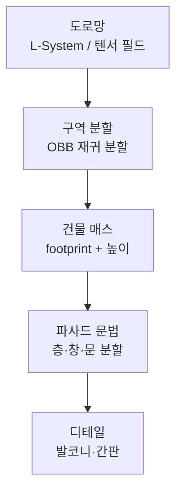
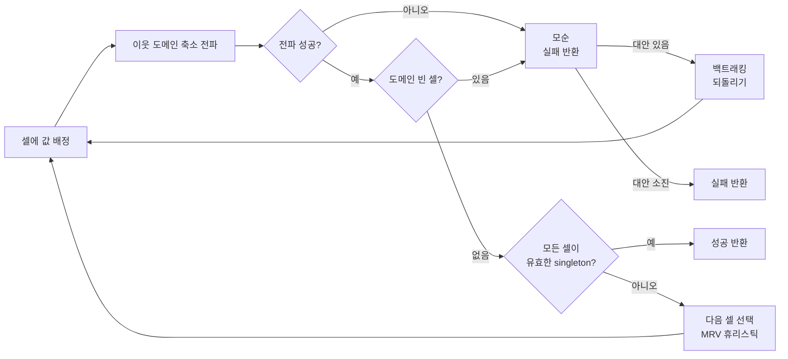
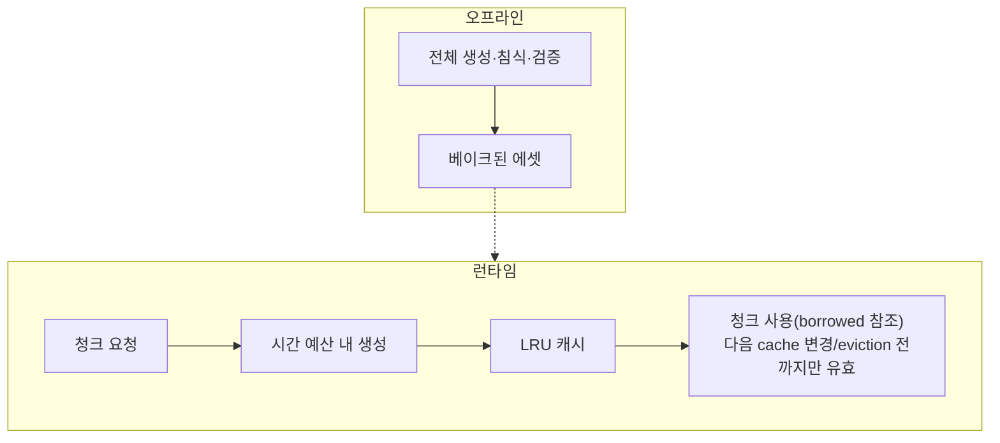
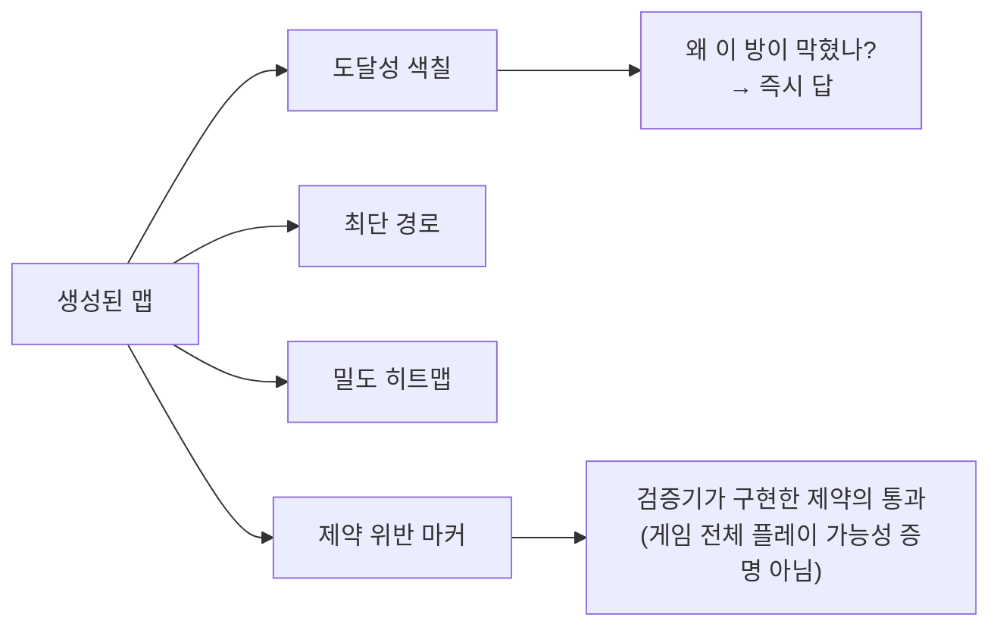

## 들어가며

절차적 생성(Procedural Generation)은 *알고리즘으로 콘텐츠를 만드는 일* 이지만, 툴 개발자의 관점에서 보면 그 본질은 *다양성 ↔ 통제력* 의 줄다리기다. 난수의 자유도를 높이면 끝없는 변주가 나오지만 디자이너가 원하는 모양은 점점 멀어지고, 규칙과 제약을 조이면 의도대로 나오지만 매번 비슷한 결과가 반복된다. 절차적 생성 툴의 거의 모든 설계 결정은 이 두 극단 사이 어디에 점을 찍을지의 문제다.

이 글은 그 트레이드오프를 축으로 절차적 생성 시스템의 구성요소를 한 흐름으로 정리한다. 난수가 어떻게 시드에서 결정론적으로 흘러나오는지, 노이즈가 어떻게 자연스러운 무작위를 만드는지, 그래프와 문법이 어떻게 구조를 강제하는지, 제약과 규칙이 다양성을 어떻게 가두는지, Wave Function Collapse가 어떻게 예시에서 규칙을 뽑아내는지, 생성된 결과를 어떻게 검증하고 추려내는지, 같은 생성기를 오프라인 베이크와 런타임 스트리밍에서 어떻게 다르게 쓰는지, 그리고 눈에 안 보이는 생성 과정을 어떻게 시각화해 디버깅하는지를 다룬다.


이 글의 목표.

1. **시드와 결정론** — RNG 선택, 시드 분기, 재현 가능한 생성.
2. **노이즈와 분포** — Perlin/Simplex, fBm, 도메인 워핑, 샘플링 분포.
3. **그래프와 문법 기반 생성** — L-System, Shape Grammar, 미션 그래프.
4. **제약과 규칙 시스템** — CSP, 인접 규칙, 백트래킹.
5. **Wave Function Collapse** — 엔트로피·전파·모순 처리.
6. **검증과 큐레이션** — 도달성·메트릭·아웃라이어·시드 블랙리스트.
7. **런타임 대 오프라인** — 베이크, 청크 스트리밍, 시간 예산.
8. **디버깅과 시각화** — 결정론 재현, 스텝 시각화, 시드 비교.


---

## 목차
1. [시드와 결정론](#1-시드와-결정론)
2. [노이즈와 분포](#2-노이즈와-분포)
3. [그래프와 문법 기반 생성](#3-그래프와-문법-기반-생성)
4. [제약과 규칙 시스템](#4-제약과-규칙-시스템)
5. [Wave Function Collapse](#5-wave-function-collapse)
6. [검증과 큐레이션](#6-검증과-큐레이션)
7. [런타임 대 오프라인](#7-런타임-대-오프라인)
8. [디버깅과 시각화](#8-디버깅과-시각화)


---

## 1. 시드와 결정론

### 결정론이 먼저다

절차적 생성에서 *다양성 ↔ 통제력* 트레이드오프를 논하기 전에 재현성 계약을 정한다. 같은 생성기 버전·설정·시드·입력 청크를 넣었을 때 같은 결과를 요구하면 디자이너가 결과를 다시 열고, 버그를 재현하고, 여러 노드가 같은 세계를 생성할 수 있다. 반대로 서버가 결과를 베이크해 배포하는 일회성 생성은 클라이언트 간 bit-exact 실행이 필요하지 않을 수 있다. 결정론은 모든 효과의 절대 조건이 아니라 **재생·증분 빌드·네트워크 동기화가 생성 과정을 다시 실행하는 설계의 핵심 계약**이다.

재현성을 깨는 흔한 원인은 전역 상태 RNG, 플랫폼·컴파일 옵션에 따른 부동소수점 차이, 명세되지 않은 해시 순회 순서와 병렬 작업 완료 순서다. 필요한 재현 범위가 같은 빌드·같은 머신인지, 지원 플랫폼 전체의 bit-exact 결과인지 먼저 정하고 그 범위 안의 원인을 통제한다. 알고리즘이나 콘텐츠 규칙이 바뀌면 같은 시드의 결과도 바뀌므로 생성기 버전 역시 입력 계약에 포함한다.

### RNG 선택 — 게임 PRNG의 요건

적대자가 생성 결과를 예측해 경제·보안 이득을 얻는 문제가 아니라면 암호학적 난수는 보통 필요하지 않다. 생성기가 요구하는 것은 충분한 통계 품질, 명시된 상태 전이, 필요한 jump/split 기능, 저장 가능한 작은 상태다. 플랫폼 간 동일 결과가 계약이면 PRNG 알고리즘과 정수 overflow, seed 확장, 범위 매핑까지 직접 고정한다. `std::mt19937` 엔진의 출력은 표준화되어 있지만 `std::uniform_*_distribution`의 구체적 매핑 결과는 구현별로 같다고 가정하지 않는다.

| RNG | 상태 크기 | 속도 | 비고 |
|---|---|---|---|
| `mt19937` | ~2.5KB | 중간 | 상태가 커 다중 스트림에 부적합 |
| PCG | 8~16바이트 | 빠름 | 통계 품질 좋음, 분기 쉬움 |
| xoshiro256** | 32바이트 | 매우 빠름 | 게임에서 널리 쓰임 |
| SplitMix64 | 8바이트 | 매우 빠름 | 시드 분배·해시 시드용 |

표의 상대 속도는 *구현·플랫폼·컴파일러 의존* 이며 보편 순위가 아니다. 상태 크기·통계 품질·분기 기능과 함께 프로젝트에서 직접 측정해 정한다.

작은 상태가 중요한 이유는 *스트림을 흩뿌리기* 때문이다. 청크마다, 객체마다, 기능마다 독립 RNG를 두려면 상태가 작아야 한다. 아래는 64비트 상태의 단순 PRNG 예시다.

```cpp
std::uint64_t UniformBelow(std::uint64_t n);   // [0, n), n > 0

struct Rng {
    uint64_t state;
    explicit Rng(uint64_t seed) : state(seed ? seed : 0x9E3779B97F4A7C15ull) {}

    uint64_t Next() {                       // xorshift64* 변종
        state ^= state >> 12;
        state ^= state << 25;
        state ^= state >> 27;
        return state * 0x2545F4914F6CDD1Dull;
    }
    float NextFloat() {                      // [0,1)
        return (Next() >> 40) * (1.0f / 16777216.0f);   // 상위 24비트만 사용
    }
    int Range(int lo, int hi) {              // [lo, hi), lo < hi 필요
        if (lo >= hi) throw std::invalid_argument("Range requires lo < hi");
        const std::int64_t low = lo;
        const auto width = static_cast<uint64_t>(std::int64_t(hi) - low);
        const uint64_t offset = UniformBelow(width);   // [0, width)
        return static_cast<int>(low + static_cast<std::int64_t>(offset));
    }
};
```

`hi - lo`를 `int`에서 계산하면 `Range(INT_MIN, INT_MAX)`처럼 차가 오버플로한다. 그래서 폭은 *int64에서 계산* 하고 `lo < hi`를 먼저 검증한다. `lo + offset`도 `int64`에서 더해 결과가 `[lo, hi)`에 들어감을 보장한 뒤 `int`로 변환한다.

`Next() % n`은 *모듈로 편향(modulo bias)* 을 가진다 — 범위가 $2^{64}$의 약수가 아니면 작은 값이 미세하게 더 자주 나온다. 균등성이 중요한 곳(루트 테이블, 확률 분포)에서는 거부 샘플링으로 편향을 제거한다. 아래 helper는 생략 가능한 함수가 아니라 *명시된 원천 분포에 맞는 범위 매핑 계약* 이다.

```cpp
// 요구 계약: n > 0일 때 [0, n) 값을 반환한다.
uint64_t UniformBelow(uint64_t n) {
    if (n == 0) throw std::invalid_argument("UniformBelow requires n > 0");
    uint64_t limit = UINT64_MAX - (UINT64_MAX % n);
    uint64_t x;
    do { x = Next(); } while (x >= limit);   // 꼬리 영역 거부
    return x % n;
}
```

`Next()`를 *full uint64 균등 원천* 이라 정의하면 이 limit 식은 정상이다. 그러나 제공된 xorshift64* 변종은 비영 상태와 홀수 곱 때문에 0을 출력하지 않아 그 전제가 그대로 맞지 않는다 — 이 원천을 쓸 때는 *실제 min/max와 분포* 에 맞는 acceptance 범위를 따로 계산한다(예: 비영 출력이 균등하다는 전제라면 `Next()-1`을 0..UINT64_MAX-1로 옮겨 그 결과 수에 맞춰 계산). 근거 없이 limit 식을 off-by-one으로 바꾸지는 않는다(T21).

### 시드 분기 — 계층적 결정론

절차적 세계는 하나의 RNG로 만들지 않는다. 마스터 시드 하나에서 *기능별·위치별 하위 시드* 를 *해시로 유도* 한다. 핵심은 *순서 독립성* 이다 — 청크 (10, 5)의 지형은 청크 (3, 9)를 먼저 생성했든 안 했든 *항상 같아야* 한다. 그래서 각 하위 시드를 *좌표와 마스터 시드의 해시* 로 직접 계산한다.

```cpp
// 좌표를 마스터 시드와 섞어 위치별 결정론 시드 유도 (SplitMix64 finalizer)
uint64_t HashSeed(uint64_t master, int x, int y, uint32_t channel) {
    uint64_t h = master;
    h ^= (static_cast<uint64_t>(static_cast<uint32_t>(x)) * 0x9E3779B97F4A7C15ull);
    h ^= (static_cast<uint64_t>(static_cast<uint32_t>(y)) * 0xC2B2AE3D27D4EB4Full);
    h ^= (static_cast<uint64_t>(channel) * 0x165667B19E3779F9ull);
    h ^= h >> 30; h *= 0xBF58476D1CE4E5B9ull;
    h ^= h >> 27; h *= 0x94D049BB133111EBull;
    h ^= h >> 31;
    return h;
}

Rng ChunkRng(uint64_t master, int cx, int cy, uint32_t channel) {
    return Rng(HashSeed(master, cx, cy, channel));   // 청크·채널마다 독립 스트림
}
```

`channel`은 같은 청크 안에서 *기능을 분리* 한다. 지형 높이는 채널 0, 식생 배치는 채널 1, 적 스폰은 채널 2를 쓰면, 식생 배치 로직을 바꿔도 지형 높이는 *비트 단위로 그대로* 유지된다. 채널 분리 없이 하나의 스트림을 공유하면, 한 기능에서 난수를 하나 더 뽑는 순간 그 뒤의 모든 결과가 어긋난다 — *RNG 소비 순서 의존성* 이라는 가장 흔한 재현성 버그다.

### 함정 — 부동소수점과 순회 순서

결정론을 무너뜨리는 두 함정이 있다. 첫째, 부동소수점 연산은 컴파일러 최적화(FMA 결합, `-ffast-math`), 플랫폼 SIMD 차이로 *마지막 비트가 갈린다*. 같은 시드라도 PC와 콘솔에서 지형이 미세하게 어긋날 수 있다. 네트워크 동기화가 필요한 생성은 *정수 또는 고정소수점* 으로 핵심 경로를 짜거나, 부동소수점 모드를 명시적으로 고정한다.

둘째, *순회 순서* 다. 객체 집합을 순회하며 난수를 소비할 때 그 순서가 해시 맵의 내부 순서나 멀티스레드 완료 순서에 의존하면, 같은 시드라도 결과가 흔들린다. 생성 단계의 순회는 *정렬된 순서* 또는 *좌표 기반 해시 시드* 로 순서 독립성을 확보한다.

```cpp
// 나쁨: 해시 맵 순회 순서가 RNG 소비 순서를 결정 → 비결정적
for (auto& [id, obj] : unorderedMap) obj.tint = rng.NextFloat();

// 좋음: 각 객체가 자기 좌표 해시로 독립 시드를 가짐 → 순서 무관
for (auto& [id, obj] : unorderedMap)
    obj.tint = Rng(HashSeed(master, obj.x, obj.y, kTintChannel)).NextFloat();
```

이 절의 결론은 단순하다. *시드 → 해시 분기 → 채널 분리 → 순서 독립* 의 골격이 갖춰져야, 이후 절들의 모든 다양성이 *재현 가능하고 디버깅 가능한* 형태가 된다.

## 2. 노이즈와 분포

### 왜 노이즈인가 — 균등 난수의 문제

지형 높이를 균등 난수로 채우면 *백색 잡음(white noise)* 이 된다 — 인접 픽셀이 완전히 무관해 거칠고 자연스럽지 않다. 자연의 형태는 *공간적으로 매끄럽고, 여러 스케일의 변동이 겹쳐* 있다. 이 성질을 만드는 것이 *그래디언트 노이즈(gradient noise)* 다 — 격자점마다 의사난수 그래디언트를 두고, 그 사이를 부드럽게 보간한다.

### Perlin과 Simplex

*Perlin 노이즈* 는 정수 격자의 각 꼭짓점에 그래디언트 벡터를 배정하고, 각 꼭짓점에서 샘플 점으로의 변위와 그래디언트의 내적을 *페이드 곡선* 으로 보간한다. 2D는 4개 꼭짓점, 3D는 8개를 보간한다 — 차원이 $D$면 $2^D$개로, 고차원에서 비싸진다.

```cpp
// Perlin 2D 핵심: 격자 꼭짓점 그래디언트와의 내적을 보간
float Perlin2D(float x, float y) {
    int xi = FastFloor(x), yi = FastFloor(y);
    float xf = x - xi, yf = y - yi;
    float u = Fade(xf), v = Fade(yf);               // 6t^5-15t^4+10t^3
    float n00 = DotGrad(Hash(xi,   yi),   xf,       yf);
    float n10 = DotGrad(Hash(xi+1, yi),   xf - 1,   yf);
    float n01 = DotGrad(Hash(xi,   yi+1), xf,       yf - 1);
    float n11 = DotGrad(Hash(xi+1, yi+1), xf - 1,   yf - 1);
    return Lerp(Lerp(n00, n10, u), Lerp(n01, n11, u), v);   // [-1, 1] 근처
}

float Fade(float t) { return t * t * t * (t * (t * 6 - 15) + 10); }
```

*Simplex 노이즈* 는 같은 동기에서 출발하되 격자를 *심플렉스(2D는 삼각형, 3D는 사면체)* 로 바꾼다. 차원 $D$에서 보간할 꼭짓점이 $2^D$가 아니라 $D+1$개로 줄어 *고차원에서 훨씬 싸고*, 방향성 아티팩트(격자축을 따라 보이는 줄무늬)가 적다. 3D 이상을 자주 샘플링하는 생성기(볼류메트릭 동굴, 구름)는 Simplex 계열을 선호한다.

| 노이즈 | 보간 꼭짓점(D차원) | 아티팩트 | 용도 |
|---|---|---|---|
| Value | $2^D$ | 격자 뭉침 | 단순·저렴 |
| Perlin | $2^D$ | 축 방향 줄무늬 | 2D 지형 표준 |
| Simplex | $D+1$ | 적음 | 3D·고차원 |
| Worley(Cellular) | 특징점 거리 | 세포·균열 패턴 | 동굴·암석·물 |

### fBm — 스케일을 겹친다

노이즈 한 층은 단조롭다. 자연 지형은 *큰 산맥 위에 언덕, 그 위에 바위* 처럼 여러 주파수가 겹친다. 이를 만드는 표준 기법이 *fBm(fractional Brownian motion)* — 주파수를 배로 올리고(lacunarity) 진폭을 절반으로 줄이며(gain) 여러 *옥타브(octave)* 를 합산한다.

```cpp
// 전제: octaves >= 1, lacunarity > 1, 0 <= gain <= 1, 기저 노이즈는 [-1,1].
float fBm(float x, float y, int octaves, float lacunarity, float gain) {
    if (octaves < 1) throw std::invalid_argument("octaves >= 1 required");
    if (!(lacunarity > 1.0f) || !(gain >= 0.0f && gain <= 1.0f))
        throw std::invalid_argument("lacunarity > 1, 0 <= gain <= 1 required");
    float sum = 0, amp = 0.5f, freq = 1.0f, norm = 0;
    for (int o = 0; o < octaves; ++o) {
        sum  += amp * Perlin2D(x * freq, y * freq);
        norm += amp;
        freq *= lacunarity;       // 보통 2.0 — 주파수 배가
        amp  *= gain;             // 보통 0.5 — 진폭 절반
    }
    return sum / norm;            // 진폭 가중 정규화 (분산 정규화 아님)
}
```

`octaves`, `lacunarity`, `gain`이 *다양성 ↔ 통제력* 의 다이얼이다. 옥타브를 늘리면 디테일이 풍부해지지만 비용이 선형으로 늘고, gain을 높이면 거칠어지고 낮추면 매끄러워진다. `sum / norm`은 가중 *진폭* 을 정규화하는 것이지 결과를 정확히 [-1,1]로 보장하거나 *분산* 을 정규화하는 것이 아니다 — 기저 노이즈가 [-1,1]이고 가중치가 음수가 아닐 때만 가중 평균 설명이 성립한다. 변형도 많다 — 절댓값을 씌워 능선을 만드는 *ridged 노이즈*, 출력을 다시 입력에 더하는 *도메인 워핑(domain warping)* 으로 흐르는 듯한 왜곡을 준다.

```cpp
// 도메인 워핑: 좌표 자체를 노이즈로 밀어 흐르는 형태를 만든다
float Warped(float x, float y) {
    float qx = fBm(x,        y,        4, 2.0f, 0.5f);
    float qy = fBm(x + 5.2f, y + 1.3f, 4, 2.0f, 0.5f);   // 오프셋으로 독립 채널
    return fBm(x + 4.0f * qx, y + 4.0f * qy, 4, 2.0f, 0.5f);
}
```

### 노이즈에서 통제로 — 마스크와 커브

순수 노이즈는 *통제 불가능한 다양성* 이다. 디자이너가 "여기는 평원, 저기는 산"을 원하면 노이즈를 그대로 쓸 수 없다. 실무는 노이즈를 *입력* 으로 삼고 그 위에 *통제 레이어* 를 쌓는다. 높이를 *리맵 커브* 로 통과시켜 평지/절벽 비율을 조정하고, 디자이너가 그린 *영향 마스크* 와 곱해 노이즈가 작용할 영역을 한정한다.

```cpp
float TerrainHeight(float x, float y) {
    float base = fBm(x, y, 6, 2.0f, 0.5f);     // [-1,1] 다양성 원천
    float h = HeightCurve.Eval(base * 0.5f + 0.5f);  // 디자이너 커브로 형태 통제
    float mask = InfluenceMask.Sample(x, y);   // 손으로 그린 영역 마스크
    return h * mask + FlatBaseline * (1 - mask);
}
```

이 패턴이 절차적 지형 툴의 핵심이다 — *노이즈는 무한한 변주를, 커브와 마스크는 디자이너의 의도를 담는다*. 둘의 곱이 트레이드오프의 균형점이다.

### 샘플링 분포 — 어디에 놓을 것인가

높이뿐 아니라 *객체 배치* 도 노이즈/난수의 영역이다. 균등 난수로 나무를 뿌리면 뭉치거나 빈 구멍이 생긴다. 자연스러운 *고르게 흩어진 무작위* 가 필요하면 *포아송 디스크 샘플링(Poisson disk sampling)* 을 쓴다 — 모든 점이 최소 거리 $r$ 이상 떨어지도록 보장한다. Bridson 알고리즘은 활성 점 주변에 후보를 뿌리고 격자로 거리 검사를 해 $O(n)$에 가깝게 동작한다(반복당 $O(k)$와 고정 $k$ 전제에서의 분석이다).

```cpp
// Bridson 포아송 디스크: 활성 리스트에서 후보를 던지고 최소 거리 검사
std::vector<Vec2> PoissonDisk(float r, Vec2 size, Rng& rng, int k = 30) {
    float cell = r / std::sqrt(2.0f);            // 격자 한 칸에 점 최대 1개
    Grid grid(size, cell);
    std::vector<Vec2> samples, active;
    Vec2 p0{rng.NextFloat()*size.x, rng.NextFloat()*size.y};
    samples.push_back(p0); active.push_back(p0); grid.Insert(p0);
    while (!active.empty()) {
        int i = rng.Range(0, (int)active.size());
        bool found = false;
        for (int t = 0; t < k; ++t) {            // k번 후보 시도
            Vec2 c = active[i] + RandomAnnulus(r, 2*r, rng);  // [r, 2r) 고리
            if (InBounds(c, size) && grid.NoNeighborWithin(c, r)) {
                samples.push_back(c); active.push_back(c); grid.Insert(c);
                found = true; break;
            }
        }
        if (!found) { active[i] = active.back(); active.pop_back(); }   // 더 못 놓으면 비활성(순서 무관 → swap-remove)
    }
    return samples;
}
```

활성 리스트의 순서는 결과에 영향을 주지 않으므로 제거는 `erase(begin()+i)` 대신 swap-remove를 쓴다 — `erase(begin()+i)`는 삭제 위치 뒤 원소를 이동시켜 반복당 상수 시간 전제를 깬다(앞에서 차례로 지우면 매번 O(n) 이동). 교육용으로 단순 삭제를 유지한다면 원문 Bridson의 선형 분석을 그대로 적용할 수 없다고 제한해야 한다.

밀도에 *변화* 를 주려면 $r$을 노이즈로 변조한다 — 숲 중심은 $r$을 줄여 빽빽하게, 가장자리는 늘려 성기게. 이렇게 *균등 분포 + 노이즈 변조* 로 군집 패턴을 만든다. 분포 선택이 곧 배치의 "느낌"을 정한다.

## 3. 그래프와 문법 기반 생성

### 노이즈로 못 만드는 것 — 구조

노이즈는 *연속적이고 매끄러운* 형태에 강하다. 그러나 *방, 복도, 도로, 가지* 처럼 *이산적이고 위상이 중요한* 구조는 노이즈 단독으로 보장하기 어렵다 — threshold·분류 뒤 제약 검증을 붙이면 이산 구조를 만들 수 있지만, 관계를 직접 정의하고 검증하지는 못한다. "모든 방이 연결되어야 한다", "막다른 길은 셋 이하"처럼 *관계* 가 핵심인 콘텐츠는 *그래프와 문법* 으로 생성한다. 이쪽은 다양성보다 *통제력* 에 무게가 실린 도구다.

### L-System — 재귀적 가지치기

*L-System(Lindenmayer System)* 은 *문자열 재작성 규칙* 으로 가지 구조를 만든다. 시작 문자열(axiom)에서 출발해 규칙을 반복 적용하고, 결과 문자열을 터틀 그래픽으로 해석한다. 식물, 번개, 강 지류처럼 *자기 유사 가지* 에 적합하다.

```cpp
// L-System: 규칙 반복 적용 후 터틀로 해석
std::string Expand(std::string s, const std::map<char,std::string>& rules, int iters) {
    for (int i = 0; i < iters; ++i) {
        std::string next;
        for (char c : s) {
            auto it = rules.find(c);
            next += (it != rules.end()) ? it->second : std::string(1, c);
        }
        s = std::move(next);
    }
    return s;
}
// axiom="F", rule F -> "FF+[+F-F-F]-[-F+F+F]" 3회 → 나무 가지
// 해석: F=전진, +/-=회전, [=상태 push, ]=pop
```

*확률적 L-System* 은 한 기호에 여러 규칙을 두고 시드 RNG로 고른다 — 같은 문법에서 매번 다른 나무가 나온다. 여기서 *문법은 통제, RNG는 다양성* 이라는 분업이 다시 드러난다. 회전 각도·길이에 노이즈를 더하면 더 자연스러워진다.

### Shape Grammar — 건물과 도시

*Shape Grammar* 는 L-System의 형태판이다. 하나의 형상(예: 건물 매스)을 규칙으로 *분할·돌출·반복* 한다. "건물 → 바닥층 + 중간층들 + 옥상", "중간층 → 창문 격자"처럼 *형상을 점점 세분* 한다. 도시 생성기는 보통 *도로망 → 구역(lot) 분할 → 건물 매스 → 파사드* 의 계층 문법을 쓴다.



각 단계가 *위 단계의 출력을 입력* 으로 받는 *파이프라인* 이다. 이 계층성 덕분에 디자이너는 원하는 층위에서 개입한다 — 도로망은 손으로 그리고 그 아래만 절차 생성, 혹은 특정 구역만 고정하고 나머지는 재생성. *부분 통제(partial control)* 가 그래프/문법 생성의 강점이다.

### 미션 그래프 — 의미를 먼저, 공간을 나중에

던전 생성에서 강력한 패턴이 *그래프 우선(graph-first)* 접근이다. 먼저 *미션 그래프* 를 만든다 — "열쇠 → 잠긴 문 → 보스" 같은 *게임플레이 의존 관계* 를 노드와 엣지로 표현한다. 그 다음 이 그래프를 *공간에 임베딩* 해 실제 방 배치로 푼다. 공간을 먼저 만들고 의미를 끼워 넣으면 "열쇠가 잠긴 문 뒤에 있는" 모순이 생기지만, 그래프 우선은 *그래프에서 정의·검증한 제약을 생성 과정에서 유지하기 쉽게* 한다. 단 임베딩이 통로 폭·상태 의존 통행 같은 기하 조건까지 보장하지는 않으므로, 플레이 경로의 최종 보장은 6절의 검증에 맡긴다.

```cpp
// 미션 그래프: 게임플레이 의존을 위상으로 표현
struct MissionNode { enum Type { Entrance, Key, Lock, Combat, Boss, Treasure }; };
struct MissionGraph {
    std::vector<MissionNode> nodes;
    std::vector<std::pair<int,int>> edges;        // 의존(선후) 관계
    bool LockAfterKey() const;                    // 모든 Lock은 해당 Key 뒤
};
// 1단계: 문법으로 미션 그래프 생성 (Entrance → ... → Boss)
// 2단계: 그래프를 공간 레이아웃으로 임베딩 (방=노드, 복도=엣지)
// 3단계: 각 방 내부를 노이즈·타일로 채움
```

이 *두 단계 분리* — 위상 생성과 기하 생성 — 가 다양성과 통제를 동시에 얻는 방법이다. 미션 그래프는 *통제된 구조* 를, 방 내부 채움은 *노이즈 다양성* 을 담당한다. 검증(6절)도 미션 그래프 수준에서 하면 "도달 불가능한 보스" 같은 치명적 결함을 *공간을 다 만들기 전에* 잡는다.

### 함정 — 그래프 임베딩의 충돌

그래프를 2D 공간에 풀 때 *방이 겹치거나, 복도가 교차하거나, 그래프 위상이 평면에 안 들어가는* 문제가 생긴다. 비평면 그래프를 평면에 억지로 욱여넣으면 복도가 다른 방을 관통한다. 해법은 임베딩 시 *충돌 검사 후 재배치* 하거나, *층(layer)을 도입* 해 교차하는 복도를 다른 높이로 분리하거나, 애초에 *평면 그래프만 생성하도록 문법을 제한* 하는 것이다. 통제를 강하게 걸수록 실패(생성 불가)도 늘어난다는 트레이드오프가 여기서도 나타난다.

## 4. 제약과 규칙 시스템

### 다양성을 가두는 제약

문법은 *무엇을 만들지* 를 적극적으로 기술한다. 반대 방향의 도구가 *제약(constraint)* 이다 — *무엇이 안 되는지* 를 기술하고, 그 안에서 가능한 모든 변주를 허용한다. "물 타일 옆엔 모래만 온다", "절벽은 90도로 꺾이지 않는다" 같은 *지역 규칙* 의 집합이 전역 형태를 결정한다. 제약 기반 생성은 *제약 만족 문제(CSP, Constraint Satisfaction Problem)* 로 정식화된다.

CSP는 세 요소다. *변수*(각 셀), *도메인*(각 셀이 가질 수 있는 값 집합), *제약*(값들 사이 허용 관계). 생성은 모든 변수에 제약을 만족하는 값을 배정하는 *탐색* 이다.

### 인접 규칙과 도메인 축소

가장 흔한 제약은 *인접 규칙(adjacency rule)* 이다 — 어떤 타일이 어떤 타일 옆에 올 수 있는지의 표. 이 표를 손으로 적거나, *예시 이미지에서 자동 추출* 한다(5절 WFC의 핵심). 인접 규칙이 주어지면, 한 셀의 값을 정할 때 *이웃의 도메인을 축소* 할 수 있다.

```cpp
// 인접 규칙: tileA의 dir 방향에 올 수 있는 타일 집합
struct AdjacencyRules {
    // allowed[tile][dir] = 그 방향에 허용되는 타일 비트마스크
    std::vector<std::array<TileMask, 4>> allowed;   // 4방향(상하좌우)

    // 예시 그리드에서 인접 규칙 자동 학습
    static AdjacencyRules LearnFrom(const Grid& example) {
        AdjacencyRules r;
        r.allowed.resize(example.TileCount());
        for (auto [a, b, dir] : example.AllAdjacentPairs())
            r.allowed[a][dir].set(b);               // a 옆 dir에 b가 실제로 등장
        return r;
    }
};
```

규칙을 *예시에서 학습* 하면 디자이너가 규칙표를 직접 안 적어도 된다 — "이렇게 생긴 맵을 더 만들어줘"라는 *예시 기반(example-based)* 워크플로가 가능하다. 이것이 제약 시스템이 디자이너에게 매력적인 이유다. 규칙을 코드로 적는 대신 *그림으로 보여준다*.

### 백트래킹과 전파

CSP 탐색의 표준 알고리즘은 *백트래킹(backtracking)* 이다 — 한 변수에 값을 배정하고, 제약 위반이 생기면 되돌린다. 순진한 백트래킹은 막다른 길에서 *지수적으로 폭발* 한다. 이를 줄이는 핵심이 *제약 전파(constraint propagation)* 다. 값을 하나 정하면, 그 결정이 강제하는 이웃의 도메인 축소를 *연쇄적으로 전파* 해 모순을 일찍 발견한다.



전파에 *AC-3*(Arc Consistency) 같은 알고리즘을 쓰면 전체 탐색 전에 불가능한 값을 제거한다. *MRV(Minimum Remaining Values)* 는 선택지가 가장 적은 셀을 먼저 골라 실패를 빨리 드러낸다. WFC도 관측으로 한 셀의 가능 집합을 줄이고 인접 제약을 전파한다는 점에서 같은 CSP 구조를 사용하며, 모순 시 backtracking·restart 정책이 필요하다.

### 함정 — 과제약과 무한 루프

제약을 너무 빡빡하게 걸면 *해가 존재하지 않는다*. "모든 방은 정확히 3개 출구"를 요구하면 작은 던전에서 풀 수 없다. 과제약(over-constrained) 시스템은 *백트래킹이 전부 실패* 하거나, 더 나쁘게는 *완화 없이 무한 반복* 한다. 실무 대응은 세 가지다. 제약에 *우선순위(hard/soft)* 를 두어 soft 제약은 위반을 허용하고 페널티만 매긴다, 백트래킹에 *시도 횟수 상한* 을 두고 초과 시 부분해로 폴백한다, 그리고 *모순이 잦은 규칙* 을 프로파일링해 어느 규칙이 충돌의 주범인지 찾는다. 통제력을 높일수록 *생성 실패율* 이 오르는 것이 제약 시스템의 근본 트레이드오프다.

## 5. Wave Function Collapse

### WFC는 무엇인가

*Wave Function Collapse(WFC)* 는 4절 CSP의 한 구현으로, *예시 한 장에서 인접 규칙을 학습* 해 임의 크기의 *비슷하지만 새로운* 출력을 만든다. 이름은 양자역학의 비유다 — 처음엔 모든 셀이 *모든 타일일 수 있는 중첩 상태(superposition)* 이고, 하나씩 *관측(collapse)* 하며 확정한다. 한 셀이 확정되면 인접 규칙이 이웃의 가능성을 줄이고(*전파*), 이 연쇄가 전체로 퍼진다.

WFC가 인기를 끈 이유는 *워크플로* 다. 디자이너는 알고리즘을 몰라도 된다 — *원하는 스타일의 작은 예시 타일맵 하나* 를 그리면, 그 *국소 패턴* 을 유지한 큰 맵이 나온다. 다양성(매번 다른 배치)과 통제력(예시의 스타일 보존)을 *예시 한 장* 으로 동시에 잡는다.

### 알고리즘 — 엔트로피, 관측, 전파

WFC의 루프는 세 단계다. *최소 엔트로피 셀 선택 → 관측(가능 타일 중 하나로 확정) → 전파(이웃 가능성 축소)*. 엔트로피는 "이 셀이 가질 수 있는 타일의 수"의 척도다 — 가장 확정에 가까운(선택지 적은) 셀을 먼저 관측하는 4절의 MRV 휴리스틱이다.

```cpp
struct Cell {
    TileMask possible;          // 아직 가능한 타일 비트마스크
    int Entropy() const { return possible.count(); }   // 가중 엔트로피 변형도 흔함
    bool Collapsed() const { return possible.count() == 1; }
};

bool WFC(Grid& grid, const AdjacencyRules& rules, Rng& rng) {
    while (true) {
        if (HasEmptyDomain(grid)) return false;      // 모순(빈 도메인) → 실패
        if (AllValidSingletons(grid))                // 모든 셀의 도메인 크기 == 1
            return SatisfiesFixedConstraints(grid);  // 고정 제약까지 통과해야 성공
        Cell* c = FindMinEntropy(grid);              // 미확정 셀만 반환 (MRV)
        if (!c) return false;                        // 축소 가능한 셀이 없음 → 실패
        Collapse(c, rng);                            // 가중 무작위로 하나 선택
        if (!Propagate(grid, rules, c))              // 전파 실패도 실패로 전파
            return false;                            // 재시도/백트래킹은 호출자가 결정
    }
}
```

`FindMinEntropy`가 null을 돌려주는 두 경우를 구분하는 것이 핵심이다 — *미확정 셀이 없음*(모든 셀 확정)과 *모든 도메인이 비어 있음*은 다르다. 전자는 `AllValidSingletons`로 모든 도메인 크기가 정확히 1임을 확인한 뒤에만 성공이고, 후자는 모순이다. 그래서 완료 검사(“모든 셀이 유효한 singleton”)와 empty domain 검사를 분리한다. 사전 제약·전파·탐색 어디서 실패해도 같은 실패 결과로 상위에 전파한다.

*전파* 가 알고리즘의 심장이다. 한 셀이 확정되면, 그 인접 규칙에 따라 이웃에서 *불가능해진 타일* 을 제거하고, 이웃의 가능성이 줄었으면 *그 이웃의 이웃까지* 워크리스트로 연쇄 전파한다.

```cpp
bool Propagate(Grid& g, const AdjacencyRules& rules, Cell* start) {
    std::vector<Cell*> work{start};
    while (!work.empty()) {
        Cell* c = work.back(); work.pop_back();
        for (int dir = 0; dir < 4; ++dir) {
            Cell* nb = g.Neighbor(c, dir);
            if (!nb) continue;
            TileMask allowed = AllowedFrom(c->possible, rules, dir);  // c가 dir에 허용하는 합집합
            TileMask before = nb->possible;
            nb->possible &= allowed;                  // 이웃 가능성 축소
            if (nb->possible.none()) return false;    // 모순 — 가능 타일이 0
            if (nb->possible != before) work.push_back(nb);  // 줄었으면 더 전파
        }
    }
    return true;
}
```

### 모순 처리 — 실패는 정상이다

WFC는 *전파 중 어떤 셀의 가능 타일이 0이 되는* 모순에 종종 빠진다. 특히 제약이 빡빡하거나 출력이 클수록 잦다. 대응 전략이 WFC 구현의 품질을 가른다.

| 전략 | 방법 | 비용 | 비고 |
|---|---|---|---|
| 재시작(restart) | 처음부터 다시, 다른 RNG 진행 | 실패율에 비례 | 구현 단순, 작은 맵 |
| 백트래킹 | 마지막 관측을 되돌림 | 상태 스냅샷 필요 | 큰 맵에 유리 |
| 부분 고정 | 충돌 영역만 지우고 재생성 | 중간 | 점진적 |
| 제약 완화 | soft 규칙 위반 허용 | 품질 저하 | 폴백 |

가장 단순한 구현은 *재시작* 이다 — 모순이 나면 변형된 실패 grid를 이어 쓰지 않고 *초기 도메인+고정 제약* 에서 다른 진행으로 다시 시도한다. 여기서 $50 \times 50$은 예시 경계이며, 실패율은 ruleset·가중치·시드에 의존한다. 큰 맵은 *백트래킹* 으로 마지막 몇 수만 되돌리거나, *모순 주변만 국소 재생성* 한다. 어느 쪽이든 *시드를 기록* 해 성공한 결과를 재현 가능하게 두는 것이 1절의 결정론과 이어진다.

### 가중치와 통제 — 다양성을 조율한다

순수 WFC는 예시의 인접 규칙만 본다. 거기에 *타일 가중치(weight)* 를 더하면 빈도를 통제한다 — 관측 시 균등 무작위가 아니라 *가중 무작위* 로 골라 "물은 드물게, 풀은 흔하게"를 조정한다. 더 나아가 *사전 제약(pre-constraint)* 으로 특정 셀을 미리 확정한다 — 맵 중앙에 강을, 모서리에 입구를 *고정* 하고 WFC가 그 주변을 채우게 한다.

```cpp
// 사전 제약: 디자이너가 일부 셀을 미리 확정 → WFC가 나머지를 일관되게 채움
Grid initial = grid;                              // 초기 도메인+고정 제약을 재시작 기준으로 보관
grid.At(cx, cy).possible = MaskOf(TileRiver);     // 강 고정
grid.At(0, 0).possible   = MaskOf(TileEntrance);  // 입구 고정
if (!Propagate(grid, rules, &grid.At(cx, cy)) ||  // 고정한 셀마다 영향을 먼저 전파
    !Propagate(grid, rules, &grid.At(0, 0)))
    return;                                       // 사전 제약 자체가 모순 → 실패 처리
if (!WFC(grid, rules, rng)) {                     // 남은 셀 채움(실패 반환을 사용)
    grid = initial;                               // 변형된 실패 grid 재사용 금지
    // 초기 도메인+고정 제약에서 다른 진행으로 재시도
}
```

이 *가중치 + 사전 제약* 이 WFC를 "통제 불가능한 마법"에서 *디자이너 도구* 로 바꾼다. 예시는 스타일을, 가중치는 분포를, 사전 제약은 구조를 담당한다 — 세 층의 통제가 다양성 위에 얹힌다.

### 함정 — 국소성의 한계

WFC는 *국소 인접 규칙* 만 본다. 그래서 *전역 구조* 는 보장하지 못한다 — "모든 방이 연결되어 있다", "입구에서 출구까지 길이 있다" 같은 *위상적 보장* 은 WFC의 사정권 밖이다. WFC 출력은 국소적으로 그럴듯해도 *섬처럼 끊긴 영역* 이 생길 수 있다. 그래서 실무는 *그래프 우선(3절)으로 전역 구조를 잡고, 각 영역 내부를 WFC로 채우는* 하이브리드를 쓴다. WFC 출력은 반드시 *연결성 검증(6절)* 을 거쳐야 한다. 국소 일관성과 전역 보장은 다른 도구로 따로 책임진다.

## 6. 검증과 큐레이션

### 생성은 절반, 검증이 나머지 절반

절차적 생성기의 출력은 *대부분 괜찮지만 가끔 망가진다*. 도달 불가능한 보스방, 출구 없는 방, 물 위에 뜬 나무, 절벽으로 막힌 퀘스트. 다양성을 높일수록 이런 *아웃라이어(outlier)* 가 늘어난다. *검증(validation)* 과 *큐레이션(curation)* — 자동으로 결함을 잡고, 좋은 결과만 추리는 단계 — 가 없으면 절차적 생성은 출시 품질에 못 미친다. 이 절은 *다양성의 비용* 을 관리하는 단계다.

### 하드 제약 — 플레이 가능성 검증

가장 먼저 *반드시 만족해야 하는 성질(hard constraint)* 을 자동 검사한다. 핵심은 *도달성(reachability)* 이다 — 입구에서 모든 필수 목표까지 *실제로 경로가 존재* 하는가. 플러드 필 또는 BFS로 검사한다.

```cpp
// 도달성 검증: 입구에서 모든 필수 목표까지 경로가 있는가
bool ValidateReachability(const Map& map) {
    std::queue<Cell> q{ {map.entrance} };
    std::unordered_set<Cell> seen{ map.entrance };
    while (!q.empty()) {
        Cell c = q.front(); q.pop();
        for (Cell n : map.WalkableNeighbors(c))     // 통행 가능한 이웃만
            if (seen.insert(n).second) q.push(n);
    }
    for (Cell goal : map.requiredGoals)              // 보스·열쇠·출구
        if (!seen.count(goal)) return false;         // 하나라도 못 닿으면 실패
    return true;
}
```

플러드 필/BFS는 *정적 통행 가능성* 만 증명한다 — 열쇠·잠긴 문처럼 상태에 의존하는 통로는 미션 그래프(3절) 수준에서 따로 검증한다. 미션 그래프가 있으면 검증이 더 강력해진다 — 단순 연결성이 아니라 *열쇠를 먼저 얻을 수 있는가*, *잠긴 문이 진행을 영구히 막지 않는가* 같은 *순서 제약* 까지 검사한다. 하드 제약 위반은 *재생성* 으로 처리한다 — 그 시드를 버리고 다음 시드로 넘어간다.

### 소프트 메트릭 — 품질 점수

하드 제약을 통과해도 *재미없는* 결과가 있다. 너무 좁거나, 너무 휑하거나, 분기 없이 일직선이거나. 이런 *질적 속성* 은 *메트릭(metric)* 으로 정량화해 점수를 매긴다.

| 메트릭 | 측정 | 좋은 범위(예시) |
|---|---|---|
| 경로 길이 | 입구→출구 최단 경로 | 맵 크기에 비례 |
| 분기도 | 갈림길 수 / 방 수 | 0.2 ~ 0.5 |
| 개방도 | 통행 가능 면적 비율 | 0.3 ~ 0.6 |
| 막다른 길 | dead-end 개수 | 적당히(보상 배치용) |
| 전투 밀도 | 적 수 / 면적 | 난이도 곡선 일치 |

```cpp
struct MapMetrics {
    float pathLength, branchFactor, openness, deadEnds, combatDensity;
    float QualityScore() const {                  // 목표 범위와의 거리 가중 합
        return InRange(branchFactor, 0.2f, 0.5f)  * 2.0f
             + InRange(openness,     0.3f, 0.6f)  * 1.5f
             + InRange(pathLength,   minLen, maxLen) * 1.0f;
    }
};
```

메트릭은 *큐레이션의 근거* 다. 생성기를 N번 돌려 점수순으로 정렬하고 상위만 채택하는 *generate-and-test* 전략을 쓴다. "100개 생성, 점수 상위 10개 채택"이면 *다양성(100개의 변주)* 과 *품질(상위 추림)* 을 동시에 얻는다 — 다양성의 비용을 *계산량* 으로 치르는 거래다.

### 시드 블랙리스트와 화이트리스트

런타임 생성에서 generate-and-test 비용을 감당할 수 없다면 빌드 시 seed를 검증·점수화하고 합격 목록을 출하할 수 있다. 이 목록이 보장하는 것은 **해당 생성기 버전과 설정에서 검사가 표현한 predicate를 통과했다**는 사실뿐이다. 생성기·asset·검증 코드가 바뀌면 목록을 무효화하고 다시 계산해야 한다. 알려진 결함 seed의 blacklist는 긴급 차단에는 유용하지만 검증하지 않은 seed의 안전성을 뜻하지 않는다.

```cpp
// 오프라인: 시드 공간을 훑어 합격 시드만 화이트리스트로
std::vector<uint64_t> BuildSeedWhitelist(uint64_t count) {
    std::vector<uint64_t> good;
    for (uint64_t seed = 0; seed < count; ++seed) {
        Map m = Generate(seed);
        if (ValidateReachability(m) && m.Metrics().QualityScore() > kThreshold)
            good.push_back(seed);                  // 합격 시드만 보관
    }
    return good;   // 런타임은 이 목록에서만 선택
}
```

이 *오프라인 검증 + 런타임 선택* 패턴이 절차적 생성의 신뢰성을 결정한다. 다양성은 화이트리스트의 *크기* 로, 품질은 *임계값* 으로 조율한다. 디자이너가 임계값 다이얼 하나로 "양이냐 질이냐"를 정한다.

### 함정 — 검증 가능한 것만 보장된다

자동 검증은 *코드로 표현된 성질만* 잡는다. "분위기가 으스스한가", "보스전이 극적인가" 같은 *주관적 품질* 은 메트릭이 못 잡는다. 그래서 자동 검증은 *치명적 결함 제거* 와 *후보 추림* 까지만 하고, 최종 판단은 *사람의 플레이테스트* 가 한다. 메트릭을 과신하면 "점수는 높은데 재미없는" 맵을 양산한다. 검증의 역할은 *나쁜 것을 거르는 것* 이지 *좋은 것을 만드는 것* 이 아니다 — 이 구분을 흐리면 메트릭에 최적화된 단조로운 결과로 수렴한다.

## 7. 런타임 대 오프라인

### 같은 생성기, 다른 예산

절차적 생성기는 실행 시점에 따라 다른 제약을 받는다. 오프라인 생성은 긴 계산과 대규모 seed 검증을 허용할 수 있다. 런타임 생성은 제품이 배정한 CPU·메모리·I/O deadline 안에 들어와야 한다. 청크 하나를 한 프레임에 끝낼지, 여러 프레임의 취소 가능한 job으로 나눌지, 로딩 화면에서 처리할지는 streaming 계약에 따라 다르다. 같은 알고리즘도 이 예산과 중단 가능성에 맞춰 다르게 구현한다.



### 오프라인 베이크 — 무겁고 확정적

수정 가능성이 낮고 검증이 중요한 콘텐츠는 *오프라인 베이크* 후보가 된다. 캠페인 맵, 핵심 던전, 손질이 필요한 지역이 예다. 베이크는 무거운 *생성 계산* 을 런타임 경로에서 제거하고 디자이너가 결과를 검수하게 한다. 대신 생성 결과의 저장 크기, 패치 크기, 스트리밍·디코드·GPU 업로드 비용은 런타임에 남는다. 침식 시뮬레이션처럼 반복 계산이 큰 알고리즘은 목표 하드웨어의 runtime budget에 맞지 않을 때 베이크로 옮길 수 있다.

```cpp
// 오프라인 침식: 입자를 굴려 지형을 깎는다 (런타임엔 너무 무겁다)
void HydraulicErosion(HeightMap& h, int particles, Rng& rng) {
    for (int p = 0; p < particles; ++p) {        // 수십만 입자
        Vec2 pos = RandomPoint(h, rng);
        float water = 1.0f, sediment = 0.0f, speed = 1.0f;
        for (int step = 0; step < kMaxSteps; ++step) {
            Vec2 grad = h.Gradient(pos);          // 경사 방향
            Vec2 dir  = -grad;
            pos += dir * speed;
            if (!h.InBounds(pos)) break;
            float drop = h.SampleHeightDelta(pos);
            // 빠르면 침식, 느리면 퇴적 — 강·계곡이 자연 발생
            DepositOrErode(h, pos, &sediment, &water, &speed, drop);
        }
    }
}
```

베이크 결과는 *디스크에 저장된 확정 데이터* 다 — 런타임은 그냥 로드한다. 다양성은 *빌드 시점에 고정* 되고, 그 대가로 *완벽한 통제와 검증* 을 얻는다.

### 런타임 청크 스트리밍 — 가볍고 무한

오픈월드처럼 *무한히 넓은* 콘텐츠는 베이크할 수 없다 — 디스크에 다 안 들어간다. *런타임 청크 생성* 이 답이다. 플레이어 주변 청크만 *필요할 때* 생성하고, 멀어지면 버린다. 1절의 *좌표 해시 시드* 가 여기서 빛난다 — 청크 (10, 5)는 언제 어디서 생성하든 *항상 같으므로*, 떠났다 돌아와도 똑같은 세계가 거기 있다.

```cpp
// 청크 스트리밍: 좌표 해시 시드로 위치별 결정론 생성 + LRU 캐시
class ChunkStreamer {
    LruCache<ChunkCoord, Chunk> cache_;      // 최근 청크 N개 유지
    uint64_t master_;
public:
    // 반환 참조는 borrowed — 다음 Get/Insert로 eviction되면 무효화된다.
    // 장기 보관은 값 복사 또는 shared/pinned handle을 쓴다.
    const Chunk& Get(int cx, int cy) {
        if (Chunk* c = cache_.Find({cx, cy})) return *c;
        Rng rng(HashSeed(master_, cx, cy, kTerrainChannel));   // 위치 결정론
        Chunk c = GenerateChunk(cx, cy, rng);    // 시간 예산 내 생성
        return cache_.Insert({cx, cy}, std::move(c));
    }
};
```

`Get`이 돌려주는 `const Chunk&`는 *빌려온 참조(borrowed reference)* 다 — 다음 `Get`/`Insert`가 다른 청크를 넣어 이 청크를 eviction하면 그 참조는 무효가 되고 이후 읽기는 use-after-free다. 호출 중에만 쓰려면 그대로 두고, 오래 붙잡아야 하면 값 복사 또는 shared/pinned handle을 반환하는 API를 쓴다.

런타임 생성의 제약은 *시간 예산* 이다. 청크 하나를 한 프레임에 다 만들면 *히치(hitch, 끊김)* 가 난다. 그래서 생성을 *워커 스레드* 로 넘기거나(메인 스레드는 결과만 수령), *여러 프레임에 나눠 점진 생성* 한다. 점진 생성은 청크를 단계로 쪼갠다 — 1프레임 높이맵, 2프레임 식생, 3프레임 디테일. 1절의 *채널 분리* 가 여기서도 유효하다 — 단계마다 독립 채널을 써 순서에 무관하게 같은 결과를 낸다.

### 하이브리드 — 베이크 골격 + 런타임 채움

실무는 흔히 *둘을 섞는다*. 도시 레이아웃·핵심 도로는 *오프라인 베이크* 로 디자이너 통제 아래 두고, 그 사이 *건물 디테일·소품·NPC* 는 *런타임 생성* 으로 채운다. 베이크된 골격이 *전역 통제* 를, 런타임 채움이 *국소 다양성* 을 담당한다 — 3절의 그래프 우선과 같은 분업이 시간 축으로 나타난 형태다.

이 선택의 다이얼은 *수정 가능성과 규모* 다. 손질이 필요하고 양이 한정적이면 베이크, 무한하고 자동 품질이면 런타임, 둘 다면 하이브리드. 같은 생성 코드를 두 모드로 돌릴 수 있게 짜두는 것 — *생성 로직과 실행 시점의 분리* — 이 절차적 생성 툴의 좋은 설계다.

## 8. 디버깅과 시각화

### 보이지 않는 과정을 보이게

절차적 생성의 디버깅이 어려운 이유는 *과정이 눈에 안 보이기* 때문이다. "이 던전 출구가 왜 막혔지?"의 답은 생성 알고리즘 *중간 어딘가* 에 있는데, 최종 결과만 봐서는 알 수 없다. 그래서 절차적 생성 툴의 절반은 *시각화* 다 — 각 생성 단계의 중간 상태를 눈으로 볼 수 있게 만든다. 1절의 결정론이 여기서 갚아진다 — *같은 시드는 같은 결과* 이므로, 버그를 *그 시드로 정확히 재현* 할 수 있다.

### 결정론 재현 — 시드를 기록한다

디버깅의 출발점은 *문제를 재현* 하는 것이다. 모든 생성 결과에 *생성에 쓴 시드와 파라미터를 함께 기록* 한다. 버그 리포트에 시드가 있으면, 개발자는 *정확히 같은 맵* 을 즉시 띄운다.

```cpp
// 모든 생성 결과에 재현 정보를 박는다 — 버그 리포트가 곧 재현 레시피
struct GenManifest {
    uint64_t masterSeed;
    GenParams params;                 // 옥타브·임계값·규칙 버전 등 전부
    uint32_t codeVersion;             // 알고리즘 변경 추적
    std::vector<uint64_t> failedSeeds;// 재시작·백트래킹으로 버린 시드들
};
// 화면 구석에 seed 오버레이를 띄우면, QA가 스크린샷만 찍어도 재현된다
```

`codeVersion`이 중요하다 — 알고리즘이 바뀌면 같은 시드라도 결과가 달라진다. 버전을 기록해야 "예전 시드가 재현 안 됨"의 원인이 *알고리즘 변경* 임을 안다.

### 스텝 시각화 — 알고리즘을 한 수씩 본다

WFC(5절)나 백트래킹(4절)처럼 *반복적으로 진행하는* 알고리즘은 *스텝 시각화* 가 결정적이다. 매 관측·전파를 한 프레임씩 그려, 어디서 모순이 생기는지 *눈으로 추적* 한다. 모순이 잦은 영역, 백트래킹이 폭발하는 지점이 즉시 드러난다.

```cpp
// 스텝 모드: 한 수씩 진행하며 셀 엔트로피를 색으로 시각화 (WFC와 같은 상태 기계)
void WFC_StepVisualized(Grid& grid, DebugDraw& dbg) {
    for (;;) {
        if (HasEmptyDomain(grid)) {              // 모순 → 실패 상태
            dbg.Flash(FirstEmptyCell(grid).pos, kRed);
            dbg.WaitForStep();                   // pause/rollback/restart 전이
            return;                              // 실패를 성공으로 넘기지 않는다
        }
        Cell* c = FindMinEntropy(grid);          // 미확정 셀만 반환
        if (!c) return;                          // 모든 셀 유효한 singleton → 완료
        Collapse(c, rng_);
        bool ok = Propagate(grid, rules_, c);
        for (auto& cell : grid.cells)            // 엔트로피를 히트맵으로
            dbg.FillCell(cell.pos, EntropyToColor(cell.Entropy()));
        if (!ok) {                               // 전파 실패도 같은 실패 상태
            dbg.Flash(c->pos, kRed);
            dbg.WaitForStep();
            return;
        }
        dbg.WaitForStep();                       // 사용자가 한 수씩 넘김
    }
}
```

엔트로피를 *히트맵* 으로 그리면(선택지 많음=차가운 색, 적음=뜨거운 색), 전파가 어떻게 퍼지는지가 보인다. 이런 시각화 없이 WFC 규칙을 디버깅하는 것은 *깜깜이* 다.

### 진단 오버레이 — "왜 이렇지?"에 답한다

완성된 맵에는 *진단 오버레이* 를 겹친다. 검증(6절)이 계산한 정보를 화면에 그린다.

- *도달성 맵*: 입구에서 닿는 영역을 색칠 — *고립된 섬* 이 즉시 보인다.
- *경로 오버레이*: 입구→출구 최단 경로를 선으로 — 길이·분기를 한눈에.
- *밀도 히트맵*: 적·아이템·구조물 분포 — 휑한 곳, 과밀한 곳.
- *제약 위반 마커*: soft 제약을 어긴 셀에 표시 — 어느 규칙이 깨졌는지.



이 오버레이가 *생성 결과를 디버깅 가능한 데이터로* 바꾼다. "왜 보스에 못 가지?"는 도달성 맵으로, "왜 이 구역이 비었지?"는 밀도 히트맵으로 *즉시 답* 한다.

### 시드 비교와 파라미터 스윕

마지막 도구는 *비교* 다. 파라미터 하나를 바꿨을 때 결과가 어떻게 변하는지 보려면, *여러 시드를 격자로 나란히* 띄운다. 같은 파라미터로 시드만 바꾼 *변주 격자(variation grid)* 는 다양성을 한눈에 보여주고, 같은 시드로 파라미터를 스윕한 *파라미터 격자* 는 다이얼의 효과를 보여준다.

```cpp
// 파라미터 스윕: 행=시드, 열=파라미터. 행의 시드는 한 번만 계산해 모든 열에 재사용한다.
void RenderSweep(GenParams base, ParamAxis axis, int seeds, int steps) {
    if (seeds < 0 || steps < 1)
        throw std::invalid_argument("seeds >= 0, steps >= 1 required");
    for (int s = 0; s < seeds; ++s) {
        const uint64_t rowSeed = HashSeed(0, s, 0, 0);   // 행마다 고정
        for (int t = 0; t < steps; ++t) {
            const float u = steps == 1 ? 0.0f : t / float(steps - 1);  // steps==1은 대표값 0
            GenParams p = base; axis.Apply(p, u);         // 열은 파라미터만 변경
            Map m = Generate(rowSeed, p);                 // 같은 시드, 다른 파라미터
            DrawThumbnail(m, /*col=*/t, /*row=*/s);       // 격자에 썸네일
        }
    }
}
```

행의 시드를 열마다 바꾸면 파라미터 효과와 난수 실현 차이를 구분할 수 없다 — 열은 파라미터만 바꾼다. `steps == 1`은 대표 파라미터(u=0) 하나만 그린다.

이 격자가 *다양성 ↔ 통제력* 트레이드오프를 *눈으로 만지게* 한다. 시드 축은 다양성의 폭을, 파라미터 축은 통제의 효과를 보여준다 — 디자이너가 "이 다이얼을 여기까지 올리면 이렇게 변하는구나"를 *시행착오 없이* 안다. 좋은 절차적 생성 툴은 결국 *이 격자를 빠르게 그려주는 도구* 다.


---

## 결론

절차적 생성의 모든 결정은 *다양성 ↔ 통제력* 의 한 축 위에 놓인다. 노이즈와 분포는 연속적 다양성을, 그래프와 문법은 구조적 통제를, 제약과 WFC는 그 둘을 *예시와 규칙으로 매개* 한다. 어느 도구도 한쪽 극단을 강요하지 않는다 — 노이즈 위에 커브와 마스크를 얹고, 미션 그래프 안에 노이즈 채움을 두고, WFC에 가중치와 사전 제약을 거는 식으로, *다양성 위에 통제 레이어를 쌓는* 것이 일관된 패턴이다.

이 모든 것의 바닥에 *결정론* 이 깔린다. 시드에서 해시로 분기하고, 채널로 기능을 분리하고, 순서 독립성을 확보하는 골격이 있어야 다양성이 *재현 가능하고 검증 가능한* 형태가 된다. 그 위에서 검증과 큐레이션이 다양성의 비용 — 가끔 망가지는 아웃라이어 — 을 관리하고, 오프라인 베이크와 런타임 스트리밍이 같은 생성기를 시간 예산에 맞춰 나눠 쓴다.

그리고 보이지 않는 생성 과정을 *보이게 만드는 시각화* 가 이 모두를 실용적인 툴로 묶는다. 시드 재현, 스텝 시각화, 진단 오버레이, 파라미터 스윕 격자 — 이 도구들이 디자이너에게 *다이얼을 돌리면 무엇이 어떻게 변하는지* 를 즉시 보여준다. 절차적 생성 툴의 성패는 알고리즘의 정교함보다, *다양성과 통제 사이의 균형점을 디자이너가 직접 찾을 수 있게 하는가* 에 달렸다.

## 더 읽을거리

- Ken Perlin, "Improving Noise" (SIGGRAPH 2002) — Perlin 노이즈 개선과 페이드 곡선의 원전.
- Stefan Gustavson, "Simplex noise demystified" — Simplex 노이즈 구현 해설.
- Robert Bridson, "Fast Poisson Disk Sampling in Arbitrary Dimensions" — $O(n)$ 포아송 디스크 알고리즘.
- Maxim Gumin, Wave Function Collapse 저장소(github.com/mxgmn/WaveFunctionCollapse) — WFC 원 구현과 예시.
- Joris Dormans, "Adventures in Level Design: Generating Missions and Spaces for Action Adventure Games" (DiGRA 2010) — 미션 그래프와 그래프 우선 던전 생성.
- Procedural Content Generation in Games(procedural-generation 교과서, Shaker·Togelius·Nelson) — 생성·검증·메트릭의 학술 정리.
- Sebastian Lague, "Hydraulic Erosion" 저장소(github.com/SebLague/Hydraulic-Erosion) — 수력 침식 시뮬레이션의 직관적 구현 참고.
