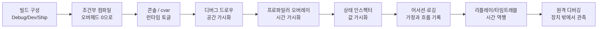
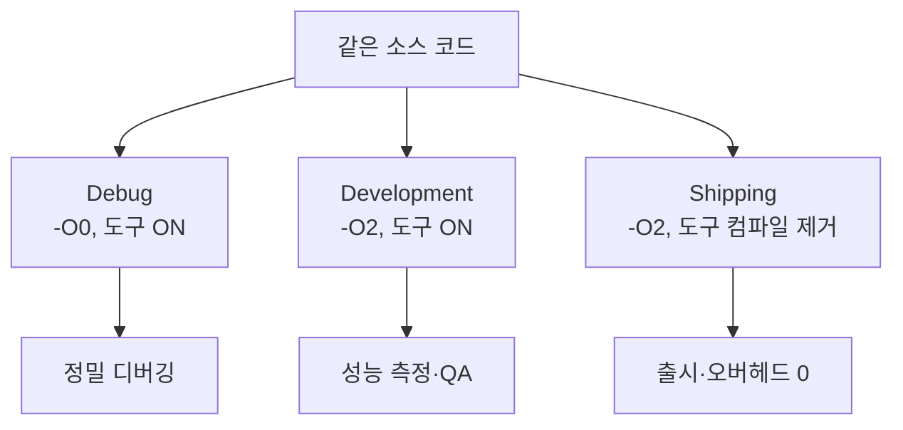
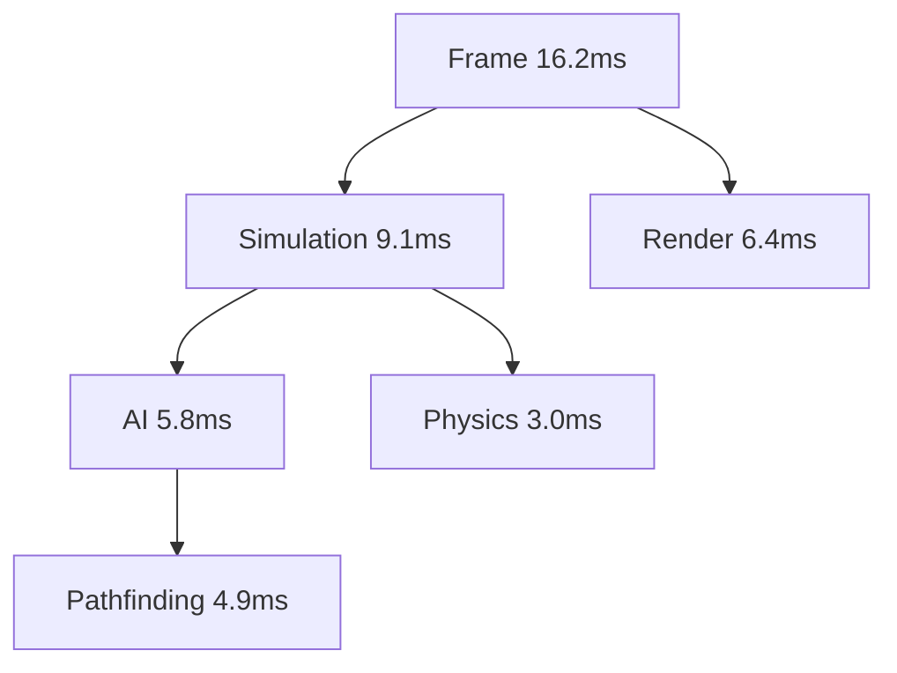
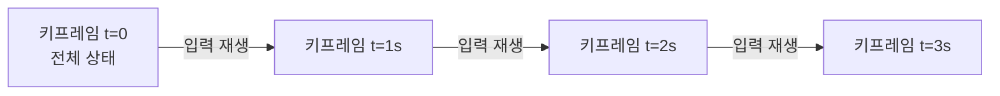
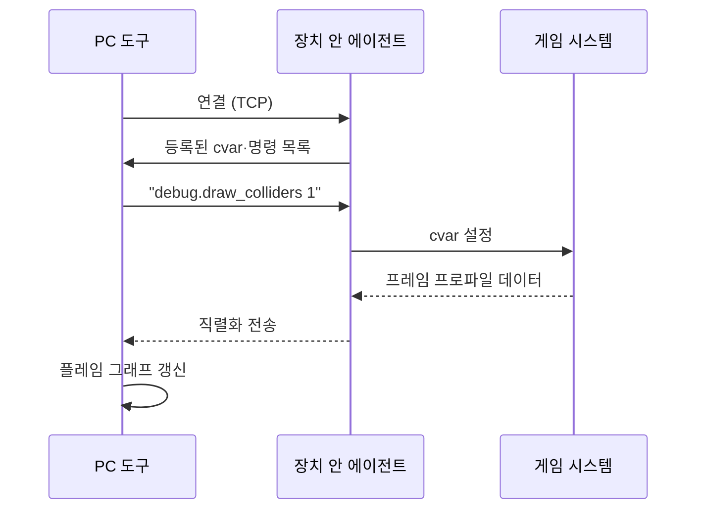

## 들어가며

검증은 반례를 찾는 데서 끝나지 않는다. 반례가 발생한 실행을 설명하고 재현하려면 보이지 않는 상태 변화를 관찰 가능한 증거로 바꾸는 디버그 인프라가 필요하다. 게임은 매 프레임 수만 개의 상태 변화, 수백 개의 객체 갱신, 수십 개의 시스템 상호작용을 일으키며 흐른다. 정상일 때는 화면에 결과만 나오고, 버그일 때는 그 결과가 잘못 나올 뿐 *이유는 어디에도 적혀 있지 않다*. 디버그 도구의 목적은 그 흐름 한가운데에 *관측 지점* 을 박아, 무엇이 어떤 값으로 어떻게 변했는지를 끄집어내는 것이다.

문제는 관측 자체가 공짜가 아니라는 데 있다. 모든 함수의 진입·종료를 기록하면 프레임 시간이 두 배가 되고, 모든 할당의 콜스택을 남기면 메모리가 폭증하며, 모든 변수를 네트워크로 흘려보내면 대역폭이 막힌다. 그래서 디버그 도구의 거의 모든 결정은 *가시성(visibility) ↔ 오버헤드(overhead)* 의 줄다리기 위에 놓인다. 무엇을 항상 보이게 하고, 무엇을 켤 때만 보이게 하며, 무엇을 출시 빌드에서 완전히 지울지 — 이 분배가 도구의 설계를 결정한다.



이 글은 그 트레이드오프를 따라 디버그 도구의 구성요소를 한 흐름으로 정리한다. 빌드 구성과 조건부 컴파일이 어떻게 오버헤드를 빌드별로 0까지 깎는지, 인게임 콘솔과 cvar이 어떻게 런타임에 가시성을 켜고 끄는지, 디버그 드로우 인프라가 공간 상태를 어떻게 그려내는지, 프로파일러 오버레이가 시간 예산을 어떻게 보이게 하는지, 상태 인스펙터가 살아있는 값을 어떻게 들여다보는지, 어서션과 로깅이 가정과 흐름을 어떻게 남기는지, 리플레이와 타임트래블이 어떻게 재현 불가능한 버그를 붙잡는지, 그리고 원격 디버깅이 어떻게 장치 밖에서 이 모두에 접근하는지를 다룬다.


---

## 목차

1. 빌드 구성과 조건부 컴파일
2. 인게임 콘솔과 cvar
3. 디버그 드로우 인프라
4. 프로파일러 오버레이
5. 상태 인스펙터
6. 어서션과 로깅
7. 리플레이와 타임트래블
8. 원격 디버깅

---

## 1. 빌드 구성과 조건부 컴파일

### 세 가지 빌드 구성

디버그 도구의 오버헤드 문제는 출시 빌드에서 *코드 자체를 없애면* 사라진다. 이를 위해 게임 프로젝트는 보통 세 가지 빌드 구성을 둔다. 이름은 엔진마다 다르지만 역할은 같다.

| 구성 | 최적화 | 디버그 코드 | 어서션 | 용도 |
|---|---|---|---|---|
| Debug | 없음 (`-O0`) | 전부 활성 | 전부 | 단계별 디버깅, 정확한 변수 추적 |
| Development | 켬 (`-O2`) | 활성 | 전부 | 실제 성능에 가깝게 도구 사용 |
| Shipping | 켬 (`-O2`) | 컴파일 제거 | 치명적만 또는 제거 | 출시본, 오버헤드 0 |

핵심은 *Development 구성* 이다. Debug 빌드는 최적화가 꺼져 있어 프레임 시간이 실제와 동떨어진다 — 60FPS 게임이 Debug에서 15FPS로 기어 다니면 성능 버그를 재현할 수 없다. 그래서 일상적인 개발과 프로파일링은 *최적화는 켜되 디버그 도구는 살아있는* Development 빌드에서 한다. Debug는 미세한 단계 실행이 필요할 때만 쓴다.



### 조건부 컴파일로 오버헤드를 0으로

디버그 도구 코드를 빌드별로 켜고 끄는 수단이 *조건부 컴파일(conditional compilation)* 이다. 전처리기 매크로로 코드 블록을 감싸, Shipping 빌드에서는 *컴파일 단계에서 통째로 제거* 한다. 런타임 `if` 분기와 다르다 — 분기는 검사 비용이라도 남지만, 조건부 컴파일은 *기계어에 단 한 바이트도 남지 않는다*.

```cpp
// 빌드 구성이 정의하는 매크로
#if defined(BUILD_DEBUG)
    #define DEBUG_TOOLS_ENABLED 1
#elif defined(BUILD_DEVELOPMENT)
    #define DEBUG_TOOLS_ENABLED 1
#else  // BUILD_SHIPPING
    #define DEBUG_TOOLS_ENABLED 0
#endif

#if DEBUG_TOOLS_ENABLED
    #define DEBUG_ONLY(x) x
#else
    #define DEBUG_ONLY(x)   // 인자가 사라진다 — 컴파일에서 제거
#endif
```

이 `DEBUG_ONLY` 한 줄이 도구 전체의 토대다. 디버그 드로우 호출, 프로파일러 마커, 인스펙터 등록을 전부 이 매크로로 감싸면, Shipping 빌드에서는 *호출 자체가 존재하지 않는다*. 함정은 매크로 안에 *부작용 있는 코드* 를 넣는 것이다.

```cpp
// 위험: enemyCount 증가가 Shipping에서 사라진다
DEBUG_ONLY(DrawDebugSphere(pos, ComputeAndRegister(++enemyCount)));

// 안전: 부작용을 매크로 밖으로
int count = ComputeCount();
DEBUG_ONLY(DrawDebugSphere(pos, count));
```

매크로 안의 표현식이 사라져도 게임 로직이 동일하게 동작해야 한다는 것이 철칙이다. 부작용은 항상 매크로 밖에 둔다.

### 빌드 간 동작 차이라는 함정

조건부 컴파일의 가장 위험한 실패는 *빌드 구성에 따라 게임이 다르게 동작* 하는 것이다. 디버그 코드가 게임 상태를 건드리면, Development에서는 멀쩡한 버그가 Shipping에서만 터진다 — 그리고 Shipping에는 그걸 잡을 도구가 없다.

```cpp
// 재앙: 디버그 검증이 상태를 정규화하면, Shipping에서만 비정규 값이 남는다
DEBUG_ONLY(transform.rotation = transform.rotation.Normalized());  // 절대 금지

// 디버그 코드는 관측만 한다 — 검증은 어서션으로
DEBUG_ONLY(Assert(transform.rotation.IsNormalized()));
```

규칙은 단순하다. *디버그 코드는 읽기 전용이다*. 게임 상태를 절대 쓰지 않고, 난수 시드를 소비하지 않으며, 실행 순서에 의존하는 부작용을 만들지 않는다. 이 규칙을 어기면 "내 PC에선 되는데 빌드 서버에선 안 됨"이라는, 디버그 도구가 *만들어낸* 버그를 추적하게 된다.

### 심볼과 스트리핑

Shipping 빌드는 *심볼 정보(symbol information)* — 함수명·변수명·소스 줄 매핑 — 를 실행 파일에서 떼어내 별도 파일로 보관한다. 실행 파일은 작아지고 역공학이 어려워지지만, 크래시가 났을 때 *심볼 파일과 대조* 해야 콜스택을 사람이 읽는 함수명으로 복원할 수 있다. 빌드 파이프라인은 매 출시 빌드의 심볼 파일을 *빌드 번호로 보관* 해, 현장에서 올라온 크래시 주소를 나중에 함수명으로 되살린다. 심볼을 잃으면 크래시 리포트는 의미 없는 주소 나열이 된다.

## 2. 인게임 콘솔과 cvar

### 런타임 토글이 필요한 이유

조건부 컴파일이 *빌드 시점* 의 가시성 스위치라면, 콘솔과 cvar은 *런타임* 의 스위치다. Development 빌드 안에 도구는 다 들어 있지만, 그걸 *전부 항상 켜면* 화면이 디버그 정보로 뒤덮이고 프레임이 느려진다. 필요한 것만, 필요할 때, 게임을 재시작하지 않고 켜는 수단이 *콘솔 변수(console variable, cvar)* 다.

### cvar의 구조

cvar은 *이름으로 접근하는 전역 설정값* 이다. 코드 어디서나 값을 읽고, 콘솔에서 이름으로 바꾼다.

```cpp
enum class CVarFlags {
    None     = 0,
    Cheat    = 1 << 0,   // 치트 — 멀티플레이/Shipping에서 잠금
    ReadOnly = 1 << 1,   // 읽기 전용 (빌드 정보 등)
    Saved    = 1 << 2,   // 설정 파일에 저장
};

struct CVar {
    const char*  name;
    float        value;
    float        defaultValue;
    CVarFlags    flags;
    const char*  help;

    CVar(const char* n, float v, float d, CVarFlags f, const char* h)
        : name(n), value(v), defaultValue(d), flags(f), help(h) {
        CVarRegistry::Get().Add(this);      // 생성 시 레지스트리에 자기 자신을 등록
    }
};

// 정적 등록 — 전역 객체 생성 시 레지스트리에 자동 추가
static CVar cv_drawColliders { "debug.draw_colliders", 0.0f, 0.0f,
                               CVarFlags::None, "충돌체 와이어프레임 표시" };
```

코드는 `cv_drawColliders.value > 0.5f`로 값을 읽고, 콘솔에서 `debug.draw_colliders 1`로 켠다. 등록을 *정적 초기화* 로 하면, 각 시스템이 자기 cvar을 자기 파일에서 선언하고, 레지스트리는 프로그램 시작 시 자동으로 모인다. 중앙 목록을 손으로 관리하지 않는다.

### 콘솔 — 명령 파싱과 디스패치

콘솔은 입력 문자열을 *명령(command)* 또는 *cvar 대입* 으로 해석한다. 첫 토큰이 등록된 명령이면 호출하고, cvar이면 값을 읽거나 쓴다.

```cpp
void Console::Execute(const std::string& line) {
    auto tokens = Tokenize(line);          // 공백 분리, 따옴표 처리
    if (tokens.empty()) return;
    const std::string& head = tokens[0];

    if (CVar* cv = registry.FindCVar(head)) {
        if (tokens.size() == 1) {
            Print("%s = %g  (기본 %g)  %s", cv->name, cv->value,
                  cv->defaultValue, cv->help);   // 값 조회
        } else {
            if (IsCheatLocked(cv)) { Print("치트 잠금: %s", cv->name); return; }
            cv->value = std::stof(tokens[1]);     // 값 설정
        }
    } else if (Command* cmd = registry.FindCommand(head)) {
        cmd->Invoke(tokens);                       // 명령 실행
    } else {
        Print("알 수 없는 명령: %s", head.c_str());
    }
}
```

명령은 인자를 받는 함수다 — `teleport 100 0 50`, `spawn enemy_heavy 3`, `give all`. cvar은 *상태를 바꾸는 값* 이고, 명령은 *동작을 일으키는 함수* 라는 구분이 깔끔하다.

### 치트와 Shipping 잠금

콘솔은 강력해서, 그대로 두면 플레이어가 무적·순간이동·아이템 복제를 켤 수 있다. 그래서 cvar에 *Cheat 플래그* 를 둔다. 치트 cvar은 싱글플레이 개발 빌드에서만 자유롭고, 멀티플레이에 접속하거나 Shipping 빌드에서는 *잠긴다*. 무적이나 시간 정지 같은 게임플레이 변경은 치트로 분류하고, 관측 전용이라도 다른 플레이어의 상태를 드러내는 드로우(적 위치·충돌체·시야·경로)는 멀티플레이에서 치트로 분류해 잠근다 — 벽 너머로 보이는 순간 그것은 ESP다. 자기 소유 객체나 렌더 통계처럼 상대 정보를 노출하지 않는 토글만 비치트로 둔다.

조건부 컴파일과의 관계도 정리된다. *오버헤드가 큰 도구* (예: 메모리 추적, 프로파일러)는 cvar 토글에 더해 `DEBUG_TOOLS_ENABLED`로 감싸 Shipping에서 코드째 빼고, *오버헤드가 작고 켜둘 일이 거의 없는* 토글만 Shipping에 cvar로 남긴다. 콘솔 자체도 Shipping에서는 보통 컴파일 제거하거나 비밀번호로 잠근다.

### 자동완성과 히스토리

콘솔의 실용성은 *입력 편의* 에서 갈린다. 등록된 cvar·명령은 모두 레지스트리에 있으므로, 접두사로 후보를 추려 자동완성한다. `debug.dr`까지 치면 `debug.draw_colliders`, `debug.draw_nav`가 뜬다. 이전 명령 히스토리(위 화살표)와 결합하면, 반복 디버깅에서 같은 명령을 다시 칠 필요가 없다. 자동완성 후보 목록은 cvar에 박은 `help` 문자열을 함께 보여줘, 이름만으로 용도를 짐작하게 한다.

## 3. 디버그 드로우 인프라

### 공간 상태를 보이게

게임의 많은 버그는 *공간* 에 있다. AI가 왜 저 벽으로 걸어가는지, 충돌체가 메시와 왜 어긋났는지, 레이캐스트가 어디까지 닿았는지는 숫자로 보면 안 보이고 *그려보면 즉시 보인다*. 디버그 드로우 인프라는 코드 어디서나 *한 줄로 선·구·박스·텍스트를 월드에 찍는* 수단이다.

```cpp
// 어디서든, 어떤 시스템에서든 한 줄로
DebugDraw::Line(start, end, Color::Red);
DebugDraw::Sphere(enemyPos, attackRadius, Color::Yellow);
DebugDraw::Box(collider.center, collider.extents, Color::Green);
DebugDraw::Text3D(npcPos, "state: PATROL", Color::White);
```

### 즉시 모드 큐와 배칭

디버그 드로우의 구조는 *즉시 모드 큐(immediate-mode queue)* 다. 각 호출은 그리지 않고 *명령을 큐에 쌓을 뿐* 이고, 프레임 끝에 한꺼번에 렌더링한다. 이렇게 하면 호출자는 렌더 상태를 신경 쓸 필요 없이 게임플레이 코드 어디서나 그릴 수 있다.

```cpp
struct DebugLineVert { Vec3 pos; uint32_t color; };

class DebugDrawQueue {
    std::vector<DebugLineVert> lines_;        // 선분 정점 (쌍으로)
    std::vector<DebugTextCmd>  texts_;
public:
    void Line(Vec3 a, Vec3 b, uint32_t c) {
        lines_.push_back({a, c});
        lines_.push_back({b, c});             // 그리지 않고 쌓기만
    }
    void Flush(Renderer& r) {
        r.DrawLineBatch(lines_);              // 프레임당 1회 드로우 콜
        for (auto& t : texts_) r.DrawText(t);
        lines_.clear(); texts_.clear();       // 다음 프레임을 위해 비움
    }
};
```

핵심은 *배칭(batching)* 이다. 디버그 선분 수천 개를 하나하나 그리면 드로우 콜이 폭발하지만, 모두 한 정점 버퍼에 모아 *한 번의 드로우 콜* 로 그리면 오버헤드가 크게 준다. 구·원·박스 같은 도형은 내부적으로 선분 집합으로 분해해 같은 선분 배치에 합류시킨다.

### 지속성 — 한 프레임 대 N초

디버그 드로우의 큰 함정은 *언제 사라지는가* 다. 기본은 *한 프레임* 만 그리고 매 프레임 큐를 비우는 것이다 — 매 프레임 호출되는 코드에 박으면 계속 보인다. 그러나 *한 번만 실행되는 이벤트* (총알 발사, 충돌 발생)는 한 프레임만 그리면 *깜빡이고 사라져 눈으로 못 본다*. 그래서 *지속 시간(duration)* 을 둔다.

```cpp
struct DebugLineEntry {
    Vec3 a, b; uint32_t color;
    float remainingTime;     // 0이면 이번 프레임만, >0이면 N초간 유지
};

void Tick(float dt) {
    for (auto& e : persistentLines_) e.remainingTime -= dt;
    std::erase_if(persistentLines_,
                  [](const DebugLineEntry& e){ return e.remainingTime <= 0; });
}
```

`DebugDraw::Line(a, b, color, 3.0f)`은 *3초간 유지* 된다. 순간적으로 발생하는 레이캐스트 결과나 충돌 지점을 잡을 때 필수다. 단, 지속 항목이 쌓이면 화면이 난장판이 되고 정점 버퍼가 커지므로, 지속 시간은 *짧게* 두고 콘솔에서 일괄 비우는 명령(`debug.clear`)을 둔다.

### 깊이 테스트와 가시성

디버그 도형을 *깊이 테스트(depth test)* 와 함께 그릴지가 또 하나의 선택이다. 깊이 테스트를 켜면 도형이 벽 뒤로 가려진다 — 실제 공간감과 맞지만, *벽 뒤의 충돌체를 보려고 디버그를 켰는데 안 보이는* 모순이 생긴다. 그래서 보통 두 패스를 둔다. 깊이 테스트를 켠 패스(가려지는 도형, 진한 색)와 끈 패스(항상 보이는 도형, 흐린 색)를 *겹쳐 그려*, 가까운 것은 선명하고 가린 것은 흐릿하게 보이게 한다. cvar로 모드를 전환해 상황에 맞춘다.

### 2D 오버레이와 텍스트

3D 월드 드로우와 별개로, *화면 공간 2D 오버레이* 가 필요하다 — 프레임 시간 숫자, 활성 객체 수, 좌상단 상태 텍스트. 3D 텍스트(`Text3D`)는 월드 좌표를 화면으로 투영해 그리고, 2D 텍스트(`Text2D`)는 픽셀 좌표에 직접 그린다. 3D 텍스트는 *카메라 뒤에 있으면 그리지 않도록* 투영 후 클립 검사를 해야 한다 — 이를 빼먹으면 뒤쪽 객체의 라벨이 화면에 뒤집혀 나타난다.

## 4. 프로파일러 오버레이

### 시간 예산을 보이게

게임은 *프레임 예산* 안에서 돈다 — 60FPS면 한 프레임에 16.6ms, 30FPS면 33.3ms. 이 예산을 누가 얼마나 쓰는지 보이지 않으면 최적화는 추측이 된다. 프로파일러는 *시간을 함수·시스템 단위로 쪼개* 어디에 얼마가 쓰였는지를 보인다.

### 인스트루멘테이션 — 스코프 타이머

가장 직접적인 방식은 *인스트루멘테이션(instrumentation)* 이다 — 측정할 코드 구간에 *직접 타이머를 박는다*. RAII 스코프 객체가 생성 시 시각을 찍고 소멸 시 경과를 기록하면, 중괄호 블록 하나가 곧 측정 구간이 된다.

```cpp
struct ScopeTimer {
    const char* name;
    uint64_t    start;
    ScopeTimer(const char* n) : name(n), start(NowTicks()) {}
    ~ScopeTimer() {
        uint64_t elapsed = NowTicks() - start;
        Profiler::Record(name, elapsed);   // 이름별 누적
    }
};

#define PROF_CAT_(a, b) a##b
#define PROF_CAT(a, b)  PROF_CAT_(a, b)    // 한 단계 더 거쳐야 __LINE__이 치환된다
#define PROFILE_SCOPE(name) DEBUG_ONLY(ScopeTimer PROF_CAT(timer_, __LINE__)(name))

void UpdateAI() {
    PROFILE_SCOPE("AI::Update");           // 이 블록의 시간이 "AI::Update"로 집계
    for (auto& agent : agents_) agent.Think();
}
```

`PROFILE_SCOPE`를 `DEBUG_ONLY`로 감쌌으므로 Shipping에서는 *타이머가 통째로 사라진다*. 측정 자체의 오버헤드 — `NowTicks` 호출과 기록 — 가 Development 빌드의 프레임 시간에 더해지지만, 측정 구간을 *시스템 단위의 굵은 입자* 로 두면 이 오버헤드는 무시할 수준이다. 함정은 *너무 잘게* 박는 것이다. 매 객체, 매 함수에 타이머를 박으면 측정 비용이 측정 대상을 넘어 *측정이 결과를 왜곡* 한다.

### 샘플링 대 트레이싱

측정에는 두 철학이 있다.

| 방식 | 원리 | 오버헤드 | 정확도 | 용도 |
|---|---|---|---|---|
| 인스트루멘테이션(트레이싱) | 박은 지점마다 정확히 기록 | 지점 수에 비례 | 박은 곳은 정확 | 시스템별 예산 분해 |
| 샘플링(sampling) | 주기적으로 콜스택 스냅샷 | 낮음·일정 | 통계적 | 코드 전역 핫스팟 탐색 |

인스트루멘테이션은 *박은 곳만* 보이고 안 박은 곳은 안 보인다. 샘플링은 일정 주기(예: 1ms)마다 *현재 콜스택을 통째로 떠* 어느 함수가 자주 잡히는지로 핫스팟을 찾는다 — 코드를 손대지 않고 전역을 보지만 결과가 통계적이라 *드물게 비싼 호출* 을 놓칠 수 있다. 실무는 둘을 병행한다 — 인스트루멘테이션으로 시스템별 큰 그림을, 샘플링으로 그 안의 핫스팟을 본다.

### 계층 타이밍과 프레임 그래프

스코프 타이머는 중첩되므로, 측정 결과는 자연히 *트리* 가 된다 — `Frame` 아래 `AI::Update`, 그 아래 `Pathfinding`. 이 트리를 시간 폭으로 그린 것이 *프레임 그래프(frame graph)* 다. 각 막대의 가로 길이가 소요 시간이고, 세로 깊이가 호출 계층이다.



이 그림에서 한눈에 드러나는 것은 *Pathfinding이 AI의 거의 전부* 이며 *AI가 시뮬레이션의 병목* 이라는 사실이다. 막대 하나의 가로 길이가 곧 최적화 우선순위다. 넓은 막대부터 파고들면 적은 노력으로 큰 시간을 회수한다.

### 오버레이와 히스토리 그래프

프로파일러 오버레이는 두 가지를 화면에 띄운다. 하나는 *현재 프레임의 분해* (위 트리), 다른 하나는 *최근 N프레임의 프레임 시간 그래프* 다. 프레임 시간 히스토리는 *스파이크(spike)* 를 잡는 데 결정적이다 — 평균은 16ms인데 가끔 40ms로 튀는 *히치(hitch)* 는 평균값만 보면 안 보이고, 시간축 그래프의 *뾰족한 막대* 로만 드러난다.

```cpp
struct FrameHistory {
    static constexpr int N = 240;     // 약 4초 (60FPS 기준)
    float times[N];                   // 링 버퍼
    int   head = 0;
    void Push(float ms) { times[head] = ms; head = (head + 1) % N; }
    float Max() const { return *std::max_element(times, times + N); }
};
```

스파이크를 봤으면, 그 프레임에서 *어느 막대가 튀었는지* 를 본다. 매 프레임 GC가 도는지, 특정 에셋 로드가 메인 스레드를 막는지, 적이 일정 수를 넘으면 경로 탐색이 폭발하는지 — 히스토리 그래프가 *언제* 를, 프레임 그래프가 *무엇* 을 가리킨다.

### GPU 측정의 비동기성

CPU 측정과 달리 GPU 측정은 *비동기* 라 까다롭다. CPU가 드로우 명령을 큐에 넣는 시각과 GPU가 그걸 실제로 실행하는 시각이 다르다. GPU 시간을 재려면 *타임스탬프 쿼리(timestamp query)* 를 명령 스트림에 삽입하고, *몇 프레임 뒤* 에 결과를 회수한다. 그래서 GPU 프로파일 결과는 보통 *2~3프레임 지연* 되어 표시된다. 이 지연을 모르고 CPU·GPU 시간을 같은 프레임의 것으로 나란히 읽으면 잘못된 결론에 닿는다.

## 5. 상태 인스펙터

### 살아있는 값을 들여다보기

프로파일러가 *시간* 을 보인다면, 인스펙터는 *값* 을 보인다. 실행 중인 게임의 객체 — 플레이어 위치, AI 상태, 인벤토리 내용, 시스템 설정 — 를 *멈추지 않고* 화면에서 읽고, 때로는 바꾼다. "이 적의 HP가 지금 얼마지?"를 코드에 로그를 박아 재컴파일하지 않고, 인스펙터 패널에서 즉시 본다.

### 리플렉션 — 타입을 런타임에 아는 법

인스펙터의 토대는 *리플렉션(reflection)* 이다 — 객체의 필드 이름·타입·주소를 *런타임에 열거* 하는 능력. C++은 리플렉션이 언어에 없으므로, 매크로나 코드 생성으로 *타입 메타데이터* 를 직접 만든다.

```cpp
struct FieldInfo {
    const char* name;
    const char* typeName;
    size_t      offset;      // 객체 시작에서의 바이트 오프셋
    enum Kind { Float, Int, Bool, Vec3, String } kind;
};

#define REFLECT_BEGIN(T) const FieldInfo* T::Fields(int& n) { \
    static FieldInfo f[] = {
#define FIELD(T, type, member, kind) \
    { #member, #type, offsetof(T, member), FieldInfo::kind },
#define REFLECT_END() }; n = sizeof(f)/sizeof(f[0]); return f; }

// 사용
REFLECT_BEGIN(Enemy)
    FIELD(Enemy, float, hp,       Float)
    FIELD(Enemy, Vec3,  position, Vec3)
    FIELD(Enemy, bool,  isAlert,  Bool)
REFLECT_END()
```

이렇게 등록하면 인스펙터는 타입을 *몰라도* 필드를 순회한다. 객체 포인터와 `FieldInfo` 배열만 있으면, 각 필드의 오프셋으로 값을 읽어 이름과 함께 그린다.

```cpp
void DrawInspector(void* obj, const FieldInfo* fields, int n) {
    for (int i = 0; i < n; ++i) {
        const FieldInfo& f = fields[i];
        void* addr = (char*)obj + f.offset;       // 필드 주소 계산
        switch (f.kind) {
            case FieldInfo::Float:
                ImGui::DragFloat(f.name, (float*)addr); break;   // 읽고 쓰기
            case FieldInfo::Bool:
                ImGui::Checkbox(f.name, (bool*)addr); break;
            case FieldInfo::Vec3:
                ImGui::DragFloat3(f.name, (float*)addr); break;
            // ...
        }
    }
}
```

### 읽기와 쓰기의 위험

인스펙터가 *쓰기* 까지 허용하면 강력하지만 위험하다. 위젯이 객체 필드를 직접 수정하면 — `Enemy::hp`를 슬라이더로 0으로 — 게임은 *코드를 거치지 않은 상태 변경* 을 겪는다. 이는 디버깅에 유용하지만, *불변식(invariant)을 깰* 수 있다. 예를 들어 `hp`를 음수로 쓰면, hp가 음수일 리 없다고 가정한 코드가 미정의 동작을 한다.

해법은 *경계를 위젯에 박는* 것이다 — 슬라이더의 최소·최대를 필드 메타데이터에 함께 등록한다. 또한 쓰기 가능 인스펙터는 *치트로 분류* 해 Shipping·멀티플레이에서 잠근다. 관측(읽기)은 쓰기보다 위험이 작지만 — 상대 정보를 드러내는 관측은 2절에서 본 대로 그 자체가 치트로 분류된다 — 조작(쓰기)은 게임 결과를 직접 바꾸기 때문이다.

### 선택과 계층 탐색

인스펙터의 실용성은 *무엇을 들여다볼지 고르는* 방법에 달렸다. 두 경로가 흔하다. 하나는 *씬 계층 트리* 에서 객체를 클릭해 선택하는 것이고, 다른 하나는 *화면에서 직접 객체를 클릭* (피킹, picking)해 선택하는 것이다. 피킹은 마우스 광선을 월드로 쏴 맞는 객체를 찾는다 — 3절의 디버그 드로우와 결합하면, 선택한 객체를 *하이라이트 박스* 로 강조해 "지금 보고 있는 게 이 객체"임을 확인시킨다.

객체가 다른 객체를 참조하면(적이 자기 타겟을 가리키면), 인스펙터는 그 참조를 *클릭 가능한 링크* 로 그려 계층을 따라간다. 이렇게 객체 그래프를 인스펙터 안에서 항해한다.

### 워치와 그래프

특정 값을 *시간에 따라* 보고 싶을 때가 있다 — 프레임마다 플레이어 속도가 어떻게 변하는지. 인스펙터에 *워치(watch)* 를 걸면 그 값을 매 프레임 샘플링해 *작은 선 그래프* 로 그린다. 순간값으로는 안 보이는 *진동·드리프트·튐* 이 그래프에서 드러난다. 카메라가 미세하게 떨리는 버그는 위치 값의 워치 그래프에서 *톱니 패턴* 으로 즉시 보인다.

## 6. 어서션과 로깅

### 어서션 — 가정을 코드에 박기

*어서션(assertion)* 은 "여기서 이 조건은 참이어야 한다"는 가정을 코드에 박고, 거짓이면 *즉시 멈추는* 장치다. 버그를 *증상이 나타난 곳* 이 아니라 *가정이 깨진 곳* 에서 잡는다 — 널 포인터를 100줄 뒤에서 역참조해 크래시하는 대신, 널이 들어온 *그 자리* 에서 멈춘다.

```cpp
#if DEBUG_TOOLS_ENABLED
    #define ASSERT(cond, msg) \
        do { if (!(cond)) { \
            ReportAssert(#cond, msg, __FILE__, __LINE__); \
            DebugBreak();    /* 디버거를 그 줄에 멈춘다 */ \
        } } while(0)
#else
    #define ASSERT(cond, msg) ((void)0)   // Shipping: 사라진다
#endif

void Damage(Entity* target, float amount) {
    ASSERT(target != nullptr, "Damage 대상이 널이다");
    ASSERT(amount >= 0.0f, "음수 데미지");
    target->hp -= amount;
}
```

`DebugBreak`는 디버거가 붙어 있으면 *바로 그 줄에 멈춰* 콜스택과 변수를 그대로 보여준다. 어서션 실패는 *프로그래머의 오류* 를 가리킨다 — 사용자 입력 오류나 파일 없음 같은 *예상 가능한 실패* 는 어서션이 아니라 정상적인 오류 처리로 다룬다. 어서션은 "절대 일어나면 안 되는 일"에만 쓴다.

### 어서션의 비용과 Shipping 처리

어서션은 *조건 검사 비용* 을 가진다. 핫 루프 안의 어서션은 Development 빌드를 느리게 한다. 그래서 어서션을 두 등급으로 나눈다. 일반 `ASSERT`는 Development까지만 살리고, 핫 루프용 `SLOW_ASSERT`는 Debug 빌드에서만 산다 — 비싼 검사(전체 배열 정렬 검증 등)는 후자에 둔다.

Shipping에서 어서션을 *완전히 제거할지* 가 또 하나의 결정이다. 제거하면 오버헤드는 0이지만, 출시본에서 가정이 깨졌을 때 *조용히 잘못된 상태로 계속 굴러* 더 큰 손상이 난다. 절충은 *치명적 어서션만 Shipping에 남기되 동작을 바꾸는* 것이다 — 멈추는 대신 *로그를 남기고 크래시 리포트를 보내고 안전하게 종료* 한다.

### 정적 어서션 — 컴파일 타임 검증

런타임 어서션과 별개로, *정적 어서션(static assertion)* 은 *컴파일 시점* 에 검사해 거짓이면 *컴파일을 실패* 시킨다. 런타임 비용이 0이다 — 검사가 빌드 단계에서 끝나기 때문이다.

```cpp
static_assert(sizeof(PacketHeader) == 16, "패킷 헤더가 16바이트가 아니다");
static_assert(MAX_PLAYERS <= 64, "플레이어 상한 초과");
```

구조체 크기, 정렬, 상수 범위처럼 *컴파일 타임에 알 수 있는* 불변식은 정적 어서션으로 못 박는다. 누군가 헤더에 필드를 추가해 패킷 크기가 바뀌면 *빌드가 즉시 실패* 해, 런타임에 직렬화가 깨지기 전에 잡힌다.

### 로깅 — 시간을 따라 흐른 흔적

어서션이 *지점* 을 잡는다면, 로그는 *흐름* 을 남긴다. 재현하기 어려운 버그는 멈춰서 보기보다 *지나간 로그* 를 거슬러 읽어 추적한다. 로그는 *레벨(level)* 과 *카테고리(category)* 로 분류한다.

```cpp
enum class LogLevel { Verbose, Info, Warning, Error, Fatal };

#define LOG(category, level, fmt, ...) \
    DEBUG_ONLY(Logger::Write(category, LogLevel::level, fmt, ##__VA_ARGS__))

LOG("AI", Info,    "agent %d 상태 전환 PATROL→CHASE", agent.id);
LOG("Net", Warning,"패킷 지연 %dms", latency);
```

레벨은 *심각도* 다 — 평상시엔 Warning 이상만 출력하고, 특정 시스템을 파고들 때 그 카테고리만 Verbose로 내린다. 카테고리별 레벨을 cvar로 두면(`log.AI verbose`), *원하는 시스템의 로그만 콘솔에서 켠다*. 모든 로그를 항상 출력하면 *정작 중요한 줄이 묻히고* 디스크·콘솔 출력 자체가 프레임을 갉는다.

### 로깅의 성능과 구조화

로그의 함정은 *문자열 포매팅 비용* 이다. 출력하지 않을 로그도 인자를 포매팅하면 비용이 든다. 그래서 *레벨·카테고리 검사를 포매팅보다 먼저* 한다 — 출력 안 할 로그는 문자열을 만들지조차 않는다. 또한 핫 루프에서 매 프레임 로그를 찍으면 출력만으로 병목이 되므로, 로그는 *상태 변화 같은 이벤트* 에 두고 *연속 값* 은 인스펙터 워치(5절)로 본다.

도구가 로그를 *기계로 읽어야* 할 때는 *구조화 로깅(structured logging)* 을 쓴다 — 자유 문장이 아니라 키-값 필드로 남겨, 나중에 카테고리·시간·필드로 *필터·집계* 한다. 텔레메트리로 수집한 대량 로그를 분석할 때 사람이 읽는 문장보다 구조화된 필드가 검색에 유리하다.

## 7. 리플레이와 타임트래블

### 재현 불가능한 버그를 붙잡기

가장 다루기 힘든 버그는 *어쩌다 한 번* 나는 것이다 — 30분 플레이 중 단 한 번, 특정 입력 순서에서만 터지는 동기화 깨짐. 멈춰서 보려 해도 *다시 그 상태를 만들 수 없다*. 리플레이(replay)는 이 문제를 *입력을 기록해 그대로 재생* 함으로써 푼다.

### 결정론 — 리플레이의 전제

입력 기록만으로 재생하는 리플레이의 전제는 *결정론(determinism)* 이다. 같은 실행 계약 아래에서 `초기 상태 + tick별 명령 + 외부 사건`이 같아야 같은 상태열을 얻는다. 실행 계약에는 게임·콘텐츠·스크립트 버전, 설정, tick rate, 난수 스트림과 권위 서버가 전달한 사건도 포함된다. 이 조건이 성립하면 전체 상태를 매 tick 저장하지 않고 명령 스트림으로 재구성할 수 있지만, 용량은 플레이 시간·플레이어 수·명령률에 따라 계산해야 한다.

```cpp
struct InputFrame {
    uint32_t  frameNumber;
    uint16_t  buttons;        // 비트마스크
    int8_t    moveX, moveY;   // 아날로그 스틱
    uint32_t  rngSeed;        // 이 프레임의 난수 시드
};

class ReplayRecorder {
    std::vector<InputFrame> frames_;
public:
    void Record(const InputFrame& f) { frames_.push_back(f); }
    // 재생: 게임 입력 시스템 대신 기록된 프레임을 먹인다
    InputFrame Playback(uint32_t frame) { return frames_[frame]; }
};
```

결정론을 깨는 원인은 벽시계·OS 사건처럼 기록하지 않은 입력, 난수 소비 순서, 플랫폼별 부동소수점 계약, 가변 `dt`, 명세되지 않은 자료구조 순회와 병렬 작업 완료 순서다. 고정 시간 간격은 입력 시간축을 고정할 뿐 충분조건이 아니다. 매 frame RNG를 다시 seed하는 예제는 설명을 단순화한 것이며, 실제 시스템은 스트림별 초기 seed와 draw count를 고정하거나 난수 결과를 기록한다. frame seed 하나만 저장하면 코드 경로가 달라져 draw 수가 바뀐 경우를 복구하지 못한다.

### 결정론이 어려울 때 — 상태 스냅샷

완전한 결정론은 비싸거나 달성 범위가 제한될 수 있다. 이때 주기적 *상태 스냅샷(state snapshot)* 으로 seek 시작점과 발산 구간을 짧게 만든다. 아래 1초 간격은 예시일 뿐이며 snapshot 크기와 목표 seek latency로 정한다. 중요한 제한은 **스냅샷 사이를 입력만으로 정확히 재구성하려면 그 구간은 여전히 결정적이어야 한다**는 점이다. 그렇지 않다면 물리 접촉 결과·비동기 완료·서버 snapshot 같은 비결정 결과를 추가로 기록하거나, 상태 delta를 더 촘촘히 저장해야 한다.



이 구조는 *임의 시점으로 점프* 를 가능하게 한다 — t=2.5s를 보려면 가장 가까운 키프레임(t=2s)을 복원하고 0.5초분 입력만 재생한다. 키프레임 간격이 *저장 용량 ↔ 점프 속도* 의 트레이드오프다. 촘촘하면 점프가 빠르지만 용량이 크고, 성기면 반대다.

### 타임트래블 — 뒤로 돌리기

상태 스냅샷이 쌓이면 *타임트래블(time-travel) 디버깅* 이 열린다 — 시간을 *뒤로 돌려* 버그 직전으로 가서, 다시 천천히 앞으로 재생하며 *무엇이 어디서 잘못됐는지* 본다. 버그를 본 순간 시간을 5초 되돌려, 디버그 드로우(3절)와 인스펙터(5절)를 켠 채 *한 프레임씩 전진* 한다.

```cpp
class TimeTravel {
    std::deque<StateSnapshot> ring_;     // 최근 N초의 키프레임
public:
    void StepBack(int frames) {
        uint32_t target = currentFrame_ - frames;
        RestoreNearestKeyframe(target);   // 가장 가까운 이전 키프레임 복원
        ReplayInputsTo(target);           // 거기서 target까지 입력 재생
        paused_ = true;                   // 멈춘 채로 검사
    }
    void StepForward() { AdvanceOneFrame(); }   // 한 프레임씩 전진
};
```

이것이 "방금 그게 왜 그랬지?"에 답한다. 일반 디버깅은 버그를 *다시 일으켜야* 보지만, 타임트래블은 *이미 일어난* 버그의 직전으로 돌아가 *느린 화면* 으로 다시 본다.

### 리플레이의 또 다른 쓸모

리플레이 인프라는 디버깅 너머로 쓰인다. 기록 세션의 상태 checksum과 불변식을 매 빌드에서 비교하면 회귀를 찾을 수 있다. 킬캠·관전은 lockstep 게임에서는 명령 스트림을, 서버 권위 게임에서는 서버 snapshot·event 스트림을 재생하는 편이 일반적이다. 단순히 로컬 입력만 기록하면 다른 플레이어와 서버 판정을 복원할 수 없다. 밸런스 분석용 로그는 재생에 필요한 정밀한 상태와 개인정보·저장 비용의 계약이 다르므로 별도 schema로 관리한다.

## 8. 원격 디버깅

### 장치 밖에서 관측해야 하는 이유

지금까지의 도구는 *게임이 도는 그 장치* 안에서 동작했다. 그러나 콘솔·모바일·VR은 *개발 PC가 아닌 별도 장치* 에서 돈다. 콘솔은 화면에 인스펙터를 띄울 여유가 없고, VR은 헤드셋을 쓴 채 콘솔을 칠 수 없으며, 모바일은 화면이 작다. *원격 디버깅(remote debugging)* 은 도구의 UI를 *개발 PC* 로 빼내, 게임은 장치에서 돌리되 *PC에서 관측·조작* 한다.

### 구조 — 장치 안 에이전트와 PC 도구

원격 디버깅의 골격은 *장치 안의 에이전트* 와 *PC의 도구* 가 네트워크로 통신하는 것이다. 에이전트는 게임 안에 박혀 프로파일 데이터·로그·인스펙터 값을 *직렬화해 전송* 하고, 명령을 받아 cvar을 바꾸거나 명령을 실행한다.



PC 도구가 보낸 콘솔 명령은 장치의 콘솔(2절)에 그대로 먹이고, 장치가 보낸 프로파일·인스펙터 데이터는 PC에서 4·5절의 UI로 그린다. 즉 *도구의 백엔드는 장치, 프런트엔드는 PC* 다.

### 전송 비용과 샘플링

원격 디버깅의 핵심 트레이드오프는 *전송 대역폭* 이다. 매 프레임 전체 인스펙터 상태(수천 필드)를 보내면 네트워크가 막히고, 그 직렬화·전송 자체가 *게임 프레임을 늦춰* 측정을 왜곡한다. 그래서 전송은 *선택적* 이다.

```cpp
void RemoteAgent::Tick() {
    // 매 프레임: 가벼운 요약만 (프레임 시간, 보이스 수 등)
    SendSummary(frameMs_, activeObjects_);

    // 인스펙터: PC가 "지금 보고 있는" 객체만 전송 (구독)
    for (ObjectId id : subscribedObjects_)
        SendInspectorData(id, SnapshotFields(id));

    // 프로파일 트리: N프레임에 1회, 또는 PC가 요청할 때만
    if (profileRequested_) { SendProfileTree(); profileRequested_ = false; }
}
```

원칙은 *PC가 보고 있는 것만 보낸다* 는 구독(subscription) 모델이다. 인스펙터에서 객체 하나를 열면 PC가 그 객체를 *구독* 하고, 에이전트는 *구독된 객체만* 매 프레임 전송한다. 보지 않는 수천 객체는 보내지 않는다. 이 선택적 전송이 대역폭과 측정 오염을 함께 줄인다.

### 끊김에 강한 프로토콜

원격 연결은 *불안정* 하다 — 무선 장치, 장치 재시작, 게임 크래시. 도구는 *연결이 끊겨도 무너지지 않아야* 한다. 에이전트와 도구는 *재연결 가능* 한 프로토콜을 쓴다 — 연결이 끊기면 도구는 재연결을 시도하고, 다시 붙으면 cvar·구독 상태를 *재동기화* 한다. 게임 쪽 에이전트는 *연결이 없어도 게임에 영향을 주지 않는다* — 전송할 도구가 없으면 데이터를 그냥 버린다. 원격 디버깅이 게임을 멈추게 하면 도구가 아니라 장애물이 된다.

### 크래시 회수

원격 인프라의 마지막 쓸모는 *크래시 회수* 다. 장치에서 게임이 죽으면, 에이전트는 죽기 직전까지의 *로그 버퍼·마지막 인스펙터 상태·크래시 콜스택* 을 PC나 수집 서버로 보낸다. 1절의 심볼 파일과 대조하면 콜스택이 함수명으로 복원되고, 직전 로그(6절)가 *무엇이 그 크래시로 이어졌는지* 의 흐름을 보인다. 재현 빌드가 결정론적이면(7절), 직전 입력 스트림을 받아 *크래시를 PC에서 그대로 재생* 한다 — 원격 디버깅이 앞 절들의 도구를 *장치 밖으로* 연결하는 마지막 고리다.


---

## 결론

디버그 도구의 모든 결정은 *가시성 ↔ 오버헤드* 의 줄다리기 위에 놓인다. 빌드 구성과 조건부 컴파일이 Shipping의 오버헤드를 0으로 깎고, 콘솔과 cvar이 Development 안에서 가시성을 골라 켜며, 디버그 드로우가 공간을, 프로파일러 오버레이가 시간을, 인스펙터가 값을 보이게 하고, 어서션과 로그가 가정과 흐름을 기록하며, 리플레이와 타임트래블이 재현 불가능한 버그를 붙잡고, 원격 디버깅이 이 모두를 장치 밖으로 연결한다 — 각각은 "무엇을 얼마나 보이게 하고 그 대가로 얼마를 낼지"의 선택이다.

이 트레이드오프를 다루는 두 축이 일관되게 흐른다. 하나는 *컴파일 시점의 제거* 다 — `DEBUG_ONLY`로 감싼 도구는 출시본에서 흔적 없이 사라지므로, 개발 중엔 마음껏 박고 출시엔 0으로 만든다. 다른 하나는 *런타임의 선택* 이다 — cvar 토글, 디버그 드로우 지속 시간, 프로파일러 입자 크기, 인스펙터 구독, 원격 전송 범위가 모두 "지금 필요한 것만" 보이게 해 측정이 측정 대상을 왜곡하지 않게 한다. 디버그 코드는 *읽기 전용* 이라는 철칙 — 게임 상태를 바꾸지 않는다 — 이 이 모든 것의 바닥에 깔린다.

도구가 잘 만들어지면 디버깅은 추측에서 관측으로 바뀐다. "왜 안 되지?"의 답이 코드를 다시 컴파일하기 전에, 화면의 디버그 드로우와 인스펙터와 프로파일러에 *이미 적혀 있다*. 그리고 그 도구들은 디버깅 너머로 번진다 — 리플레이는 자동 테스트와 관전이 되고, 텔레메트리는 밸런스 분석이 되며, 원격 인프라는 크래시 회수가 된다. 보이지 않는 것을 보이게 만드는 투자는 개발 내내 복리로 돌아온다.

## 더 읽을거리

- Dear ImGui 저장소 — 즉시 모드 GUI로 인스펙터·디버그 패널·오버레이를 구축하는 사실상의 표준.
- "Game Programming Patterns" (Robert Nystrom) — Service Locator·Command 패턴이 콘솔과 cvar 시스템의 구조에 닿는다.
- Tracy Profiler 문서 — 인스트루멘테이션·샘플링·GPU 타임스탬프·원격 전송을 함께 다루는 오픈 프로파일러.
- RenderDoc 문서 — GPU 프레임 캡처와 비동기 측정의 실제 구현 참고.
- rr(record-and-replay 디버거) 문서와 "1500 Archers on a 28.8"(Age of Empires, GDC 2001) — 결정론·리플레이·타임트래블 디버깅의 실제 구현과 산업 사례.
- Breakpad / Crashpad 문서 — 심볼 관리와 원격 크래시 회수 파이프라인의 오픈 구현.
