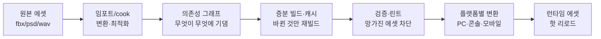
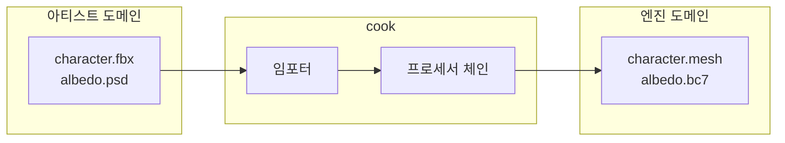
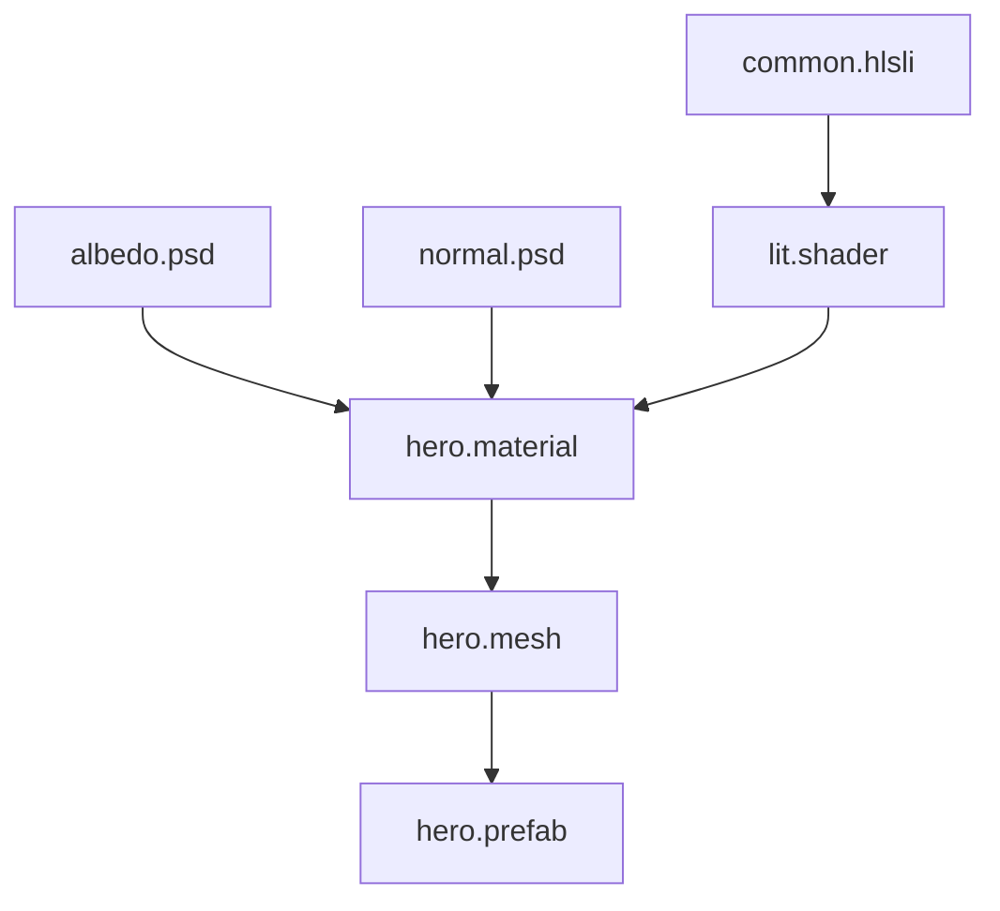
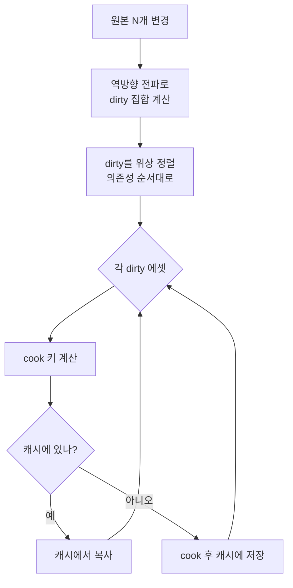
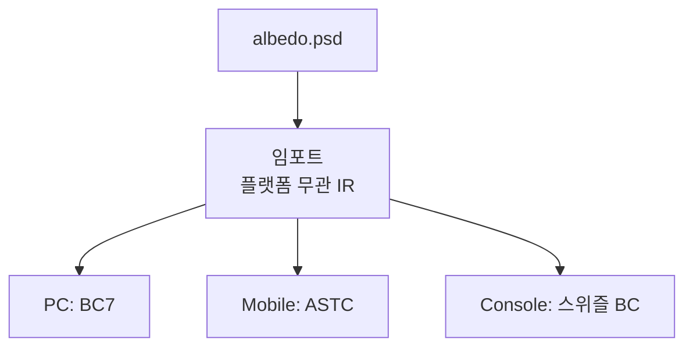
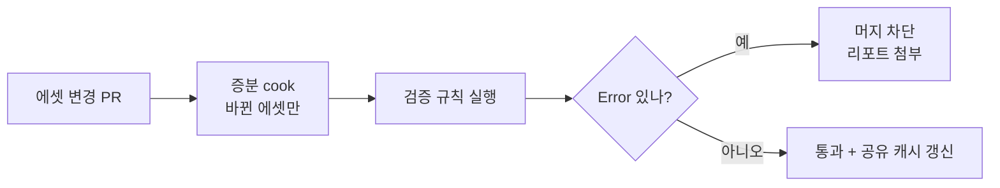
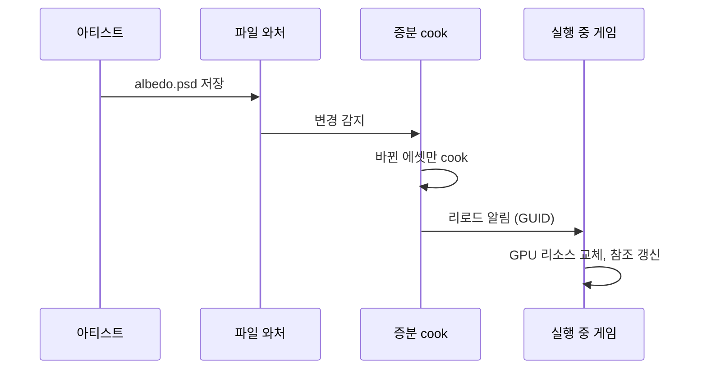

## 들어가며

에셋 파이프라인은 *반복 속도(iteration speed)* 와 *최종 품질* 사이의 끝없는 줄다리기다. 아티스트가 텍스처 하나를 고치고 게임 안에서 결과를 보기까지 걸리는 시간 — 이 *반복 루프* 가 짧을수록 콘텐츠 품질은 올라간다. 한 번 고쳐 보는 데 30초가 걸리면 하루에 수백 번을 돌려보지만, 5분이 걸리면 아티스트는 시도를 줄이고 "대충 이 정도면 됐다"에서 멈춘다. 반대로 최종 빌드의 품질 — 최적의 텍스처 압축, LOD, 셰이더 배리언트 — 은 *충분한 변환 시간* 을 요구한다. 풀 품질 변환은 느리고, 빠른 변환은 품질을 깎는다.

이 글은 그 트레이드오프를 따라 에셋 파이프라인의 구성요소를 한 흐름으로 정리한다. 원본 에셋이 어떻게 임포트되고 굽혀지는지(cook), 에셋들이 서로 어떤 의존성 그래프를 이루는지, 무엇이 바뀌었을 때 무엇만 다시 빌드해야 하는지(증분 빌드), 변환 결과를 어떻게 캐시하고 공유하는지, 고친 에셋을 게임을 끄지 않고 어떻게 갈아끼우는지(핫 리로드), 망가진 에셋을 어떻게 자동으로 걸러내는지(검증/린트), 같은 원본을 플랫폼마다 어떻게 다르게 굽는지, 그리고 이 모두를 버전 관리와 어떻게 엮는지를 다룬다.



이 글의 목표.

1. **파이프라인 아키텍처** — 임포터·프로세서 체인·cook의 구조와 결정론.
2. **의존성 그래프** — 에셋 간 기댐 관계, 무효화 전파, 순환 탐지.
3. **증분 빌드와 캐시** — 해시 기반 무효화, 로컬·공유 캐시, 분산 빌드.
4. **에셋별 변환** — 텍스처·메시·셰이더의 변환 비용과 품질 노브.
5. **플랫폼별 변환** — 같은 원본, 다른 굽기. 압축 포맷·셰이더 배리언트.
6. **메타데이터와 버전 관리** — 사이드카·임베디드, 대용량 바이너리, 결정론.
7. **검증·린트·CI** — 자동 규칙, 명명·예산, 빌드 게이트.
8. **핫 리로드와 운영** — 파일 와처, 참조 갱신, 상태 보존, 디버깅.


---

## 목차
1. [파이프라인 아키텍처](#1-파이프라인-아키텍처)
2. [의존성 그래프](#2-의존성-그래프)
3. [증분 빌드와 캐시](#3-증분-빌드와-캐시)
4. [에셋별 변환](#4-에셋별-변환)
5. [플랫폼별 변환](#5-플랫폼별-변환)
6. [메타데이터와 버전 관리](#6-메타데이터와-버전-관리)
7. [검증·린트·CI](#7-검증린트ci)
8. [핫 리로드와 운영](#8-핫-리로드와-운영)


---

## 1. 파이프라인 아키텍처

### 임포트와 cook의 분리

에셋은 두 가지 다른 표현으로 존재한다. *원본(source)* 은 아티스트의 도구가 뱉는 형식 — `.fbx`, `.psd`, `.wav` — 으로, 풍부한 메타데이터를 담지만 게임 런타임에는 비효율적이거나 아예 못 읽는다. *런타임 에셋(cooked/baked)* 은 엔진이 바로 메모리에 올려 쓰는 형식 — GPU 압축 텍스처, 인터리브된 버텍스 버퍼, 컴파일된 셰이더 바이트코드 — 으로, 작고 빠르지만 사람이 편집할 수 없다.

이 둘을 잇는 변환이 *cook* (혹은 *bake*, *import*)이다. cook은 원본을 읽어 플랫폼·품질 설정에 맞는 런타임 에셋을 굽는다. 원본은 *버전 관리에 들어가고 절대 게임에 실리지 않으며*, 런타임 에셋은 *cook의 출력일 뿐 버전 관리에 들어가지 않는다* — 언제든 원본에서 다시 구울 수 있어야 한다.



이 분리가 반복 속도와 품질의 트레이드오프를 *분리 가능한 두 축* 으로 만든다. 원본은 편집 친화적으로 유지하고, cook은 품질을 끌어올리는 데 시간을 쓰되, 캐시(3절)로 그 비용을 한 번만 치른다.

### 임포터 시스템

임포터는 *원본 형식 → 중간 표현(IR)* 변환을 담당한다. 형식마다 임포터가 하나씩 있고, 확장자나 파일 시그니처로 디스패치된다.

```cpp
class AssetImporter {
public:
    virtual bool CanImport(const std::string& ext) const = 0;
    // 원본을 읽어 엔진 중립 IR로 변환한다. 플랫폼 무관 단계.
    virtual ImportResult Import(const SourcePath& src,
                               const ImportSettings& settings) = 0;
};

// 등록: 확장자 → 임포터
class ImporterRegistry {
    std::unordered_map<std::string, AssetImporter*> byExt_;
public:
    AssetImporter* Find(const std::string& ext) {
        auto it = byExt_.find(ext);
        return it != byExt_.end() ? it->second : nullptr;
    }
};
```

임포터는 *플랫폼 무관* 단계여야 한다. `.fbx`를 읽어 메시 IR(버텍스·인덱스·본·머티리얼 참조)로 만드는 일은 PC든 콘솔이든 같다. 플랫폼별로 갈라지는 것 — GPU 텍스처 압축 포맷, 셰이더 타깃 — 은 *프로세서 체인* 의 뒷단으로 미룬다. 이 분리가 5절의 멀티플랫폼 굽기에서 *임포트 결과를 한 번 만들어 N개 플랫폼이 공유* 하게 한다.

### 프로세서 체인

임포트가 IR을 만들면, *프로세서(processor)* 들이 그 IR을 순차 변환한다. 각 프로세서는 입력 IR을 받아 변형된 IR을 내는 작은 단계다 — 메시 최적화, LOD 생성, 텍스처 밉맵 생성, 압축.

```cpp
struct ProcessorContext {
    Platform     target;          // 어떤 플랫폼으로 굽는가
    QualityLevel quality;         // 빠른 미리보기 vs 출시 품질
    AssetIR&     ir;              // in/out
    DependencyRecorder& deps;     // 이 단계가 읽은 입력을 기록 (2절)
};

class MeshOptimizer : public AssetProcessor {
public:
    void Process(ProcessorContext& ctx) override {
        OptimizeVertexCache(ctx.ir.mesh);     // 버텍스 캐시 지역성
        if (ctx.quality >= QualityLevel::Ship)
            GenerateLODs(ctx.ir.mesh);        // 출시 품질에서만 풀 LOD
    }
};
```

체인을 단계로 쪼개는 이유는 *재사용과 캐시* 다. "밉맵 생성" 프로세서는 모든 텍스처가 공유하고, 그 출력은 단계 단위로 캐시될 수 있다. 또한 `QualityLevel`이 *반복 속도와 품질을 노브 하나로 묶는다* — 아티스트가 작업 중일 때는 `Preview`(밉맵 생략, 빠른 압축)로 굽고, CI 빌드는 `Ship`(풀 LOD, 최고 압축)으로 굽는다. 같은 파이프라인, 다른 시간 예산.

### 결정론 — cook의 숨은 계약

cook은 *결정론적(deterministic)* 이어야 한다. 같은 원본 + 같은 설정 → *바이트 단위로 같은 출력*. 이 성질이 깨지면 3절의 캐시가 무의미해지고(같은 입력이 다른 출력을 내면 캐시 히트가 거짓이 된다), 분산 빌드에서 머신마다 다른 결과가 나오며, 버전 관리에서 "안 바꿨는데 diff가 생기는" 잡음이 끝없이 발생한다.

결정론을 깨는 흔한 원인은 다음과 같다.

| 원인 | 증상 | 대응 |
|---|---|---|
| 타임스탬프 임베딩 | 매 빌드마다 출력 변함 | cook 출력에 시각 넣지 않음 |
| 해시맵 순회 순서 | 머신·실행마다 순서 다름 | 정렬된 컨테이너로 직렬화 |
| 부동소수 비결정 | 컴파일러·CPU별 미세 차이 | 결정적 수학 또는 정수화 |
| 절대 경로 | 머신마다 경로 다름 | 프로젝트 상대 경로만 사용 |
| 멀티스레드 누적 순서 | 병렬 합산 순서 비결정 | 순서 독립 누적 또는 정렬 후 합산 |

결정론은 "있으면 좋은" 성질이 아니라 *증분 빌드의 전제조건* 이다. 캐시 키가 입력에서 출력을 예측한다고 믿으려면, 같은 입력이 같은 출력을 보장해야 한다.

## 2. 의존성 그래프

### 에셋은 서로 기댄다

에셋은 고립되지 않는다. 머티리얼은 텍스처와 셰이더를 참조하고, 메시는 머티리얼을 참조하며, 프리팹은 메시·머티리얼·사운드를 모은다. 텍스처 아틀라스는 여러 소스 텍스처에서 만들어지고, 셰이더는 여러 include 파일에서 컴파일된다. 이 *기댐 관계* 의 전체가 *의존성 그래프(dependency graph)* 다.



그래프가 중요한 이유는 *무효화 전파* 다. `common.hlsli`를 고치면 그것을 include한 `lit.shader`가 다시 컴파일되어야 하고, 그 셰이더를 쓰는 `hero.material`이, 다시 그 머티리얼을 쓰는 모든 메시가 영향을 받는다. 그래프 없이는 "무엇을 다시 빌드해야 하는가"를 알 수 없어, *전부 다시 빌드* 하거나(느림) *틀린 결과를 출시* 한다(빠지면 끔찍하다).

### 의존성의 두 종류

의존성에는 *빌드 의존성* 과 *런타임 의존성* 이 있고, 둘을 구분해야 한다.

- *빌드 의존성*: cook 시점에 입력으로 읽은 것. 셰이더가 읽은 include 파일, 아틀라스가 합친 소스 텍스처. 이게 바뀌면 *재빌드* 가 필요하다.
- *런타임 의존성*: 게임 실행 시 함께 로드되어야 하는 것. 프리팹이 참조하는 메시·사운드. 이건 *로딩·패키징* 에 쓰인다 — 이 레벨을 로드하면 어떤 에셋들을 함께 묶어야 하는가.

같은 참조가 둘 다일 수 있지만(머티리얼은 빌드 시 셰이더를 컴파일에 쓰고 런타임에 바인딩한다), 어떤 건 한쪽만이다 — 셰이더 include는 빌드 의존성이지 런타임 의존성이 아니다(컴파일 후 바이트코드에 녹아든다).

### 의존성을 자동으로 수집한다

의존성을 손으로 선언하게 두면 반드시 빠진다. *프로세서가 입력을 읽을 때 자동으로 기록* 하는 편이 안전하다. 1절의 `DependencyRecorder`가 이 역할이다 — 모든 파일 읽기를 가로채 그래프에 간선을 추가한다.

```cpp
class DependencyRecorder {
    std::set<AssetId> reads_;   // 정렬 컨테이너 → 결정적 직렬화
public:
    // 프로세서가 파일을 열 때 반드시 이걸 거친다
    FileHandle Open(const AssetId& id) {
        reads_.insert(id);       // 이 cook이 id에 의존함을 기록
        return RawOpen(id);
    }
    const std::set<AssetId>& Recorded() const { return reads_; }
};
```

핵심은 *프로세서가 파일을 직접 열지 못하게* 막고 모든 읽기를 이 레코더로 강제하는 것이다. 그러면 의존성 누락이 구조적으로 불가능해진다 — 읽은 것은 곧 기록된 것이다. 셰이더 컴파일러처럼 외부 도구가 include를 처리하는 경우, 그 도구의 *의존성 출력*(예: 컴파일러의 `-MD` 같은 의존성 덤프)을 파싱해 그래프에 합친다.

### 순환과 무효화 전파

그래프는 *방향 비순환 그래프(DAG)* 여야 한다. 순환 — A가 B를, B가 A를 참조 — 이 생기면 순진한(방문 표시 없는) 무효화가 무한 루프에 빠진다. cook 시점에 순환을 탐지해 명확한 에러로 거부한다.

```cpp
// 무효화: 바뀐 에셋에서 시작해 역방향으로 전파
void Invalidate(AssetId changed, DependencyGraph& g, std::set<AssetId>& dirty) {
    if (!dirty.insert(changed).second) return;   // 이미 표시됨
    for (AssetId dependent : g.ReverseEdges(changed))  // changed에 기댄 것들
        Invalidate(dependent, g, dirty);          // 재귀 전파
}
```

무효화는 *역방향 간선* 을 따른다 — "내가 바뀌면 누가 영향받는가". 그래서 그래프는 순방향(누구에게 기대는가)과 역방향(누가 나에게 기대는가)을 모두 빠르게 조회할 수 있어야 한다. 대규모 프로젝트에서 이 그래프는 수십만 노드에 이르므로, 무효화는 *바뀐 노드에서 도달 가능한 부분만* 건드리는 게 핵심이다 — 이것이 3절 증분 빌드의 토대다.

## 3. 증분 빌드와 캐시

### 무엇이 바뀌었는가 — 해시 기반 무효화

증분 빌드의 첫 질문은 "이 에셋을 다시 구워야 하나"다. 순진한 답은 *타임스탬프 비교* 다 — 원본 수정 시각이 출력보다 새로우면 재빌드. 하지만 타임스탬프는 거짓 양성(파일을 건드렸지만 내용은 그대로)과 거짓 음성(시각 동기화 문제, 브랜치 전환)에 취약하다.

견고한 답은 *콘텐츠 해시* 다. cook의 출력은 *입력 전체의 해시* 로 키가 정해진다. 입력에는 원본 내용뿐 아니라 *모든 빌드 의존성, 임포트 설정, 프로세서 버전, 타깃 플랫폼* 이 들어간다.

```cpp
// cook 키 = 이 출력을 결정하는 모든 입력의 해시
Hash ComputeCookKey(const AssetId& asset, const DependencyGraph& g,
                   const ImportSettings& settings, Platform target) {
    Hasher h;
    h.Add(ContentHash(asset));            // 원본 내용
    for (AssetId dep : g.Dependencies(asset))  // 정렬된 순서로
        h.Add(ContentHash(dep));          // 모든 빌드 의존성 내용
    h.Add(settings.Serialize());          // 임포트 설정
    h.Add(ProcessorVersion(asset.type));  // 프로세서 코드 버전
    h.Add(target);                        // 플랫폼
    return h.Finalize();
}
```

이 키가 바뀌지 않으면 출력도 바뀌지 않는다(결정론 덕분, 1절). 키가 같으면 *재빌드를 건너뛴다*. 프로세서 코드 자체를 해시에 넣는 점이 중요하다 — 압축 알고리즘을 개선하면 코드 버전이 바뀌고, 그것에 영향받는 모든 에셋이 자동으로 무효화된다. 이게 빠지면 "코드는 고쳤는데 옛날 출력이 캐시에 남아" 추적 불가능한 버그가 된다.

### 증분 빌드의 흐름

증분 빌드는 2절의 무효화 집합과 3절의 해시 키를 합친다.



dirty 집합을 *위상 정렬* 하는 이유는, 어떤 에셋의 cook이 다른 에셋의 출력을 입력으로 쓸 수 있기 때문이다(아틀라스는 개별 텍스처 cook 결과를 합칠 수 있다). 의존성이 먼저 구워져야 그 키가 확정된다. 이 순서 덕분에 *한 번의 변경이 그래프를 따라 정확히 필요한 만큼만* 전파된다 — 100만 에셋 프로젝트에서 텍스처 하나를 고치면 그 텍스처와 그것을 쓰는 머티리얼 몇 개만 다시 구워진다.

### 로컬 캐시와 공유 캐시

캐시는 *cook 키 → 출력 바이트* 의 맵이다. 두 층으로 둔다.

- *로컬 캐시*: 각 개발자 머신의 디스크. 같은 에셋을 두 번 굽지 않는다. 브랜치를 오가며 같은 상태로 돌아오면 즉시 캐시 히트.
- *공유 캐시(shared/remote cache)*: 팀 전체가 공유하는 캐시 서버. 누군가 이미 구운 에셋은 *남이 다시 굽지 않고 내려받는다*.

공유 캐시가 결정적인 이유는 *팀 단위 반복 속도* 다. 빌드 머신(CI)이 야간에 모든 에셋을 구워 공유 캐시를 채워두면, 아침에 동기화한 개발자는 *수십 GB의 에셋을 단 하나도 굽지 않고* 내려받기만 한다. 콜드 빌드가 시간 단위였던 것이 분 단위가 된다.

```cpp
CookResult GetOrCook(const AssetId& asset, Hash key) {
    if (auto local = localCache_.Get(key))  return *local;     // 1. 내 디스크
    if (auto shared = sharedCache_.Get(key)) {                 // 2. 팀 캐시
        localCache_.Put(key, *shared);       // 다음엔 로컬에서
        return *shared;
    }
    CookResult result = RunCook(asset, key); // 3. 진짜 굽기
    localCache_.Put(key, result);
    sharedCache_.Put(key, result);           // 남을 위해 올림
    return result;
}
```

공유 캐시의 신뢰성은 *결정론* 에 전적으로 달렸다(1절). 머신 A의 cook과 머신 B의 cook이 같은 키에 다른 바이트를 낸다면, 캐시는 누구의 출력을 믿어야 할지 모른다 — 비결정적 cook은 공유 캐시를 *오염원* 으로 만든다.

### 분산 빌드

콜드 빌드(캐시 전무, 예: 신규 플랫폼 추가)는 여전히 수만 에셋을 구워야 한다. 에셋 cook은 대개 *서로 독립적* 이므로(위상 정렬 후 같은 레벨의 에셋들은 병렬 가능) *분산 빌드(distributed build)* 로 여러 머신에 나눈다.

작업 분배의 단위는 *cook 키* 다. 코디네이터가 dirty 집합을 위상 정렬하고, 의존성이 해소된 에셋들을 워커 풀에 던진다. 각 워커는 자신이 구운 결과를 공유 캐시에 올린다. 분산 빌드의 효율은 *그래프의 폭* 에 비례한다 — 의존성 사슬이 길고 좁으면(A→B→C→...) 병렬화 여지가 적고, 넓고 얕으면(독립 텍스처 수천 개) 거의 선형으로 빨라진다.

함정은 *작업 단위가 너무 작을 때의 오버헤드* 다. 1KB 텍스처 하나를 원격 워커에 보내 굽고 받아오는 네트워크 비용이 로컬 cook보다 클 수 있다. 작은 에셋은 묶어서(batch) 보내고, 큰 에셋(고해상도 텍스처, 복잡한 셰이더 배리언트)만 분산한다.

## 4. 에셋별 변환

### 텍스처 — 압축이 곧 트레이드오프

텍스처 cook의 핵심은 *GPU 블록 압축* 이다. 원본 PNG/PSD는 비압축 RGBA지만, GPU는 *블록 압축 포맷*(BC7, ASTC, ETC2)을 직접 샘플링한다 — VRAM과 대역폭을 4~8배 아낀다. 압축은 *손실* 이고, 압축 *시간* 과 *품질* 이 반비례한다.

| 포맷 | 플랫폼 | 압축률 | 품질 | 인코딩 비용 |
|---|---|---|---|---|
| BC1 | PC/콘솔 | 6:1 | 낮음(1bit 알파) | 낮음 |
| BC7 | PC/콘솔 | 4:1 | 높음 | 높음(느림) |
| ASTC | 모바일 중심, 일부 PC/GPU/API | 가변 | 높음 | 매우 높음 |
| ETC2 | 모바일 | 4:1 | 중간 | 중간 |
| 비압축 | 전부 | 1:1 | 무손실 | 없음 |

BC7·ASTC 같은 고품질 인코더는 블록마다 여러 모드를 시도해 최적을 고르므로 *느리다* — 4K 텍스처 하나에 수 초가 걸릴 수 있다. 여기서 반복 속도와 품질이 정면충돌한다. 해법은 1절의 `QualityLevel`이다.

```cpp
TextureFormat ChooseEncoder(QualityLevel q, Platform p) {
    if (p == Platform::Mobile) {
        if (q == QualityLevel::Preview)
            return TextureFormat::ASTC_6x6_Fast;  // 빠른 미리보기, 품질 양보
        return TextureFormat::ASTC_4x4_Slow;      // 출시: 최고 품질
    }
    if (q == QualityLevel::Preview)
        return TextureFormat::BC1_Fast;    // 빠른 미리보기, 품질 양보
    return TextureFormat::BC7_Slow;
}
```

작업 중에는 빠른 인코더로 즉시 결과를 보고, CI 출시 빌드만 느린 고품질 인코더를 돌린다. 캐시(3절)가 출시 인코딩을 한 번만 치르게 보장한다. 추가로 *밉맵 생성*(다운샘플 체인), *노멀맵 처리*(원본 노멀은 특수 압축·재정규화 필요), *아틀라싱*(작은 텍스처들을 한 장으로 패킹해 드로우콜 절감)이 텍스처 프로세서 체인에 들어간다.

### 메시 — 최적화와 LOD

메시 cook은 임포트한 IR(버텍스·인덱스·본)을 *GPU 친화적 형태* 로 바꾼다.

- *버텍스 캐시 최적화*: 인덱스 순서를 재배열해 post-transform 캐시 적중률을 높인다. 같은 메시가 같은 삼각형 수로 더 적은 버텍스 셰이더 호출을 낸다.
- *버텍스 압축*: 위치·노멀·UV를 풀 float 대신 정규화 정수·옥타헤드럴 인코딩으로 줄여 대역폭을 아낀다.
- *LOD 생성*: 거리별 단순화 메시를 자동 생성. 디시메이션 알고리즘이 삼각형을 줄이되 실루엣을 보존한다. 출시 품질에서만 풀 LOD 체인을 굽는다.
- *충돌 메시*: 렌더 메시와 별개로 단순화된 충돌 표현을 생성하거나 추출한다.

메시 최적화는 텍스처만큼 시간 민감하지 않지만, LOD 자동 생성과 디시메이션은 비싸다 — 역시 `QualityLevel`로 미리보기에서 생략한다.

### 셰이더 — 배리언트 폭발

셰이더 cook은 *컴파일* 이다 — HLSL/GLSL 원본을 플랫폼 바이트코드로. 문제는 *배리언트(variant)* 다. 하나의 셰이더가 기능 토글(그림자 on/off, 라이트 수, 스키닝 여부)의 조합마다 다른 컴파일 결과를 낸다. 토글이 10개면 이론상 1,024개 배리언트다 — *배리언트 폭발*.

```cpp
// 셰이더 키 = 원본 + include 해시 + 매크로 조합 + 타깃
struct ShaderVariantKey {
    Hash         sourceHash;       // 원본 + 모든 include
    uint64_t     featureMask;      // 어떤 #define 조합
    ShaderStage  stage;
    Platform     target;
};
```

배리언트 폭발을 다루는 표준 기법은 *사용된 조합만 컴파일* 하는 것이다. 빌드 시 머티리얼·렌더 패스를 훑어 *실제로 요청되는 배리언트 집합* 을 수집하고, 그것만 컴파일한다. 1,024개 중 실제 쓰이는 건 수십 개인 경우가 많다. 컴파일된 배리언트는 키로 캐시되어(3절) 같은 조합은 다시 컴파일하지 않는다. 셰이더는 include 그래프(2절)가 깊어 *의존성 추적이 특히 중요* 하다 — 공통 include 하나를 고치면 그것에 기댄 모든 배리언트가 무효화되어야 한다.

### 에러 리포팅 — cook은 실패할 수 있다

변환은 실패한다 — 셰이더 컴파일 에러, 깨진 fbx, 알파 채널 없는 노멀맵. cook 실패의 처리가 파이프라인 사용성을 좌우한다.

- *원본 위치로 매핑*: 셰이더 컴파일 에러는 *원본 파일·줄 번호* 로 보고되어야 한다 — include 전개 후 줄 번호가 아니라. 컴파일러 출력을 파싱해 원본 좌표로 되돌린다.
- *부분 실패 격리*: 한 에셋의 cook 실패가 빌드 전체를 멈추면 안 된다. 실패한 에셋은 *플레이스홀더*(자홍색 텍스처, 빈 메시)로 대체하고 빌드를 계속하되, 검증 단계(7절)에서 빌드를 게이트한다.
- *명확한 메시지*: "cook failed" 대신 "albedo.psd: 알파 채널 없음, 이 머티리얼은 알파를 요구함"처럼 *무엇을·왜·어디서* 를 담는다.

## 5. 플랫폼별 변환

### 같은 원본, 다른 굽기

하나의 원본은 플랫폼마다 다르게 구워진다. 같은 `albedo.psd`가 PC에서는 BC7, 모바일에서는 ASTC로, 콘솔에서는 그 콘솔의 스위즐된 포맷으로 변환된다. 같은 셰이더가 DirectX 바이트코드, SPIR-V, 콘솔 네이티브로 컴파일된다. 이것이 cook 키에 *플랫폼* 이 들어가는 이유다(3절) — 플랫폼별로 별개의 캐시 항목이 생긴다.



핵심 설계는 *임포트를 플랫폼 무관으로, 프로세서 뒷단만 플랫폼별로* 가르는 것이다(1절). PSD 디코딩·레이어 병합은 한 번만 하고, 그 IR을 N개 플랫폼 인코더가 공유한다. 임포트까지 플랫폼별로 반복하면 콜드 빌드 시간이 플랫폼 수에 곱해진다.

### 플랫폼 프로파일

플랫폼별 차이는 코드에 흩뿌리지 않고 *프로파일* 로 모은다 — 각 플랫폼의 텍스처 포맷·최대 해상도·오디오 코덱·메모리 예산을 한 곳에 선언한다.

```cpp
struct PlatformProfile {
    TextureFormat defaultTexFormat;   // BC7 / ASTC / ...
    int           maxTextureSize;     // 모바일은 2048로 클램프
    AudioCodec    audioCodec;         // 콘솔 HW 코덱 / Vorbis
    ShaderTarget  shaderTarget;       // DXIL / SPIR-V / ...
    size_t        memoryBudget;       // 검증 예산 (7절)
};
```

프로파일은 *데이터* 다 — 새 플랫폼 추가가 코드 변경이 아니라 프로파일 추가가 되도록. 모바일은 텍스처를 2K로 클램프하고, 콘솔은 하드웨어 오디오 코덱을 쓰고, 각 플랫폼의 메모리 예산이 검증 단계의 임계값이 된다. 이 프로파일이 플랫폼별 트레이드오프 결정을 *한 파일에 모아* 추적 가능하게 한다.

### 멀티플랫폼 캐시와 빌드 매트릭스

플랫폼별 굽기는 캐시·분산 빌드와 직접 엮인다. N개 플랫폼 × M개 에셋이 빌드 매트릭스를 이루고, 각 셀이 독립 cook 키다. CI는 야간에 전 매트릭스를 분산 빌드로 채워 공유 캐시에 올린다. 개발자가 모바일 빌드를 처음 돌릴 때, 그가 모바일 에셋을 처음 굽는 게 아니라 *CI가 이미 채워둔 공유 캐시에서 내려받는다*. 플랫폼별 굽기의 비용은 결국 캐시로 한 번만 치러진다.

## 6. 메타데이터와 버전 관리

### 임포트 설정을 어디에 두는가 — 사이드카

각 에셋은 *임포트 설정* 을 가진다 — 텍스처의 압축 포맷·sRGB 여부·밉맵 생성, 메시의 스케일·LOD 개수, 오디오의 비트레이트. 이 설정은 원본 옆에 *사이드카(sidecar) 파일* 로 둔다.

```text
textures/
  albedo.psd          # 원본 (아티스트가 편집)
  albedo.psd.meta      # 사이드카 (임포트 설정 + 안정 GUID)
```

사이드카가 *임베디드(원본 안에 설정 주입)* 보다 나은 이유가 여럿이다.

- *원본 불변*: 아티스트 도구가 뱉은 원본을 건드리지 않는다. 도구가 재저장할 때 설정이 날아가지 않는다.
- *텍스트 diff*: `.meta`는 텍스트(YAML/JSON)라 버전 관리에서 *설정 변경이 사람이 읽는 diff* 로 보인다. "이 텍스처 압축이 BC1에서 BC7로 바뀜"이 코드 리뷰에 드러난다.
- *형식 무관*: 임베디드 설정을 못 받는 원본 형식에도 똑같이 적용된다.

함정은 *고아 사이드카* 와 *짝 분리* 다. 원본을 지우면 `.meta`도 함께 지워야 하고, 원본을 옮기면 `.meta`도 함께 옮겨야 한다. 에셋 도구가 이동·삭제를 가로채 짝을 함께 처리하거나, 검증 단계(7절)에서 고아 사이드카를 경고한다.

### 안정 GUID — 참조의 닻

에셋은 서로를 참조한다(2절). 참조를 *파일 경로* 로 하면 파일을 옮기는 순간 모든 참조가 깨진다. 그래서 각 에셋에 *안정 GUID* 를 부여하고(사이드카에 저장), 참조는 경로가 아니라 GUID로 한다. 경로↔GUID 매핑은 에셋 데이터베이스가 관리한다.

```cpp
// 참조는 경로가 아니라 GUID로 — 파일 이동에 견고
struct AssetRef {
    AssetGuid guid;     // 안정 식별자 (사이드카에 영구 저장)
    // 경로는 DB가 GUID로 역인덱싱해 해소한다
};
```

이 GUID가 *리네임·이동에도 참조가 안 깨지는* 토대다. 머티리얼이 텍스처를 GUID로 참조하면, 텍스처를 다른 폴더로 옮겨도 머티리얼은 멀쩡하다 — DB가 새 경로를 찾아준다.

### 대용량 바이너리와 버전 관리

원본 에셋은 *크고 바이너리* 다 — 수백 MB의 PSD, 수 GB의 텍스처 소스. 일반 git은 이걸 잘 못 다룬다(모든 리비전을 로컬에 보관해 저장소가 폭발). 대응은 둘이다.

- *Git LFS*: 바이너리를 별도 서버에 두고 git에는 포인터만. 텍스트 코드와 같은 워크플로를 유지하되 대용량은 분리.
- *전용 에셋 VCS*: Perforce 같은 중앙집중 VCS는 *대용량 바이너리·독점 잠금(exclusive lock)* 에 강하다. 두 아티스트가 같은 PSD를 동시에 편집해 충돌(머지 불가능한 바이너리)나는 것을 *잠금* 으로 막는다.

바이너리는 *머지가 불가능* 하다는 게 텍스트 코드와 근본적으로 다른 점이다. 텍스트는 충돌나도 손으로 합치지만, PSD 두 버전은 합칠 수 없다 — 한쪽을 버려야 한다. 그래서 에셋 워크플로는 *선잠금(lock-before-edit)* 모델을 자주 쓴다.

### 무엇을 버전 관리에 넣는가

규칙은 단순하다. *원본과 사이드카는 넣고, cook 출력은 넣지 않는다*. cook 출력은 원본+설정의 결정론적 함수이므로(1절), 버전 관리할 필요 없이 *언제든 캐시에서 복원* 된다. cook 출력을 버전 관리에 넣으면 저장소가 폭발하고, 결정론이 깨졌을 때 "어느 버전이 맞나" 혼란이 생긴다. 공유 캐시(3절)가 사실상 *cook 출력의 분산 저장소* 역할을 하되, 키가 입력 해시라 버전 충돌이 원천적으로 없다.

## 7. 검증·린트·CI

### 망가진 에셋을 자동으로 막는다

에셋은 다양한 방식으로 망가진다 — 압축 못 받는 해상도, 음수 스케일 메시, 알파 없는 노멀맵, 예산 초과 텍스처, 규칙 위반 이름. 사람이 매번 눈으로 잡으면 반드시 새어나간다. *검증(validation)·린트(lint)* 는 이걸 *자동 규칙* 으로 막는다.

```cpp
struct ValidationIssue {
    Severity    level;       // Error(빌드 차단) / Warning / Info
    AssetId     asset;
    std::string rule;        // "texture.power_of_two"
    std::string message;
};

class TextureValidator : public AssetValidator {
public:
    void Validate(const Asset& a, IssueSink& sink) override {
        const auto& tex = a.AsTexture();
        if (tex.width % 4 != 0 || tex.height % 4 != 0)   // BCn·ETC2는 4x4 블록
            sink.Error(a.id, "texture.block_multiple",
                       "압축은 블록 크기의 배수를 요구한다(BCn·ETC2는 4, ASTC는 블록 풋프린트)");
        if (tex.width > profile_.maxTextureSize)
            sink.Error(a.id, "texture.size", "플랫폼 최대 해상도를 초과한다");
        if (tex.isNormalMap && !tex.hasFullPrecisionChannels)
            sink.Warn(a.id, "texture.normal", "노멀맵 압축이 정밀도를 잃을 수 있다");
    }
};
```

검증 규칙의 종류는 다음과 같다.

| 범주 | 예시 규칙 | 심각도 |
|---|---|---|
| 형식 | 블록 크기의 배수, 지원 픽셀 포맷 | Error |
| 명명 | `T_` 접두사 텍스처, `SM_` 스태틱 메시 | Warning |
| 예산 | 텍스처 메모리, 메시 삼각형 수, 본 수 | Error/Warning |
| 무결성 | 깨진 참조, 고아 사이드카, 순환 의존 | Error |
| 성능 | 드로우콜 유발 머티리얼 수, 오버드로우 | Warning |

### 심각도와 게이트

모든 위반을 Error로 막으면 작업이 멈추고, 모두 Warning으로 두면 무시된다. *심각도 구분* 이 균형이다. 무결성·예산 초과는 Error(빌드·머지 차단), 명명·스타일은 Warning(보고하되 통과)이다. 작업 중 로컬에서는 Warning을 흘려보내고, *CI 게이트* 에서 Error를 강제한다.



CI 게이트가 *반복 속도를 지키면서 품질을 강제* 하는 지점이다. 개발자는 로컬에서 빠르게 반복하고, 머지 전 CI가 증분 cook(바뀐 에셋만, 3절)으로 검증을 돌려 Error를 차단한다. 통과한 빌드는 공유 캐시를 갱신해 다음 사람의 반복을 빠르게 한다 — 검증과 캐시가 같은 파이프라인에서 맞물린다.

### 에셋 리포트

검증은 *통과/실패* 만이 아니라 *리포트* 를 낸다 — 플랫폼별 메모리 사용, 가장 무거운 텍스처·메시 목록, 예산 대비 현황. 이 리포트가 "이 레벨이 왜 메모리 예산을 넘었는가"를 추적 가능하게 한다. 리포트를 CI 빌드마다 보관하면 *시계열 추적* 이 된다 — "지난주 대비 텍스처 메모리가 200MB 늘었고, 범인은 이 에셋들"을 자동으로 짚는다.

## 8. 핫 리로드와 운영

### 반복 루프의 마지막 구간 — 핫 리로드

여기까지의 모든 것 — 증분 빌드, 캐시 — 은 *에셋을 빨리 굽는* 데 집중했다. 하지만 반복 루프의 끝은 *고친 에셋을 게임 안에서 보는* 것이다. 게임을 끄고 다시 켜서 그 지점까지 다시 가야 한다면, 빠른 cook도 무의미하다. *핫 리로드(hot reload)* 는 *게임을 끄지 않고* 바뀐 에셋을 갈아끼운다.



이 루프가 닫히면 아티스트는 *도구에서 저장 → 1초 내 게임에 반영* 을 본다. 이것이 반복 속도의 최종 형태다 — cook·캐시·검증 모두 이 1초를 위한 토대다.

### 파일 와처

핫 리로드의 시작은 *파일 와처(file watcher)* 다 — 원본 디렉토리의 변경을 OS 이벤트(`inotify`, `ReadDirectoryChangesW`, `FSEvents`)로 감지한다.

```cpp
class AssetWatcher {
    void OnFileChanged(const SourcePath& path) {
        DebounceAndQueue(path);   // 디바운스: 저장 중 다중 이벤트 합침
    }
    void ProcessQueue() {
        for (auto& path : DrainQueue()) {
            auto dirty = ComputeInvalidation(path);  // 2절: 전파
            for (AssetId a : TopoSort(dirty))
                ReloadIfChanged(a);                  // 3절: 키 비교 후 cook
        }
    }
};
```

함정은 *저장 중 다중 이벤트* 다. 도구가 파일을 저장할 때 OS는 여러 이벤트(생성·수정·이름변경)를 연달아 낸다. 이걸 그대로 받으면 한 번 저장에 여러 번 리로드한다. *디바운스* — 짧은 시간 창의 이벤트를 합쳐 한 번만 처리 — 가 필수다. 또한 와처는 변경을 *증분 빌드 경로* 로 흘려보내야 한다 — 와처가 본 것은 원본 변경이고, 그 무효화 전파(2절)와 키 비교(3절)는 빌드와 같은 로직을 탄다.

### 참조 갱신과 GPU 리소스 교체

cook이 새 에셋을 내면, *실행 중 게임* 이 옛 리소스를 새것으로 교체해야 한다. 핵심은 *참조하는 쪽을 건드리지 않고* 교체하는 것이다 — 머티리얼·메시가 GUID로 참조하므로(6절), GUID가 가리키는 *실제 리소스만 갈아끼우면* 참조자는 그대로다.

```cpp
void ReloadTexture(AssetGuid guid, const CookedTexture& fresh) {
    Texture* tex = registry_.Get(guid);     // GUID로 기존 핸들 조회
    tex->ReplaceGpuResource(fresh);          // GPU 리소스만 교체
    // 이 텍스처를 참조하는 머티리얼들은 GUID로 가리키므로 건드릴 것 없다
}
```

타입마다 교체 복잡도가 다르다. 텍스처·셰이더는 GPU 리소스 교체로 비교적 단순하다. 메시는 버텍스 버퍼 교체와 함께 그것을 쓰는 렌더 객체의 바운딩 볼륨 재계산이 필요하다. 셰이더는 컴파일 실패 시 *옛 버전을 유지* 해야 한다 — 새 셰이더가 에러나는데 옛것까지 버리면 화면이 깨진다.

### 상태 보존과 부분 리로드

핫 리로드의 어려운 부분은 *상태 보존* 이다. 에셋이 *데이터* (텍스처 픽셀)면 교체가 쉽지만, *동작* (스크립트, 파티클 정의)을 담으면 *실행 중 상태* 와 엮인다. 파티클 시스템 정의를 리로드할 때, 이미 날아가던 파티클들을 어떻게 할 것인가 — 다 죽이면(전체 리셋) 깜빡이고, 살리면(상태 이주) 새 정의와 안 맞을 수 있다.

- *데이터 에셋*(텍스처·메시·오디오): 리소스만 교체. 상태 무관, 가장 쉽다.
- *정의 에셋*(머티리얼·파티클·애니메이션): 파라미터 교체 후 *실행 인스턴스를 부드럽게 재초기화*. 가능하면 진행 중 상태를 새 정의에 매핑한다.
- *부분 리로드*: 거대한 에셋(레벨, 큰 아틀라스)은 통째로 리로드하면 끊긴다. *바뀐 하위 부분만* 교체한다 — 아틀라스의 한 타일만, 레벨의 한 청크만.

핫 리로드는 *개발 편의 기능* 이지 출시 경로가 아니다. 그래서 완벽한 상태 보존보다 *흔한 경우를 빠르고 안전하게* 처리하고, 어려운 경우(스크립트 구조 변경)는 명시적 리셋으로 폴백하는 게 실용적이다.

### 운영과 디버깅

파이프라인은 *눈에 안 보이는 실패* 가 많다 — 잘못된 캐시 히트, 누락된 의존성, 비결정적 cook. 운영 가시성이 필수다.

- *cook 추적*: 어떤 에셋이 왜 다시 구워졌는가(어떤 입력 해시가 바뀌었나)를 로그로 남긴다. "이게 왜 또 빌드되지"의 답이 여기 있다.
- *캐시 히트율*: 로컬·공유 캐시 히트율을 모니터링한다. 히트율이 급락하면 *결정론이 깨졌거나*(1절) 프로세서 버전이 잘못 올라간 신호다.
- *의존성 누락 탐지*: cook이 기록되지 않은 파일을 읽으려 하면(2절의 레코더 우회) 에러를 낸다 — 누락 의존성을 *조용한 버그* 가 아니라 *즉시 실패* 로 만든다.
- *그래프 시각화*: "왜 이 텍스처를 고쳤더니 500개 에셋이 다시 빌드되지"의 답은 의존성 그래프에 있다. 역방향 도달 집합을 시각화하면 *과잉 의존*(불필요하게 넓은 무효화)을 찾아 그래프를 다듬는다.

가장 위험한 실패는 *조용한 잘못된 캐시 히트* 다 — 입력이 바뀌었는데 키가 그걸 반영 못 해 옛 출력을 내는 경우. 이건 게임에 *옛 에셋이 실리는데 아무 에러도 없는* 형태로 나타나 추적이 극도로 어렵다. 그래서 cook 키에 *모든 입력*(원본·의존성·설정·프로세서 버전·플랫폼)을 빠짐없이 넣는 것이 파이프라인 신뢰성의 마지막 보루다.


---

## 결론

에셋 파이프라인의 모든 결정은 *반복 속도 ↔ 품질* 의 트레이드오프 위에 놓인다. 원본과 cook 출력의 분리(편집 친화 대 런타임 효율), 품질 레벨 노브(빠른 미리보기 대 출시 품질), 증분 빌드와 캐시(바뀐 것만 다시 굽기), 플랫폼별 변환(같은 원본을 플랫폼마다 다르게), 검증 게이트(반복은 빠르게, 머지는 엄격하게), 핫 리로드(고친 에셋을 1초 내 게임에) — 모두 이 두 축 사이에서 어디에 무게를 둘지의 선택이다.

이 트레이드오프를 다루는 기반 구조는 일관된다. 결정론적 cook이 캐시를 신뢰 가능하게 만들고, 의존성 그래프가 무엇을 다시 빌드할지 정확히 짚으며, 해시 기반 키와 공유 캐시가 팀 전체의 콜드 빌드를 분 단위로 줄이고, 안정 GUID가 파일 이동에도 참조를 지키며, 검증 규칙이 망가진 에셋을 빌드 게이트에서 차단하고, 파일 와처와 GUID 기반 교체가 핫 리로드 루프를 닫는다. 결정론 — 같은 입력은 같은 출력 — 이 이 모든 것의 바닥에 깔린다.

대규모 프로젝트일수록 이 파이프라인의 가치는 *반복 루프의 길이* 로 직결된다. 콜드 빌드가 시간 단위인가 분 단위인가, 텍스처 하나를 고쳐 보는 데 30초인가 5분인가가 콘텐츠 품질을 결정한다. 파이프라인의 성패는 *가시성* 에 달렸다 — cook 추적, 캐시 히트율, 의존성 누락 탐지, 그래프 시각화가 조용한 실패(잘못된 캐시 히트, 누락 의존성)를 보이게 만들어, "빠른 반복"과 "올바른 출력"을 동시에 지키는 마지막 도구다.

## 더 읽을거리

- Unreal Engine 문서 — Derived Data Cache(DDC)·쿠킹·에셋 레지스트리의 산업 표준 구현.
- Unity 문서 — AssetImporter·AssetDatabase·Addressables·플랫폼별 텍스처 압축 설정.
- bazel / Buck 등 빌드 시스템 문서 — 해시 기반 증분·원격 캐시·분산 빌드의 일반 원리.
- "Game Engine Architecture" (Jason Gregory) — 에셋 컨디셔닝 파이프라인과 런타임 리소스 관리 장.
- Perforce / Git LFS 문서 — 대용량 바이너리 에셋의 버전 관리와 잠금 워크플로.
- GDC 발표들 — 대규모 프로젝트의 cook 시간 단축·셰이더 배리언트 관리·핫 리로드 사례.
