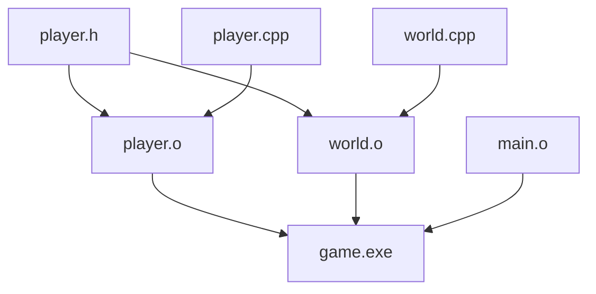
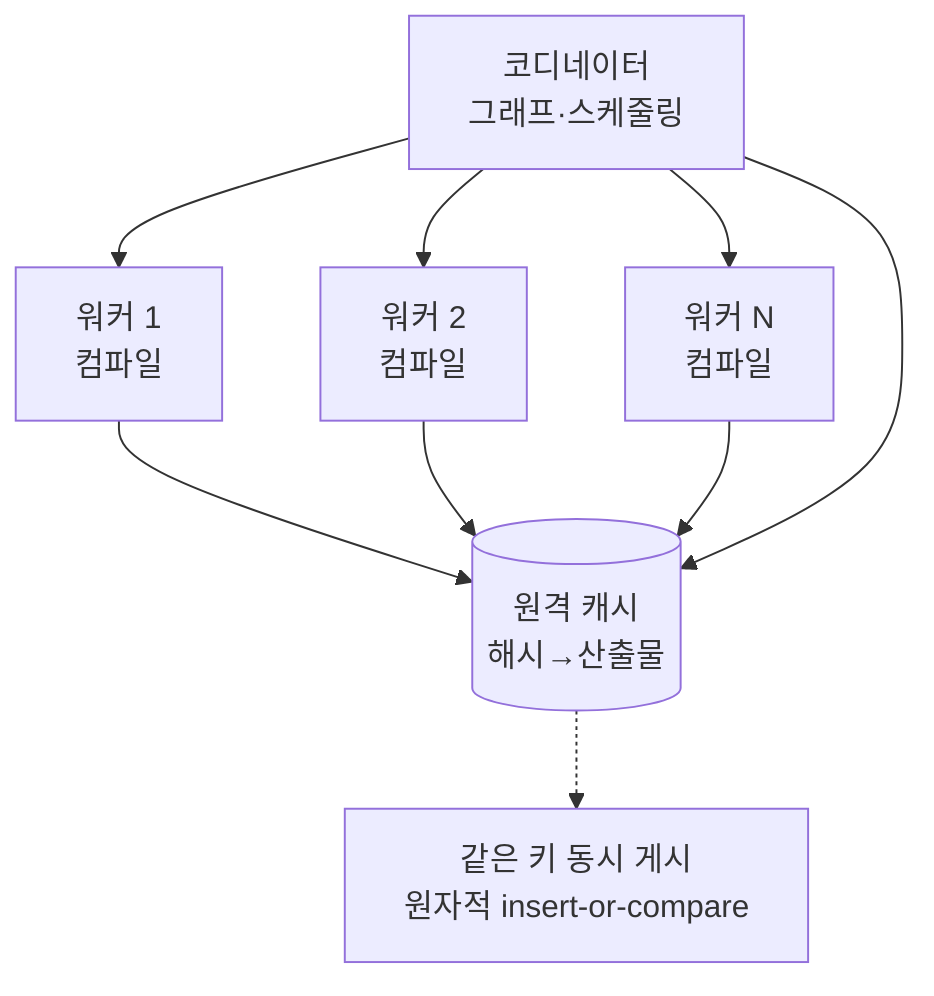
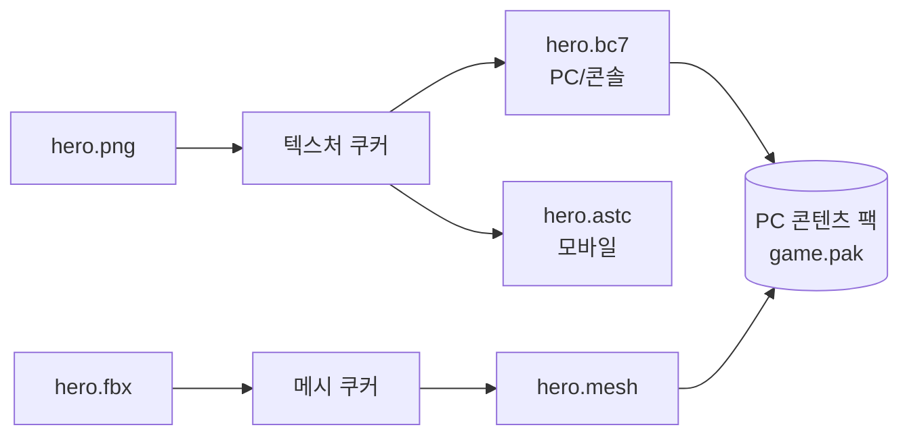
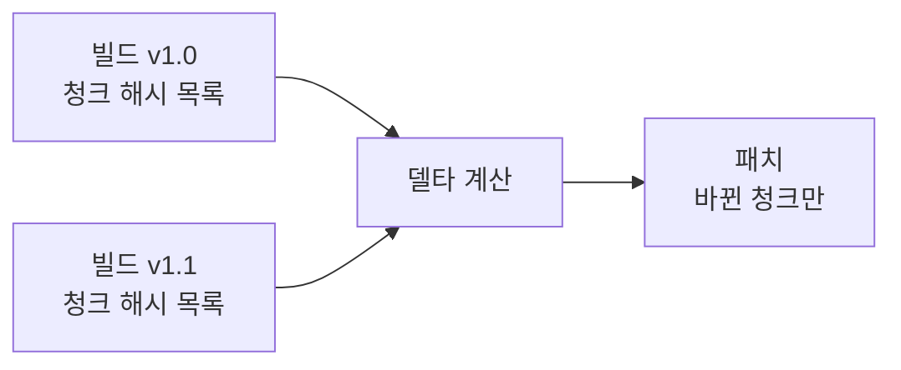
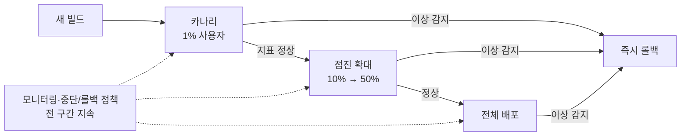

## 들어가며

빌드 시스템은 *속도* 와 *재현성* 사이의 줄다리기다. 개발자는 코드 한 줄을 고친 뒤 결과를 *몇 초 안에* 보고 싶어 한다 — 빌드가 30분 걸리면 반복 주기가 무너지고, 하루에 시도할 수 있는 실험 횟수가 줄어든다. 반면 출시 빌드는 *누가, 언제, 어디서 돌려도 비트 단위로 같은 결과* 가 나와야 한다. 어제 통과한 테스트가 오늘 같은 커밋에서 깨지면, 그 원인이 코드인지 환경인지 분간할 수 없다.

이 두 요구는 자주 충돌한다. 속도를 위한 캐시·증분 빌드·분산 빌드는 *상태를 재사용* 하는데, 그 상태가 더러우면 재현성이 깨진다. 재현성을 위한 클린 빌드·고정 툴체인·결정론적 출력은 *모든 것을 처음부터* 하려 들어 속도를 희생한다. 잘 만든 빌드 시스템은 이 둘을 동시에 잡는다 — *정확한 의존성 그래프* 로 "바뀐 것만 다시 만들되, 바뀌지 않은 것은 절대 다시 만들지 않는" 상태를 보장한다. 그래야 캐시가 안전해지고, 안전한 캐시가 곧 속도다.


이 글의 목표.

1. **빌드 그래프와 의존성** — 그래프의 정확성이 증분·캐시·재현성의 토대다.
2. **증분 빌드** — 변경 감지, 해시 대 타임스탬프, PCH·유니티 빌드의 비용.
3. **분산 빌드와 캐시** — 작업 분산, 원격 캐시, 캐시 키 설계.
4. **결정론적·재현 가능 빌드** — 비결정성의 원천과 제거 방법.
5. **쿠킹과 패키징** — 에셋 변환, 플랫폼별 굽기, 패치·DLC.
6. **CI/CD 파이프라인** — 트리거, 단계 분리, 배포 전략.
7. **자동화 테스트 통합** — 빌드 게이트, 플레이키 테스트, 캐싱.
8. **아티팩트 관리와 모니터링** — 버전, 보관, 빌드 시간 추적.


---

## 목차
1. [빌드 그래프와 의존성](#1-빌드-그래프와-의존성)
2. [증분 빌드](#2-증분-빌드)
3. [분산 빌드와 캐시](#3-분산-빌드와-캐시)
4. [결정론적·재현 가능 빌드](#4-결정론적재현-가능-빌드)
5. [쿠킹과 패키징](#5-쿠킹과-패키징)
6. [CI/CD 파이프라인](#6-cicd-파이프라인)
7. [자동화 테스트 통합](#7-자동화-테스트-통합)
8. [아티팩트 관리와 모니터링](#8-아티팩트-관리와-모니터링)


---

## 1. 빌드 그래프와 의존성

### 빌드는 그래프다

빌드 시스템의 본질은 *방향성 비순환 그래프(DAG)* 다. 노드는 *산출물(파일)* 이고, 엣지는 *의존성* 이다. `main.o`는 `main.cpp`와 그것이 `#include`하는 모든 헤더에 의존하고, `game.exe`는 모든 `.o`에 의존한다. 빌드란 이 그래프를 *위상 정렬* 해 의존성이 먼저 만들어지도록 순서대로 *액션(action)* 을 실행하는 것이다.



이 그래프가 정확하면 두 가지가 따라온다. *증분 빌드* — 바뀐 노드와 그 후손만 다시 만든다. *병렬 빌드* — 서로 의존하지 않는 노드는 동시에 만든다. 그래프가 부정확하면 둘 다 깨진다. 누락된 엣지는 *오래된 산출물(stale output)* 을 남기고, 잘못된 엣지는 불필요한 재빌드를 유발한다.

### 명시적 그래프 대 발견된 그래프

의존성을 *누가 선언하는가* 가 빌드 도구를 가른다.

| 방식 | 도구 예 | 의존성 출처 | 정확성 | 속도 |
|---|---|---|---|---|
| 명시적 선언 | Bazel, Buck | 빌드 파일에 직접 기술 | 높음 (강제) | 빠름 (증분 분석·캐시로 비용 절감) |
| 자동 발견 | Make + `-MMD`, MSBuild | 컴파일러가 출력 | 중간 | 중간 |
| 혼합 | CMake → Ninja | 선언 + 컴파일러 발견 | 중간~높음 | 빠름 |

명시적 그래프는 *모든 입력을 선언* 하도록 강제한다. Bazel도 loading·analysis·execution 단계를 거쳐 *rule/target을 분석한 뒤 액션 그래프를 만든다* — 선언이 analysis 자체를 없애지는 않지만, 증분 분석·캐시로 비용을 줄일 수 있다. Bazel은 선언되지 않은 파일에 접근하면 *샌드박스가 막아* 빌드를 실패시키지만, 절대 경로·샌드박스 전략·fallback 한계 때문에 그래프 완전성이 자동 보증되지는 않는다(F22). 빌드 파일 작성 비용은 크다. 자동 발견은 편하지만 *숨은 의존성* 을 놓치기 쉽다 — 컴파일러가 읽은 헤더는 잡아도, 코드가 런타임에 읽는 데이터 파일이나 환경 변수는 그래프에 안 들어간다.

### 헤더 의존성의 함정

C++ 빌드에서 가장 흔한 그래프 오류는 *헤더 의존성 누락* 이다. `player.cpp`가 `config.h`를 포함하는데 빌드 시스템이 그 엣지를 모르면, `config.h`만 고쳤을 때 `player.o`가 다시 만들어지지 않는다. 결과는 *부분적으로 오래된 바이너리* — 어떤 번역 단위는 새 `config.h`로, 어떤 것은 옛 것으로 컴파일된 상태다. ODR 위반과 미묘한 크래시로 이어진다.

해법은 *컴파일러가 읽은 사용자 헤더 목록을 받아내는* 것이다. GCC/Clang의 `-MMD -MF`는 컴파일하면서 의존성 파일(`.d`)을 부산물로 출력한다.

```make
# 컴파일과 동시에 .d 의존성 파일 생성
%.o: %.cpp
	$(CXX) -MMD -MP -MF $(@:.o=.d) -c $< -o $@

# 다음 빌드에서 .d를 읽어 헤더 변경을 그래프에 반영
-include $(OBJS:.o=.d)
```

`.d` 파일에는 `player.o: player.cpp player.h config.h...` 형태로 *컴파일러가 읽은 사용자 헤더* 가 들어간다 — `-MMD`는 시스템 헤더를 제외하므로, 표준 헤더까지 포함하려면 `-MD`를 쓴다. 첫 빌드 후 이 파일을 그래프에 합치면, 다음부터는 헤더 변경이 정확히 추적된다. 이 "컴파일하며 의존성을 발견하는" 패턴이 자동 발견 빌드의 핵심이다. `-MP`는 삭제된 헤더에 대한 phony target을 생성해, 헤더와 include를 함께 지운 정상 리팩터링에서 stale `.d`가 "No rule to make target"으로 make를 막는 것을 방지한다.

### 모듈은 그래프를 먼저 알아야 한다

헤더 모델에서 의존성 발견이 가능한 이유는 *번역 단위가 서로 독립* 이기 때문이다. `a.cpp`와 `b.cpp`는 어떤 순서로 컴파일해도 되고, 헤더 목록은 컴파일하면서 부산물로 받아내면 된다. C++20 모듈은 이 전제를 깬다.

```cpp
// math.cppm — 모듈 인터페이스
export module math;
export int add(int a, int b);

// main.cpp
import math;   // math의 BMI가 이미 존재해야 컴파일할 수 있다
```

`import math;`를 컴파일하려면 `math` 모듈의 *BMI(Built Module Interface)* 가 먼저 만들어져 있어야 한다. 컴파일 순서 자체가 의존성에 종속되는데, 그 의존성은 *컴파일해 봐야 알 수 있는* 것이 아니라 *컴파일하기 전에 알아야 하는* 것이다. 닭과 달걀이다.

해법은 *컴파일과 분리된 스캔 단계* 다. 빌드 시스템은 컴파일 전에 소스를 훑어 각 파일이 *무엇을 export하고 무엇을 import하는지* 만 뽑아낸다. 이 스캔 결과로 그래프를 확장한 뒤에야 위상 정렬과 컴파일이 가능하다.


BMI는 *캐시가 아니라 산출물* 이라는 점이 실무에서 가장 자주 오해된다. PCH는 없어도 빌드가 성립하는 *속도 최적화* 지만, BMI는 없으면 *컴파일 자체가 불가능한 필수 입력* 이다. 그래서 BMI는 그래프의 정식 노드로 들어가야 하고, 컴파일러 버전·플래그가 다르면 재사용할 수 없으므로 캐시 키에도 그대로 포함된다. 스캔 단계를 그래프에 넣지 않고 모듈을 도입하면, *병렬 빌드가 무작위로 실패하는* 형태로 증상이 나타난다 — BMI가 아직 없는 순간에 소비자가 먼저 컴파일되기 때문이다.

### 액션과 입력의 분리

정확한 그래프를 만들려면 각 *액션* 의 *입력 전체* 를 알아야 한다. 입력은 소스 파일만이 아니다 — *컴파일러 실행 파일, 컴파일 플래그, 환경 변수, 포함 경로* 까지 모두 입력이다. 플래그 하나(`-O2` → `-O0`)만 바뀌어도 산출물이 달라지므로, 플래그도 그래프의 입력으로 취급해야 한다.

```cpp
// 액션 하나의 완전한 입력 명세
struct BuildAction {
    std::string             tool;          // "clang++"
    std::vector<std::string> inputs;       // 소스 + 발견된 헤더
    std::vector<std::string> args;         // 플래그 (산출물에 영향)
    std::map<std::string,std::string> env; // 영향을 주는 환경 변수만
    std::vector<std::string> outputs;      // 산출 파일
};
```

플래그를 *어느 범위에 붙이는가* 도 그래프의 모양을 바꾼다. 전역으로 플래그를 추가하면 *모든 노드의 입력* 이 달라져 그래프 전체가 무효화되고, 특정 타깃에만 붙이면 그 타깃의 서브그래프만 다시 만들어진다. 게다가 플래그에는 *자기만 쓰는 것* 과 *의존자에게 전파되어야 하는 것* 두 종류가 있다 — 헤더에 노출되는 매크로 정의나 표준 버전은 소비자도 같은 값으로 컴파일해야 하고, 최적화 수준이나 경고 설정은 그렇지 않다. 이 구분을 빌드 파일이 표현하지 못하면 *과잉 무효화(느려짐)* 나 *과소 전파(정의 불일치)* 중 하나가 난다.

이 명세가 완전하면 2절의 증분 판단과 3절의 캐시 키가 정확해진다. 입력 하나라도 빠지면 — 예를 들어 컴파일러 버전을 입력에 안 넣으면 — 툴체인을 업그레이드해도 캐시가 옛 산출물을 돌려주는 *재현성 사고* 가 난다. "무엇이 산출물에 영향을 주는가"를 빠짐없이 세는 것이 빌드 시스템 설계의 첫 단추다.

## 2. 증분 빌드

### 변경 감지 — 타임스탬프 대 해시

증분 빌드의 첫 질문은 "이 노드가 바뀌었는가"다. 두 가지 답이 있다.

*타임스탬프(mtime)*: 입력의 수정 시각이 산출물보다 최신이면 다시 만든다. Make의 기본 방식이다. 빠르지만(파일 메타데이터만 읽음) 거짓 양성이 많다 — `touch`만 해도, 내용이 같아도 재빌드한다. Git 체크아웃·브랜치 전환은 mtime을 무더기로 갱신해 *전체 재빌드* 를 유발하기도 한다.

*콘텐츠 해시*: 입력 내용의 해시(예: BLAKE3, SHA-256)가 바뀌었을 때만 다시 만든다. Bazel·Buck의 방식이다. 거짓 양성이 없어 *불필요한 재빌드를 제거* 하지만, 모든 파일을 읽어 해시해야 해 비용이 든다.

```cpp
// 혼합 전략: mtime으로 후보를 거른 뒤 해시로 확정
bool NeedsRebuild(const Node& n) {
    if (n.output_mtime == 0) return true;           // 산출물 없음
    bool any_newer = false;
    for (auto& in : n.inputs)
        if (mtime(in) > n.output_mtime) { any_newer = true; break; }
    if (!any_newer) return false;                    // 전제: 내용 변경은 항상 mtime을 갱신한다
    // mtime은 최신이지만 내용은 같을 수 있다 → 해시로 재확인
    return ContentHash(n.inputs) != n.cached_input_hash;
}
```

실무에서는 *mtime을 1차 필터, 해시를 2차 확정* 으로 쓰는 혼합 전략이 흔하다. mtime이 옛것이면 즉시 스킵(빠름), mtime이 최신일 때만 해시를 계산해 *내용이 진짜 바뀌었는지* 확인한다. Git 브랜치 전환 후 "mtime은 다 최신이지만 내용은 동일"한 경우, 해시 단계가 *전체 재빌드를 막아준다*. 이 최적화는 "입력 변경이 반드시 산출물보다 새로운 mtime으로 드러난다"는 전제에 기댄다 — 내용이 바뀌었는데 mtime을 보존·과거화하면(일부 동기화 도구) mtime 필터가 변경을 놓친다. 그 전제를 보장할 수 없으면 신뢰 가능한 change journal·metadata identity·digest cache를 쓰고, 정확한 content 기반 판단이 필요하면 보존 mtime만을 이유로 해시 확인을 생략하지 않는다.

### 빌드 로그와 명령 변경 추적

내용이 같아도 *명령이 바뀌면* 다시 만들어야 한다. `-O0`으로 빌드한 산출물을 `-O2`로 바꿨다면, 소스가 한 글자도 안 바뀌어도 재빌드가 맞다. Ninja는 각 산출물과 함께 *그것을 만든 명령의 해시* 를 `.ninja_log`에 기록하고, 해시가 달라지면 재빌드한다.

```cpp
// 증분 판단의 완전한 조건
bool ShouldRebuild(const Node& n) {
    if (n.output_mtime == 0)                  return true;  // 없음
    if (InputsChanged(n))                     return true;  // 입력 변경
    if (n.command != n.last_command)          return true;  // 명령 변경
    if (n.tool_version != n.last_tool_version) return true; // 툴 변경
    return false;
}
```

이 네 조건 — 산출물 부재, 입력 변경, 명령 변경, 툴 변경 — 이 증분 빌드 정확성의 전부다. 하나라도 빼면 *오래된 산출물* 이 살아남는다. 특히 *툴 버전* 은 자주 누락되는데, 컴파일러 업그레이드 후 "왜 재빌드가 안 되지"의 단골 원인이다.

### 프리컴파일드 헤더(PCH)

C++ 컴파일의 큰 비용은 *헤더 재파싱* 이다. 모든 `.cpp`가 `<vector>`, `<string>`, 엔진 공통 헤더를 포함하면, 같은 수만 줄을 *번역 단위마다 반복 파싱* 한다. PCH는 자주 쓰는 헤더 묶음을 *한 번 파싱해 직렬화한* 바이너리를 만들고, 각 번역 단위가 그것을 로드한다.

```cpp
// pch.h: 자주 바뀌지 않는 무거운 헤더만 모음
#include <vector>
#include <string>
#include <memory>
#include "engine/math.h"     // 안정적인 공통 헤더
// 주의: 자주 바뀌는 헤더를 넣으면 PCH가 매번 무효화돼 역효과다
```

PCH의 트레이드오프가 분명하다. *수십 개 번역 단위가 같은 헤더를 공유* 할 때 컴파일 시간을 크게 줄이지만(헤더 파싱 1회로), PCH에 *자주 바뀌는 헤더* 를 넣으면 그 헤더가 바뀔 때마다 *PCH 전체와 그것에 의존하는 모든 번역 단위* 가 재컴파일된다 — 증분성이 망가진다. PCH에는 *표준 라이브러리와 안정적인 엔진 코어* 만 넣고, 활발히 개발 중인 모듈 헤더는 빼는 것이 원칙이다.

### 유니티 빌드(Unity Build)

유니티 빌드는 여러 `.cpp`를 `#include`로 묶어 *하나의 거대한 번역 단위* 로 컴파일한다. 헤더 파싱·심볼 처리의 중복이 사라져 풀 빌드가 크게 빨라질 수 있지만, 개선 폭은 헤더 중복과 컴파일러 병렬성에 따라 달라진다.

```cpp
// unity_0.cpp: 여러 소스를 한 번역 단위로 합침
#include "player.cpp"
#include "world.cpp"
#include "physics.cpp"
// 한 번의 컴파일러 기동, 헤더 1회 파싱, 인라인 기회 증가
```

대가가 있다. *증분성 악화* — `player.cpp` 한 줄을 고쳐도 `unity_0.cpp` 전체(physics·world 포함)가 재컴파일된다. *격리 손상* — 합쳐진 파일들이 같은 네임스페이스를 공유해, 한 파일의 `static` 함수나 `using` 선언이 다른 파일에 *새어 나가* 빌드가 깨지거나 의미가 달라진다. 그래서 유니티 빌드는 *풀 빌드(CI)에는 켜고, 활발한 로컬 개발에는 끄는* 토글로 두는 경우가 많다. 속도(풀 빌드)와 증분성(반복 개발)의 정면 충돌이다.

### 정량화 — 어디에 시간이 가는가

증분 빌드 최적화는 *측정에서 시작* 한다. Clang의 `-ftime-trace`는 번역 단위별 *파싱·인스턴스화·코드 생성* 시간을 JSON으로 출력한다.

| 빌드 종류 | 변경 범위 | 재컴파일 대상 | 시간(예시) |
|---|---|---|---|
| 풀 빌드 | 전부 | 모든 번역 단위 | 18분 |
| 풀 빌드 + 유니티 | 전부 | 합친 단위 | 7분 |
| 헤더 1개 변경 | 공통 헤더 | 의존 번역 단위 다수 | 4분 |
| 소스 1개 변경 | 단일 `.cpp` | 1개 + 링크 | 25초 |
| 소스 1개 + 유니티 | 단일 `.cpp` | 그 묶음 전체 | 90초 |

이 표가 트레이드오프를 그대로 보여준다. 유니티 빌드는 *풀 빌드를 18분→7분* 으로 줄이지만, *단일 소스 변경을 25초→90초* 로 늘린다. 어떤 워크플로가 지배적인지에 따라 선택이 갈린다. 무거운 공통 헤더가 *다수 번역 단위를 무효화* 하는 패턴이 보이면, 그 헤더를 쪼개거나 전방 선언으로 의존을 끊는 것이 가장 효과가 크다.

## 3. 분산 빌드와 캐시

### 작업을 여러 머신으로

한 머신의 코어 수가 빌드 병렬성의 상한이다. 16코어 머신은 16개 컴파일을 동시에 돌리지만, 그래프에 *수천 개의 독립 번역 단위* 가 있으면 코어가 모자란다. *분산 빌드* 는 컴파일 작업을 *여러 머신(빌드 팜)으로* 보낸다.



분산이 가능한 전제는 *액션의 격리* 다 — 각 컴파일은 *선언된 입력만 읽고, 선언된 출력만 쓰는* 순수 함수여야 다른 머신에서 실행 가능하다. 1절에서 입력을 완전히 명세하는 일이 여기서 보상받는다. 입력이 누락되면 워커가 그 파일을 못 받아 빌드가 실패하거나, 더 나쁘게는 *워커마다 다른 결과* 가 나온다.

### 원격 캐시 — 한 번 빌드한 것은 모두가 재사용

분산보다 더 큰 이득은 *원격 캐시* 다. 액션의 *완전한 입력 해시* 를 키로, 산출물을 값으로 저장한다. 누군가 이미 같은 입력으로 컴파일했다면, *다시 컴파일하지 않고 캐시에서 산출물을 내려받는다*.

```cpp
// 캐시 키 = 액션의 모든 입력을 canonical serialization
std::string CacheKey(const BuildAction& a) {
    Hasher h;
    h.Update(a.tool);
    h.Update(ToolchainIdentity(a.tool));  // 버전 문자열이 아니라 toolchain/실행 환경 identity
    for (auto& in : SortedInputs(a)) {    // 논리 경로로 정렬
        h.Update(NormalizeLogicalPath(in)); // 머신 prefix는 제거, 논리 경로는 보존
        h.Update(ContentHash(in));        // 내용 해시
    }
    for (auto& arg : a.args) h.UpdateFrame(arg);  // 순서를 보존한 길이 프레이밍
    for (auto& [k,v] : SortedEnv(a.env)) h.Update(k + "=" + v);
    return h.Finalize();
}
```

캐시 키 설계가 캐시의 *정확성과 적중률* 을 동시에 좌우한다. *키에 빠진 입력* 이 있으면 잘못된 산출물을 돌려준다(정확성 사고). 반대로 *산출물에 영향을 안 주는 것을 키에 넣으면* 적중률이 떨어진다 — 예를 들어 입력 파일의 *절대 경로* 를 키에 넣으면, 다른 머신의 다른 작업 디렉토리에서는 같은 코드인데도 캐시가 안 맞는다. 그래서 키에는 *내용 해시* 를 쓰고 경로는 정규화한다.

머신별 절대 prefix는 제거할 수 있지만 *의미를 가진 논리 경로·파일명* 은 제거하면 안 된다 — `__has_include("a.h")`처럼 이름 자체가 결과를 바꾸는 경우가 있다(T26). args 순서를 보존하고 env는 정렬·프레이밍하며, 버전 문자열만 아니라 toolchain/실행 환경의 신뢰 가능한 identity와 작업 디렉터리 의미도 포함한다.

### CI와 로컬의 캐시 공유

원격 캐시의 큰 가치는 *CI가 검증한 액션 결과를 개발자가 재사용* 하는 데서 나온다. CI와 로컬의 툴체인·명령·입력 해시가 같으면 바뀌지 않은 액션은 다운로드하고 변경의 영향을 받은 액션만 실행한다. 아래 적중률과 시간은 원리를 설명하기 위한 가상 예시이며 실제 값은 그래프의 fan-out, 캐시 위치와 네트워크에 따라 달라진다.

```text
캐시 적중률(예시):
  CI 직후 main 체크아웃 → 변경 없음:     적중 100% → 다운로드만
  feature 브랜치, 파일 5개 수정:         적중 ~99% → 5개만 컴파일
  공통 헤더 1개 수정:                    적중 ~60% → 의존 단위 재컴파일
  컴파일러 버전 업그레이드:              적중 0%   → 키 전부 무효 (정상)
```

마지막 줄이 중요하다. 컴파일러 업그레이드는 *컴파일 action의 캐시를 무효화* 하는데, 이것이 *올바른 동작* 이다. 툴 버전이 키에 들어 있어 다른 산출물을 만들어내기 때문이다. 만약 *컴파일 action* 이 업그레이드 후에도 적중한다면, 그것은 키에 툴 버전이 빠진 *재현성 버그* 다. 다만 컴파일러를 쓰지 않는 복사·다른 tool action은 여전히 hit할 수 있다.

### 캐시 오염과 신뢰성

원격 캐시는 *공유 자원* 이라 오염되면 *전 팀에 전파* 된다. 비결정적 빌드(4절)가 캐시에 올라가면, 입력이 같은데 산출물이 다른 *모순된 항목* 이 쌓인다. 방어책으로 *캐시 쓰기 검증* 을 둔다 — 같은 키로 두 번 빌드해 산출물이 다르면 그 액션을 *캐시 불가(uncacheable)* 로 표시하고 경고한다.

```cpp
// 저장소의 원자적 insert-if-absent로 같은 키의 동시 writer를 비교한다
void WriteToCacheChecked(const std::string& key, const Artifact& art) {
    auto inserted = cache.InsertIfAbsent(key, art);   // {wrote, existing}
    if (inserted.wrote) return;                        // 새로 저장 성공
    if (inserted.existing->content_hash != art.content_hash) {
        LogError("비결정적 산출물: " + key);   // 4절 원인 추적
        cache.MarkPoisoned(key);                // 적중 차단 — poisoned 동시성도 저장소가 보장
    }
}
```

공유 cache write는 `Get -> Put`의 외부 두 호출로는 같은 키의 동시 writer를 비교하지 못한다. `InsertIfAbsent`가 기존 immutable digest를 반환하게 하고 서로 다르면 poison/uncacheable로 처리하는 방식 등 저장소 차원의 동시성 계약이 필요하다 — hash 검증과 poisoned 상태의 동시성도 함께 계약화한다.

원격 캐시의 신뢰성은 *액션의 결정성에 전적으로 의존* 한다. 비결정적 액션 하나가 캐시에 들어가면, 그 키를 적중한 모든 빌드가 *무작위로 다른 결과* 를 받는다 — 디버깅이 거의 불가능한 종류의 버그다. 그래서 분산·캐시를 도입하기 전에 *결정성을 먼저 확보* 해야 한다. 4절의 주제다.

## 4. 결정론적·재현 가능 빌드

### 왜 비트 단위 재현성인가

*재현 가능 빌드(reproducible build)* 는 선언된 모든 입력과 빌드 지침이 같을 때 서로 독립된 환경에서도 *비트 단위로 동일한 산출물* 을 만드는 성질이다. 소스와 컴파일러 이름만 같아서는 부족하다. 라이브러리, 환경 변수, 로케일, 경로, 시각, 난수, 파일 순서까지 입력 계약에 포함하거나 정규화해야 한다. 이것이 성립하면 캐시 안전성, 출시 바이너리 재현, 공급망 검증의 기반을 얻는다.

게임 빌드는 *수백 MB의 바이너리와 수 GB의 에셋* 을 만든다. 이 중 단 한 바이트라도 빌드마다 달라지면, 패치 시스템(5절)이 *바뀌지 않은 콘텐츠를 바뀐 것으로 오인* 해 불필요한 패치를 만든다. 재현성은 정확성 문제일 뿐 아니라 *패치 크기와 직결* 되는 실무 문제다.

### 비결정성의 원천

빌드 산출물을 흔들리게 하는 원인은 정형화돼 있다.

| 원천 | 증상 | 제거 방법 |
|---|---|---|
| 타임스탬프 임베딩 | `__DATE__`/`__TIME__`이 바이너리에 박힘 | 고정 시각 또는 커밋 시각 주입 |
| 절대 경로 | 디버그 정보에 빌드 머신 경로 | `-ffile-prefix-map`으로 정규화 |
| 병렬 순서 | 링크 순서·아카이브 순서 변동 | 입력 정렬, 결정적 순서 강제 |
| 해시맵 순회 | 심볼·문자열 테이블 순서 랜덤 | 정렬된 컨테이너 사용 |
| 난수·UUID | 빌드마다 다른 ID 생성 | 고정 시드 또는 콘텐츠 기반 ID |
| 환경 변수 누출 | `$USER`, 로케일이 출력에 영향 | 환경 고정·정규화 |

이 표의 각 항목은 *입력에 없는 무언가가 출력에 새어 든* 경우다. 결정성 확보는 결국 1절로 돌아간다 — *모든 입력을 명세하고, 명세되지 않은 것(시각·경로·환경·난수)이 출력에 영향을 주지 못하게 차단* 한다.

### 타임스탬프와 경로 제거

가장 흔한 두 원천을 코드 수준에서 막는다. 빌드 시각을 박아야 한다면, *시스템 시계 대신 커밋 시각* 을 쓴다 — 같은 커밋은 항상 같은 시각을 가진다.

```cpp
// 나쁜 예: 매 빌드마다 다른 시각이 박혀 비결정적
const char* kBuildTime = __DATE__ " " __TIME__;

// 좋은 예: 커밋의 committer date를 빌드 시 주입 (SOURCE_DATE_EPOCH)
// 빌드 스크립트: export SOURCE_DATE_EPOCH=$(git log -1 --format=%ct)
const char* kBuildTime = BUILD_EPOCH_STR;   // -D로 고정 주입
```

경로는 컴파일러 플래그로 정규화한다. 디버그 정보(`DWARF`)에 박히는 빌드 머신의 절대 경로를 *상대 경로나 고정 접두사로* 바꾼다.

```bash
# 빌드 머신마다 다른 절대 경로를 고정 접두사로 치환 (값을 인용)
clang++ -ffile-prefix-map="$(pwd)"=/build \
        -fdebug-prefix-map="$(pwd)"=/build \
        -c player.cpp -o player.o
# 이제 /home/alice/proj 든 /home/bob/proj 든 디버그 정보는 /build로 동일
```

`SOURCE_DATE_EPOCH`(타임스탬프 표준화)와 `-ffile-prefix-map`(경로 표준화)은 재현 가능 빌드의 *두 기본 도구* 다. 이 둘만으로 비결정성의 큰 부분이 사라진다. 작업 경로에 공백이 있어도 shell word splitting으로 옵션이 쪼개지지 않도록 값을 인용하고, prefix-map의 지원 범위는 compiler/OS별 해당 toolchain 문서에 한정한다.

### 순서 결정성

병렬 빌드는 *완료 순서가 비결정적* 이다. 링커가 오브젝트를 받는 순서, 아카이브(`.a`)에 멤버가 들어가는 순서, 문자열 풀의 정렬이 빌드마다 달라지면 산출물이 흔들린다. 해법은 *모든 집합 연산에 결정적 순서를 강제* 하는 것이다.

```cpp
// 나쁜 예: unordered_map 순회 순서는 구현·해시에 따라 다름
for (auto& [sym, addr] : symbol_table)   // 순서 비결정적
    EmitSymbol(sym, addr);

// 좋은 예: 정렬 후 순회 → 항상 같은 순서
std::vector<Symbol> sorted;
for (auto& [sym, addr] : symbol_table) sorted.push_back({sym, addr});
std::sort(sorted.begin(), sorted.end(),
          [](auto& a, auto& b){ return a.name < b.name; });
for (auto& s : sorted) EmitSymbol(s.name, s.addr);
```

핵심 원칙은 *해시 순서에 절대 의존하지 않는다* 는 것이다. 산출물에 영향을 주는 모든 순회는 정렬된 키나 안정적 정렬을 거쳐야 한다. 빌드 시스템 차원에서도 워커의 *완료 순서가 아니라 그래프상 정의 순서* 로 링크 입력을 배열한다.

### 재현성 검증

재현성은 *주장이 아니라 검증* 으로 보장한다. 같은 커밋을 *두 번, 가능하면 다른 머신·다른 시각에* 빌드해 산출물 해시를 비교한다.

```bash
set -euo pipefail

# 두 번 모두 독립 clean 작업공간·고정 입력으로, cache hit로 재컴파일을 생략하지 않게 실행한다.
required=(game.pak)
for workspace in build-a build-b; do
    ./build.sh --workspace "$workspace" --cache-bypass
    test -d "$workspace/out" || { echo "산출물 디렉터리 없음: $workspace/out" >&2; exit 1; }
    for f in "${required[@]}"; do
        test -s "$workspace/out/$f" || { echo "누락/빈 산출물: $workspace/out/$f" >&2; exit 1; }
    done
    # 해시 계산 실패(읽기 오류)도 pipefail을 통해 전체 실패로 전파된다.
    ( cd "$workspace/out" && find . -type f -print0 | sort -z | xargs -0 sha256sum ) > "$workspace.manifest"
    test -s "$workspace.manifest" || { echo "빈 manifest: $workspace" >&2; exit 1; }
done

if diff -u build-a.manifest build-b.manifest; then
    echo "두 관측이 동일함 (모든 compiler/CPU/환경 재현성 보장은 아님)"
else
    echo "비결정적 산출물 존재" >&2
    exit 1
fi
```

`diff`가 비면 재현 가능, 차이가 나면 *어느 파일이 흔들리는지* 가 바로 드러난다. 이 검증을 CI에 *정기적으로* 돌리면, 누군가 새 비결정성(예: 새 코드가 `__TIME__`을 박음)을 들여올 때 즉시 잡힌다. 두 번 같았다는 것은 *두 관측이 같았다* 는 뜻이지 모든 compiler/CPU/환경에서 재현 가능함을 증명하지는 않는다 — 파일명·크기·내용을 대상으로 하며, 실행 권한·소유자·타임스탬프도 배포 결과의 일부인 프로젝트는 manifest에 canonical metadata를 추가한다. 재현성은 한 번 달성하고 끝나는 것이 아니라 *지속적으로 지켜야 하는 불변식* 이다.

## 5. 쿠킹과 패키징

### 쿠킹 — 에셋을 런타임 포맷으로

게임의 빌드는 코드 컴파일만이 아니다. *에셋 쿠킹(cooking)* 은 작업용 에셋(PNG, FBX, WAV)을 *플랫폼별 런타임 포맷* 으로 변환한다 — 텍스처를 GPU 압축 포맷(BC7, ASTC)으로, 메시를 엔진 바이너리로, 오디오를 플랫폼 코덱으로. 이 변환도 *그래프* 다. 소스 에셋이 입력, 쿠킹된 에셋이 출력, 변환기(cooker)가 액션이다.



쿠킹의 핵심은 *코드 빌드와 같은 증분·캐시 원칙* 을 적용하는 것이다. 텍스처 압축은 *수십 초* 걸릴 수 있어, 바뀌지 않은 에셋을 매번 다시 쿠킹하면 빌드가 마비된다. 소스 에셋의 콘텐츠 해시와 *쿠킹 설정(압축 품질·포맷)* 을 키로 캐시하면, 한 번 쿠킹한 에셋은 재사용된다 — 코드 캐시(3절)와 같은 메커니즘이다.

### 번들링과 압축

쿠킹된 개별 에셋 수천 개를 *그대로 배포하면* 파일 시스템 오버헤드와 I/O가 폭발한다. *콘텐츠 팩(pak)* 으로 묶어 *적은 수의 큰 파일* 로 만든다. 런타임은 팩 안의 오프셋으로 에셋을 찾는다.

| 압축 | 비율 | 압축 속도 | 해제 속도 | 용도 |
|---|---|---|---|---|
| 무압축 | 1× | — | 즉시 | 이미 압축된 데이터(BC7) |
| LZ4 | 데이터 의존 | 빠름 | 빠름 | 낮은 해제 지연 후보 |
| Deflate/Zlib | 데이터 의존 | 설정 의존 | 중간 | 호환성이 중요한 배포 |
| Zstd | 데이터 의존 | 레벨 의존 | 빠른 편 | 압축률·해제 속도 조절 |
| LZMA 계열 | 데이터 의존 | 느린 편 | 설정 의존 | 오프라인 크기 우선 후보 |

압축 선택은 크기, 압축 시간, 해제 처리량, 메모리, 랜덤 접근 단위의 거래다. 런타임 스트리밍은 저장장치 I/O와 해제 작업을 겹쳤을 때 프레임 마감을 지키는지가 기준이고, 다운로드 패키지는 CDN 전송량과 설치 CPU 시간을 함께 본다. 이미 GPU 블록 압축된 텍스처도 내용과 컨테이너에 따라 추가 압축이 조금 될 수 있지만 이득이 작을 때가 많으므로 에셋 종류와 청크 크기별 실측으로 켜고 끈다.

### 플랫폼별 쿠킹

같은 소스 에셋이 *플랫폼마다 다른 산출물* 을 낳는다. PC는 BC7, 모바일은 ASTC, 콘솔은 전용 텍스처 포맷·전용 오디오 코덱. 이것은 *쿠킹 그래프가 플랫폼을 입력으로* 가진다는 뜻이다 — 플랫폼이 캐시 키에 들어가 *플랫폼별로 분리된 산출물* 이 캐시된다.

```cpp
// 쿠킹 액션의 키에 플랫폼·설정이 포함됨
struct CookAction {
    AssetId  source;
    Platform target;            // PC / Mobile / Console (키의 일부)
    CookSettings settings;      // 압축 품질·포맷 (키의 일부)
    // 키 = hash(콘텐츠(source), target, settings, cooker 버전)
};
```

플랫폼별 쿠킹의 함정은 *쿠커 버전을 키에 빼먹는* 것이다. 텍스처 압축기를 업그레이드하면 같은 입력에서 *다른 BC7* 이 나오는데, 쿠커 버전이 키에 없으면 캐시가 옛 결과를 돌려준다. 코드 빌드에서 컴파일러 버전을 키에 넣는 것(3절)과 정확히 같은 원칙이다.

### 패치와 DLC

출시 후 게임은 *패치* 를 보낸다. 패치의 크기는 *바뀐 콘텐츠의 양* 에 비례해야 한다 — 50MB 텍스처 하나만 바뀌었으면 50MB만 받아야지, 8GB 전체를 다시 받게 하면 안 된다. 이것이 가능하려면 *콘텐츠가 안정적인 단위로 청크화* 되고, *재현 가능* 해야 한다(4절).



패치 생성은 *두 빌드의 청크 해시 목록을 비교* 해 *달라진 청크만* 묶는다. 여기서 재현성이 결정적이다 — 빌드가 비결정적이면 *바뀌지 않은 청크의 해시도 흔들려*, 전부 바뀐 것으로 인식돼 패치가 비대해진다. "8GB 게임에 한 줄 고쳤는데 패치가 2GB"의 흔한 원인이 *비결정적 빌드* 다. DLC도 같은 구조다 — 기본 콘텐츠를 건드리지 않는 *추가 팩* 으로 격리해, 기존 설치를 무효화하지 않게 한다.

## 6. CI/CD 파이프라인

### 파이프라인의 단계 분리

CI/CD는 *커밋에서 배포까지* 를 자동화한 그래프다. 빠른 피드백을 위해 *단계를 분리* 하고, 앞 단계가 통과해야 뒤가 돈다. 빠르고 흔한 실패는 앞에, 느리고 드문 검증은 뒤에 둔다.


단계 순서의 원칙은 *값싼 실패를 먼저* 다. 문법 오류를 잡는 데 15분짜리 패키징까지 기다릴 필요는 없다 — 1분짜리 정적 분석에서 떨군다. 이 *fail-fast* 배치가 개발자 피드백 시간을 좌우한다. 빌드 단계는 3절의 원격 캐시를 써 *변경분만 빌드* 하므로, 풀 빌드 시간이 아니라 *증분 빌드 시간* 으로 돈다.

### 트리거 — 무엇이 무엇을 돌리는가

모든 커밋에 *전체 파이프라인* 을 돌리면 빌드 팜이 마비된다. 트리거를 *변경 범위* 에 맞춘다.

| 이벤트 | 실행 범위 | 이유 |
|---|---|---|
| PR 푸시 | 영향받은 모듈 빌드 + 단위 테스트 | 빠른 피드백 |
| main 머지 | 풀 빌드 + 전체 테스트 + 캐시 채움 | 신뢰성 + 캐시 |
| 야간(nightly) | 전 플랫폼 쿠킹 + 통합 테스트 + 재현성 검증 | 느린 검증 |
| 릴리스 태그 | 출시 빌드 + 서명 + 스토어 제출 | 배포 |

영향받은 모듈만 빌드하려면 *빌드 그래프에서 변경 파일의 역방향 도달 집합* 을 구한다 — 바뀐 파일에 의존하는 노드만 고른다. 1절의 정확한 그래프가 여기서 *CI 비용 절감* 으로 보상된다. 그래프가 부정확하면 *영향받는데 안 돈* 테스트(거짓 통과)나 *무관한데 도는* 테스트(낭비)가 생긴다.

### 배포 전략 — 위험을 점진적으로

CD는 *검증된 빌드를 사용자에게* 내보낸다. 한 번에 전부 바꾸면 문제가 *전 사용자에게 동시에* 터진다. 점진적 배포로 위험을 줄인다.



*카나리 릴리스* 는 새 빌드를 *소수에게 먼저* 보내 크래시율·지표를 관찰하고, 정상이면 점진 확대한다. 이상이 보이면 *전체 확산 전에 롤백* 한다. 게임에서는 *서버(매치메이킹·경제)* 와 *클라이언트* 의 배포 결합이 까다롭다 — 클라이언트 버전과 서버 프로토콜이 *호환되어야* 하므로, 서버를 *구·신 프로토콜 모두 수용* 하도록 먼저 배포하고 클라이언트를 점진 전환한다. 롤백 가능성은 *아티팩트가 보관* 되어 있어야 성립한다(8절).

### 환경 패리티

CI가 통과했는데 *프로덕션에서 깨지는* 가장 흔한 원인은 *환경 차이* 다 — CI의 라이브러리 버전, OS, 환경 변수가 배포 환경과 다르다. 이를 막으려면 *빌드·테스트·배포가 같은 환경* 에서 돌아야 한다.

```dockerfile
# 빌드 환경을 이미지로 고정 → CI·로컬·배포가 동일 툴체인
FROM ubuntu:24.04
RUN apt-get update && apt-get install -y clang-18 cmake ninja-build  # 메이저 버전만 지정 — 정확한 버전 핀 필요
ENV SOURCE_DATE_EPOCH=0                              # 재현성(4절)
# 이 이미지로 빌드하면 툴체인 드리프트를 줄인다 → 재현성의 필요조건이지 충분조건은 아님
```

빌드 환경을 컨테이너 이미지로 고정하면 툴체인과 사용자 공간 의존성을 통제하기 쉬워지지만 재현성을 자동 보장하지는 않는다. 예제처럼 `apt-get install clang-18`만 적으면 저장소 시점에 따라 패키지와 전이 의존성이 달라질 수 있으므로 이미지 digest나 패키지 snapshot·정확한 버전을 고정해야 한다. 커널, CPU 기능, 외부 서비스, 시각·경로·병렬 순서가 출력에 새지 않도록 하고 이미지 해시를 액션 키에 포함한다.

## 7. 자동화 테스트 통합

### 테스트는 빌드 그래프의 노드다

테스트도 *액션* 이다 — 입력은 테스트 코드와 빌드된 바이너리, 출력은 *통과/실패 결과* 다. 따라서 테스트도 *캐시* 할 수 있다. 입력이 바뀌지 않은 테스트는 *지난번 통과 결과를 재사용* 하고 다시 돌리지 않는다.

```cpp
// 테스트 결과를 입력 해시로 캐시
struct TestAction {
    std::string name;
    std::string environment;           // platform/config/env — canonical test-action ID의 일부
    std::vector<std::string> inputs;   // 테스트 바이너리 + 데이터
    // 키 = hash(테스트 코드, 대상 바이너리, 테스트 데이터, 환경)
    // 캐시에 PASS가 있으면 재실행 생략
};
```

테스트 캐싱은 선언된 입력만 사용하는 결정적 테스트의 비용을 줄일 수 있다. 코드 그래프만으로 영향 집합을 계산하면 환경 변수, 시간, 네트워크 서비스, GPU 드라이버, 숨은 데이터 의존성을 놓칠 수 있다. 따라서 hermetic 단위 테스트부터 적용하고, 통합·그래픽·장시간 테스트는 입력 계약과 결과 보존 정책이 검증된 경우에만 캐시한다. 캐시된 PASS를 주기적으로 실제 재실행해 잘못된 키와 비결정성을 감시한다.

### 테스트 게이트와 빠른 실패

테스트는 *배포 게이트* 로 작동한다 — 실패하면 파이프라인이 멈추고 배포가 막힌다. 게임 테스트는 계층이 다양하다.

| 종류 | 검증 대상 | 속도 | 배치 |
|---|---|---|---|
| 단위 테스트 | 함수·클래스 로직 | 빠름 | PR마다 |
| 통합 테스트 | 시스템 간 상호작용 | 중간 | PR마다 |
| 스모크 테스트 | 게임이 부팅·기본 동작 | 느림 | 머지 후 |
| 자동 플레이 | 봇이 레벨 진행·크래시 검출 | 매우 느림 | 야간 |
| 골든 이미지 | 렌더 출력 픽셀 비교 | 중간 | 머지 후 |

게임 특유의 테스트는 *자동 플레이* 와 *골든 이미지* 다. 자동 플레이는 봇이 게임을 진행하며 *크래시·교착·성능 저하* 를 찾는다. 골든 이미지는 렌더 결과를 *기준 이미지와 픽셀 비교* 해 시각적 회귀를 잡는다 — 이건 4절의 *결정적 렌더링* 을 전제한다. 렌더가 비결정적이면 골든 비교가 *매번 거짓 실패* 한다.

### 플레이키 테스트 — 가장 큰 적

*플레이키(flaky) 테스트* 는 코드 변경 없이 *때로 통과, 때로 실패* 하는 테스트다. 이것이 CI의 신뢰를 무너뜨린다 — 실패가 진짜인지 플레이키인지 모르면, 개발자가 *모든 실패를 무시* 하기 시작한다. "재시도하면 통과하니까"가 굳어지면 테스트는 게이트로서 죽는다.

```cpp
// 플레이키 탐지: 같은 test action·환경·입력 조건 안에서 결과가 흔들리는 테스트 격리
void RecordResult(const std::string& action, const std::string& env,
                  const std::string& commit, bool pass) {
    auto& hist = history[action][env][commit];
    hist.push_back(pass);
    if (HasBothPassAndFail(hist)) {       // 같은 action·환경·커밋에 PASS·FAIL 공존
        MarkFlaky(action, env);           // 격리: 게이트에서 제외, 별도 추적
        Alert("플레이키 테스트: " + action);
    }
}
```

플레이키의 원인은 대개 *비결정성* 이다 — 타이밍 의존(`sleep`으로 동기화), 테스트 간 *상태 누출*, 난수 미고정, 부동소수점 차이. 대응은 두 단계다. *격리* — 플레이키로 판명된 테스트를 게이트에서 빼 *신뢰를 보존* 하되 별도로 추적한다. *근본 수정* — 원인(공유 상태·타이밍·난수)을 제거한다. 같은 test action·환경·입력 조건 안에서만 결과 변동을 판정하고, 플랫폼별 확정 회귀를 다른 플랫폼의 성공과 섞어 flaky로 자동 면제하지 않는다. 자동 격리에는 증거·담당자·만료/재검증 정책을 둔다. 플레이키를 방치하면 *재시도 횟수만 늘려* CI 시간이 부풀고 진짜 회귀를 놓친다.

### 테스트 분할과 병렬화

대규모 스위트는 *여러 머신으로 분할* 해 병렬 실행한다(3절의 분산과 같은 원리). 분할 단위가 균등해야 *가장 느린 샤드* 가 전체 시간을 결정하지 않는다.

```text
나쁜 분할: 테스트 수로 균등 분배
  샤드1: 빠른 단위 테스트 500개 → 2분
  샤드2: 느린 통합 테스트 500개 → 20분   ← 전체가 20분에 묶임

좋은 분할: 과거 실행 시간으로 균형
  각 샤드 목표 시간 ~7분이 되도록 테스트 배분 (이력 기반)
```

테스트 분할의 핵심은 *개수가 아니라 과거 실행 시간으로 균형* 을 맞추는 것이다. 느린 테스트 몇 개가 한 샤드에 몰리면 그 샤드가 *임계 경로* 가 된다. 실행 시간 이력을 기록해 *각 샤드의 총 시간이 비슷하도록* 배분하면, 병렬화 효율이 올라간다. 빌드 그래프 병렬화와 동일한 *작업 균형(load balancing)* 문제다.

## 8. 아티팩트 관리와 모니터링

### 아티팩트 — 빌드의 산출물을 보관

*아티팩트(artifact)* 는 빌드가 만든 *배포 가능한 산출물* 이다 — 실행 파일, 콘텐츠 팩, 디버그 심볼, 설치 프로그램. 이것을 *버전과 함께 영구 보관* 해야 롤백(6절)과 사후 디버깅이 가능하다. 매번 다시 빌드해 얻으려 하면, 그 빌드가 *지금도 재현 가능* 하다는 보장(4절)이 필요해진다.

```cpp
// 아티팩트 메타데이터: 어떤 빌드인지 완전히 식별
struct Artifact {
    std::string version;        // "1.2.3+build.4567"
    std::string commit;         // git SHA (정확한 소스)
    std::string toolchain_hash; // 빌드 환경 이미지 해시 (4절·6절)
    Platform    platform;
    std::string content_hash;   // 산출물 자체의 해시 (무결성)
    time_t      built_at;
};
```

아티팩트의 가치는 *추적성* 에 있다. 출시 빌드가 크래시하면, 아티팩트의 *commit과 toolchain_hash로 정확히 그 빌드를 재현* 해 디버그 심볼과 함께 분석한다. 버전 문자열만으로는 부족하다 — *어떤 커밋을, 어떤 툴체인으로* 빌드했는지가 함께 기록돼야 재현이 성립한다.

### 버전 체계와 자동 증가

버전 번호는 *사람이 읽는 식별자* 이자 *호환성 신호* 다. 시맨틱 버전(`MAJOR.MINOR.PATCH`)에 *빌드 메타데이터* 를 붙인다.

```bash
# 커밋·태그에서 버전을 유도 (수동 입력 최소화)
# 개발용은 dirty 표시를 붙이고, 공식 빌드는 clean checkout을 강제한다
VERSION=$(git describe --tags --long --dirty)   # v1.2.3-45-gabc1234-dirty
#         태그 v1.2.3 + 그 후 45개 커밋 + SHA abc1234 (+ tracked dirty)
# → 1.2.3+build.45.gabc1234
```

버전을 *커밋·태그에서 유도* 하면 *수동 증가의 실수* 가 사라지지만, `git describe`는 *커밋과 태그 집합의 함수* 이지 전체 소스 상태가 아니다 — 같은 커밋의 tracked dirty working tree는 `--dirty`로만 드러나고 untracked 파일·외부 도구·mutable dependency까지 포함하지는 않는다. 공식 빌드는 clean 상태를 강제하고 commit+dependency manifest를 별도로 보관하며, 개발용은 dirty 표시를 붙인다. 아래의 SemVer 문자열 변환은 실제로 구현해야 하는 전제이고, tag metadata도 재현 입력으로 취급한다. `MAJOR`는 호환성 깨짐(세이브 포맷·프로토콜 변경), `MINOR`는 기능 추가, `PATCH`는 버그 수정으로 약속한다. 게임에서 *클라이언트-서버 프로토콜 버전* 은 별도로 관리하기도 한다 — 콘텐츠 버전과 프로토콜 호환성은 다른 축이라(6절의 배포 결합), 섞으면 *호환되는데 막히거나 안 호환되는데 통과* 하는 사고가 난다.

### 빌드 시간 추적과 병목 분석

빌드 시스템은 *스스로를 측정* 해야 느려지는 것을 막는다. 각 빌드의 *단계별 시간, 캐시 적중률, 임계 경로* 를 기록한다.

| 지표 | 의미 | 위험 신호 |
|---|---|---|
| 풀 빌드 시간 | 캐시 없는 최악 | 주마다 증가 → 빌드 부패 |
| 증분 빌드 중앙값·p95 | 일상 반복 비용 | 팀이 정한 피드백 SLO 초과 |
| 캐시 적중률 | 재사용 효율 | 하락 → 키 설계·비결정성 의심 |
| 임계 경로 (duration 합) | 병렬화 한계(자원·총 work 병기) | 길어짐 → 의존성 직렬화 |
| 큐 대기 시간 | 빌드 팜 포화 | 증가 → 워커 부족 |

가장 진단력 있는 지표는 *캐시 적중률* 과 *임계 경로* 다. 적중률이 떨어지면 *키에 불필요한 입력이 들었거나 비결정성이 끼어든* 신호다(3·4절). 임계 경로 — 그래프상 *action duration 합* 이 최대인 경로 — 가 길어지면 *코어를 더 줘도 빨라지지 않는다*; 다만 이는 자원 제약과 *총 work* 를 함께 봐야 하는 근사다. 무거운 공통 헤더나 *순차 의존* 이 경로를 늘리는 주범이라, 그 의존을 끊는 것(전방 선언·모듈 분리)이 코어 추가보다 효과가 크다.

### 빌드 부패와 회귀 방지

빌드 시간은 *방치하면 단조 증가* 한다 — 헤더가 비대해지고, 의존성이 늘고, 새 번역 단위가 추가된다. 이 *빌드 부패(build rot)* 를 막으려면 시간을 *회귀 지표로 게이트* 한다.

```cpp
// 빌드 시간 회귀 감지: PR이 풀 빌드를 일정 이상 늘리면 경고
void CheckBuildTimeRegression(double pr_time,
                              double baseline,
                              double measured_noise_budget) {
    double delta = (pr_time - baseline) / baseline;
    if (delta > measured_noise_budget)              // 반복 측정의 잡음보다 큰 증가
        Warn("빌드 시간 " + Pct(delta) + " 증가 — 새 헤더 의존 의심");
}
```

빌드 시간을 *코드 품질 지표처럼 추적* 하면, "한 PR이 무거운 헤더를 공통 헤더에 추가해 전체를 느리게" 만드는 일을 *추가된 시점에* 잡는다. 성능 회귀와 똑같이, 빌드 부패도 *쌓인 뒤 한꺼번에 고치기는 매우 어렵고* 들어올 때 막는 것이 싸다. 모니터링 대시보드가 이 추적의 마지막 도구다 — 풀 빌드 시간 추이, 적중률 추이, 플레이키 테스트 목록, 빌드 팜 가동률을 한눈에 보여, 빌드 시스템이 *조용히 썩는 것* 을 드러낸다.


---

## 결론

빌드 시스템의 모든 결정은 *속도 ↔ 재현성* 의 줄다리기 위에 놓인다. 그런데 이 둘은 흔히 생각하듯 단순 대립이 아니다 — *정확한 빌드 그래프* 라는 토대 위에서는 둘이 같은 방향을 가리킨다. 완전한 입력 명세가 있으면, 증분 빌드가 "바뀐 것만" 안전하게 다시 만들고(속도), 캐시 키가 "같은 입력은 같은 출력"을 보장하며(재현성), 분산 빌드가 격리된 액션을 여러 머신에 흩뿌릴 수 있다(속도). 정확성이 곧 속도이자 재현성이다.

이 토대 위에서 나머지가 따라온다. 증분 빌드의 변경 감지(해시 대 타임스탬프), 원격 캐시의 키 설계, 결정성 확보(타임스탬프·경로·순서 제거), 쿠킹과 패치의 청크 안정성, CI/CD의 단계 분리와 점진 배포, 테스트 캐싱과 플레이키 격리, 아티팩트 추적성과 빌드 시간 모니터링 — 모두 *입력을 빠짐없이 세고, 명세되지 않은 것이 출력에 새어 들지 못하게 막는다* 는 한 원칙의 변주다. 비결정성 하나가 캐시를 오염시키고, 패치를 부풀리고, 골든 테스트를 흔들고, 플레이키를 만든다.

게임 빌드는 코드와 수 GB 에셋, 다중 플랫폼, 출시 후 패치까지 얽혀 일반 소프트웨어보다 복잡하다. 그만큼 *측정 가능성* 이 성패를 가른다 — 캐시 적중률, 임계 경로, 빌드 시간 추이, 플레이키 목록을 보이게 만드는 모니터링이 빌드 시스템이 조용히 느려지고 더러워지는 것을 막는 마지막 도구다. 속도와 재현성을 동시에 지키는 일은 한 번의 설계가 아니라 *지속적으로 지켜야 하는 불변식* 이다.

## 더 읽을거리

- Bazel 공식 문서(https://bazel.build/docs/sandboxing; https://bazel.build/extending/concepts; https://bazel.build/remote/caching) — 명시적 의존성 그래프·action graph, 원격 캐시·실행, 샌드박싱. F22/F37 문장을 문서가 모두 보장하지는 않는다.
- Ninja 매뉴얼(https://ninja-build.org/manual.html) — 최소 빌드 그래프, 명령·의존성 추적, 빌드 로그의 설계.
- Reproducible Builds 프로젝트(https://reproducible-builds.org/docs/source-date-epoch/) — `SOURCE_DATE_EPOCH`, 경로·타임스탬프 정규화, 비결정성 원천 카탈로그. 원문 Bash 검사 구현은 별도 검증 대상이다.
- "Build Systems à la Carte" (Mokhov, Mitchell, Peyton Jones, ICFP 2018, https://www.microsoft.com/en-us/research/publication/build-systems-la-carte/) — 그래프·스케줄러·리빌더 분해. 논문 전문 대조는 부분 확인이다.
- Unreal Engine Cooking Content 문서(https://dev.epicgames.com/documentation/en-us/unreal-engine/cooking-content-in-unreal-engine) — 에셋 쿠킹·플랫폼별 변환. 패치·DLC 청크화 전체는 별도 확인이다.
- Martin Fowler의 웹 에세이 "Continuous Integration"(https://martinfowler.com/articles/continuousIntegration.html) / "Continuous Delivery"(https://martinfowler.com/bliki/ContinuousDelivery.html) — 같은 제목 책(Humble/Farley)과 구분되는 웹 에세이이며, canary·게임 patch 구현은 직접 근거가 아니다.
